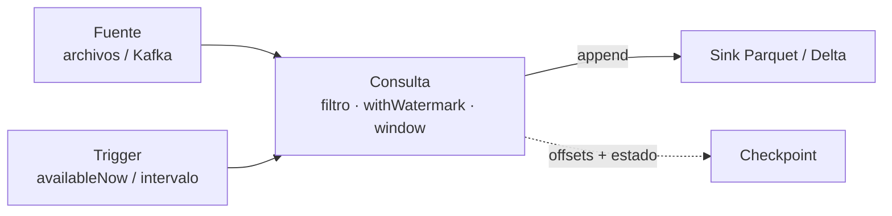

## 1. Resumen

Structured Streaming es el motor de streaming de Spark. Se escribe la consulta como si fuera batch, sobre DataFrames, y el motor la ejecuta en forma incremental sobre una tabla que crece. Por defecto corre en **micro-batches**, «a series of small batch jobs», con latencias desde unos 100 ms; hay un modo continuo con latencias desde 1 ms y garantías at-least-once.

Cuatro decisiones definen una consulta:

- **trigger:** cada cuánto corre un micro-batch (`processingTime`, `availableNow`, `continuous`);
- **modo de salida:** `append`, `update` o `complete`;
- **checkpoint:** dónde guarda offsets y estado para retomar;
- **sink:** dónde escribe, que decide la garantía final (archivos, exactly-once; Kafka y foreach, at-least-once).

## 2. Qué es

- **Consulta de streaming:** `readStream` → transformaciones → `writeStream`.
- **Micro-batch:** cada trigger procesa un rango de offsets como un pequeño job batch.
- **Modos de salida:** `append` (solo filas nuevas que no van a cambiar), `update` (filas que cambiaron), `complete` (toda la tabla de resultados).
- **`availableNow`:** procesa lo disponible en uno o más micro-batches y termina; útil en jobs programados.
- **Checkpoint:** offsets de cada batch, batches confirmados y estado.

## 3. Problema que resuelve

Un equipo tiene un job batch en PySpark que corre cada hora y quiere resultados más frescos sin reescribirlo en otro motor. Con Structured Streaming, las mismas transformaciones de DataFrame corren sobre un stream; el motor lleva la cuenta de qué ya procesó y retoma tras una falla.

## 4. Cómo funciona

1. `readStream` define la fuente: archivos, Kafka, tablas Delta.
2. Las transformaciones son las de DataFrames, con `withWatermark` y `window` para el tiempo de evento.
3. `writeStream` define sink, modo de salida, trigger y checkpoint.
4. En cada trigger, el motor registra el rango de offsets, procesa y escribe, y confirma el batch.
5. Al reiniciar con el mismo checkpoint, continúa desde el último batch confirmado.

## 5. Cuándo utilizarlo

- Equipos que ya usan Spark y necesitan streaming o micro-batch.
- Ingesta incremental de archivos o de Kafka a un lakehouse.
- Jobs programados que procesan «lo nuevo» con `availableNow`.

## 6. Cuándo no utilizarlo

- Latencias de pocos milisegundos con exactly-once: el modo continuo es at-least-once.
- Lógica muy dependiente de estado por evento, donde un motor como Flink da más control.
- Sin checkpoint durable: cada reinicio empieza de cero.

## 7. Ejemplo sencillo

Pedidos que llegan como archivos JSON. La consulta descarta los que no tienen monto, suma por tienda en ventanas de 1 hora por tiempo de evento con watermark de 15 minutos, y escribe en Parquet en modo `append`. Una segunda corrida con un archivo nuevo retoma desde el checkpoint. Resultado: `09:00 norte: 50.0`, `09:00 sur: 12.5`, `10:00 norte: 5.0`.

## 8. Ejemplo de producción

Ingesta de pedidos a un lakehouse:

- fuente Kafka con `maxOffsetsPerTrigger`;
- parseo y validación, con los inválidos a una tabla aparte;
- agregados por hora con watermark, en modo `append`, hacia una tabla Delta;
- checkpoint en almacenamiento durable, uno por consulta;
- trigger cada minuto, o `availableNow` desde un orquestador si basta con frescura horaria.

## 9. Arquitectura



## 10. Código

```python
# Python 3.12 y PySpark 4.2.0 en modo local (ejecutado en la CI con Java 17): una consulta de Structured Streaming de
# punta a punta. Lee pedidos JSON que llegan como archivos, descarta los inválidos, suma montos por tienda en ventanas
# de 1 hora por tiempo de evento con watermark de 15 minutos y escribe en Parquet con checkpoint. Una segunda corrida
# con archivos nuevos retoma desde el checkpoint.
import json
import os
import sys
import tempfile
from pathlib import Path

from pyspark.sql import SparkSession
from pyspark.sql import functions as F

base = Path(sys.argv[1] if len(sys.argv) > 1 else tempfile.mkdtemp())
src, out = base / "pedidos", base / "ventas_por_hora"
src.mkdir(parents=True, exist_ok=True)


def land(name: str, orders: list[tuple[str, str, float | None]]) -> None:
    rows = [json.dumps({"tienda": t, "event_time": f"2026-10-19 {h}:00", "monto": m}) for t, h, m in orders]
    (src / name).write_text("\n".join(rows), encoding="utf-8")
    stamp = 1_800_000_000 + len(list(src.iterdir()))   # la fuente procesa por fecha de modificación
    os.utime(src / name, (stamp, stamp))


spark = (SparkSession.builder.master("local[2]").config("spark.sql.shuffle.partitions", "2")
         .config("spark.ui.showConsoleProgress", "false").getOrCreate())
spark.sparkContext.setLogLevel("ERROR")


def run() -> None:
    orders = (spark.readStream.schema("tienda STRING, event_time TIMESTAMP, monto DOUBLE")
              .option("maxFilesPerTrigger", 1).json(str(src))
              .where(F.col("monto").isNotNull() & (F.col("monto") > 0))          # descarta inválidos
              .withWatermark("event_time", "15 minutes"))
    per_hour = (orders.groupBy("tienda", F.window("event_time", "1 hour"))
                .agg(F.sum("monto").alias("total"))
                .select("tienda", F.col("window.start").alias("hora"), "total"))
    query = (per_hour.writeStream.outputMode("append").format("parquet").option("path", str(out))
             .option("checkpointLocation", str(base / "checkpoint")).trigger(availableNow=True).start())
    query.awaitTermination()


land("1.json", [("norte", "09:10", 30.0), ("sur", "09:20", 12.5), ("norte", "09:40", None)])
land("2.json", [("norte", "09:55", 20.0), ("norte", "10:30", 5.0)])
run()
land("3.json", [("sur", "11:20", 8.0)])   # llega después: la segunda corrida retoma desde el checkpoint
run()
for r in spark.read.parquet(str(out)).orderBy("hora", "tienda").collect():
    print(f"{r.hora:%H:%M} {r.tienda}: {r.total}")
spark.stop()
```

El script se **ejecuta en la CI con PySpark 4.2.0 en modo local y Java 17**. Imprime `09:00 norte: 50.0`, `09:00 sur: 12.5` y `10:00 norte: 5.0`: la ventana de las 11:00 todavía no se cerró, porque la watermark (11:05) no pasó su fin. El pedido sin monto no aparece.

## 11. GCP

En GCP, Spark corre en **Managed Service for Apache Spark**. Según *Compare Managed Service for Apache Spark serverless and cluster deployments* (no ejecutado):

| | Spark propio | Managed Service for Apache Spark |
|---|---|---|
| Despliegue | Clúster que opera el equipo | En clúster (antes Dataproc on Compute Engine) o serverless (antes Google Cloud Serverless for Apache Spark) |

## 12. AWS

En AWS, Spark corre en **Amazon EMR**. Según *Amazon EMR release 7.14.0* y *Amazon EMR Pricing* (no ejecutado):

| | Spark 4.2.0 (esta ficha) | Amazon EMR |
|---|---|---|
| Versión | Spark 4.2.0 | La release 7.14.0 incluye Spark 3.5.8-amzn-0 (consultado el 2026-10-20): conviene revisar la versión antes de copiar código |
| Cobro (consultado el 2026-10-12) | — | Por opción de despliegue (EC2, EKS, Serverless), además de las instancias o recursos usados |

## 13. Azure

En Azure, Spark corre en **Azure Databricks**. Según *Structured Streaming concepts* y *Azure Databricks pricing* (no ejecutado):

| | Spark Structured Streaming | Azure Databricks |
|---|---|---|
| Fuentes propias | Archivos, Kafka, Delta | Además, Auto Loader para archivos nuevos en almacenamiento de nube; Delta como fuente y sink con exactly-once |
| Cobro (consultado el 2026-10-13) | — | Por DBU según el tipo de cómputo y el nivel, más las máquinas virtuales |

## 14. Buenas prácticas

- Un checkpoint por consulta, en almacenamiento durable.
- `append` con watermark para agregados que el destino recibe una vez.
- Sinks con garantía conocida: archivos o Delta; `foreachBatch` idempotente.
- Límites de entrada por micro-batch.
- **Seguridad:** credenciales de fuente y sink desde un gestor de secretos; el checkpoint con los mismos permisos que los datos.
- **Observabilidad:** duración de cada micro-batch, filas por batch, lag de la fuente y tamaño del estado.
- **Costo:** un trigger muy frecuente con poco dato desperdicia cómputo; `availableNow` programado puede bastar.

## 15. Errores frecuentes

- Cambiar el checkpoint al desplegar y reprocesar todo.
- `complete` con muchas claves: el estado y la salida crecen sin límite.
- Asumir que el modo continuo da exactly-once.
- Copiar código de Spark 4.2 a un EMR con Spark 3.5 sin revisar la API.

## 16. Trade-offs

Structured Streaming reusa el conocimiento de Spark y la misma API para batch y streaming, a cambio de latencias de micro-batch. El modo continuo baja la latencia y pierde exactly-once. Los servicios administrados simplifican la operación, con versiones de Spark que no siempre son la última.

## 17. Conceptos relacionados

- `stateful-stream-processing`: estado en las consultas.
- `watermarks`: limpieza del estado.
- `windowing`: ventanas por tiempo de evento.
- `exactly-once-semantics`: garantías por sink.
- `backpressure`: límites de entrada.
- `pyspark-dataframes`: la API de DataFrames.
- `emr-spark-clusters`: Spark en AWS.
- `azure-databricks-lakehouse`: Spark en Azure.

## 18. Preguntas técnicas abiertas

1. ¿Qué job batch tuyo podría correr como streaming con `availableNow`?
2. ¿Qué garantía da el sink de tus consultas?
3. ¿Qué versión de Spark corre en tu plataforma y cuál usa tu código?

## 19. Laboratorio relacionado

Pendiente (F4).

## 20. Fuentes

- Apache Spark 4.2.0: *Structured Streaming Programming Guide* (Overview, Getting Started y APIs on DataFrames and Datasets).
- Google Cloud: *Compare Managed Service for Apache Spark serverless and cluster deployments*.
- AWS: *Amazon EMR release 7.14.0* y *Amazon EMR Pricing*.
- Microsoft Learn: *Structured Streaming concepts* y *Azure Databricks pricing*.

El detalle de cada fuente está en `sources` del frontmatter.

## 21. Fecha de última verificación

2026-10-20. Pasa a `verified`: revisión B-F3.1 del lote F3b-14b aplicada, sin VERIFY pendientes.

## 22. Historial de cambios importantes

- 2026-10-19: creación (lote F3b-14b).
- 2026-10-19: §10: el ejemplo fija la fecha de modificación de cada archivo, porque la fuente procesa en ese orden y la watermark depende de él.
- 2026-10-20: revisión B-F3.1 del lote F3b-14b aplicada (docs/reviews/cards-f3b-14b.md): sin hallazgos en esta ficha; sin cambios.
- 2026-10-20: `verification_status: verified` (sin VERIFY pendientes).
- 2026-10-20: lote F3b-15a: la nota de *Amazon EMR release 7.14.0* cita la columna emr-7.14.0 completa, con los sufijos de la tabla (consultada el 2026-10-20); antes recortaba la lista.
