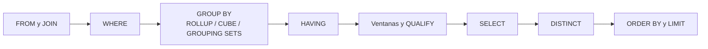

## 1. Resumen

Un `SELECT` se escribe en un orden y se evalúa en otro. Lógicamente:

1. `FROM` y los joins;
2. `WHERE`;
3. `GROUP BY` y los agregados;
4. `HAVING`;
5. las ventanas y, en los motores que lo tienen, `QUALIFY`;
6. las expresiones del `SELECT`;
7. `DISTINCT`, `ORDER BY` y `LIMIT`.

Ese orden explica por qué un alias del `SELECT` no existe todavía en el `WHERE`, y por qué `HAVING` puede filtrar por un agregado y `WHERE` no.

Sobre esa base, las **agregaciones avanzadas** (`GROUPING SETS`, `ROLLUP` y `CUBE`) calculan varios niveles de agrupación, como detalle, subtotales y total, en una sola consulta. `GROUPING()` distingue la fila de subtotal de un `NULL` real.

## 2. Qué es

Es SQL consolidado. `ROLLUP`, `CUBE` y `GROUPING SETS` están en BigQuery, Redshift, T-SQL y PostgreSQL:

| Construcción | Qué agrupa |
|---|---|
| `GROUP BY a, b` | Una agrupación: (a, b) |
| `GROUPING SETS ((a, b), (a), ())` | Las agrupaciones listadas |
| `ROLLUP (a, b)` | (a, b), (a) y (): jerarquía con subtotales y total |
| `CUBE (a, b)` | Todas las combinaciones: (a, b), (a), (b) y () |
| `HAVING` | Filtra grupos ya agregados |
| `GROUPING(a)` | 1 si `a` fue agregada en esa fila (subtotal), 0 si no |

PostgreSQL describe el efecto de varios conjuntos de agrupación como equivalente a un `UNION ALL` de consultas agrupadas por cada conjunto.

## 3. Problema que resuelve

Los reportes piden detalle y subtotales a la vez: ventas por región y producto, el total de cada región y el total general. Sin estas construcciones hacen falta varias consultas unidas con `UNION ALL`, que leen la tabla varias veces y se desalinean al cambiar un filtro.

## 4. Cómo funciona

1. **Orden lógico.** PostgreSQL y T-SQL documentan una secuencia equivalente: `FROM`, `WHERE`, `GROUP BY`, `HAVING`, `SELECT`, `DISTINCT` y `ORDER BY`, con las ventanas y `QUALIFY` donde el motor los admite. BigQuery da el orden típico con `QUALIFY`: `FROM`, `WHERE`, `GROUP BY`, `HAVING`, `WINDOW`, `QUALIFY`, `DISTINCT`, `ORDER BY` y `LIMIT`.
2. **Alias.** T-SQL lo dice explícitamente: el `SELECT` es el paso 8, así que sus alias no pueden usarse en `WHERE` pero sí en `ORDER BY`. PostgreSQL permite además referenciarlos en `GROUP BY`. Es una diferencia entre motores, no una regla general.
3. **Conjuntos de agrupación.** El motor calcula cada conjunto. En las filas de subtotal, las columnas agregadas por encima van en `NULL`; BigQuery lo llama *NULL de relleno*.
4. **`GROUPING()`** devuelve 1 cuando la columna está agregada en esa fila. Así se distingue "total de todas las regiones" de "región desconocida".

## 5. Cuándo utilizarlo

- Reportes con subtotales jerárquicos (`ROLLUP`) o cruces de dimensiones (`CUBE`).
- Tablas agregadas que guardan varios niveles a la vez para tableros.
- `HAVING` para filtrar por un agregado: clientes con más de N pedidos.

## 6. Cuándo no utilizarlo

- `CUBE` sobre muchas columnas: las combinaciones crecen como 2^n.
- Cuando cada nivel necesita filtros o fuentes distintas: consultas separadas son más claras.
- Para filtrar filas antes de agregar: eso va en `WHERE`, no en `HAVING`.

## 7. Ejemplo sencillo

```sql
SELECT cliente_id, SUM(monto) AS total
FROM pedidos
WHERE estado = 'pagado'
GROUP BY cliente_id
HAVING SUM(monto) >= 70;
```

`WHERE` filtra pedidos antes de agrupar; `HAVING` filtra clientes después.

## 8. Ejemplo de producción

Un tablero de ventas muestra el total por región, el subtotal de cada región y el total general. La tabla agregada se calcula una vez al día con `GROUP BY ROLLUP (region, producto)`.

La primera versión mostraba "(sin región)" en la fila del total general, porque el `COALESCE(region, '(sin región)')` no distinguía el `NULL` de subtotal del `NULL` real. Con `GROUPING(region)` la fila de total se rotula "(total)" y los clientes sin región quedan como "(sin región)".

## 9. Arquitectura



## 10. Código

```sql
-- PostgreSQL (ejecutado). ROLLUP, GROUPING y HAVING también están documentados en BigQuery y Redshift (GROUPING, en sus extensiones de agregación).
-- 1) Subtotal por región y total general; GROUPING distingue el total de un NULL real.
SELECT CASE WHEN GROUPING(c.region) = 1 THEN '(total)'
            ELSE COALESCE(c.region, '(sin región)') END AS region,
       SUM(p.monto) AS total
FROM pedidos AS p
JOIN clientes AS c USING (cliente_id)
WHERE p.estado = 'pagado'
GROUP BY ROLLUP (c.region)
ORDER BY GROUPING(c.region), region;

-- 2) El alias del SELECT no existe todavía en WHERE: error.
SELECT monto * 1.19 AS con_iva FROM pedidos WHERE con_iva > 100;
```

La consulta 1 devuelve `norte` 120.00, `sur` 70.00 y `(total)` 190.00. La 2 falla con *column "con_iva" does not exist*. La corrección es repetir la expresión en `WHERE` o calcularla en una CTE previa.

## 11. GCP

**BigQuery** admite `GROUPING SETS` (hasta 4096 elementos agrupables), `ROLLUP`, `CUBE`, `()` para el total general y `GROUP BY ALL`. Este último infiere las claves de agrupación de los elementos del `SELECT` y excluye las expresiones con funciones de agregación o de ventana.

`HAVING` exige que haya `GROUP BY` o agregación. La documentación da el orden típico de evaluación con `QUALIFY` y advierte que no siempre coincide con el orden de escritura.

## 12. AWS

**Redshift** documenta `GROUPING SETS`, `ROLLUP` y `CUBE` como extensiones de agregación que hacen el trabajo de varios `GROUP BY` en una sola sentencia, y admite `GROUP BY ALL`. Sus funciones `GROUPING` y `GROUPING_ID` distinguen las filas de subtotal, en las que `ROLLUP` y `CUBE` ponen `NULL`.

## 13. Azure

**T-SQL** (Synapse y Fabric Warehouse) admite `ROLLUP`, `CUBE`, `GROUPING SETS` y `GROUP BY ()` para el total general. `WITH CUBE` y `WITH ROLLUP` son sintaxis antigua, no ISO, mantenida solo por compatibilidad.

La página de `SELECT` lista el orden lógico de procesamiento. Incluye `QUALIFY` solo para Fabric Data Warehouse.

## 14. Buenas prácticas

- Filtrar filas en `WHERE` y grupos en `HAVING`.
- Rotular los subtotales con `GROUPING()`, no con `COALESCE`.
- En T-SQL, no usar `WITH ROLLUP` ni `WITH CUBE`: su documentación los llama sintaxis antigua, no ISO, mantenida por compatibilidad.
- Limitar `CUBE` a pocas dimensiones.
- **Seguridad:** en tablas agregadas que se publican, revisar que los grupos pequeños no permitan identificar a personas.
- **Observabilidad:** comprobar en las cargas que el total general coincide con la suma de los subtotales.
- **Costo:** una consulta con `GROUPING SETS` lee la tabla una vez, en lugar de una vez por cada consulta del `UNION ALL` equivalente.

## 15. Errores frecuentes

- Usar alias del `SELECT` en `WHERE`.
- Filtrar en `HAVING` lo que debía ir en `WHERE`, y agregar filas de más.
- Confundir el `NULL` de subtotal con un valor desconocido.
- `CUBE` sobre muchas dimensiones y una tabla de resultados que explota.

## 16. Trade-offs

Una sola consulta con conjuntos de agrupación es más eficiente y consistente que varios `UNION ALL`, a cambio de filas de distinto nivel en la misma tabla: el consumidor debe filtrar por `GROUPING()` o por nivel. Una tabla por nivel es más simple de consumir, a cambio de duplicar lógica.

## 17. Conceptos relacionados

- `sql-case-expressions`: agregación condicional.
- `sql-nulls`: `NULL` en subtotales y en agregados.
- `sql-window-functions`: cálculos después de la agregación.
- `sql-qualify`: filtro sobre funciones de ventana, evaluado después de ellas.

## 18. Preguntas técnicas abiertas

1. ¿Cómo guardarías una tabla con varios niveles de agregación para que un tablero no sume dos veces?
2. ¿Qué diferencias de orden de evaluación has encontrado entre los motores que usas?
3. ¿Cuándo preferirías calcular los subtotales en la herramienta de visualización?

## 19. Laboratorio relacionado

Pendiente (F4).

## 20. Fuentes

- PostgreSQL: *SELECT*.
- Google Cloud: *Query syntax* (BigQuery).
- AWS: *GROUP BY clause* (Amazon Redshift).
- Microsoft Learn: *SELECT (Transact-SQL)* y *GROUP BY (Transact-SQL)*.

El detalle de cada fuente está en `sources` del frontmatter.

## 21. Fecha de última verificación

2026-10-07. Pasa a `verified`: revisión B-F3.1 del lote F3b-02a aplicada, sin VERIFY pendientes.

## 22. Historial de cambios importantes

- 2026-10-05: esqueleto creado desde el blueprint (rama `f/sql`).
- 2026-10-06: ficha completa (lote F3b-02a, dominio 02-sql).
- 2026-10-07: revisión B-F3.1 del lote F3b-02a aplicada (docs/reviews/cards-f3b-02a.md): resumen con `QUALIFY` solo donde el motor lo tiene; «sintaxis antigua, no ISO» como dice T-SQL; fuente nueva *Aggregation extensions* de Redshift para `GROUPING`.
- 2026-10-07: `verification_status: verified` (sin VERIFY pendientes).
- 2026-10-13: `page_title` en cada cita, con el título de la página citada (ADR-012); sin cambios de contenido.
