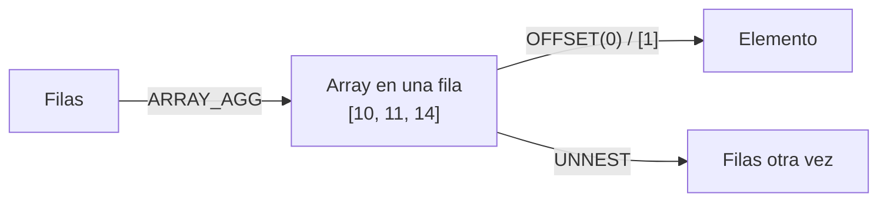

## 1. Resumen

Un array es una columna que guarda una lista ordenada de valores del mismo tipo, como las etiquetas de un evento o los ids de los pedidos de un cliente. Permite guardar una relación "uno a varios" dentro de la misma fila, sin otra tabla.

Los motores **no tienen el mismo modelo**, y pasar SQL de uno a otro no es directo:

- BigQuery tiene `ARRAY<T>` tipado;
- Redshift usa `SUPER`, sin esquema, navegado con PartiQL;
- Fabric Warehouse no lista un tipo array para tablas, y propone guardar JSON en `varchar`;
- PostgreSQL tiene arrays tipados que se numeran desde 1.

## 2. Qué es

| Aspecto | BigQuery | Redshift | Fabric Warehouse | PostgreSQL |
|---|---|---|---|---|
| Tipo | `ARRAY<T>`, elementos del mismo tipo | `SUPER` (arrays y estructuras sin esquema) | Sin tipo array en tablas; JSON en `varchar` | `T[]` |
| Anidamiento | Sin arrays de arrays; hay que intercalar un `STRUCT` | Arrays y estructuras anidadas dentro de `SUPER` | No aplica | Arrays multidimensionales |
| Primera posición | 0 con `OFFSET`; 1 con `ORDINAL` | Navegación PartiQL | Índice que devuelve `OPENJSON` | 1 |
| Fuera de rango | Error, o `NULL` con `SAFE_` | No detallado en esta ficha | No aplica | `NULL` |
| Tamaño | Ver límites de BigQuery | Hasta 16 MB por objeto `SUPER` | Hasta 16 MB en `varchar(max)` | Ver límites de PostgreSQL |

## 3. Problema que resuelve

Muchos datos de origen ya vienen como listas: JSON de APIs, eventos con atributos múltiples o pedidos con líneas. Guardarlos como array evita crear y unir otra tabla y conserva la forma original. Agregar valores en un array (`ARRAY_AGG`) también sirve para entregar "todos los X de cada Y" en una sola fila.

## 4. Cómo funciona

1. **Construir:**
   - BigQuery: literales `[1, 2, 3]`, la subconsulta `ARRAY(SELECT …)` o el agregado `ARRAY_AGG`;
   - PostgreSQL: `ARRAY[...]` y `array_agg`.
2. **Acceder por posición:** BigQuery cuenta desde 0 con `OFFSET` y desde 1 con `ORDINAL`; las variantes `SAFE_` devuelven `NULL` fuera de rango. PostgreSQL cuenta desde 1 y devuelve `NULL` fuera de rango.
3. **Expandir en filas:** con `UNNEST` (ver `sql-unnest`).
4. **Restricciones de BigQuery:**
   - no hay arrays de arrays;
   - un array con elementos `NULL` puede usarse dentro de la consulta, pero da error si llega al resultado;
   - `ARRAY` no es comparable, así que no puede usarse directamente en comparaciones de igualdad.
5. **Agregar sin filas:** el `array_agg` de PostgreSQL devuelve `NULL`, no un array vacío. La subconsulta `ARRAY` de BigQuery devuelve un array vacío.

## 5. Cuándo utilizarlo

- Atributos múltiples que se leen junto con la fila: etiquetas o categorías.
- Datos semiestructurados cargados tal como llegan.
- En BigQuery, para desnormalizar relaciones uno a varios, junto con `STRUCT` (ver `sql-structs`).

## 6. Cuándo no utilizarlo

- Cuando los elementos se filtran, se unen o se actualizan por separado con frecuencia: una tabla aparte es más simple.
- Listas sin límite de tamaño que crecen con el tiempo, como todos los eventos de un usuario: chocan con los límites de tamaño por fila u objeto.
- En SQL que debe ser portable entre motores: cada uno tiene su modelo.

## 7. Ejemplo sencillo

```sql
-- PostgreSQL (ejecutado).
SELECT cliente_id,
       array_agg(pedido_id ORDER BY creado_en)     AS pedidos,
       cardinality(array_agg(pedido_id))            AS n,
       (array_agg(pedido_id ORDER BY creado_en))[1] AS primero
FROM pedidos
WHERE cliente_id IS NOT NULL
GROUP BY cliente_id;
```

Devuelve `{10,11,14}`, 3 y 10 para el cliente 1, y `{12}`, 1 y 12 para el cliente 2.

## 8. Ejemplo de producción

Una tabla de eventos en BigQuery guarda `etiquetas ARRAY<STRING>`. Un reporte usa `etiquetas[OFFSET(0)]` como "etiqueta principal" y falla el día que llega un evento sin etiquetas, porque `OFFSET` da error fuera de rango. El equipo cambia a `SAFE_OFFSET(0)`, que devuelve `NULL`, y agrega un control que cuenta eventos sin etiquetas.

Al replicar el modelo en Redshift, las etiquetas se cargan en una columna `SUPER` y se navegan con PartiQL. El SQL no se traduce línea a línea.

## 9. Arquitectura



## 10. Código

```sql
-- 1) BigQuery: construir, acceder con seguridad y buscar (sintaxis documentada; no ejecutado aquí).
SELECT
  cliente_id,
  ARRAY_AGG(pedido_id ORDER BY creado_en)                  AS pedidos,
  ARRAY_AGG(pedido_id ORDER BY creado_en)[SAFE_OFFSET(0)] AS primero,  -- desde 0; NULL si no existe
  ARRAY_AGG(pedido_id ORDER BY creado_en)[SAFE_OFFSET(9)] AS decimo   -- NULL, no error
FROM `proyecto.ventas.pedidos`
WHERE cliente_id IS NOT NULL
GROUP BY cliente_id;

-- 2) PostgreSQL (ejecutado): numeración desde 1; fuera de rango devuelve NULL.
SELECT (ARRAY[10, 11, 14])[1] AS primero, (ARRAY[10, 11, 14])[9] AS fuera_de_rango;  -- 10, NULL
```

La consulta 2 se ejecutó en PostgreSQL. La consulta 1 sigue la sintaxis de la documentación de BigQuery y no se ejecutó, porque requiere GCP. La diferencia clave entre ambas es la posición inicial: 0 con `OFFSET` en BigQuery, 1 en PostgreSQL.

## 11. GCP

**BigQuery** tiene `ARRAY<T>`: lista ordenada de elementos del mismo tipo, sin arrays de arrays (se intercala un `STRUCT`). Da error si un resultado contiene un array con elementos `NULL`, y `ARRAY` no es un tipo comparable. Se accede con `OFFSET` o `ORDINAL` y sus variantes `SAFE_`.

El detalle del dialecto, como funciones y límites, corresponde a `bigquery-sql-dialect` del dominio 08.

## 12. AWS

**Redshift** no tiene un tipo array tipado: usa `SUPER`, un conjunto de valores de array y estructura sin esquema, de hasta 16 MB por objeto, con tipado dinámico y navegación con PartiQL. **Athena** tiene arrays y funciones como `flatten`, y los expande con `CROSS JOIN UNNEST` (ver `sql-unnest`). Son modelos distintos aunque ambos sean de AWS.

## 13. Azure

**Fabric Warehouse** no incluye un tipo array en su lista de tipos soportados para tablas. Para JSON indica usar `varchar`, de hasta 16 MB en `varchar(max)`. Las listas se guardan como JSON y se expanden con `OPENJSON` (ver `sql-unnest`). Es una diferencia de modelo, no solo de sintaxis.

## 14. Buenas prácticas

- Usar el acceso seguro (`SAFE_OFFSET` o equivalente) cuando el array puede estar vacío.
- Documentar si la posición empieza en 0 o en 1 en cada consulta que mezcla motores.
- Acotar el tamaño de los arrays por diseño.
- Aplanar con `UNNEST` para filtrar o unir por elementos.
- **Seguridad:** un array puede contener datos que la política de columnas no distingue por elemento; si algunos elementos son sensibles, separarlos en otra columna o tabla.
- **Observabilidad:** medir el tamaño medio y máximo de los arrays por carga; un crecimiento indica un cambio en el origen o un error de agregación.
- **Costo:** leer una columna de arrays grandes lee todos sus elementos; si solo se usa el primero, conviene guardarlo también como columna escalar.

## 15. Errores frecuentes

- `OFFSET(0)` sobre arrays vacíos.
- Mezclar posiciones desde 0 y desde 1.
- Resultados de BigQuery con arrays que contienen `NULL`.
- Suponer que el array de un motor se traduce directamente a otro.
- `array_agg` de PostgreSQL sin filas, que devuelve `NULL` donde se esperaba un array vacío.

## 16. Trade-offs

Los arrays conservan la forma de los datos y evitan joins, a cambio de consultas menos portables y de dificultad para indexar, actualizar o filtrar elementos sueltos. Una tabla hija normalizada es portable y fácil de filtrar, a cambio de joins en cada consulta.

## 17. Conceptos relacionados

- `sql-unnest`: expandir arrays en filas.
- `sql-structs`: registros y arrays de registros.
- `json-format`: arrays que llegan como JSON.
- Del blueprint, pendiente de ficha: `bigquery-sql-dialect`.

## 18. Preguntas técnicas abiertas

1. ¿Qué datos de tu modelo guardarías como array y cuáles como tabla hija?
2. ¿Cómo migrarías una columna `ARRAY<STRING>` de BigQuery a Redshift?
3. ¿Qué límite de tamaño pondrías a un array y cómo lo controlarías?

## 19. Laboratorio relacionado

Pendiente (F4).

## 20. Fuentes

- Google Cloud: *Data types*, *Work with arrays*, *Operators* y *Subqueries* (BigQuery).
- AWS: *SUPER type* (Amazon Redshift).
- Microsoft Learn: *Data Types in Fabric Data Warehouse*.
- PostgreSQL: *Arrays* y *Aggregate Functions*.

El detalle de cada fuente está en `sources` del frontmatter.

## 21. Fecha de última verificación

2026-10-06. En `review_required` hasta la revisión B-F3.1 del lote F3b-02a.

## 22. Historial de cambios importantes

- 2026-10-05: esqueleto creado desde el blueprint (rama `f/sql`), con la nota "el modelo ARRAY/STRUCT de BigQuery no es el de Redshift ni el de Fabric".
- 2026-10-06: ficha completa (lote F3b-02a, dominio 02-sql).
