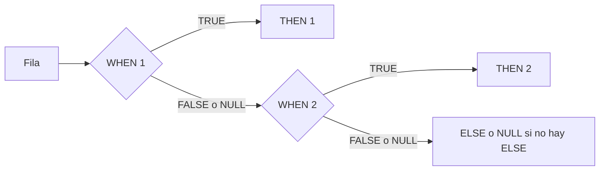

## 1. Resumen

`CASE` es el "si… entonces… si no" de SQL: devuelve el resultado del primer `WHEN` que se cumple, o el `ELSE`. Tiene dos formas:

- **buscada**: `CASE WHEN condición THEN …`;
- **simple**: `CASE valor WHEN constante THEN …`, que compara por igualdad.

Tres detalles causan errores en datos:

- sin `ELSE`, el resultado es `NULL`;
- la forma simple nunca coincide con `NULL`, porque compara con `=`;
- la evaluación "en cortocircuito" no siempre protege de errores en las ramas que no se usan.

## 2. Qué es

Es SQL consolidado y portable, disponible en BigQuery, Redshift, T-SQL (Synapse y Fabric Warehouse) y PostgreSQL. Funciones relacionadas:

| Función | Equivale a |
|---|---|
| `COALESCE(a, b, …)` | El primer valor no `NULL` |
| `NULLIF(a, b)` | `NULL` si `a = b`; si no, `a` |
| `IF(cond, x, y)` (BigQuery) | `CASE WHEN cond THEN x ELSE y END` |
| `IFNULL(a, b)` (BigQuery) | `COALESCE(a, b)` |

## 3. Problema que resuelve

Clasificar, normalizar y calcular según condiciones dentro de una consulta: tramos de monto, estados que vienen escritos de varias formas, valores por defecto o sumas que solo cuentan ciertas filas.

## 4. Cómo funciona

1. **Orden:** las condiciones se revisan en orden y gana la primera verdadera. BigQuery, PostgreSQL y T-SQL lo documentan igual.
2. **Sin coincidencia:** se devuelve el `ELSE`; si no hay, `NULL`. Una condición `NULL` cuenta como no cumplida.
3. **Forma simple:** `CASE x WHEN v` compara `x = v`. Como `x = NULL` nunca es verdadero, `WHEN NULL` no coincide jamás; hay que usar la forma buscada con `IS NULL`.
4. **Cortocircuito, con límites:**
   - PostgreSQL advierte que una constante como `1/0` puede fallar al planificar aunque esté en una rama que no se usa;
   - T-SQL evalúa primero los agregados de los `WHEN`, que pueden fallar antes del `CASE`.

   No conviene usar `CASE` como protección contra errores.

## 5. Cuándo utilizarlo

- Clasificar en tramos: alto, medio o bajo.
- Normalizar valores de origen: `'S'`, `'SI'` y `'sí'` a `TRUE`.
- **Agregación condicional:** `SUM(CASE WHEN estado = 'pagado' THEN monto ELSE 0 END)`, varias métricas en una sola pasada.

## 6. Cuándo no utilizarlo

- Tablas de correspondencia largas y cambiantes: mejor una tabla de mapeo y un join.
- Como protección contra divisiones por cero u otros errores: usar `NULLIF` en el divisor, que devuelve `NULL` en vez de dividir por cero.
- Para detectar `NULL` con la forma simple.

## 7. Ejemplo sencillo

```sql
SELECT pedido_id,
       CASE WHEN monto >= 100 THEN 'alto'
            WHEN monto >= 50  THEN 'medio'
            ELSE 'bajo' END AS tramo
FROM pedidos;
```

Un monto de 100 cae en `'alto'`, aunque también cumple la segunda condición: gana la primera.

## 8. Ejemplo de producción

Un modelo de ingresos calculaba "pagado" y "anulado" con dos consultas y un join. Pasó a una sola consulta con agregación condicional:

```sql
SUM(CASE WHEN estado = 'pagado'  THEN monto ELSE 0 END) AS pagado,
SUM(CASE WHEN estado = 'anulado' THEN monto ELSE 0 END) AS anulado
```

Lee la tabla una vez. El `ELSE 0` evita que un cliente sin anulaciones tenga `NULL` en esa columna.

## 9. Arquitectura



## 10. Código

```sql
-- PostgreSQL (ejecutado). Igual en BigQuery, Redshift y T-SQL.
-- 1) Agregación condicional: dos métricas en una pasada.
SELECT cliente_id,
       SUM(CASE WHEN estado = 'pagado'  THEN monto ELSE 0 END) AS pagado,
       SUM(CASE WHEN estado = 'anulado' THEN monto ELSE 0 END) AS anulado
FROM pedidos
WHERE cliente_id IS NOT NULL
GROUP BY cliente_id;

-- 2) La forma simple no coincide con NULL; la buscada sí.
SELECT nombre,
       CASE region WHEN NULL THEN 'sin región' ELSE region END       AS simple,
       CASE WHEN region IS NULL THEN 'sin región' ELSE region END     AS buscada
FROM clientes;
```

La consulta 1 devuelve al cliente 1 con 120.00 pagado y 50.00 anulado, y al cliente 2 con 70.00 y 0. En la 2, el cliente sin región sale con `simple` en `NULL` y `buscada` en `'sin región'`.

## 11. GCP

**BigQuery** documenta `CASE` y `CASE expr`, y además `IF`, `IFNULL`, `NULLIF` y `COALESCE`. `CASE`, `IF`, `IFNULL` y `COALESCE` dejan sin evaluar las expresiones que no corresponden. La documentación advierte que esa evaluación diferida puede aprovecharse para manejo de errores o rendimiento. Sin `ELSE`, `CASE` devuelve `NULL`.

## 12. AWS

**Redshift** admite las dos formas, simple y buscada. Su documentación de `CASE` muestra un ejemplo de cada una.

## 13. Azure

En **T-SQL** (Synapse y Fabric Warehouse), `CASE` evalúa las condiciones en orden y se detiene en la primera que se cumple. Tiene dos particularidades documentadas:

- los agregados dentro de un `WHEN` se evalúan antes del `CASE` y pueden producir errores aunque su rama no se use;
- si todas las expresiones de resultado son la constante `NULL`, se produce el error 8133.

## 14. Buenas prácticas

- Siempre un `ELSE` explícito, aunque sea `ELSE NULL`, para dejar clara la intención.
- Ordenar los `WHEN` de lo más específico a lo más general.
- `IS NULL` en la forma buscada para tratar los nulos.
- Mapeos largos en una tabla, no en un `CASE` de 40 ramas.
- **Seguridad:** no codificar listas de personas o identificadores sensibles en el SQL; si hay que clasificarlos, usar una tabla con permisos propios.
- **Observabilidad:** contar cuántas filas caen en el `ELSE` de una normalización; si crece, llegaron valores nuevos que nadie mapeó.
- **Costo:** la agregación condicional calcula varias métricas en una sola lectura de la tabla.

## 15. Errores frecuentes

- `CASE x WHEN NULL`.
- Olvidar el `ELSE` y obtener `NULL` en una suma o en un reporte.
- Condiciones superpuestas en el orden equivocado.
- Confiar en el cortocircuito para evitar una división por cero.

## 16. Trade-offs

`CASE` deja la regla visible en la consulta, a cambio de duplicarla si varios modelos la usan. Una tabla de mapeo centraliza la regla y permite cambiarla sin tocar SQL, a cambio de un join y de gobernar esa tabla.

## 17. Conceptos relacionados

- `sql-nulls`: `NULL` en condiciones y en el `ELSE`.
- `sql-advanced-select`: agregación condicional y rótulos con `GROUPING`.
- `data-transformation`: normalización de valores.

## 18. Preguntas técnicas abiertas

1. ¿Cuándo moverías un `CASE` de normalización a una tabla de mapeo?
2. ¿Cómo detectarías que llegó un valor nuevo que el `CASE` manda al `ELSE`?
3. ¿Qué alternativa usarías en tu motor para dividir sin riesgo de división por cero?

## 19. Laboratorio relacionado

Pendiente (F4).

## 20. Fuentes

- Google Cloud: *Conditional expressions* (BigQuery).
- PostgreSQL: *Conditional Expressions*.
- Microsoft Learn: *CASE (Transact-SQL)*.
- AWS: *CASE conditional expression* (Amazon Redshift).

El detalle de cada fuente está en `sources` del frontmatter.

## 21. Fecha de última verificación

2026-10-06. En `review_required` hasta la revisión B-F3.1 del lote F3b-02a.

## 22. Historial de cambios importantes

- 2026-10-05: esqueleto creado desde el blueprint (rama `f/sql`).
- 2026-10-06: ficha completa (lote F3b-02a, dominio 02-sql).
