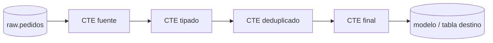

## 1. Resumen

Una CTE (*common table expression*) es una subconsulta con nombre, definida en la cláusula `WITH` antes del `SELECT` principal. Permite escribir una consulta larga como una secuencia de pasos con nombre: "pedidos pagados", luego "totales por cliente", luego "resultado".

La CTE es una herramienta de **legibilidad**, no de rendimiento garantizado. Cada motor decide si la calcula una vez o la repite:

- BigQuery y T-SQL ejecutan una CTE no recursiva una vez por cada referencia;
- PostgreSQL la calcula una sola vez por defecto si se referencia más de una vez, salvo que se indique otra cosa.

## 2. Qué es

Es SQL consolidado, disponible en BigQuery, Redshift, T-SQL (Synapse y Fabric Warehouse) y PostgreSQL:

```sql
WITH nombre_1 AS (SELECT ...),
     nombre_2 AS (SELECT ... FROM nombre_1)
SELECT ... FROM nombre_2;
```

Cada CTE puede usar las definidas antes que ella. Existe solo durante la consulta: no es una tabla ni una vista. La variante `WITH RECURSIVE` tendrá su ficha (`sql-recursive-cte`, lote F3b-02b).

## 3. Problema que resuelve

Las subconsultas anidadas en `FROM` se leen de adentro hacia afuera, y repetir la misma subconsulta obliga a mantenerla en dos lugares. La CTE ordena la consulta de arriba hacia abajo, da nombre a cada paso y permite reutilizarlo.

## 4. Cómo funciona

1. Cada CTE se declara con un nombre y una consulta.
2. Las siguientes CTE y la consulta principal la referencian como si fuera una tabla.
3. **Ejecución:** el motor decide cómo calcularla, y las fuentes no coinciden.

| Motor | Qué dice su documentación |
|---|---|
| BigQuery | Solo materializa las CTE recursivas; una CTE no recursiva referenciada varias veces se ejecuta una vez por referencia |
| PostgreSQL | Una CTE referenciada más de una vez se calcula una sola vez por defecto; `MATERIALIZED` y `NOT MATERIALIZED` cambian esa decisión |
| Redshift | Cada CTE define una tabla temporal que existe durante la consulta |
| T-SQL | No se materializa: cada referencia vuelve a ejecutar la consulta; prohíbe `ORDER BY` dentro de la definición, salvo con `TOP` u `OFFSET`/`FETCH` |

## 5. Cuándo utilizarlo

- Consultas de transformación de varios pasos, por ejemplo dentro de un modelo de dbt o Dataform.
- Para dar nombre a un filtro o una agregación que se usa una sola vez y así documentar la intención.
- Para separar la lógica de limpieza, tipado y agregación en pasos revisables.

## 6. Cuándo no utilizarlo

- Para "cachear" un cálculo caro que se referencia varias veces en BigQuery o T-SQL: se ejecuta una vez por referencia. Si el cálculo es caro, conviene una tabla temporal o intermedia.
- Para resultados que se reutilizan entre consultas distintas: la CTE muere con la consulta; para eso existen vistas, tablas o modelos.

## 7. Ejemplo sencillo

```sql
WITH pagados AS (
  SELECT cliente_id, monto FROM pedidos WHERE estado = 'pagado'
)
SELECT cliente_id, SUM(monto) AS total
FROM pagados
GROUP BY cliente_id;
```

## 8. Ejemplo de producción

Un modelo de dbt de pedidos diarios se escribe en cuatro CTE: `fuente` (selección de columnas), `tipado` (conversión y validación), `deduplicado` (último registro por clave) y `final`.

En la revisión de código cada paso se lee por separado, y un test de dbt valida el resultado. Al migrar a BigQuery, el equipo notó que `tipado` se referenciaba dos veces y el costo se duplicaba. Lo convirtió en un modelo intermedio materializado como tabla.

## 9. Arquitectura



## 10. Código

```sql
-- PostgreSQL (ejecutado). El join usa ON, que documentan los cuatro motores (T-SQL no documenta USING).
WITH pagados AS (
  SELECT cliente_id, monto
  FROM pedidos
  WHERE estado = 'pagado' AND cliente_id IS NOT NULL
),
por_cliente AS (
  SELECT cliente_id, SUM(monto) AS total, COUNT(*) AS n
  FROM pagados
  GROUP BY cliente_id
)
SELECT c.nombre, pc.total, pc.n
FROM por_cliente AS pc
JOIN clientes AS c ON c.cliente_id = pc.cliente_id
ORDER BY pc.total DESC;
```

Con los datos de prueba devuelve dos filas: Ana con 120.00 en 2 pedidos y Beto con 70.00 en 1. En PostgreSQL, si una CTE cara se referencia varias veces, se puede forzar su cálculo único con `WITH x AS MATERIALIZED (...)`. BigQuery no tiene esa opción para CTE no recursivas.

## 11. GCP

En **BigQuery**, el `WITH` con CTE no recursivas sirve sobre todo para la legibilidad, según su documentación. Cada referencia a una CTE no recursiva la vuelve a ejecutar. Solo se materializan las recursivas. `WITH RECURSIVE` solo puede ir en el nivel superior de la consulta y no se admite en funciones ni en vistas materializadas.

## 12. AWS

En **Redshift**, cada CTE define una tabla temporal que existe solo durante la consulta. La lista de columnas es opcional en una CTE no recursiva y obligatoria en una recursiva, y `WITH RECURSIVE` no puede ir dentro de una subconsulta.

## 13. Azure

En **T-SQL** (Synapse y Warehouse de Fabric), la sentencia anterior a `WITH` en un lote debe terminar en punto y coma. La definición de la CTE no admite `ORDER BY` (salvo con `TOP` u `OFFSET`/`FETCH`), `INTO` ni `OPTION`. Sus resultados no se materializan: cada referencia vuelve a ejecutar la consulta, y la documentación sugiere un objeto temporal si se referencia varias veces. La documentación tiene un artículo aparte sobre CTE anidadas en Fabric, que no se detalla aquí.

## 14. Buenas prácticas

- Un paso por CTE, con un nombre que diga qué contiene (`pedidos_pagados`, no `t1`).
- Filtrar y seleccionar columnas en las primeras CTE, no al final.
- Si una CTE cara se referencia varias veces, revisar en la documentación del motor cómo la ejecuta; en BigQuery, materializarla aparte.
- **Seguridad:** una CTE no cambia los permisos; quien ejecuta la consulta necesita acceso a todas las tablas que lee.
- **Observabilidad:** el plan de ejecución muestra si una CTE se calcula una o varias veces; revisarlo en las consultas recurrentes.
- **Costo:** en BigQuery, una CTE no recursiva referenciada dos veces se ejecuta dos veces, y las tablas que lee pueden leerse dos veces.

## 15. Errores frecuentes

- Creer que la CTE se calcula una vez en todos los motores.
- Cadenas de 20 CTE que nadie puede depurar: mejor dividir en modelos.
- `ORDER BY` dentro de la CTE esperando que ordene el resultado final.
- En T-SQL, olvidar el punto y coma de la sentencia anterior al `WITH`.

## 16. Trade-offs

La CTE mejora la lectura sin crear objetos en la base, a cambio de que el motor decide cómo ejecutarla. Una tabla intermedia garantiza un solo cálculo y permite inspeccionar el resultado, a cambio de almacenamiento y de una carga más.

## 17. Conceptos relacionados

- `sql-subqueries`: la forma anidada de lo mismo.
- `data-transformation`: modelos de transformación escritos como CTE.
- Con ficha: `sql-recursive-cte`.

## 18. Preguntas técnicas abiertas

1. ¿Cómo comprobarías en tu motor si una CTE referenciada dos veces se ejecuta dos veces?
2. ¿Cuándo convertirías una CTE en un modelo intermedio de dbt o Dataform?
3. ¿Qué nombres usarías para que una cadena de CTE se lea como una especificación?

## 19. Laboratorio relacionado

Pendiente (F4).

## 20. Fuentes

- Google Cloud: *Query syntax* (BigQuery).
- PostgreSQL: *WITH Queries (Common Table Expressions)* y *SELECT*.
- AWS: *WITH clause* (Amazon Redshift).
- Microsoft Learn: *WITH common_table_expression (Transact-SQL)*.

El detalle de cada fuente está en `sources` del frontmatter.

## 21. Fecha de última verificación

2026-10-07. Pasa a `verified`: revisión B-F3.1 del lote F3b-02a aplicada, sin VERIFY pendientes.

## 22. Historial de cambios importantes

- 2026-10-05: esqueleto creado desde el blueprint (rama `f/sql`).
- 2026-10-06: ficha completa (lote F3b-02a, dominio 02-sql).
- 2026-10-07: revisión B-F3.1 del lote F3b-02a aplicada (docs/reviews/cards-f3b-02a.md): el join del ejemplo de §10 pasa de `USING` a `ON`, que también documenta T-SQL.
- 2026-10-07: `verification_status: verified` (sin VERIFY pendientes).
- 2026-10-07: la sección de conceptos relacionados ya no lista como pendiente de ficha a `sql-recursive-cte`, que ya tiene ficha.
