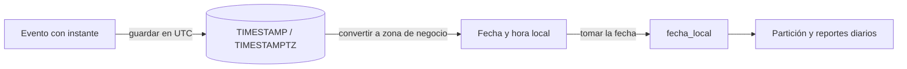

## 1. Resumen

En SQL conviven tres ideas distintas de "fecha y hora":

- **Instante** (`TIMESTAMP` de BigQuery, `TIMESTAMPTZ` de Redshift y `timestamp with time zone` de PostgreSQL): un punto absoluto en el tiempo. Redshift y PostgreSQL documentan que lo guardan en UTC; BigQuery, que es independiente de la zona y que su zona por defecto es UTC.
- **Fecha y hora civil sin zona** (`DATETIME` de BigQuery, `TIMESTAMP` de Redshift y PostgreSQL, `datetime2` de T-SQL): lo que muestra un reloj, sin decir dónde.
- **Fecha** (`DATE`): un día del calendario, que no corresponde a 24 horas fijas.

El error más común en pipelines es calcular el **día** de un evento sin decidir la zona. El mismo instante cae en días distintos en UTC y en Santiago. Los cambios de horario hacen que algunos días locales tengan 23 o 25 horas.

## 2. Qué es

| Concepto | BigQuery | Redshift | Fabric Warehouse | PostgreSQL |
|---|---|---|---|---|
| Instante | `TIMESTAMP` (UTC por defecto) | `TIMESTAMPTZ` (se guarda en UTC) | Sin tipo con zona en tablas; `datetime2` + `AT TIME ZONE` | `timestamptz` (se guarda en UTC) |
| Fecha y hora civil | `DATETIME` | `TIMESTAMP` | `datetime2` (6 decimales) | `timestamp` |
| Fecha | `DATE` | `DATE` | `date` | `date` |
| Convertir zona | `DATE(ts, zona)`, `TIMESTAMP_TRUNC(ts, DAY, zona)` | `CONVERT_TIMEZONE` | `AT TIME ZONE` | `AT TIME ZONE` |

## 3. Problema que resuelve

Los reportes cuentan por día, las tablas se particionan por fecha y los SLA se miden en horas. Si cada consulta interpreta las fechas a su manera, la venta de las 23:30 hora local aparece en el día siguiente en un reporte y en el correcto en otro. Separar instante, hora civil y fecha, y fijar la zona de cada cálculo, evita esas diferencias.

## 4. Cómo funciona

1. **Al guardar:** Redshift convierte a UTC si el valor trae zona y guarda el valor UTC. PostgreSQL guarda UTC y descarta la zona original. BigQuery documenta el `TIMESTAMP` como un instante independiente de la zona, con UTC como zona por defecto.
2. **Al leer:** PostgreSQL muestra los `timestamptz` en la zona de la sesión. BigQuery usa UTC si la función no recibe zona.
3. **Al calcular un día:** se convierte el instante a la zona de negocio y luego se toma la fecha, con `DATE(ts, 'America/Santiago')` en BigQuery o `(ts AT TIME ZONE 'America/Santiago')::date` en PostgreSQL.
4. **Cambio de horario:**
   - con un nombre de zona (`America/Santiago`), Redshift ajusta automáticamente el horario de verano; con una abreviatura, no necesariamente;
   - T-SQL documenta cómo trata la hora que no existe al adelantar el reloj;
   - BigQuery documenta que un `DATE` puede representar un día más corto o más largo.

## 5. Cuándo utilizarlo

- Guardar los instantes de eventos como `TIMESTAMP` o `TIMESTAMPTZ` (UTC) y calcular la fecha local al consultar o en una columna derivada.
- Usar `DATE` para conceptos de calendario: fecha de facturación o fecha de nacimiento.
- Usar fecha y hora civil solo cuando la zona es implícita y fija por diseño, como la hora de apertura de una tienda.

## 6. Cuándo no utilizarlo

- Guardar instantes como texto o como hora civil sin zona: se pierde qué momento fue.
- Usar abreviaturas de zona (`CLT`, `CST`) en lugar de nombres (`America/Santiago`): Redshift documenta que solo los nombres ajustan el horario de verano.
- Comparar un `DATE` con un instante sin conversión explícita.

## 7. Ejemplo sencillo

```sql
-- BigQuery (sintaxis documentada; no ejecutado aquí).
SELECT DATE(ocurrido_en, 'America/Santiago') AS dia_local, SUM(monto) AS total
FROM ventas
GROUP BY dia_local;
```

## 8. Ejemplo de producción

Un reporte de ventas diarias agrupaba por `DATE(ocurrido_en)`, sin zona, es decir, en UTC. Las ventas entre las 21:00 y las 23:59 de Santiago aparecían en el día siguiente, y el cierre diario no cuadraba con el sistema de caja. El equipo agregó `fecha_local` como columna derivada en la carga, calculada con la zona de negocio, y particionó la tabla por esa columna. El instante original se conserva en UTC para cruzar con otros sistemas.

## 9. Arquitectura



## 10. Código

```sql
-- PostgreSQL (ejecutado), sesión en UTC.
-- 1) El mismo instante cae en días distintos según la zona.
SELECT venta_id,
       (ocurrido_en AT TIME ZONE 'UTC')::date              AS dia_utc,
       (ocurrido_en AT TIME ZONE 'America/Santiago')::date AS dia_santiago
FROM ventas;

-- 2) Cambio de horario: el día local tiene 23 horas.
SELECT ('2026-09-07 00:00'::timestamp AT TIME ZONE 'America/Santiago')
     - ('2026-09-06 00:00'::timestamp AT TIME ZONE 'America/Santiago') AS duracion_dia;
```

Con una venta a las 02:30 UTC del 7 de octubre de 2026, la consulta 1 da `dia_utc` = 2026-10-07 y `dia_santiago` = 2026-10-06. La consulta 2 da 23:00:00 con la base de zonas horarias que trae la instalación de PostgreSQL usada. Las reglas de horario de cada país cambian, y conviene verificarlas con la versión de la base de zonas del motor.

En BigQuery, el equivalente de la consulta 1 es `DATE(ocurrido_en, 'America/Santiago')`. No se ejecutó: requiere GCP.

## 11. GCP

**BigQuery** distingue `DATE`, `DATETIME` (sin zona) y `TIMESTAMP` (instante, precisión de microsegundos). Las funciones usan UTC si no se indica zona; `DATE(ts, zona)` y `TIMESTAMP_TRUNC(ts, granularidad, zona)` aceptan la zona explícita.

`CURRENT_DATE()` se fija al inicio de la sentencia: todas sus invocaciones en una consulta dan el mismo valor. Según la documentación, un `DATE` no es un periodo fijo de 24 horas: su duración depende de la zona y de los cambios de horario.

## 12. AWS

En **Redshift**, `TIMESTAMP` es sin zona y `TIMESTAMPTZ` convierte a UTC al guardar. `CONVERT_TIMEZONE` convierte entre zonas, con origen UTC por defecto, y ajusta el horario de verano cuando se usa un nombre de zona, no una abreviatura.

## 13. Azure

**Fabric Warehouse** limita `datetime2` y `time` a 6 decimales y no admite `datetimeoffset` en tablas. La alternativa documentada es `datetime2`, con `datetimeoffset` solo para convertir mediante `CAST` y `AT TIME ZONE`.

`AT TIME ZONE` (Synapse y Fabric Warehouse) convierte a la zona de destino y documenta el tratamiento del cambio de horario. Que la tabla no guarde la zona es una diferencia de modelo con BigQuery y Redshift: la zona de los `datetime2` debe acordarse y documentarse; por ejemplo, siempre UTC.

## 14. Buenas prácticas

- Guardar instantes en UTC y convertir a la zona de negocio en un único lugar (columna derivada o capa semántica).
- Usar nombres de zona IANA, no abreviaturas.
- Nombrar las columnas con su semántica: `ocurrido_en_utc` o `fecha_local`.
- Particionar por la fecha que se usa en los filtros, con la zona decidida explícitamente.
- **Seguridad:** las fechas de nacimiento y las marcas de tiempo de actividad pueden ser datos personales; aplicar los mismos controles que al resto de la fila.
- **Observabilidad:** comparar los totales diarios en UTC y en hora local en los días de cambio de horario; son los días en que más fallan los reportes.
- **Costo:** filtrar por la columna de partición sin funciones encima permite la poda de particiones (ver `partition-pruning`). Una conversión de zona sobre esa columna en el `WHERE` puede impedirla.

## 15. Errores frecuentes

- `DATE(ts)` sin zona en BigQuery, que es UTC, cuando el negocio es local.
- Guardar hora local sin zona y mezclarla con instantes UTC.
- Abreviaturas de zona que no siguen el horario de verano.
- Suponer que todos los días tienen 24 horas al calcular promedios por hora.
- Llamar `timestamp` a cosas distintas según el motor: en BigQuery es un instante y en Redshift y PostgreSQL, una hora civil.

## 16. Trade-offs

Guardar solo UTC simplifica la integración entre sistemas, a cambio de convertir en cada consulta local. Guardar además una fecha local derivada acelera los filtros y particiones de negocio, a cambio de fijar una zona y de recalcular si cambia la definición.

## 17. Conceptos relacionados

- `late-arriving-data`: eventos que llegan después del día al que pertenecen.
- `partitioning` y `partition-pruning`: particionar por fecha.
- `sql-advanced-select`: agregaciones por día.
- `event-time-vs-processing-time`: tiempo de evento y tiempo de procesamiento.

## 18. Preguntas técnicas abiertas

1. ¿Qué zona define el "día" de tu negocio y dónde está documentada?
2. ¿Cómo comprobarías los reportes en los días de cambio de horario?
3. Si tu empresa opera en varias zonas, ¿qué fecha usarías para particionar?

## 19. Laboratorio relacionado

Pendiente (F4).

## 20. Fuentes

- Google Cloud: *Data types*, *Date functions* y *Timestamp functions* (BigQuery).
- AWS: *Datetime types* y *CONVERT_TIMEZONE* (Amazon Redshift).
- Microsoft Learn: *AT TIME ZONE (Transact-SQL)* y *Data Types in Fabric Data Warehouse*.
- PostgreSQL: *Date/Time Types* y *Date/Time Functions and Operators*.

El detalle de cada fuente está en `sources` del frontmatter.

## 21. Fecha de última verificación

2026-10-07. Pasa a `verified`: revisión B-F3.1 del lote F3b-02b aplicada, sin VERIFY pendientes.

## 22. Historial de cambios importantes

- 2026-10-05: esqueleto creado desde el blueprint (rama `f/sql`), con la nota "zonas horarias y DATE vs TIMESTAMP van en esta ficha".
- 2026-10-07: ficha completa (lote F3b-02b, dominio 02-sql).
- 2026-10-07: revisión B-F3.1 del lote F3b-02b aplicada (docs/reviews/cards-f3b-02b.md): BigQuery: «zona por defecto UTC», no «se guarda en UTC»; el guardado en UTC queda atribuido a Redshift y PostgreSQL.
- 2026-10-07: `verification_status: verified` (sin VERIFY pendientes).
- 2026-10-13: `page_title` en cada cita, con el título de la página citada (ADR-012); sin cambios de contenido.
- 2026-10-14: lote F3b-rel (regla del §17): relations incluye `partition-pruning`.
- 2026-10-19: lote F3b-14b (regla del §17): relations y el §17 enlazan `event-time-vs-processing-time`, que ya tiene ficha; antes figuraba como pendiente de ficha.
