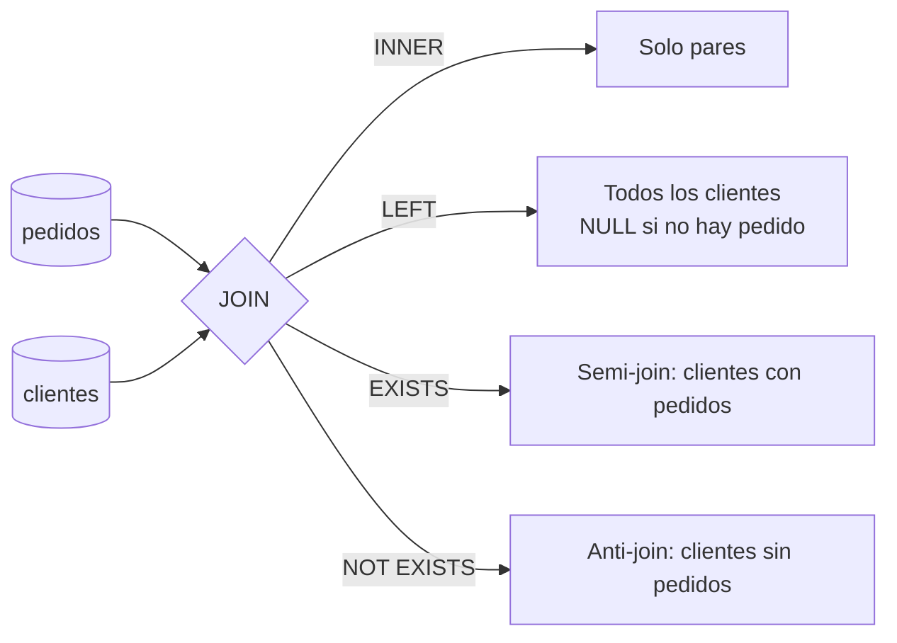

## 1. Resumen

Un `JOIN` combina filas de dos tablas según una condición. El tipo de join decide qué pasa con las filas sin pareja: `INNER` las descarta, `LEFT`, `RIGHT` y `FULL` las conservan con `NULL` en el lado que falta, y `CROSS` combina todas con todas.

En pipelines de datos, los errores frecuentes no son de sintaxis:

- un filtro en `WHERE` que convierte un `LEFT JOIN` en `INNER`;
- una clave duplicada que multiplica filas;
- un `NOT IN` que devuelve cero filas porque la subconsulta trae un `NULL`.

Esta ficha cubre también los **semi-joins** ("los que tienen") y **anti-joins** ("los que no tienen"), escritos con `EXISTS` y `NOT EXISTS`.

## 2. Qué es

Es SQL básico y consolidado, disponible en BigQuery, Redshift, T-SQL (Synapse y Fabric Warehouse) y PostgreSQL:

| Join | Resultado |
|---|---|
| `INNER JOIN` | Solo los pares que cumplen la condición |
| `LEFT [OUTER] JOIN` | Todas las filas de la izquierda; `NULL` a la derecha si no hay pareja |
| `RIGHT [OUTER] JOIN` | Lo simétrico |
| `FULL [OUTER] JOIN` | Todas las filas de ambos lados |
| `CROSS JOIN` | Producto cartesiano: cada fila con cada fila |
| Semi-join (`EXISTS`) | Filas de la izquierda que tienen al menos una pareja, sin duplicarlas |
| Anti-join (`NOT EXISTS`) | Filas de la izquierda sin pareja |

La condición va en `ON` (cualquier expresión). PostgreSQL, BigQuery y Redshift documentan además `USING (columnas)`, para cuando las columnas se llaman igual en ambos lados; la gramática de join de T-SQL (Synapse y Fabric Warehouse) solo documenta `ON`.

## 3. Problema que resuelve

Los datos normalizados o dimensionales reparten la información en varias tablas: pedidos y clientes, hechos y dimensiones. El join los vuelve a juntar para consultar, validar (filas sin pareja) o cargar (detectar registros nuevos).

## 4. Cómo funciona

1. **El motor empareja filas** según la condición. Lógicamente es un producto cartesiano filtrado; físicamente el motor elige otra estrategia.
2. **El join externo agrega las filas sin pareja**, con `NULL` en las columnas del otro lado.
3. **`ON` frente a `WHERE`:** según PostgreSQL, una restricción en `ON` se procesa antes del join y una en `WHERE` después. En un `LEFT JOIN`, un filtro sobre la tabla derecha en `WHERE` descarta las filas rellenadas con `NULL`: el join externo se comporta como interno.
4. **Cardinalidad:** si la clave no es única en uno de los lados, cada fila del otro lado se repite por cada coincidencia.
5. **Semi-join y anti-join:** `EXISTS` es verdadero si la subconsulta devuelve al menos una fila, así que no duplica filas. `NOT IN` no sirve como anti-join si la subconsulta puede devolver `NULL`: PostgreSQL documenta que el resultado es nulo, no verdadero.

## 5. Cuándo utilizarlo

- Para unir hechos con dimensiones en consultas y modelos.
- Para encontrar filas sin pareja: claves huérfanas y registros nuevos, con anti-join.
- Para filtrar por pertenencia sin duplicar filas, con semi-join.
- Para aplanar arrays con un join correlacionado, como `UNNEST` en BigQuery.

## 6. Cuándo no utilizarlo

- `CROSS JOIN` sin intención: el resultado crece como el producto de ambas tablas.
- Un `JOIN` contra una tabla con clave no única cuando se quiere pertenencia: mejor `EXISTS`.
- `NOT IN (subconsulta)` sobre columnas que admiten `NULL`: mejor `NOT EXISTS`.

## 7. Ejemplo sencillo

```sql
SELECT c.nombre, p.pedido_id
FROM clientes AS c
LEFT JOIN pedidos AS p ON p.cliente_id = c.cliente_id;
```

Lista todos los clientes. Los que no tienen pedidos aparecen una vez, con `pedido_id` en `NULL`.

## 8. Ejemplo de producción

Un reporte diario cuenta pedidos pagados por cliente, incluidos los clientes sin compras. La primera versión filtraba `WHERE p.estado = 'pagado'` y los clientes sin compras desaparecían. Al mover el filtro a la condición `ON`, vuelven con conteo 0.

Un control de calidad usa un anti-join con `NOT EXISTS` para listar pedidos cuyo `cliente_id` no existe en la dimensión. Antes se usaba `NOT IN`, que dejó de reportar huérfanos el día que llegó un pedido con `cliente_id` nulo.

## 9. Arquitectura



## 10. Código

```sql
-- PostgreSQL (ejecutado). Los resultados de abajo son los de esa prueba; las páginas de los otros motores
-- documentan los mismos tipos de join, pero no describen esta trampa del LEFT JOIN.
-- 1) Filtro en ON: conserva a los clientes sin pedidos pagados (conteo 0).
SELECT c.cliente_id, COUNT(p.pedido_id) AS pagados
FROM clientes AS c
LEFT JOIN pedidos AS p
  ON p.cliente_id = c.cliente_id AND p.estado = 'pagado'
GROUP BY c.cliente_id;

-- 2) El mismo filtro en WHERE descarta las filas con NULL: se comporta como INNER JOIN.
SELECT c.cliente_id, COUNT(p.pedido_id) AS pagados
FROM clientes AS c
LEFT JOIN pedidos AS p ON p.cliente_id = c.cliente_id
WHERE p.estado = 'pagado'
GROUP BY c.cliente_id;

-- 3) Anti-join: clientes sin pedidos.
SELECT c.cliente_id
FROM clientes AS c
WHERE NOT EXISTS (SELECT 1 FROM pedidos AS p WHERE p.cliente_id = c.cliente_id);

-- 4) Trampa: si algún pedido tiene cliente_id NULL, NOT IN devuelve cero filas.
SELECT c.cliente_id
FROM clientes AS c
WHERE c.cliente_id NOT IN (SELECT p.cliente_id FROM pedidos AS p);
```

Con 4 clientes y un pedido sin `cliente_id`:

- la consulta 1 devuelve los 4 clientes (dos con conteo 0);
- la 2 devuelve solo los 2 clientes con pedidos pagados;
- la 3 devuelve los 2 clientes sin pedidos;
- la 4 devuelve 0 filas.

## 11. GCP

**BigQuery** admite `INNER`, `LEFT`, `RIGHT`, `FULL` y `CROSS JOIN` con `ON` o `USING`. `CROSS JOIN` no admite ninguna de las dos. El `CROSS JOIN` puede escribirse con coma (`FROM a, b`), pero esa forma no puede ir entre paréntesis.

La documentación define el **join correlacionado**: el elemento de la derecha referencia columnas del de la izquierda. Es la forma de aplanar arrays con `UNNEST` (ver `sql-unnest`).

## 12. AWS

**Redshift** admite los mismos tipos de join, con la condición en `NATURAL`, `ON`, `USING` o `WHERE`. Exige que las columnas del join tengan tipos comparables. `NATURAL` y `USING` conservan una sola columna de cada par en el resultado intermedio; `ON` conserva ambas.

## 13. Azure

**T-SQL** (Synapse y Warehouse de Fabric, según la página de `FROM`) ofrece los mismos joins y además `CROSS APPLY` y `OUTER APPLY`. Evalúan una expresión de tabla por cada fila de la izquierda; `OUTER APPLY` conserva la fila aunque la expresión no devuelva nada.

Cumplen el papel de `LATERAL` en PostgreSQL. La sintaxis y los detalles cambian entre motores.

## 14. Buenas prácticas

- Calificar cada columna con el alias de su tabla.
- En joins externos, los filtros sobre la tabla opcional van en `ON`.
- Verificar la unicidad de la clave del lado "uno" antes de unir; si no es única, deduplicar primero.
- `NOT EXISTS` para anti-joins, nunca `NOT IN` sobre columnas que admiten `NULL`.
- Comparar el conteo de filas antes y después del join en los modelos críticos.
- **Seguridad:** un join puede reunir datos que por separado no identifican a una persona; revisar los permisos sobre el resultado, no solo sobre las tablas de origen.
- **Observabilidad:** registrar filas sin pareja (huérfanas) como métrica de calidad del pipeline.
- **Costo:** un join no reduce lo que se lee de cada tabla; filtrar y seleccionar solo las columnas necesarias antes del join, sí.

## 15. Errores frecuentes

- Filtro en `WHERE` sobre la tabla opcional de un `LEFT JOIN`.
- Joins que duplican filas por una clave no única, y sumas infladas en consecuencia.
- `NOT IN` con una subconsulta que trae `NULL`.
- Joins por columnas de distinto tipo que coinciden de forma inesperada o fallan.
- `CROSS JOIN` implícito por olvidar la condición.

## 16. Trade-offs

El join explícito es claro y portable. Para pertenencia, `EXISTS` evita duplicados a cambio de no poder devolver columnas de la otra tabla. Desnormalizar para evitar joins, como sugiere BigQuery con columnas anidadas (ver `sql-structs`), reduce joins en consulta a cambio de redundancia y de cargas más complejas.

## 17. Conceptos relacionados

- `sql-subqueries`: `EXISTS`, `IN` y subconsultas correlacionadas.
- `sql-nulls`: `NULL` en joins externos y en `NOT IN`.
- `sql-unnest`: joins correlacionados con arrays.
- `fact-tables`: joins de hechos con dimensiones.
- Del blueprint, pendiente de ficha: `join-optimization`.

## 18. Preguntas técnicas abiertas

1. ¿Cómo detectarías que un join está duplicando filas en un modelo que ya está en producción?
2. ¿Qué cambia si la condición del `LEFT JOIN` incluye una columna de la tabla izquierda?
3. ¿Cuándo preferirías un `FULL OUTER JOIN` para comparar dos versiones de una tabla?

## 19. Laboratorio relacionado

Pendiente (F4).

## 20. Fuentes

- PostgreSQL: *Table Expressions* y *Subquery Expressions*.
- Google Cloud: *Query syntax* (BigQuery).
- AWS: *FROM clause* (Amazon Redshift).
- Microsoft Learn: *FROM clause plus JOIN, APPLY, PIVOT (Transact-SQL)*.

El detalle de cada fuente está en `sources` del frontmatter.

## 21. Fecha de última verificación

2026-10-06. En `review_required` hasta la revisión B-F3.1 del lote F3b-02a.

## 22. Historial de cambios importantes

- 2026-10-05: esqueleto creado desde el blueprint (rama `f/sql`).
- 2026-10-06: ficha completa (lote F3b-02a, dominio 02-sql).
- 2026-10-07: revisión B-F3.1 del lote F3b-02a aplicada (docs/reviews/cards-f3b-02a.md): §2 limita `USING` a PostgreSQL, BigQuery y Redshift (la gramática de T-SQL solo tiene `ON`); §10 presenta los resultados como de la prueba en PostgreSQL.
