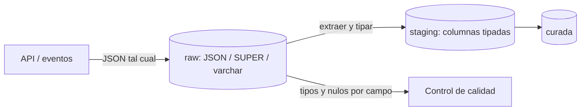

## 1. Resumen

Muchos pipelines cargan JSON tal como llega de APIs o eventos y lo tipan dentro del warehouse. Las funciones JSON de SQL extraen escalares, objetos y arrays de esos documentos.

Hay dos decisiones clave:

- **Dónde vive el JSON:** como tipo nativo (`JSON` en BigQuery, `jsonb` en PostgreSQL), en el tipo semiestructurado `SUPER` de Redshift o como texto (`varchar` en Fabric Warehouse). Cambia el rendimiento y las funciones disponibles.
- **Qué pasa con un dato que no encaja:** en modo *lax*, una ruta inexistente o de otro tipo suele devolver `NULL` en silencio. Sin una validación, el pipeline carga nulos donde había un error del origen.

## 2. Qué es

| Tarea | BigQuery | Redshift | Fabric Warehouse | PostgreSQL |
|---|---|---|---|---|
| Tipo | `JSON` | `SUPER` (o texto) | `varchar` | `jsonb` / `json` |
| Escalar | `JSON_VALUE(j, '$.a')`, `j.a` | Navegación PartiQL sobre `SUPER` | `JSON_VALUE(texto, '$.a')` | `j ->> 'a'` |
| Objeto o array | `JSON_QUERY` | Navegación PartiQL | `JSON_QUERY`, `OPENJSON` | `j -> 'a'`, `jsonb_path_query` |
| Parsear texto | `PARSE_JSON` | `JSON_PARSE` | Ya es texto | `'…'::jsonb` |
| Conversión tolerante | `LAX_INT64`, `SAFE.` | — | Modo `lax` | — |

## 3. Problema que resuelve

Los esquemas de origen cambian, y no siempre vale la pena modelar cada campo al cargar. Guardar el documento y extraer lo necesario con funciones JSON permite cargar sin perder datos y tipar en la capa siguiente, con un esquema que se aplica al leer.

## 4. Cómo funciona

1. **Cargar:** el documento se guarda en una columna JSON, `SUPER` o texto. Redshift recomienda `SUPER` sobre las funciones JSON en `VARCHAR`, por estar ya parseado.
2. **Extraer:**
   - una ruta (`$.pedido.monto`) o un operador (`->`, `->>`) devuelve un escalar, normalmente como texto;
   - `JSON_VALUE` devuelve `STRING` en BigQuery y `nvarchar(4000)` en T-SQL.
3. **Tipar:** se convierte el texto al tipo destino. Aquí aparecen los errores: un monto que llega como `"1250.50"` (texto) en un evento y como `90` (número) en otro.
4. **Datos que no encajan:**
   - en T-SQL, el modo lax devuelve `NULL` y el modo strict da error;
   - en BigQuery, `JSON_VALUE` devuelve `NULL` si la ruta no apunta a un escalar, y las funciones de conversión dan error salvo con `SAFE.`.

## 5. Cuándo utilizarlo

- En la capa raw o de staging, para extraer y tipar los campos de documentos cargados tal como llegaron.
- Para atributos opcionales o muy variables que no justifican columnas propias.
- Para inspeccionar el origen antes de decidir un esquema.

## 6. Cuándo no utilizarlo

- En la capa curada, para campos que se filtran y agregan siempre: mejor columnas tipadas o `STRUCT`.
- Para agrupar u ordenar por el JSON directamente: BigQuery no lo permite y exige extraer con `JSON_VALUE`.
- Cuando el JSON trae datos que requieren control de acceso por fila en BigQuery: las políticas de acceso por fila no se aplican a columnas `JSON`.

## 7. Ejemplo sencillo

```sql
-- PostgreSQL (ejecutado).
SELECT payload -> 'pedido' ->> 'id' AS pedido_id
FROM eventos_raw;
```

## 8. Ejemplo de producción

Un pipeline de pedidos carga el JSON de una API en una columna `JSON` de BigQuery y tipa en staging con `SAFE_CAST(JSON_VALUE(payload, '$.pedido.monto') AS NUMERIC)`. Un día el proveedor empieza a enviar el monto como objeto `{"valor": …, "moneda": …}`. `JSON_VALUE` devuelve `NULL` y la carga no falla, pero el monto queda nulo.

El equipo agrega dos controles: un conteo de montos nulos con umbral de alerta y un registro de tipos JSON por campo. El cambio se detecta en la primera carga.

## 9. Arquitectura



## 10. Código

```sql
-- PostgreSQL (ejecutado): extraer, tipar y medir el tipo de origen.
SELECT id,
       payload -> 'pedido' ->> 'id'                      AS pedido_id,
       (payload -> 'pedido' ->> 'monto')::numeric         AS monto,
       jsonb_typeof(payload -> 'pedido' -> 'monto')       AS tipo_json,
       jsonb_array_length(payload -> 'pedido' -> 'items') AS n_items
FROM eventos_raw;

-- Un documento inválido falla al convertir a jsonb.
SELECT '{"pedido": {"id": "A4",}}'::jsonb;   -- ERROR: invalid input syntax for type json

-- BigQuery (sintaxis documentada; no ejecutado aquí, requiere GCP):
-- SELECT JSON_VALUE(payload, '$.pedido.id')                             AS pedido_id,
--        SAFE_CAST(JSON_VALUE(payload, '$.pedido.monto') AS NUMERIC)     AS monto
-- FROM raw.eventos;
```

Con tres eventos de prueba, la primera consulta devuelve:

- **A1:** monto 1250.50, `tipo_json` = `string` y 2 items;
- **A2:** monto 90, `tipo_json` = `number` y sin items (`NULL`);
- **A3:** sin monto ni items.

La columna `tipo_json` muestra que el origen no es consistente, algo que la conversión sola ocultaría. La segunda consulta falla por la coma final.

## 11. GCP

**BigQuery** tiene el tipo `JSON`, con acceso por punto y subíndices, y los extractores estándar `JSON_VALUE`, `JSON_QUERY` y sus versiones de array. `JSON_EXTRACT` y los demás extractores heredados siguen admitidos, pero la documentación recomienda los estándar.

Los conversores `LAX_` toleran tipos distintos y el prefijo `SAFE.` devuelve `NULL` en vez de error. Los valores `JSON` no se agrupan ni ordenan directamente. El límite de anidación es 500 y las políticas de acceso por fila no se aplican a columnas `JSON`.

## 12. AWS

**Redshift** tiene funciones JSON sobre `VARCHAR`, pero recomienda `SUPER` para datos JSON, porque es una representación ya parseada y sin esquema. `JSON_PARSE` convierte texto JSON a `SUPER` al insertar o actualizar. Luego se navega con PartiQL (ver `sql-arrays` y `sql-structs`).

## 13. Azure

**Fabric Warehouse** no admite el tipo `json` en tablas: el JSON se guarda en `varchar`, con hasta 16 MB en `varchar(max)`. `JSON_VALUE` (que aplica a Fabric Warehouse) extrae escalares como `nvarchar(4000)`. Con más de 4000 caracteres devuelve `NULL` en modo lax o error en modo strict, y la documentación remite a `OPENJSON` para valores mayores. Para objetos o arrays se usa `JSON_QUERY` u `OPENJSON`.

## 14. Buenas prácticas

- Tipar en staging y no propagar JSON a la capa curada para campos de uso frecuente.
- Elegir conscientemente entre conversión estricta (falla) y tolerante (`NULL`), y medir los nulos en el segundo caso.
- Registrar el tipo JSON de cada campo crítico (`jsonb_typeof` o equivalente) para detectar cambios del origen.
- En Redshift, preferir `SUPER` a funciones sobre `VARCHAR`, como recomienda su documentación.
- **Seguridad:** los documentos JSON suelen traer más campos de los que se usan, a veces sensibles; en BigQuery, las políticas de acceso por fila no aplican a columnas `JSON`, así que conviene extraer a columnas lo que requiere control.
- **Observabilidad:** alertar por aumento de nulos o cambio de tipo en los campos extraídos.
- **Costo:** leer una columna JSON grande para extraer un campo lee el documento entero; extraer a columnas los campos de uso frecuente reduce lo que se escanea.

## 15. Errores frecuentes

- Modo lax o `SAFE.` sin control de nulos: errores del origen que pasan como datos faltantes.
- Mezclar números y textos en el mismo campo y convertir sin revisar.
- Usar en BigQuery los extractores heredados en código nuevo.
- En T-SQL, escalares de más de 4000 caracteres, para los que `JSON_VALUE` devuelve `NULL` en modo lax (no los corta).

## 16. Trade-offs

Guardar JSON da flexibilidad ante cambios del origen, a cambio de tipar en cada consulta y de errores que aparecen tarde. Columnas tipadas desde la carga detectan los cambios al cargar y se consultan más rápido, a cambio de mantener el esquema cuando el origen cambia.

## 17. Conceptos relacionados

- `json-format`: el formato.
- `schema-on-read-vs-schema-on-write`: tipar al leer o al escribir.
- `sql-unnest`: expandir arrays JSON.
- `sql-structs`: pasar de JSON a estructuras tipadas.
- `sql-arrays`: navegar SUPER con PartiQL en Redshift (§12).

## 18. Preguntas técnicas abiertas

1. ¿Qué campos de tu JSON de origen pasarías a columnas y cuáles dejarías como JSON?
2. ¿Preferirías que un cambio de tipo en el origen detenga la carga o cargue `NULL` con una alerta?
3. ¿Cómo detectarías un campo nuevo en el JSON que nadie está usando?

## 19. Laboratorio relacionado

Pendiente (F4).

## 20. Fuentes

- Google Cloud: *JSON functions* y *Work with JSON data* (BigQuery).
- AWS: *JSON functions* y *JSON_PARSE* (Amazon Redshift).
- Microsoft Learn: *JSON_VALUE (Transact-SQL)* y *Data Types in Fabric Data Warehouse*.
- PostgreSQL: *JSON Functions and Operators*.

El detalle de cada fuente está en `sources` del frontmatter.

## 21. Fecha de última verificación

2026-10-07. Pasa a `verified`: revisión B-F3.1 del lote F3b-02b aplicada, sin VERIFY pendientes.

## 22. Historial de cambios importantes

- 2026-10-05: esqueleto creado desde el blueprint (rama `f/sql`).
- 2026-10-07: ficha completa (lote F3b-02b, dominio 02-sql).
- 2026-10-07: revisión B-F3.1 del lote F3b-02b aplicada (docs/reviews/cards-f3b-02b.md): §15: `JSON_VALUE` devuelve `NULL` por encima de 4000 caracteres en modo lax; no trunca.
- 2026-10-07: `verification_status: verified` (sin VERIFY pendientes).
- 2026-10-13: `page_title` en cada cita, con el título de la página citada (ADR-012); sin cambios de contenido.
- 2026-10-14: lote F3b-rel (regla del §17): relations incluye `sql-arrays`; el §17 nombra `sql-arrays`, que el cuerpo ya citaba.
