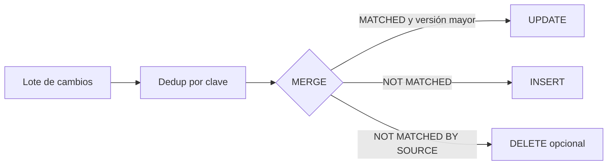

## 1. Resumen

`MERGE` compara una tabla destino con una tabla origen mediante una condición y, en una sola sentencia, actualiza las filas que coinciden, inserta las que faltan y, opcionalmente, borra. Es la herramienta central de las cargas incrementales, los upserts y SCD2 en un data warehouse.

## 2. Qué es

Es una sentencia DML del estándar SQL que combina `INSERT`, `UPDATE` y `DELETE`. Sus cláusulas `WHEN MATCHED` y `WHEN NOT MATCHED` definen qué hacer con cada fila según si encuentra pareja en el otro lado.

## 3. Problema que resuelve

Sin `MERGE`, aplicar un lote de cambios requiere varias sentencias (`UPDATE` de las existentes, `INSERT` de las nuevas) y cuidado para que sean coherentes entre sí. `MERGE` expresa la sincronización completa en una operación, con una sola lectura de las tablas.

## 4. Cómo funciona

1. Se unen destino (`target`) y origen (`source`) por la condición `ON`.
2. Cada fila cae en un caso:
   - `WHEN MATCHED`: existe en ambos lados → `UPDATE` o `DELETE`.
   - `WHEN NOT MATCHED [BY TARGET]`: existe solo en el origen → `INSERT`.
   - `WHEN NOT MATCHED BY SOURCE` (en los motores que lo admiten, como BigQuery y T-SQL): existe solo en el destino → `UPDATE` o `DELETE`.
3. Cada cláusula admite condiciones extra (`AND s.version > t.version`).

La regla clave: **cada fila del destino debe coincidir con a lo sumo una fila del origen**. Qué pasa si no se cumple cambia según el motor (ver GCP, AWS y Azure).

## 5. Cuándo utilizarlo

- Upserts de lotes de cambios (CDC, cargas incrementales).
- SCD tipo 1 y tipo 2.
- Sincronizar una tabla con una fuente de verdad, incluidos los borrados (`NOT MATCHED BY SOURCE`).

## 6. Cuándo no utilizarlo

- Cargas solo de inserción (logs, eventos inmutables): un `INSERT` o un append es más barato.
- Reemplazo completo de una partición: sobrescribirla suele ser más simple y barato que emparejar fila a fila.
- Lotes enormes contra tablas enormes sin filtrar la ventana afectada: se lee todo el destino.

## 7. Ejemplo sencillo

```sql
MERGE inventario t
USING llegadas s ON t.producto = s.producto
WHEN MATCHED THEN UPDATE SET cantidad = t.cantidad + s.cantidad
WHEN NOT MATCHED THEN INSERT (producto, cantidad) VALUES (s.producto, s.cantidad);
```

## 8. Ejemplo de producción

Un job aplica cada hora los cambios de clientes llegados por CDC. Antes del `MERGE`, deduplica el lote por `customer_id` quedándose con el cambio más reciente. Aplica solo si la versión es mayor, filtra el destino por las particiones afectadas para no leer toda la tabla y registra cuántas filas se insertaron y actualizaron para reconciliar contra el origen.

## 9. Arquitectura



## 10. Código

```sql
-- BigQuery (ejecutable adaptando nombres). Requiere customers(customer_id, email, version)
-- y customers_stg con las mismas columnas.
MERGE `proyecto.dataset.customers` AS t
USING (
  SELECT * FROM `proyecto.dataset.customers_stg`
  WHERE TRUE
  QUALIFY ROW_NUMBER() OVER (PARTITION BY customer_id ORDER BY version DESC) = 1
) AS s
ON t.customer_id = s.customer_id
WHEN MATCHED AND s.version > t.version THEN
  UPDATE SET email = s.email, version = s.version
WHEN NOT MATCHED THEN
  INSERT (customer_id, email, version) VALUES (s.customer_id, s.email, s.version);
```

## 11. GCP

En **BigQuery**, `MERGE` admite `WHEN NOT MATCHED BY SOURCE`. Si una fila del destino coincide con más de una fila del origen, la sentencia falla con *"UPDATE/MERGE must match at most one source row for each target row"*. Sobre los bytes procesados, la documentación indica: con solo cláusulas `INSERT` se factura el origen; si hay `UPDATE` o `DELETE`, se factura origen más destino. Filtrar el destino por partición reduce ese costo.

## 12. AWS

**Redshift** tiene `MERGE`, pero con un comportamiento distinto ante duplicados: si varias filas del destino coinciden con la misma fila de origen, **elimina los duplicados, conserva una y la actualiza**, en lugar de fallar. Además ofrece un modo simplificado, `REMOVE DUPLICATES`, que exige que origen y destino tengan columnas compatibles. No es el mismo `MERGE` que el de BigQuery: el mismo SQL puede fallar en uno y en el otro borrar filas en silencio.

## 13. Azure

El `MERGE` de T-SQL aplica a SQL Server, Azure SQL Database, Azure SQL Managed Instance, Azure Synapse Analytics (solo dedicated SQL pool) y Warehouse en Microsoft Fabric. Si más de una fila del origen coincide con una fila del destino en un `UPDATE`, devuelve error: no puede actualizar la misma fila más de una vez. Admite `WHEN NOT MATCHED BY SOURCE`.

## 14. Buenas prácticas

- Deduplicar siempre el origen por la clave de la condición `ON`.
- Añadir una condición de versión en `WHEN MATCHED` para no retroceder datos.
- Limitar el destino a la ventana afectada (particiones) cuando el motor lo permita.
- Registrar filas insertadas, actualizadas y borradas para reconciliar.

## 15. Errores frecuentes

- Clave `ON` que no es única en el origen: error en BigQuery y T-SQL, borrado silencioso de duplicados en Redshift.
- Olvidar la condición de versión y sobrescribir datos nuevos con cambios viejos.
- `WHEN NOT MATCHED BY SOURCE THEN DELETE` con un origen parcial (un lote incremental): borra todo lo que no vino en el lote.
- Portar un `MERGE` entre motores sin revisar su semántica.

## 16. Trade-offs

Una sentencia atómica y legible frente a varias sentencias coordinadas. A cambio, suele leer más datos que un `INSERT` y su semántica cambia entre motores. Para reemplazos completos de partición, sobrescribir es más simple.

## 17. Conceptos relacionados

- `idempotency`: `MERGE` con versión es la escritura idempotente típica.
- `scd-type-2`, `incremental-load`: patrones que se implementan con `MERGE`.
- Del blueprint, pendientes de ficha: `upsert`, `deduplication`, `sql-window-functions`, `sql-qualify`.

## 18. Preguntas técnicas abiertas

1. ¿Qué pasa en tu warehouse si el lote de origen trae dos cambios para la misma clave, y cómo lo evitas?
2. ¿Cuándo usarías `WHEN NOT MATCHED BY SOURCE THEN DELETE` y qué riesgo introduce en una carga incremental?
3. ¿Cómo reducirías el costo de un `MERGE` diario sobre una tabla de varios TB?

## 19. Laboratorio relacionado

Pendiente (F4): lab de tipo A "Implementar una carga incremental desde una tabla staging hacia una tabla final" (§25).

## 20. Fuentes

- Google Cloud: *DML statements in GoogleSQL* (BigQuery).
- AWS: *MERGE* (Amazon Redshift).
- Microsoft Learn: *MERGE (Transact-SQL)*.

El detalle de cada fuente está en `sources` del frontmatter.

## 21. Fecha de última verificación

2026-09-30. La ficha queda en `review_required` hasta la revisión humana (B-F3.1).

## 22. Historial de cambios importantes

- 2026-09-30: creación (lote 1 de F3).
