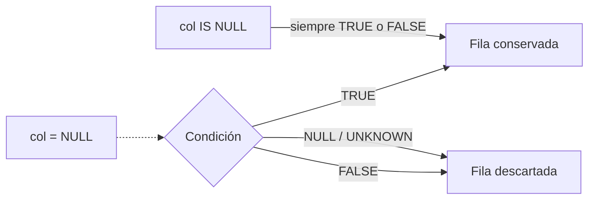

## 1. Resumen

`NULL` representa un valor desconocido o ausente: no es cero ni texto vacío. SQL lo trata con **lógica de tres valores**, en la que una comparación puede ser verdadera, falsa o desconocida. De ahí salen casi todos los errores silenciosos con nulos:

- `columna = NULL` nunca es verdadero: hay que usar `IS NULL`;
- `WHERE` descarta las filas cuya condición es desconocida;
- los agregados ignoran los nulos, y `SUM` de cero filas da `NULL`, no 0;
- `NOT IN (subconsulta)` con un `NULL` dentro no devuelve ninguna fila;
- comparar dos versiones de una fila con `<>` no detecta el cambio de un valor a `NULL`: hay que usar `IS DISTINCT FROM`.

## 2. Qué es

Es SQL consolidado, pero no todo está documentado igual en cada motor:

| Expresión | Resultado | Lo documentan |
|---|---|---|
| `NULL = NULL` | Desconocido (`NULL`) | PostgreSQL, Redshift, T-SQL |
| `1 + NULL` | `NULL` | Redshift |
| `NULL IS NULL` | Verdadero | PostgreSQL, Redshift, T-SQL |
| `NULL IS DISTINCT FROM NULL` | Falso | PostgreSQL, BigQuery, Fabric Warehouse (no Redshift) |
| `1 IS DISTINCT FROM NULL` | Verdadero | PostgreSQL, BigQuery, Fabric Warehouse (no Redshift) |
| `COUNT(*)` | Cuenta filas, con o sin nulos | PostgreSQL |
| `COUNT(col)`, `SUM(col)` | Ignoran los nulos | PostgreSQL; `SUM`, también BigQuery |
| `SUM` sobre cero filas | `NULL` | PostgreSQL; BigQuery (grupo vacío) |

Redshift lista `IS DISTINCT FROM` entre las funciones de PostgreSQL que no admite.

## 3. Problema que resuelve

Entender `NULL` evita resultados incorrectos que no producen errores: clientes que desaparecen de un reporte, promedios que no son lo que parecen, controles de calidad que dejan de detectar problemas o cargas incrementales que no ven un cambio.

## 4. Cómo funciona

1. **Comparaciones:** cualquier operador con un `NULL` devuelve `NULL`; Redshift y T-SQL lo documentan así. `WHERE` y `HAVING` solo conservan las filas con condición verdadera.
2. **`IS NULL` e `IS DISTINCT FROM`:** nunca devuelven `NULL`. BigQuery define `IS DISTINCT FROM` como "distintos para `GROUP BY`", así que dos `NULL` no son distintos. Redshift no admite `IS DISTINCT FROM`; ahí la comparación segura con nulos se escribe a mano (sección 10).
3. **Agregados:** según PostgreSQL, `count(expresión)` y `sum` operan sobre los valores no nulos, y salvo `count`, los agregados sobre cero filas devuelven `NULL`. Por eso `AVG` de (10, `NULL`, 20) es 15, no 10.
4. **`IN` y `NOT IN`:** BigQuery documenta que `NOT IN` devuelve `NULL` cuando no encuentra igual pero no puede excluir el valor, que es el caso con un `NULL` en la lista. PostgreSQL documenta lo mismo para subconsultas.
5. **Joins externos:** las columnas del lado sin pareja se rellenan con `NULL` (ver `sql-joins`).

## 5. Cuándo utilizarlo

`NULL` es correcto para "no se sabe" o "no aplica": una fecha de baja de un cliente activo o un dato opcional no informado. Se trata explícitamente con:

- `IS NULL` e `IS NOT NULL` en filtros;
- `COALESCE` para sustituir un valor por defecto al presentar o sumar;
- `IS DISTINCT FROM` al comparar versiones de una fila.

## 6. Cuándo no utilizarlo

- Como valor de negocio con significado propio ("sin región" o "desconocido"), si se va a agrupar, filtrar o reportar con frecuencia: un valor explícito evita ambigüedades.
- `NULL` en claves de join o claves primarias.
- `COALESCE(x, 0)` antes de promediar sin decidirlo: cambia el promedio (15 frente a 10 en el ejemplo).

## 7. Ejemplo sencillo

```sql
SELECT COUNT(*) AS filas, COUNT(region) AS con_region
FROM clientes;
```

Con 4 clientes y uno sin región: `filas` = 4, `con_region` = 3.

## 8. Ejemplo de producción

Una carga incremental detecta cambios con `WHERE nuevo.email <> actual.email`. Cuando un cliente borra su email (pasa a `NULL`), la condición da `NULL` y el cambio no se detecta, así que la dimensión queda desactualizada. El equipo cambia la condición a `nuevo.email IS DISTINCT FROM actual.email`, que trata el paso a `NULL` como diferencia.

En el mismo pipeline, una métrica diaria de reembolsos aparecía vacía los días sin reembolsos, porque la suma de cero filas es `NULL`. Ahora se calcula con `COALESCE(SUM(monto), 0)`.

## 9. Arquitectura



## 10. Código

```sql
-- PostgreSQL (ejecutado). Ver en la tabla de §2 qué motor documenta cada comportamiento.
SELECT COUNT(*) AS filas, COUNT(region) AS con_region FROM clientes;            -- 4, 3

SELECT COUNT(*) FILTER (WHERE region = NULL) AS igual_null,                      -- 0
       COUNT(*) FILTER (WHERE region IS NULL) AS is_null                         -- 1
FROM clientes;

SELECT SUM(monto) AS suma_vacia, COALESCE(SUM(monto), 0) AS suma_coalesce       -- NULL, 0
FROM pedidos WHERE estado = 'reembolsado';

SELECT (NULL = NULL) IS NULL           AS igual_es_null,                         -- true
       NULL IS DISTINCT FROM NULL      AS distinto,                              -- false
       1 IS DISTINCT FROM NULL         AS distinto_1;                            -- true

SELECT AVG(x) AS promedio_ignora_null, AVG(COALESCE(x, 0)) AS promedio_con_cero  -- 15, 10
FROM (VALUES (10), (NULL), (20)) AS v(x);

-- Comparación segura con nulos sin IS DISTINCT FROM (para motores que no lo admiten, como Redshift):
-- da el mismo resultado que a IS DISTINCT FROM b en los 5 casos probados (iguales, distintos, uno NULL, el otro NULL, ambos NULL).
SELECT a, b, COALESCE(a <> b, (a IS NULL) <> (b IS NULL)) AS distinto
FROM (VALUES ('x','x'), ('x','y'), ('x',NULL), (NULL,'y'), (NULL,NULL)) AS v(a, b);
```

`FILTER (WHERE …)` es la sintaxis de PostgreSQL para contar con condición. La forma portable a los otros motores es `SUM(CASE WHEN … THEN 1 ELSE 0 END)`. La última consulta se ejecutó en PostgreSQL; en Redshift no se ejecutó.

## 11. GCP

**BigQuery** documenta la semántica de `IN` y `NOT IN` con `NULL`: si no encuentra un igual pero tampoco puede excluir el valor, el resultado es `NULL`. Define `IS DISTINCT FROM` según los grupos que formaría `GROUP BY`, y ese operador nunca devuelve `NULL`. `SUM` suma los valores no nulos y devuelve `NULL` si el grupo está vacío o todos sus valores son `NULL`.

## 12. AWS

**Redshift** documenta que un nulo no equivale a cero ni a cadena vacía, que toda expresión aritmética con un nulo da nulo y que un nulo no es igual ni distinto de ningún valor, incluido otro nulo. Para probarlo se usan `IS NULL` e `IS NOT NULL`. Redshift lista `IS DISTINCT FROM` entre las funciones de PostgreSQL que no admite: la comparación segura con nulos se escribe con `IS NULL` explícitos (sección 10).

## 13. Azure

**T-SQL** (Synapse y Fabric Warehouse) define `NULL` como desconocido. Ningún par de nulos es igual, y comparar un nulo con cualquier valor devuelve `UNKNOWN`. Se prueba con `IS NULL` o `IS NOT NULL`. `IS [NOT] DISTINCT FROM` tiene su propia página, que aplica a Warehouse en Fabric (y a SQL Server 2022) pero no menciona Synapse.

## 14. Buenas prácticas

- `IS NULL` e `IS NOT NULL`, nunca `= NULL`.
- `IS DISTINCT FROM` para detectar cambios entre versiones de una fila, donde el motor lo admite; en Redshift, la comparación con `IS NULL` explícitos.
- `NOT EXISTS` en lugar de `NOT IN` con subconsultas.
- `COALESCE(SUM(...), 0)` cuando el consumidor espera 0 los días sin datos.
- Decidir y documentar por columna qué significa `NULL`.
- **Seguridad:** un `NULL` en una columna de pertenencia o de permisos puede excluir o incluir filas sin querer en políticas de acceso por fila; probar esas condiciones con nulos.
- **Observabilidad:** medir el porcentaje de nulos por columna clave en cada carga; un salto indica un cambio en el origen.
- **Costo:** los nulos no tienen costo propio relevante; el costo está en reprocesar cuando un cambio no detectado obliga a corregir datos después.

## 15. Errores frecuentes

- `WHERE col = NULL` o `WHERE col <> 'x'` esperando que incluya los nulos.
- `NOT IN` con una subconsulta que trae `NULL`.
- Detectar cambios con `<>` y perder los pasos a `NULL`.
- Promedios con nulos interpretados como si fueran ceros, o al revés.
- Sumas de cero filas mostradas como vacío en un tablero.

## 16. Trade-offs

Permitir `NULL` refleja con honestidad que un dato falta, a cambio de exigir cuidado en cada consulta. Sustituirlo por un valor centinela (`'desconocido'` o `-1`) simplifica filtros y joins, a cambio de ocultar que el dato falta y arriesgar que el centinela se sume o se promedie.

## 17. Conceptos relacionados

- `sql-joins`: nulos de los joins externos y anti-joins.
- `sql-case-expressions`: tratamiento explícito con `CASE` y `COALESCE`.
- `sql-subqueries`: subconsultas escalares sin filas.
- `data-reconciliation`: comparar valores con nulos.
- Del blueprint, pendiente de ficha: `change-detection`.

## 18. Preguntas técnicas abiertas

1. ¿Qué columnas de tu modelo admiten `NULL` y qué significa en cada una?
2. ¿Cómo detectarías en una carga incremental los cambios de un valor a `NULL`?
3. ¿Cuándo preferirías un valor centinela en lugar de `NULL`?

## 19. Laboratorio relacionado

Pendiente (F4).

## 20. Fuentes

- PostgreSQL: *Comparison Functions and Operators*, *Aggregate Functions* y *Subquery Expressions*.
- Google Cloud: *Operators* (BigQuery).
- AWS: *Nulls* (Amazon Redshift).
- Microsoft Learn: *NULL and UNKNOWN (Transact-SQL)*.

El detalle de cada fuente está en `sources` del frontmatter.

## 21. Fecha de última verificación

2026-10-06. En `review_required` hasta la revisión B-F3.1 del lote F3b-02a.

## 22. Historial de cambios importantes

- 2026-10-05: esqueleto creado desde el blueprint (rama `f/sql`).
- 2026-10-06: ficha completa (lote F3b-02a, dominio 02-sql).
- 2026-10-07: revisión B-F3.1 del lote F3b-02a aplicada (docs/reviews/cards-f3b-02a.md): `IS DISTINCT FROM` ya no se presenta como comportamiento de Redshift (lo lista como no admitido); se documenta en PostgreSQL, BigQuery y Fabric Warehouse con su página, sin extenderlo a Synapse. `SUM` de cero filas atribuido a PostgreSQL y a *Aggregate functions* de BigQuery. Tabla de §2 con el motor que documenta cada fila; §10 agrega la comparación segura con nulos sin `IS DISTINCT FROM`, ejecutada en PostgreSQL.
