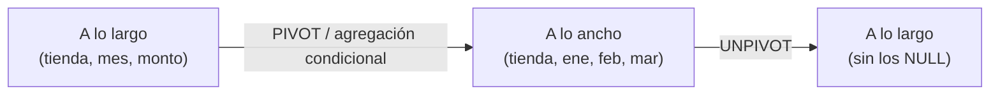

## 1. Resumen

`PIVOT` rota filas a columnas. Por ejemplo, ventas por tienda y mes pasan a una fila por tienda y una columna por mes, con una agregación como `SUM`. `UNPIVOT` hace lo contrario: columnas a filas.

BigQuery, Redshift y T-SQL (Synapse y Fabric Warehouse) tienen el operador. PostgreSQL no lo incluye en su `SELECT`; tiene `crosstab` en una extensión. La forma portable es la **agregación condicional**.

Dos límites importan:

- los valores que se vuelven columnas deben conocerse al escribir la consulta (constantes);
- `UNPIVOT` no reconstruye exactamente lo que `PIVOT` agregó.

## 2. Qué es

| Motor | Pivot | Unpivot |
|---|---|---|
| BigQuery | `PIVOT(SUM(x) FOR col IN ('a', 'b'))` en el `FROM` | `UNPIVOT` |
| Redshift | `PIVOT` en el `FROM` | `UNPIVOT` |
| T-SQL (Synapse, Fabric Warehouse) | `PIVOT` | `UNPIVOT` |
| PostgreSQL | Agregación condicional o `crosstab` (`tablefunc`) | `LATERAL (VALUES …)` |

## 3. Problema que resuelve

Los reportes y algunos modelos piden datos "a lo ancho": una columna por mes, por canal o por estado. Los datos de origen suelen estar "a lo largo": una fila por combinación. `PIVOT` y `UNPIVOT` cambian de forma sin escribir un `CASE` por columna.

## 4. Cómo funciona

1. **`PIVOT`:** agrupa por las columnas que no participan, aplica la agregación a cada valor de la lista `IN` y crea una columna por valor. Las combinaciones sin datos quedan en `NULL`.
2. **Valores constantes:**
   - BigQuery exige que cada valor del `IN` sea una constante, sin variables ni parámetros;
   - Redshift no admite referencias a columnas ni subconsultas en esa lista.

   Para columnas dinámicas hay que generar el SQL.
3. **Nombres de columna:** se derivan del valor (y del prefijo en BigQuery) o de un alias explícito.
4. **`UNPIVOT`:** convierte un conjunto de columnas en pares nombre-valor. T-SQL documenta que no es la inversa exacta: lo que `PIVOT` agregó no se recupera, y los `NULL` desaparecen.

## 5. Cuándo utilizarlo

- Reportes con columnas conocidas y estables: meses, canales o estados.
- `UNPIVOT` para normalizar archivos anchos de origen, como una planilla con una columna por mes.
- En BigQuery, como alternativa a self-joins, según su guía de buenas prácticas.

## 6. Cuándo no utilizarlo

- Cuando los valores cambian con el tiempo (nuevos productos o tiendas): la consulta queda desactualizada o hay que generarla dinámicamente.
- Para guardar datos a lo ancho en la capa curada: dificulta agregar valores nuevos y filtrar. Mejor pivotar al presentar.
- En SQL que debe ser portable con PostgreSQL: usar agregación condicional.

## 7. Ejemplo sencillo

```sql
-- BigQuery (sintaxis documentada; no ejecutado aquí).
SELECT *
FROM (SELECT tienda, mes, monto FROM ventas_mes)
PIVOT (SUM(monto) FOR mes IN ('ene', 'feb', 'mar'));
```

## 8. Ejemplo de producción

Un socio entrega una planilla con una columna por mes (`ene`, `feb`, …). La carga usa `UNPIVOT` para pasarla a filas (`tienda`, `mes`, `monto`), que es como se guarda en la capa curada. El tablero vuelve a pivotar al mostrar.

Al aparecer una columna `abr` que la consulta no listaba, el control de esquema de la carga lo detectó. El `UNPIVOT` solo procesa las columnas listadas, así que `abr` se habría perdido sin error.

## 9. Arquitectura



## 10. Código

```sql
-- PostgreSQL (ejecutado). Pivot portable con agregación condicional;
-- en BigQuery, Redshift y T-SQL también vale SUM(CASE WHEN mes = 'ene' THEN monto END).
SELECT tienda,
       SUM(monto) FILTER (WHERE mes = 'ene') AS ene,
       SUM(monto) FILTER (WHERE mes = 'feb') AS feb,
       SUM(monto) FILTER (WHERE mes = 'mar') AS mar
FROM ventas_mes
GROUP BY tienda;

-- Unpivot portable con LATERAL VALUES (PostgreSQL, ejecutado).
WITH ancho AS (SELECT 'T1' AS tienda, 10 AS ene, 25 AS feb, NULL::int AS mar)
SELECT a.tienda, u.mes, u.monto
FROM ancho AS a
CROSS JOIN LATERAL (VALUES ('ene', a.ene), ('feb', a.feb), ('mar', a.mar)) AS u(mes, monto);
```

Con ventas de T1 (ene 10, feb 20 + 5) y T2 (ene 7, mar 3), el pivot devuelve T1 = 10, 25, `NULL` y T2 = 7, `NULL`, 3. El unpivot portable conserva la fila de marzo con `NULL`. Un `UNPIVOT` nativo la descartaría, según la documentación de T-SQL.

## 11. GCP

En **BigQuery**, `PIVOT` es parte del `FROM` y rota filas a columnas con una agregación. Los valores del `IN` deben ser constantes: no se admiten variables ni parámetros de consulta. Los nombres de columna se arman con el prefijo y el valor. También existe `UNPIVOT`, y la guía de rendimiento sugiere `PIVOT` o funciones de ventana en lugar de self-joins.

## 12. AWS

**Redshift** admite `PIVOT` y `UNPIVOT` en el `FROM`. La lista `IN` de `PIVOT` no puede contener referencias a columnas ni subconsultas. `UNPIVOT` no se aplica sobre joins, CTE recursivas, otro `PIVOT`/`UNPIVOT` ni expresiones `SUPER` desanidadas, y sus columnas deben compartir un tipo.

## 13. Azure

**T-SQL** (Synapse y Fabric Warehouse) tiene `PIVOT` y `UNPIVOT`. La documentación advierte que `UNPIVOT` no es la inversa exacta de `PIVOT` y que usarlos repetidamente en una sentencia puede afectar el rendimiento.

## 14. Buenas prácticas

- Guardar a lo largo y pivotar al presentar.
- Listar los valores explícitamente y alias claros para las columnas.
- Si los valores cambian, generar el SQL desde una lista controlada y versionada.
- Al hacer `UNPIVOT` de archivos anchos, verificar que no aparecieron columnas nuevas no listadas.
- **Seguridad:** pivotar puede convertir categorías sensibles (por ejemplo, un diagnóstico) en nombres de columna visibles en el esquema; revisar qué valores se exponen.
- **Observabilidad:** contar filas antes y después del `UNPIVOT`, y los `NULL` descartados.
- **Costo:** un pivot es una agregación, con el costo de leer las filas de origen; las consultas repetidas sobre la misma forma pueden materializarse.

## 15. Errores frecuentes

- Esperar que `UNPIVOT` reconstruya los datos originales de un `PIVOT`.
- Valores del `IN` que no coinciden exactamente (mayúsculas, espacios) y columnas vacías como resultado.
- Pasar parámetros o variables como valores del pivot en BigQuery.
- Tablas anchas en la capa curada que hay que modificar con cada valor nuevo.

## 16. Trade-offs

El operador `PIVOT` es conciso, a cambio de portabilidad y de columnas fijas. La agregación condicional es portable y explícita, a cambio de repetir una expresión por columna. Generar el SQL dinámicamente da columnas al día, a cambio de complejidad y de revisar el SQL generado.

## 17. Conceptos relacionados

- `sql-case-expressions`: agregación condicional.
- `sql-advanced-select`: agrupación y orden de evaluación.
- `sql-nulls`: `NULL` en combinaciones sin datos y en `UNPIVOT`.

## 18. Preguntas técnicas abiertas

1. ¿Qué tablas de tu modelo están a lo ancho y deberían estar a lo largo?
2. ¿Cómo generarías un pivot con valores que cambian cada mes sin perder control del SQL?
3. ¿Cómo detectarías una columna nueva en un archivo ancho de origen?

## 19. Laboratorio relacionado

Pendiente (F4).

## 20. Fuentes

- Google Cloud: *Query syntax* (BigQuery).
- AWS: *PIVOT and UNPIVOT examples* (Amazon Redshift).
- Microsoft Learn: *Using PIVOT and UNPIVOT*.
- PostgreSQL: *tablefunc* y *SELECT*.

El detalle de cada fuente está en `sources` del frontmatter.

## 21. Fecha de última verificación

2026-10-07. Pasa a `verified`: revisión B-F3.1 del lote F3b-02b aplicada, sin VERIFY pendientes.

## 22. Historial de cambios importantes

- 2026-10-05: esqueleto creado desde el blueprint (rama `f/sql`).
- 2026-10-07: ficha completa (lote F3b-02b, dominio 02-sql).
- 2026-10-07: revisión B-F3.1 del lote F3b-02b aplicada (docs/reviews/cards-f3b-02b.md): sin cambios pedidos.
- 2026-10-07: `verification_status: verified` (sin VERIFY pendientes).
- 2026-10-13: `page_title` en cada cita, con el título de la página citada (ADR-012); sin cambios de contenido.
