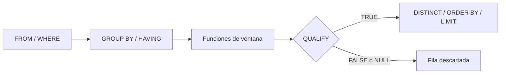

## 1. Resumen

`QUALIFY` filtra filas por el resultado de una función de ventana, igual que `HAVING` filtra por el de un agregado. Su uso típico en pipelines es la deduplicación:

```sql
QUALIFY ROW_NUMBER() OVER (PARTITION BY pedido_id ORDER BY cargado_en DESC) = 1
```

Esa línea conserva la última versión de cada pedido sin envolver la consulta en una subconsulta.

Es una práctica **modern**: la documentan BigQuery, Redshift y Fabric Warehouse, pero no todos los motores. PostgreSQL no la incluye en su sintaxis de `SELECT`. El equivalente portable, una subconsulta o CTE con la ventana y un `WHERE` afuera, sigue siendo válido en todos y no queda obsoleto.

## 2. Qué es

Es una cláusula opcional del `SELECT` que se evalúa después de las funciones de ventana:

| Cláusula | Filtra | Cuándo se evalúa |
|---|---|---|
| `WHERE` | Filas | Antes de agrupar |
| `HAVING` | Grupos | Después de los agregados |
| `QUALIFY` | Filas | Después de las ventanas |

La condición puede usar el alias de una ventana del `SELECT` o una ventana escrita dentro del propio `QUALIFY`.

## 3. Problema que resuelve

Las funciones de ventana no pueden usarse en `WHERE`, porque se calculan después. Sin `QUALIFY`, filtrar por `ROW_NUMBER()` obliga a calcularlo en una subconsulta o CTE y filtrar afuera. `QUALIFY` evita ese nivel extra y deja la deduplicación o el "top N por grupo" en una sola consulta.

## 4. Cómo funciona

1. El motor resuelve `FROM`, `WHERE`, `GROUP BY` y `HAVING`.
2. Calcula las funciones de ventana.
3. Evalúa `QUALIFY` y conserva solo las filas con condición verdadera. BigQuery descarta explícitamente las que dan `NULL` o `FALSE`.
4. Sigue con `DISTINCT`, `ORDER BY` y `LIMIT`. BigQuery y Fabric documentan ambos que `QUALIFY` va antes de `DISTINCT` y `ORDER BY`.

Particularidades documentadas:

- **BigQuery:** debe haber una función de ventana en `QUALIFY` o en el `SELECT`.
- **Redshift:** si `QUALIFY` va directamente después de `FROM`, la tabla necesita alias.
- **Fabric:** `QUALIFY` se admite en subconsultas, CTE, vistas, `INSERT … SELECT` y CTAS.

## 5. Cuándo utilizarlo

- Deduplicar: la última versión por clave (ver `deduplication`).
- Top N por grupo: los 3 productos más vendidos por categoría.
- Cuando el código va a ejecutarse siempre en un motor que la documenta.

## 6. Cuándo no utilizarlo

- En SQL que debe ser portable entre motores, incluidos PostgreSQL y SQL Server: usar subconsulta o CTE.
- Cuando el resultado de la ventana se necesita también como columna en otros pasos: una CTE lo deja disponible.
- Con un `ORDER BY` de la ventana que admite empates, sin desempate: `ROW_NUMBER()` elige una fila de forma no determinista (ver `sql-window-functions`).

## 7. Ejemplo sencillo

```sql
-- BigQuery, Redshift o Fabric Warehouse (sintaxis documentada; no ejecutado aquí).
SELECT categoria, producto, ventas
FROM ventas_producto AS v
QUALIFY RANK() OVER (PARTITION BY categoria ORDER BY ventas DESC) <= 3;
```

## 8. Ejemplo de producción

La tabla `raw.pedidos` recibe varias versiones de cada pedido. El modelo de staging en BigQuery conserva la última con:

```sql
QUALIFY ROW_NUMBER() OVER (PARTITION BY pedido_id ORDER BY cargado_en DESC, archivo DESC) = 1
```

`archivo` desempata dos versiones cargadas en el mismo instante, para que el resultado sea determinista. Cuando el equipo replicó el modelo en un PostgreSQL de pruebas, usó la versión con subconsulta, porque PostgreSQL no tiene `QUALIFY`.

## 9. Arquitectura



## 10. Código

```sql
-- 1) BigQuery: última versión de cada pedido (sintaxis documentada; no ejecutado aquí, requiere GCP).
SELECT pedido_id, cliente_id, creado_en
FROM `proyecto.raw.pedidos`
WHERE cliente_id IS NOT NULL
QUALIFY ROW_NUMBER() OVER (PARTITION BY cliente_id ORDER BY creado_en DESC) = 1;

-- 2) Equivalente portable (ejecutado en PostgreSQL; válido también en Redshift, T-SQL y BigQuery).
SELECT pedido_id, cliente_id, creado_en
FROM (
  SELECT p.*, ROW_NUMBER() OVER (PARTITION BY cliente_id ORDER BY creado_en DESC) AS rn
  FROM pedidos AS p
  WHERE cliente_id IS NOT NULL
) AS x
WHERE rn = 1;
```

Con los datos de prueba, la consulta 2 devuelve el pedido 14 para el cliente 1 (el más reciente de sus tres) y el pedido 12 para el cliente 2. La consulta 1 expresa lo mismo en una sola consulta. No se ejecutó: requiere BigQuery, y la sintaxis se tomó de su documentación.

## 11. GCP

**BigQuery** documenta `QUALIFY` con dos reglas:

- debe haber una función de ventana en `QUALIFY` o en el `SELECT`, aunque no hace falta que esté en el `SELECT`;
- descarta las filas cuya condición es `NULL` o `FALSE`.

Su orden de evaluación típico pone `QUALIFY` después de `WINDOW` y antes de `DISTINCT`, `ORDER BY` y `LIMIT`.

## 12. AWS

**Redshift** documenta `QUALIFY` como un filtro sobre el resultado de las ventanas, parecido a `HAVING`. Ambos pueden ir en la misma consulta. Si `QUALIFY` va directamente después de `FROM`, la relación necesita alias.

## 13. Azure

**Fabric Warehouse** y el SQL analytics endpoint de Fabric documentan `QUALIFY`. No reemplaza a `WHERE` ni a `HAVING`, se evalúa después de las ventanas y antes de `ORDER BY`, `DISTINCT` y `FOR JSON`, y se admite en subconsultas, CTE, vistas, `INSERT … SELECT` y CTAS.

La página general de `SELECT` de T-SQL incluye `QUALIFY` en el orden de procesamiento "solo en Fabric Data Warehouse". En los demás motores de T-SQL se usa la forma con subconsulta o CTE.

## 14. Buenas prácticas

- Desempatar siempre el `ORDER BY` de la ventana con una columna única.
- Mantener la versión portable en la documentación del modelo si el SQL puede migrar de motor.
- Usar `QUALIFY` para filtros de ventana y `WHERE` para todo lo que puede filtrarse antes; filtrar antes reduce las filas sobre las que se calcula la ventana.
- **Seguridad:** `QUALIFY` no cambia los permisos; en deduplicaciones, revisar que la versión "última" no venga de una fuente sin autorización para sobrescribir datos.
- **Observabilidad:** registrar cuántas filas descarta la deduplicación por carga; un salto indica reenvíos o duplicados en el origen.
- **Costo:** la ventana se calcula sobre todas las filas que llegan a ella; filtrar con `WHERE` y particiones antes reduce el trabajo.

## 15. Errores frecuentes

- Usar `QUALIFY` en un motor que no la tiene y descubrirlo al migrar.
- `ROW_NUMBER()` sin desempate: la "última" versión cambia entre ejecuciones.
- Poner en `QUALIFY` condiciones que deberían ir en `WHERE`.
- En Redshift, omitir el alias de la tabla cuando `QUALIFY` sigue a `FROM`.

## 16. Trade-offs

`QUALIFY` acorta la consulta y deja la intención en una línea, a cambio de portabilidad. La versión con subconsulta o CTE funciona en todos los motores y expone el número de fila como columna, a cambio de un nivel más de anidación. No hay diferencia de resultado entre ambas.

## 17. Conceptos relacionados

- `sql-window-functions`: las funciones que `QUALIFY` filtra.
- `deduplication`: el patrón que más la usa.
- `sql-advanced-select`: orden de evaluación del `SELECT`.
- `sql-subqueries`: el equivalente portable.

## 18. Preguntas técnicas abiertas

1. ¿Qué columna usarías para desempatar dos versiones cargadas en el mismo instante?
2. Si tu SQL debe correr en BigQuery y en PostgreSQL, ¿mantendrías dos versiones o solo la portable?
3. ¿Cómo comprobarías que la deduplicación es determinista entre ejecuciones?

## 19. Laboratorio relacionado

Pendiente (F4).

## 20. Fuentes

- Google Cloud: *Query syntax* (BigQuery).
- AWS: *QUALIFY clause* (Amazon Redshift).
- Microsoft Learn: *QUALIFY Clause (Transact-SQL)* (Fabric) y *SELECT (Transact-SQL)*.
- PostgreSQL: *SELECT*.

El detalle de cada fuente está en `sources` del frontmatter.

## 21. Fecha de última verificación

2026-10-07. Pasa a `verified`: revisión B-F3.1 del lote F3b-02a aplicada, sin VERIFY pendientes.

## 22. Historial de cambios importantes

- 2026-10-05: esqueleto creado desde el blueprint (rama `f/sql`), con la nota "no es SQL estándar; verificar soporte por motor".
- 2026-10-06: ficha completa (lote F3b-02a, dominio 02-sql). No se afirma si `QUALIFY` es o no parte del estándar SQL, porque ninguna fuente oficial consultada lo dice; se documenta el soporte de cada motor según su documentación.
- 2026-10-07: revisión B-F3.1 del lote F3b-02a aplicada (docs/reviews/cards-f3b-02a.md): sin cambios pedidos.
- 2026-10-07: `verification_status: verified` (sin VERIFY pendientes).
- 2026-10-13: `page_title` en cada cita, con el título de la página citada (ADR-012); sin cambios de contenido.
