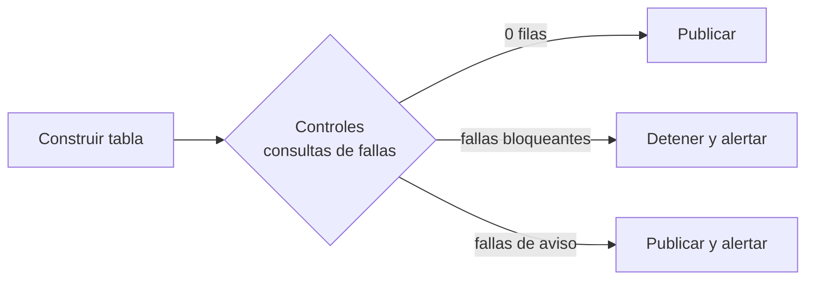

## 1. Resumen

Un control de calidad en SQL es una **consulta que devuelve las filas que violan una regla**: claves duplicadas, nulos donde no deben estar, pedidos sin cliente, montos negativos o datos atrasados. Cero filas significa que la regla se cumple.

Esa forma es la que usan las herramientas:

- dbt define sus data tests como consultas que buscan registros que fallan;
- las aserciones manuales de Dataform deben devolver cero filas;
- `ASSERT` de BigQuery falla si su expresión no es verdadera.

En warehouses cloud, estos controles **no son opcionales**. Cada motor documenta su caso:

- **BigQuery** no aplica las claves primarias ni foráneas, y las consultas sobre tablas que las violan pueden dar resultados incorrectos;
- **Redshift** trata la unicidad, la clave primaria y la clave foránea como informativas (sí aplica `NOT NULL`), y advierte resultados incorrectos si no son válidas;
- **Fabric Warehouse** admite `PRIMARY KEY` y `UNIQUE` solo como `NONCLUSTERED` y `NOT ENFORCED`, y `FOREIGN KEY` solo como `NOT ENFORCED`.

## 2. Qué es

| Regla | Consulta de control (devuelve fallas) |
|---|---|
| Unicidad | `GROUP BY clave HAVING COUNT(*) > 1` |
| No nulo | `WHERE col IS NULL` |
| Integridad referencial | Anti-join con `NOT EXISTS` (ver `sql-joins`) |
| Valores aceptados o rango | `WHERE col NOT IN (...)` o `WHERE monto <= 0` |
| Frescura | `MAX(cargado_en)` más antiguo que el umbral |
| Volumen | Conteo del día fuera del rango esperado |

Las herramientas los empaquetan:

- dbt: `unique`, `not_null`, `accepted_values` y `relationships`;
- Dataform: `uniqueKey`, `nonNull` y `rowConditions`.

## 3. Problema que resuelve

Los errores de datos no detienen los pipelines: llegan duplicados, nulos o claves huérfanas y los reportes siguen funcionando con números incorrectos. Los controles convierten esas reglas en verificaciones automáticas que detienen o alertan antes de que el dato llegue al consumidor.

## 4. Cómo funciona

1. **Escribir la regla como consulta de fallas.** La consulta devuelve las filas problemáticas, lo que además sirve para investigar.
2. **Ejecutarla en el pipeline, después de construir la tabla y antes de publicarla:**
   - en BigQuery, `ASSERT (SELECT COUNT(*) …) = 0 AS 'descripción'` falla con un error;
   - en Dataform, una aserción integrada o manual;
   - en dbt, `dbt test`.
3. **Decidir la severidad:** algunos controles detienen la publicación (error) y otros solo alertan. En dbt se configura como `warn` o `error`.
4. **No confiar en restricciones no aplicadas:**
   - BigQuery y Redshift usan las claves declaradas para optimizar, pero no las verifican;
   - Redshift advierte que, si no son válidas, consultas como `SELECT DISTINCT` pueden devolver duplicados;
   - Fabric solo admite claves `NOT ENFORCED`.

   PostgreSQL sí aplica `CHECK`, `UNIQUE` y claves foráneas al escribir.

## 5. Cuándo utilizarlo

- En cada tabla publicada: unicidad de la clave y no nulos en columnas obligatorias, como mínimo.
- En tablas con claves declaradas pero no aplicadas por el motor.
- Para frescura y volumen en cargas programadas.
- Como parte de un contrato de datos (ver `data-contracts`).

## 6. Cuándo no utilizarlo

- Para reemplazar restricciones que el motor sí aplica (`NOT NULL` en Redshift, `CHECK` en PostgreSQL): usar ambas, no solo el control.
- Para reglas que cambian a diario sin dueño: un control que siempre está en rojo deja de mirarse.
- Controles que escanean toda la historia en cada carga si basta con la partición nueva.

## 7. Ejemplo sencillo

```sql
-- Debe devolver cero filas: pedidos con la misma clave.
SELECT pedido_id, COUNT(*) AS veces
FROM pedidos
GROUP BY pedido_id
HAVING COUNT(*) > 1;
```

## 8. Ejemplo de producción

El modelo `fct_pedidos` de Dataform declara `uniqueKey: ["pedido_id"]`, `nonNull: ["pedido_id", "cliente_id"]` y una `rowCondition` `monto > 0`. Una aserción manual verifica que todo `cliente_id` exista en `dim_cliente`.

Un día la integridad referencial falla: llegaron pedidos de clientes creados después del corte de la dimensión. El equipo pasa ese control a severidad de alerta, porque es un caso de llegada tardía conocido, y deja la unicidad y los no nulos como bloqueantes.

## 9. Arquitectura



## 10. Código

```sql
-- PostgreSQL (ejecutado): varios controles en una consulta, con el número de fallas por regla.
SELECT 'clave única' AS control, COUNT(*) AS fallas
FROM (SELECT pedido_id FROM pedidos GROUP BY pedido_id HAVING COUNT(*) > 1) AS x
UNION ALL
SELECT 'cliente no nulo', COUNT(*) FROM pedidos WHERE cliente_id IS NULL
UNION ALL
SELECT 'cliente existe', COUNT(*)
FROM pedidos AS p
WHERE cliente_id IS NOT NULL
  AND NOT EXISTS (SELECT 1 FROM dim_cliente AS d WHERE d.cliente_id = p.cliente_id)
UNION ALL
SELECT 'monto positivo', COUNT(*) FROM pedidos WHERE monto <= 0;

-- BigQuery (sintaxis documentada; no ejecutado aquí): detener el script si hay duplicados.
-- ASSERT (SELECT COUNT(*) FROM (SELECT pedido_id FROM ventas.pedidos GROUP BY pedido_id HAVING COUNT(*) > 1)) = 0
--   AS 'pedido_id duplicado en ventas.pedidos';
```

```yaml
# dbt (sintaxis documentada; no ejecutado aquí): los cuatro tests genéricos.
models:
  - name: fct_pedidos
    columns:
      - name: pedido_id
        data_tests: [unique, not_null]
      - name: estado
        data_tests:
          - accepted_values:
              arguments:
                values: ['pagado', 'anulado']
      - name: cliente_id
        data_tests:
          - relationships:
              arguments:
                to: ref('dim_cliente')
                field: cliente_id
```

Con 5 pedidos de prueba (un `pedido_id` repetido, un cliente nulo, un cliente inexistente y un monto negativo), la consulta de PostgreSQL devolvió 1 falla en cada una de las cuatro reglas. Una restricción `CHECK (monto > 0)` de PostgreSQL rechazó el `INSERT` del monto negativo al escribir. Los ejemplos de BigQuery y dbt siguen la sintaxis de su documentación y no se ejecutaron.

## 11. GCP

En **BigQuery**, `ASSERT` falla si su expresión es `FALSE` o `NULL`, se factura como el `SELECT` de la expresión y nunca se cachea. Las claves primarias y foráneas no se aplican, y las consultas sobre tablas que las violan pueden dar resultados incorrectos.

**Dataform** ofrece aserciones integradas (`uniqueKey`, `uniqueKeys`, `nonNull`, `rowConditions`) y manuales, que deben devolver cero filas.

## 12. AWS

En **Redshift**, unicidad, clave primaria y clave foránea son informativas: los `INSERT` que las violan pueden tener éxito, y el planificador las usa igual, con riesgo de resultados incorrectos. La documentación recomienda declararlas solo si son válidas. `NOT NULL` sí se aplica. Los controles de unicidad e integridad referencial deben correr en el pipeline.

## 13. Azure

**Fabric Warehouse** solo admite `PRIMARY KEY` y `UNIQUE` como `NONCLUSTERED` y `NOT ENFORCED`, y `FOREIGN KEY` como `NOT ENFORCED`. No admite restricciones `DEFAULT`. Igual que en BigQuery y Redshift, las reglas se verifican con consultas de control (o dbt) y no con las restricciones.

## 14. Buenas prácticas

- Cada tabla publicada con, al menos, unicidad de la clave y no nulos en columnas obligatorias.
- Escribir los controles como consultas que devuelven las filas que fallan, no solo un conteo, para poder investigar.
- Separar controles bloqueantes de controles de aviso.
- Limitar los controles a la partición nueva cuando la regla lo permite.
- Declarar claves no aplicadas solo si se verifican con controles.
- **Seguridad:** las consultas de fallas devuelven datos reales; guardar sus resultados con los mismos permisos que la tabla controlada.
- **Observabilidad:** registrar el resultado de cada control por ejecución y su tendencia; un control que falla de a poco anticipa un problema mayor.
- **Costo:** cada control es una consulta; en BigQuery, `ASSERT` se factura como su `SELECT`, así que los controles sobre particiones nuevas cuestan mucho menos que sobre toda la tabla.

## 15. Errores frecuentes

- Confiar en una `PRIMARY KEY` declarada en BigQuery, Redshift o Fabric como si garantizara unicidad.
- Controles que solo cuentan, sin dejar ver qué filas fallaron.
- Todo bloqueante o todo aviso, sin distinguir severidad.
- Controles sobre toda la historia en cada carga.
- Olvidar que `col NOT IN (...)` no detecta los `NULL` (ver `sql-nulls`).

## 16. Trade-offs

Más controles detectan más problemas, a cambio de costo de cómputo y de alertas que hay que atender. Controles bloqueantes protegen a los consumidores a cambio de retrasar la publicación ante cualquier falla. Las restricciones aplicadas por el motor (PostgreSQL) detectan al escribir. En BigQuery, Redshift y Fabric Warehouse las claves se declaran pero no se aplican, cada uno con las particularidades de la sección 1, y el control pasa al pipeline.

## 17. Conceptos relacionados

- `data-reconciliation`: comparar origen y destino.
- `data-contracts`: estructura acordada.
- `sql-nulls`: reglas con `NULL`.
- `sql-joins`: anti-join para integridad referencial.

## 18. Preguntas técnicas abiertas

1. ¿Qué controles de tu pipeline son bloqueantes y cuáles de aviso, y por qué?
2. ¿Qué claves declaradas en tu warehouse no se verifican hoy con ningún control?
3. ¿Cómo limitarías tus controles a los datos nuevos sin perder detección?

## 19. Laboratorio relacionado

Pendiente (F4).

## 20. Fuentes

- Google Cloud: *Debugging statements* y *Use primary keys and foreign keys* (BigQuery); *Test data quality with assertions* (Dataform).
- dbt: *Add data tests to your DAG*.
- AWS: *Defining table constraints* (Amazon Redshift).
- Microsoft Learn: *Primary keys, foreign keys, and unique keys in Fabric Data Warehouse*.
- PostgreSQL: *Constraints*.

El detalle de cada fuente está en `sources` del frontmatter.

## 21. Fecha de última verificación

2026-10-07. Pasa a `verified`: revisión B-F3.1 del lote F3b-02c aplicada, sin VERIFY pendientes.

## 22. Historial de cambios importantes

- 2026-10-05: esqueleto creado desde el blueprint (rama `f/sql`).
- 2026-10-07: ficha completa (lote F3b-02c, dominio 02-sql).
- 2026-10-07: revisión B-F3.1 del lote F3b-02c aplicada (docs/reviews/cards-f3b-02c.md): claves no exigidas atribuidas por motor según su página (BigQuery: PK y FK; Redshift: unicidad, PK y FK informativas, NOT NULL aplicado; Fabric: PK y UNIQUE NONCLUSTERED NOT ENFORCED, FK NOT ENFORCED); sin «no existen».
- 2026-10-07: `verification_status: verified` (sin VERIFY pendientes).
