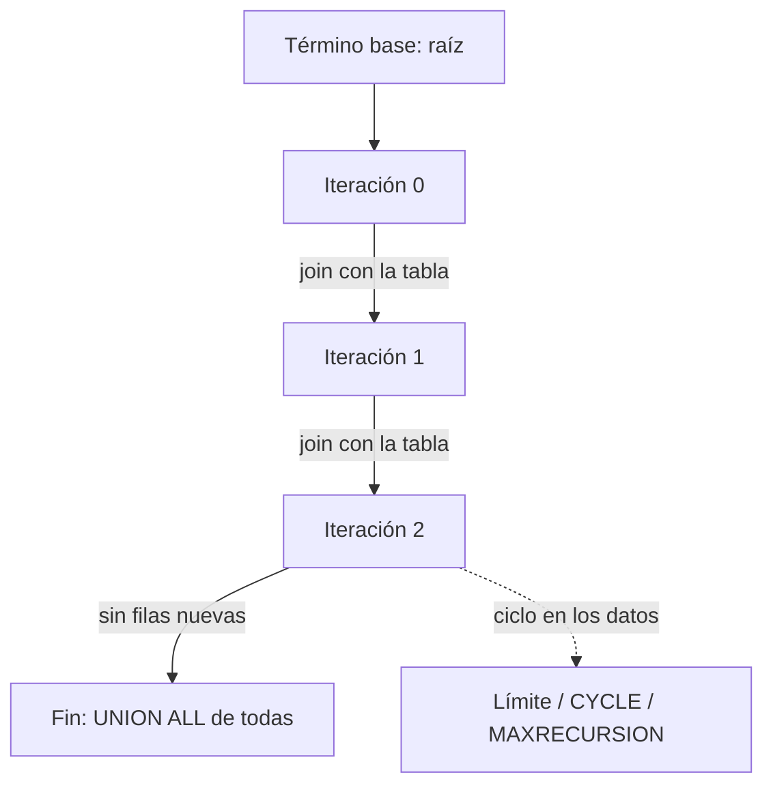

## 1. Resumen

Una CTE recursiva (`WITH RECURSIVE`) recorre estructuras de profundidad variable: un organigrama, un árbol de categorías o los enlaces de un grafo.

Tiene dos partes unidas por `UNION ALL`:

- un **término base**, que da el punto de partida (por ejemplo, el gerente general);
- un **término recursivo**, que une la tabla con las filas de la iteración anterior (los subordinados de los ya encontrados).

El motor repite hasta que una iteración no produce filas.

El riesgo es un **ciclo** (A reporta a B, B reporta a A): la consulta no termina o termina por un límite. La admiten BigQuery, Redshift y PostgreSQL. Fabric Warehouse lista las consultas recursivas entre lo que no admite.

## 2. Qué es

| Motor | Soporte | Límites y control |
|---|---|---|
| BigQuery | `WITH RECURSIVE` en el nivel superior | No en funciones ni vistas materializadas |
| Redshift | `WITH RECURSIVE` con `UNION ALL` | Lista de columnas obligatoria; sin `ORDER BY`/`LIMIT` en el miembro recursivo; no dentro de subconsultas |
| T-SQL | Miembro ancla y miembro recursivo | `MAXRECURSION`, 100 por defecto |
| Fabric Warehouse | No admite consultas recursivas | Aplanar la jerarquía al cargar |
| PostgreSQL | `WITH RECURSIVE` | `CYCLE` y `SEARCH`; `LIMIT` para probar |

## 3. Problema que resuelve

Un join resuelve una cantidad fija de niveles. Una jerarquía real tiene profundidad variable y cambia con el tiempo. La CTE recursiva recorre todos los niveles sin saber cuántos hay.

## 4. Cómo funciona

1. **Término base:** se ejecuta una vez y sus filas forman el resultado inicial.
2. **Término recursivo:** se ejecuta sobre las filas nuevas de la iteración anterior. PostgreSQL lo describe como una tabla de trabajo que se reemplaza en cada paso. BigQuery y Redshift lo describen igual: cada iteración alimenta la siguiente.
3. **Fin:** cuando una iteración no produce filas nuevas.
4. **Ciclos:** si los datos tienen un ciclo, cada iteración vuelve a producir filas. Las defensas dependen del motor:
   - `CYCLE` en PostgreSQL;
   - `MAXRECURSION` en T-SQL;
   - una profundidad máxima en la condición del término recursivo, en cualquier motor.
5. **`UNION` frente a `UNION ALL`:** en PostgreSQL, `UNION` descarta duplicados en cada paso. Redshift exige `UNION ALL`.

## 5. Cuándo utilizarlo

- Recorrer jerarquías: organigramas, árboles de categorías o cuentas contables.
- Calcular rutas o alcanzabilidad en grafos pequeños o medianos.
- Generar series cuando no hay una función para eso.

## 6. Cuándo no utilizarlo

- En Fabric Warehouse, que no admite consultas recursivas: aplanar la jerarquía al cargar (columnas `nivel_1`, `nivel_2`… o una tabla puente).
- Grafos muy grandes o densos: el número de filas por iteración puede crecer mucho.
- Cuando la jerarquía se consulta a menudo y cambia poco: es mejor aplanarla una vez al cargar que recorrerla en cada consulta.

## 7. Ejemplo sencillo

```sql
WITH RECURSIVE n(i) AS (
  SELECT 1
  UNION ALL
  SELECT i + 1 FROM n WHERE i < 5
)
SELECT i FROM n;   -- 1, 2, 3, 4, 5
```

## 8. Ejemplo de producción

La dimensión de productos tiene una jerarquía de categorías de profundidad variable. Un modelo diario recorre la jerarquía con una CTE recursiva y escribe una tabla puente (`categoria`, `ancestro`, `distancia`), que los reportes usan con un join simple.

El modelo limita la profundidad a 20 niveles en la condición recursiva. Un control aparte cuenta las categorías que alcanzan ese límite: si aparece alguna, hay un ciclo en los datos de origen y la carga se detiene.

## 9. Arquitectura



## 10. Código

```sql
-- PostgreSQL (ejecutado). 1) Organigrama con nivel y ruta.
WITH RECURSIVE cadena AS (
  SELECT id, nombre, jefe_id, 0 AS nivel, nombre::text AS ruta
  FROM empleados
  WHERE jefe_id IS NULL
  UNION ALL
  SELECT e.id, e.nombre, e.jefe_id, c.nivel + 1, c.ruta || ' > ' || e.nombre
  FROM empleados AS e
  JOIN cadena AS c ON e.jefe_id = c.id
)
SELECT id, nivel, ruta FROM cadena ORDER BY ruta;

-- 2) Grafo con un ciclo 1 → 2 → 3 → 1: CYCLE (PostgreSQL) lo detecta y corta.
WITH RECURSIVE camino(nodo, pasos) AS (
  SELECT 1, 0
  UNION ALL
  SELECT l.hacia, c.pasos + 1 FROM enlaces AS l JOIN camino AS c ON l.desde = c.nodo
) CYCLE nodo SET es_ciclo USING ruta
SELECT nodo, pasos, es_ciclo FROM camino ORDER BY pasos;
```

- **Consulta 1:** recorre 5 empleados en 4 niveles, hasta "Gerente > Jefa A > Analista > Practicante".
- **Consulta 2:** devuelve los nodos 1, 2 y 3, y una cuarta fila con el nodo 1 marcada `es_ciclo = true`, en la que se detiene. Sin `CYCLE` ni un límite de pasos, no terminaría.

En BigQuery y Redshift, la defensa portable es una condición de profundidad (`WHERE c.pasos < 20`) en el término recursivo.

## 11. GCP

En **BigQuery**, `WITH RECURSIVE` tiene un término base, un operador `UNION` y un término recursivo. Con `UNION ALL`, cada iteración alimenta la siguiente hasta que una no produce filas. Solo va en el nivel superior de la consulta, no se admite en funciones ni en vistas materializadas, y sus resultados se materializan, a diferencia de las CTE no recursivas.

## 12. AWS

**Redshift** exige `UNION ALL` entre el miembro inicial y el recursivo, la lista de columnas de la CTE y una condición `WHERE` que termine la recursión. El miembro recursivo no admite `ORDER BY` ni `LIMIT`, y `WITH RECURSIVE` no puede ir dentro de una subconsulta.

## 13. Azure

**Fabric Warehouse** lista las consultas recursivas entre los comandos que no admite actualmente. Las jerarquías se aplanan al cargar o se resuelven antes de llegar al warehouse.

En otros entornos T-SQL, la documentación de `WITH` describe miembros ancla y recursivo y limita la recursión con `MAXRECURSION`, 100 niveles por defecto. Que un motor no admita una construcción es una diferencia real entre nubes, no solo de sintaxis.

## 14. Buenas prácticas

- Limitar siempre la profundidad o detectar ciclos.
- Llevar en cada fila el nivel y la ruta, para depurar y para detectar ciclos.
- Probar con `LIMIT` en la consulta externa mientras se desarrolla, como sugiere PostgreSQL.
- Si la jerarquía se consulta a menudo, materializarla como tabla puente.
- **Seguridad:** recorrer un organigrama puede exponer relaciones de reporte; aplicar a la tabla puente los mismos permisos que a la tabla de origen.
- **Observabilidad:** registrar la profundidad máxima y las filas por iteración; un salto indica un ciclo o un cambio de datos.
- **Costo:** cada iteración es un join; una jerarquía mal acotada puede multiplicar filas y tiempo de cómputo.

## 15. Errores frecuentes

- Olvidar la condición de corte y crear un bucle infinito.
- Usar `UNION ALL` con datos que tienen ciclos o caminos repetidos y obtener filas duplicadas.
- Suponer que todos los motores admiten recursión: Fabric Warehouse no.
- Recalcular en cada consulta una jerarquía que cambia una vez al mes.

## 16. Trade-offs

La recursión al consultar siempre refleja los datos actuales, a cambio de costo por consulta y de riesgo de ciclos. Aplanar al cargar (tabla puente o columnas por nivel) da consultas simples y rápidas, a cambio de recalcular cuando la jerarquía cambia.

## 17. Conceptos relacionados

- `sql-cte`: CTE no recursivas.
- `sql-joins`: el join del término recursivo.
- `dimension-tables`: jerarquías dentro de dimensiones.

## 18. Preguntas técnicas abiertas

1. ¿Qué jerarquías de tu modelo tienen profundidad variable y cómo las consultas hoy?
2. ¿Cómo detectarías un ciclo introducido por un error en el sistema de origen?
3. Si tu warehouse no admite recursión, ¿dónde aplanarías la jerarquía?

## 19. Laboratorio relacionado

Pendiente (F4).

## 20. Fuentes

- Google Cloud: *Query syntax* (BigQuery).
- AWS: *WITH clause* (Amazon Redshift).
- PostgreSQL: *WITH Queries (Common Table Expressions)*.
- Microsoft Learn: *WITH common_table_expression (Transact-SQL)* y *T-SQL Surface Area in Fabric Data Warehouse*.

El detalle de cada fuente está en `sources` del frontmatter.

## 21. Fecha de última verificación

2026-10-07. Pasa a `verified`: revisión B-F3.1 del lote F3b-02b aplicada, sin VERIFY pendientes.

## 22. Historial de cambios importantes

- 2026-10-05: esqueleto creado desde el blueprint (rama `f/sql`).
- 2026-10-07: ficha completa (lote F3b-02b, dominio 02-sql).
- 2026-10-07: revisión B-F3.1 del lote F3b-02b aplicada (docs/reviews/cards-f3b-02b.md): sin cambios pedidos.
- 2026-10-07: `verification_status: verified` (sin VERIFY pendientes).
- 2026-10-13: `page_title` en cada cita, con el título de la página citada (ADR-012); sin cambios de contenido.
