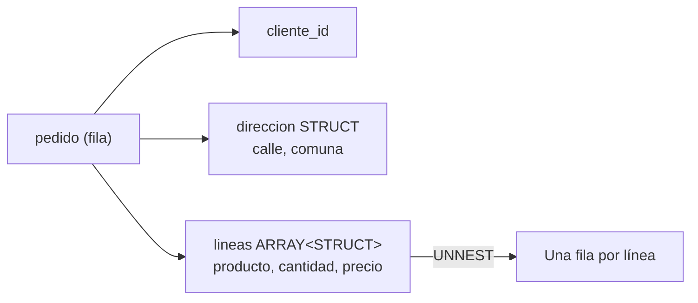

## 1. Resumen

Un `STRUCT` (en BigQuery; "tipo compuesto" en PostgreSQL) agrupa varios campos con nombre en una sola columna. Por ejemplo, `direccion STRUCT<calle STRING, comuna STRING>`. Combinado con arrays, `ARRAY<STRUCT<…>>` guarda una lista de registros dentro de la fila: un pedido con sus líneas, sin tabla de líneas aparte.

BigQuery recomienda este modelo de **columnas anidadas y repetidas** porque rinde mejor con datos desnormalizados. Es una recomendación de BigQuery, no una regla general: Redshift guarda estructuras en `SUPER` sin esquema, y Fabric Warehouse no tiene un tipo struct para tablas.

## 2. Qué es

| Motor | Estructura | Lista de estructuras | Acceso |
|---|---|---|---|
| BigQuery | `STRUCT<…>` (columna `RECORD`) | `ARRAY<STRUCT<…>>` (`RECORD` en modo `REPEATED`) | `col.campo`; `UNNEST` para la lista |
| Redshift | Objeto dentro de `SUPER` | Array dentro de `SUPER` | Punto y corchetes (PartiQL) |
| Fabric Warehouse | Sin tipo struct; JSON en `varchar` | JSON en `varchar` | `OPENJSON … WITH (columnas)` |
| PostgreSQL | Tipo compuesto (`CREATE TYPE`) | Array de tipo compuesto | `(col).campo` |

## 3. Problema que resuelve

Representa datos jerárquicos (un cliente con su dirección, un pedido con sus líneas) en la misma fila. Así evita joins al consultar y conserva la forma de los datos de origen, como JSON o Avro.

## 4. Cómo funciona

1. **Definir:** el struct tiene campos ordenados con tipo. En BigQuery el nombre del campo es opcional, y el tipo de cada campo puede ser otro struct o un array.
2. **Leer un campo:** `direccion.comuna` en BigQuery; `(dir).comuna` en PostgreSQL; punto o corchetes sobre `SUPER` en Redshift.
3. **Lista de structs:** se aplana con `UNNEST` y se leen los campos de cada elemento (ver `sql-unnest`).
4. **Comparar:** en BigQuery, la igualdad de structs es campo a campo en orden, ignorando los nombres, y no hay `<` ni `>`.
5. **Límites de BigQuery:**
   - hasta 15 niveles de `RECORD` anidados;
   - `RECORD` no se puede usar con `UNION`, `INTERSECT`, `EXCEPT DISTINCT` ni `SELECT DISTINCT`;
   - no se admiten structs anónimos en `GROUP BY`.

## 5. Cuándo utilizarlo

- En BigQuery, para relaciones uno a varios que se leen juntas (pedido y líneas), siguiendo su recomendación de desnormalizar.
- Para agrupar campos relacionados (dirección, coordenadas) y que el esquema sea legible.
- Para cargar datos jerárquicos (Avro, JSON) sin aplanarlos.

## 6. Cuándo no utilizarlo

- Cuando la parte anidada se actualiza por separado y con frecuencia, como el estado de una línea: actualizar una fila con todo su array es más caro que actualizar una fila de una tabla hija.
- Cuando el modelo debe ser portable a motores sin structs (Fabric Warehouse) o con otro modelo (Redshift `SUPER`).
- Si se necesita `SELECT DISTINCT` o `UNION DISTINCT` sobre esas columnas en BigQuery.

## 7. Ejemplo sencillo

```sql
-- PostgreSQL (ejecutado).
CREATE TYPE direccion AS (calle text, comuna text);
CREATE TABLE clientes_dir (cliente_id int, dir direccion);
INSERT INTO clientes_dir VALUES (1, ROW('Av. Uno 123', 'Ñuñoa')), (2, ROW('Calle Dos 45', NULL));
SELECT cliente_id, (dir).comuna FROM clientes_dir;   -- 1 Ñuñoa, 2 NULL
```

## 8. Ejemplo de producción

Una tabla de pedidos en BigQuery guarda `lineas ARRAY<STRUCT<producto_id STRING, cantidad INT64, precio NUMERIC>>`. Las consultas de ingreso por pedido no necesitan join: suman sobre `UNNEST(lineas)`.

Al exportar a Fabric Warehouse para otro equipo, las líneas se guardan como JSON en `varchar` y se leen con `OPENJSON … WITH (producto_id varchar(20), cantidad int, precio decimal(12,2))`. La lógica se mantiene; el tipo y la sintaxis cambian.

## 9. Arquitectura



## 10. Código

```sql
-- 1) BigQuery: tabla con columnas anidadas y repetidas y consulta de ingreso por pedido
--    (sintaxis documentada; no ejecutado aquí, requiere GCP).
CREATE TABLE ventas.pedidos (
  pedido_id STRING NOT NULL,
  direccion STRUCT<calle STRING, comuna STRING>,
  lineas    ARRAY<STRUCT<producto_id STRING, cantidad INT64, precio NUMERIC>>
);

SELECT p.pedido_id,
       p.direccion.comuna,
       SUM(l.cantidad * l.precio) AS ingreso
FROM ventas.pedidos AS p
LEFT JOIN UNNEST(p.lineas) AS l
GROUP BY p.pedido_id, p.direccion.comuna;
```

La consulta usa `LEFT JOIN` para no perder los pedidos sin líneas (ver `sql-unnest`). No se ejecutó: requiere BigQuery, y la sintaxis se tomó de su documentación de tipos y de columnas anidadas y repetidas. El equivalente con tipos compuestos de PostgreSQL de la sección 7 sí se ejecutó.

## 11. GCP

**BigQuery** documenta `STRUCT` y las columnas `RECORD` y `REPEATED`. Recomienda desnormalizar con columnas anidadas y repetidas en lugar de mantener un esquema en estrella o copo de nieve, porque mantienen las relaciones sin el impacto de rendimiento de un esquema normalizado.

Límites: 15 niveles de `RECORD` anidados, incompatibilidad con `UNION`, `INTERSECT`, `EXCEPT DISTINCT` y `SELECT DISTINCT`, y nada de structs anónimos en `GROUP BY`. El detalle del dialecto corresponde a `bigquery-sql-dialect` del dominio 08.

## 12. AWS

**Redshift** no tiene un tipo struct tipado: guarda objetos y arrays dentro de `SUPER` y los navega con notación de punto y corchetes (PartiQL). Recorre los arrays anidados en el `FROM`. El esquema no se declara; se resuelve al consultar.

## 13. Azure

**Fabric Warehouse** no lista tipos struct para tablas. El equivalente es guardar JSON en `varchar` y leerlo con `OPENJSON … WITH (…)`, que declara al leer las columnas, sus tipos y, si hace falta, las rutas JSON.

## 14. Buenas prácticas

- En BigQuery, anidar lo que se lee junto y mantener en tablas aparte lo que se actualiza por separado.
- Nombrar todos los campos del struct, aunque BigQuery permita omitirlos.
- No superar unos pocos niveles de anidación: cada nivel complica las consultas.
- Documentar la forma anidada en el catálogo de datos; no es evidente para quien solo ve el nombre de la columna.
- **Seguridad:** las políticas por columna aplican sobre la columna struct o sus campos según el motor; revisar que un campo sensible dentro de un struct quede protegido.
- **Observabilidad:** validar en la carga el esquema de los structs que llegan del origen; un campo nuevo o con otro tipo cambia el struct.
- **Costo:** en motores columnares, leer un campo de un struct puede leer solo ese campo o toda la columna, según el motor; revisar el costo de las consultas que solo usan un campo.

## 15. Errores frecuentes

- Agregar `SELECT DISTINCT` a una consulta con columnas `RECORD` en BigQuery.
- Comparar structs suponiendo que se comparan por nombre de campo: BigQuery compara por orden.
- Perder pedidos sin líneas al aplanar con `CROSS JOIN`.
- Suponer que el modelo anidado de BigQuery se traslada tal cual a Redshift o Fabric.

## 16. Trade-offs

Las columnas anidadas y repetidas evitan joins y conservan la forma del origen, a cambio de actualizaciones más caras de las partes internas y de menor portabilidad. El modelo dimensional (`star-schema`) es portable y fácil de actualizar por tabla, a cambio de joins. BigQuery recomienda el primero para su motor; no lo presenta como reemplazo general del segundo.

## 17. Conceptos relacionados

- `sql-arrays`: listas de valores.
- `sql-unnest`: aplanar arrays de structs.
- `star-schema`: el modelo normalizado que BigQuery propone desnormalizar.
- `bigquery-sql-dialect`: GoogleSQL, el dialecto de BigQuery.

## 18. Preguntas técnicas abiertas

1. ¿Qué relaciones de tu modelo anidarías en BigQuery y cuáles dejarías en tablas aparte?
2. ¿Cómo manejarías un campo nuevo que aparece dentro de un struct de origen?
3. ¿Cómo trasladarías un `ARRAY<STRUCT>` a un motor sin structs?

## 19. Laboratorio relacionado

Pendiente (F4).

## 20. Fuentes

- Google Cloud: *Data types*, *Specify nested and repeated columns in table schemas* y *Query syntax* (BigQuery).
- AWS: *Querying semi-structured data* (Amazon Redshift).
- Microsoft Learn: *OPENJSON (Transact-SQL)* y *Data Types in Fabric Data Warehouse*.
- PostgreSQL: *Composite Types*.

El detalle de cada fuente está en `sources` del frontmatter.

## 21. Fecha de última verificación

2026-10-07. Pasa a `verified`: revisión B-F3.1 del lote F3b-02a aplicada, sin VERIFY pendientes.

## 22. Historial de cambios importantes

- 2026-10-05: esqueleto creado desde el blueprint (rama `f/sql`), con la nota "el modelo ARRAY/STRUCT de BigQuery no es el de Redshift ni el de Fabric".
- 2026-10-06: ficha completa (lote F3b-02a, dominio 02-sql).
- 2026-10-07: revisión B-F3.1 del lote F3b-02a aplicada (docs/reviews/cards-f3b-02a.md): §13 sin la frase de validación de esquema; describe solo lo que dicen las páginas de tipos de Fabric y de `OPENJSON`.
- 2026-10-07: `verification_status: verified` (sin VERIFY pendientes).
- 2026-10-11: «pendiente de ficha» actualizado: la ficha ya existe (lote F3b-08a); el §17 la enlaza y relations la incluye: relations incluye `bigquery-sql-dialect`, que el §17 nombra; §17 enlaza las fichas que ya existen.
- 2026-10-13: `page_title` en cada cita, con el título de la página citada (ADR-012); sin cambios de contenido.
