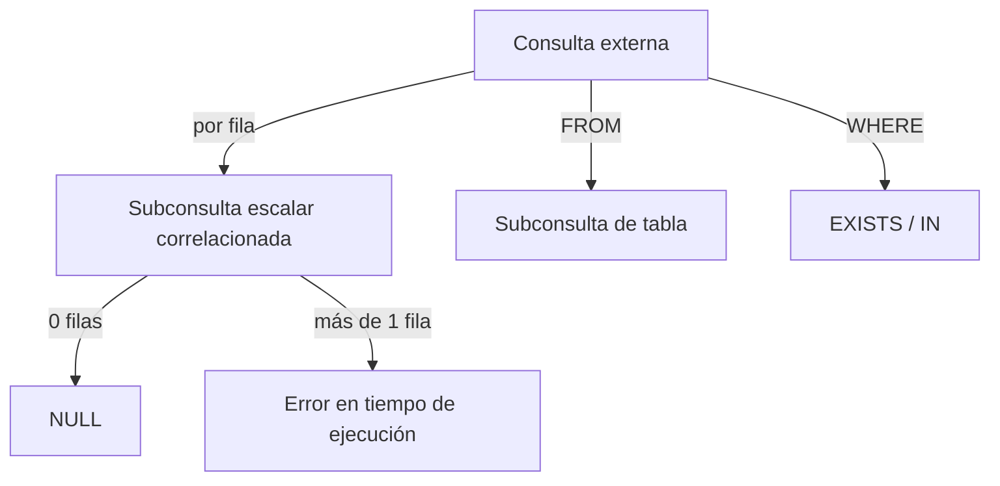

## 1. Resumen

Una subconsulta es un `SELECT` dentro de otra consulta. Según dónde va y qué devuelve:

- **escalar**: un valor, por ejemplo en el `SELECT` o en una comparación;
- **de tabla**: un conjunto de filas en `FROM`;
- **de pertenencia**: con `EXISTS`, `IN` o `NOT IN`.

Si referencia columnas de la consulta externa es **correlacionada**: lógicamente se evalúa una vez por fila externa.

Dos reglas evitan la mayoría de los problemas:

- una subconsulta escalar que devuelve más de una fila produce un error en tiempo de ejecución, y una que no devuelve filas da `NULL`;
- `NOT IN` con un `NULL` en la subconsulta no devuelve nada (ver `sql-nulls`).

## 2. Qué es

Es SQL consolidado y portable:

| Tipo | Dónde | Devuelve |
|---|---|---|
| Escalar | `SELECT`, `WHERE`, expresiones | Un valor; `NULL` si no hay filas; error si hay más de una |
| De tabla (derivada) | `FROM (...) AS alias` | Una tabla |
| `EXISTS` | `WHERE` | Verdadero si hay al menos una fila |
| `IN` | `WHERE` | Pertenencia a una columna de valores |
| `ARRAY` (BigQuery) | Expresión | Un array; vacío si no hay filas, nunca `NULL` |

## 3. Problema que resuelve

Permite usar el resultado de una consulta dentro de otra sin crear tablas intermedias: comparar con un promedio, filtrar por pertenencia u obtener el último valor relacionado de cada fila.

## 4. Cómo funciona

1. **Escalar:** el motor la evalúa y usa su valor. BigQuery y Redshift documentan el mismo comportamiento: `NULL` con cero filas y error con más de una.
2. **De tabla:** el resultado se trata como una tabla con alias.
3. **Correlacionada:** la subconsulta referencia columnas de la consulta externa, así que su resultado depende de cada fila. BigQuery indica que la correlación impide reutilizar el resultado. El optimizador puede reescribirla como join, pero no hay que suponerlo.
4. **`IN` y `NULL`:** PostgreSQL documenta que `IN` da nulo si no hay iguales y alguna fila de la subconsulta es nula. Por eso `NOT IN` puede descartar todas las filas.

## 5. Cuándo utilizarlo

- Comparar contra un valor agregado: "pedidos por sobre el promedio".
- Pertenencia sin duplicar filas: `EXISTS`.
- Un valor relacionado por fila cuando el volumen es acotado, como "fecha del último pedido de cada cliente".

## 6. Cuándo no utilizarlo

- Subconsultas anidadas en varios niveles: una CTE (`sql-cte`) se lee mejor.
- Una subconsulta correlacionada sobre tablas grandes cuando existe un join o una función de ventana equivalente que el motor ejecuta mejor; revisar el plan.
- `NOT IN` sobre columnas que admiten `NULL`: usar `NOT EXISTS`.

## 7. Ejemplo sencillo

```sql
SELECT pedido_id, monto
FROM pedidos
WHERE monto > (SELECT AVG(monto) FROM pedidos);
```

## 8. Ejemplo de producción

Un modelo calcula, para cada cliente, la fecha de su último pedido con una subconsulta escalar correlacionada. Funciona hasta que alguien la cambia para devolver `pedido_id` en lugar de `MAX(creado_en)`: sin agregación, el primer cliente con dos pedidos hace fallar la consulta con un error de más de una fila. El equipo la reescribe con una función de ventana, que no depende de que la subconsulta devuelva una sola fila.

## 9. Arquitectura



## 10. Código

```sql
-- PostgreSQL (ejecutado). BigQuery y Redshift documentan el mismo comportamiento de las subconsultas escalares.
-- 1) Escalar no correlacionada: pedidos pagados por sobre el promedio de los pagados.
SELECT p.pedido_id, p.monto
FROM pedidos AS p
WHERE p.estado = 'pagado'
  AND p.monto > (SELECT AVG(monto) FROM pedidos WHERE estado = 'pagado');

-- 2) Escalar correlacionada: último pedido de cada cliente (NULL si no tiene).
SELECT c.nombre,
       (SELECT MAX(p.creado_en) FROM pedidos AS p WHERE p.cliente_id = c.cliente_id) AS ultimo_pedido
FROM clientes AS c;

-- 3) Escalar que devuelve más de una fila: error en tiempo de ejecución.
SELECT (SELECT pedido_id FROM pedidos WHERE cliente_id = 1) AS uno;
```

Resultados con los datos de prueba:

- la consulta 1 devuelve los pedidos de 100.00 y 70.00 (el promedio de los pagados es 55);
- la 2 devuelve una fila por cliente, con `NULL` para los que no tienen pedidos;
- la 3 falla con *more than one row returned by a subquery used as an expression*. BigQuery y Redshift documentan un error equivalente.

## 11. GCP

**BigQuery** clasifica las subconsultas en de expresión (escalar, `ARRAY`, `EXISTS`, `IN`) y de tabla (solo en `FROM`). Una subconsulta escalar debe seleccionar una sola columna: con cero filas da `NULL` y con más de una falla en tiempo de ejecución.

La subconsulta `ARRAY` devuelve un array vacío, nunca `NULL`, cuando no hay filas. La documentación advierte que la correlación impide reutilizar el resultado de la subconsulta.

## 12. AWS

**Redshift** documenta la subconsulta escalar igual: un valor, `NULL` con cero filas y error con más de una. Además, no es válida como valor por defecto ni en `GROUP BY` y `HAVING`.

## 13. Azure

La página de subconsultas de **SQL Server** aplica a Azure Synapse Analytics, pero no menciona Warehouse en Fabric. Dice que muchas subconsultas se pueden escribir como joins y que normalmente no hay diferencia de rendimiento. La excepción son algunos casos de comprobación de existencia, en que un join rinde mejor. Para Fabric Warehouse no hay en esta ficha una fuente específica sobre subconsultas.

## 14. Buenas prácticas

- Subconsultas escalares solo sobre expresiones que garanticen una fila: agregaciones o claves únicas.
- `EXISTS` y `NOT EXISTS` para pertenencia.
- Pasar a CTE las subconsultas que se anidan o se repiten.
- Revisar el plan de las subconsultas correlacionadas sobre tablas grandes.
- **Seguridad:** una subconsulta lee tablas con los permisos de quien ejecuta la consulta, igual que el resto de la sentencia.
- **Observabilidad:** un error de "más de una fila" en producción indica que se rompió un supuesto de unicidad en los datos; registrarlo como incidente de calidad, no solo como fallo técnico.
- **Costo:** una subconsulta correlacionada que el motor no reescribe puede leer la tabla interna muchas veces; comparar con la versión con join o ventana.

## 15. Errores frecuentes

- Subconsulta escalar sin agregación que un día devuelve dos filas.
- `NOT IN` con `NULL`.
- Confiar en que el motor reescribirá una subconsulta correlacionada sin revisar el plan.
- Anidar tres niveles de subconsultas en `FROM`.

## 16. Trade-offs

La subconsulta es local y explícita. La CTE da nombre y orden a la consulta. El join suele ser la forma que el optimizador trata mejor, aunque puede duplicar filas si la clave no es única. Para "el último de cada grupo", una función de ventana evita tanto la correlación como el riesgo de varias filas.

## 17. Conceptos relacionados

- `sql-cte`: subconsultas con nombre.
- `sql-joins`: alternativa con join; semi-joins y anti-joins.
- `sql-nulls`: `NULL` en subconsultas escalares y en `IN`.
- `sql-window-functions`: alternativa para "el último de cada grupo".

## 18. Preguntas técnicas abiertas

1. ¿Cómo reescribirías una subconsulta correlacionada como join sin cambiar el resultado si la clave no es única?
2. ¿Qué garantiza que una subconsulta escalar devuelva una sola fila hoy y mañana?
3. ¿Cómo compararías el plan de una subconsulta con `EXISTS` y el de un join equivalente?

## 19. Laboratorio relacionado

Pendiente (F4).

## 20. Fuentes

- Google Cloud: *Subqueries* (BigQuery).
- AWS: *Scalar subqueries* (Amazon Redshift).
- PostgreSQL: *Subquery Expressions*.
- Microsoft Learn: *Subqueries (SQL Server)*.

El detalle de cada fuente está en `sources` del frontmatter.

## 21. Fecha de última verificación

2026-10-07. Pasa a `verified`: revisión B-F3.1 del lote F3b-02a aplicada, sin VERIFY pendientes.

## 22. Historial de cambios importantes

- 2026-10-05: esqueleto creado desde el blueprint (rama `f/sql`).
- 2026-10-06: ficha completa (lote F3b-02a, dominio 02-sql).
- 2026-10-07: revisión B-F3.1 del lote F3b-02a aplicada (docs/reviews/cards-f3b-02a.md): §10 deja de atribuir a T-SQL el comportamiento del ejemplo.
- 2026-10-07: `verification_status: verified` (sin VERIFY pendientes).
- 2026-10-13: `page_title` en cada cita, con el título de la página citada (ADR-012); sin cambios de contenido.
