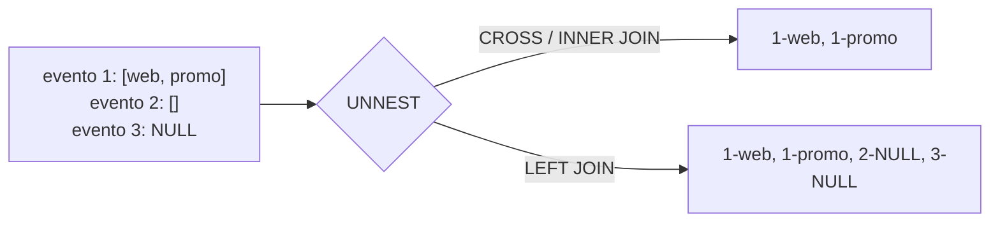

## 1. Resumen

`UNNEST` convierte un array en filas: un pedido con `etiquetas = ['web', 'promo']` pasa a ser dos filas, una por etiqueta. Se combina con un join **correlacionado**: por cada fila de la tabla, se expande su propio array.

Dos detalles definen si el resultado es correcto:

- **Arrays vacíos o `NULL`:** con `CROSS JOIN` o `INNER JOIN` la fila desaparece; con `LEFT JOIN … ON TRUE` se conserva con `NULL`.
- **Orden:** BigQuery documenta que `UNNEST` destruye el orden de los elementos. Para conservarlo se pide la posición con `WITH OFFSET`, o `WITH ORDINALITY` en PostgreSQL.

## 2. Qué es

Es la operación para leer datos anidados: eventos con listas de etiquetas, pedidos con sus líneas o respuestas JSON con arrays. Cada motor la ofrece con su sintaxis:

| Motor | Forma |
|---|---|
| BigQuery | `FROM t, UNNEST(t.arr) AS x` o `LEFT JOIN UNNEST(t.arr) AS x`, con `WITH OFFSET` |
| Redshift (SUPER) | Sintaxis PartiQL en el `FROM` u operación `UNNEST` |
| Athena | `CROSS JOIN UNNEST(arr) AS t(x)`; `flatten` para unir arrays anidados |
| Fabric Warehouse | Sin tipo array; `OPENJSON` expande un array JSON guardado como texto |
| PostgreSQL | `unnest(arr)`, con `LATERAL` y `WITH ORDINALITY` |

## 3. Problema que resuelve

Los datos anidados son compactos y se cargan tal como llegan, pero las agregaciones, los joins y los filtros trabajan sobre filas. `UNNEST` es el puente: permite contar etiquetas, unir líneas de pedido con productos o filtrar por un elemento del array.

## 4. Cómo funciona

1. Por cada fila de la tabla, el motor expande su array en tantas filas como elementos tenga.
2. Las columnas de la fila original se repiten en cada fila expandida.
3. **Vacíos y `NULL`:** BigQuery documenta que los arrays vacíos y `NULL` producen cero filas. Un `INNER` o `CROSS JOIN` elimina entonces la fila original; un `LEFT JOIN` la conserva con el elemento en `NULL`. Un elemento `NULL` dentro del array sí produce una fila, con `NULL`.
4. **Posición:** `WITH OFFSET` (BigQuery, desde 0) o `WITH ORDINALITY` (PostgreSQL, desde 1) agregan la posición del elemento.

## 5. Cuándo utilizarlo

- Contar o filtrar por elementos de un array: eventos con la etiqueta `promo`.
- Pasar de un modelo anidado (pedido con líneas) a uno plano para un join.
- Procesar respuestas JSON con listas.

## 6. Cuándo no utilizarlo

- Para buscar un elemento cuando el motor tiene una función o un operador de pertenencia: por ejemplo, `x = ANY (arr)` en PostgreSQL o `x IN UNNEST(arr)` en BigQuery, sin multiplicar filas.
- Para aplanar y luego volver a agrupar sin necesidad: muchas operaciones se resuelven con funciones de arrays.
- Con `CROSS JOIN` cuando las filas sin elementos deben seguir en el resultado.

## 7. Ejemplo sencillo

```sql
-- BigQuery (sintaxis documentada; no ejecutado aquí).
SELECT e.evento_id, etiqueta
FROM eventos AS e
LEFT JOIN UNNEST(e.etiquetas) AS etiqueta;
```

## 8. Ejemplo de producción

Un modelo cuenta eventos por etiqueta con `FROM eventos, UNNEST(etiquetas)`. El total de eventos del tablero no cuadraba con la tabla de origen: los eventos sin etiquetas desaparecían en el `CROSS JOIN` implícito de la coma. El conteo por etiqueta se mantuvo así, porque un evento sin etiquetas no tiene etiqueta que contar. El total de eventos pasó a calcularse sobre la tabla sin aplanar, y un control compara ambos.

## 9. Arquitectura



## 10. Código

```sql
-- 1) BigQuery: aplanar conservando eventos sin etiquetas y la posición
--    (sintaxis documentada; no ejecutado aquí, requiere GCP).
SELECT e.evento_id, etiqueta, pos
FROM eventos AS e
LEFT JOIN UNNEST(e.etiquetas) AS etiqueta WITH OFFSET AS pos
ORDER BY e.evento_id, pos;

-- 2) PostgreSQL (ejecutado): lo mismo con LATERAL y WITH ORDINALITY (posición desde 1).
SELECT e.evento_id, t.etiqueta, t.pos
FROM eventos AS e
LEFT JOIN LATERAL unnest(e.etiquetas) WITH ORDINALITY AS t(etiqueta, pos) ON true
ORDER BY e.evento_id, t.pos;

-- 3) PostgreSQL (ejecutado): con CROSS JOIN se pierden los eventos 2 (array vacío) y 3 (NULL).
SELECT e.evento_id, t.etiqueta
FROM eventos AS e
CROSS JOIN LATERAL unnest(e.etiquetas) AS t(etiqueta);
```

Datos de prueba: evento 1 con `['web', 'promo']`, evento 2 con array vacío y evento 3 con `NULL`.

- La consulta 2 devuelve 4 filas: `1-web-1`, `1-promo-2`, `2-NULL` y `3-NULL`.
- La consulta 3 devuelve 2 filas, solo las del evento 1.
- La consulta 1 debería devolver lo mismo que la 2 con posiciones desde 0, según la documentación de BigQuery; no se ejecutó.

## 11. GCP

En **BigQuery**, `UNNEST` destruye el orden de los elementos; `WITH OFFSET` lo recupera, con la columna `offset` desde 0. Los arrays vacíos y `NULL` producen cero filas, y aplanar con `INNER JOIN` excluye esas filas; `LEFT JOIN` las incluye. Un `UNNEST` correlacionado debe ir a la derecha de un `CROSS JOIN`, `LEFT JOIN` o `INNER JOIN`.

## 12. AWS

**Redshift** desanida arrays del tipo `SUPER` con la sintaxis de PartiQL en el `FROM` o con la operación `UNNEST`, que según su documentación dan el mismo resultado. **Athena** expande arrays con `CROSS JOIN UNNEST` y tiene `flatten` para unir arrays anidados en uno. En el ejemplo de su documentación, un array vacío no produce filas.

## 13. Azure

**Fabric Warehouse** no lista tipos array entre sus tipos de datos soportados para tablas (ver `sql-arrays`). Un array guardado como JSON en `varchar` se expande con `OPENJSON`, que devuelve una fila por elemento, con `key` (índice del elemento), `value` y `type`. Es un equivalente funcional, no el mismo tipo de dato.

## 14. Buenas prácticas

- Decidir explícitamente si las filas sin elementos deben quedar (`LEFT JOIN … ON TRUE`) o no (`CROSS JOIN`).
- Pedir la posición si el orden importa; no confiar en el orden de salida.
- Calcular los totales a nivel de la fila original sobre la tabla sin aplanar.
- **Seguridad:** al aplanar, los campos de la fila original se repiten en cada elemento; revisar que el resultado no exponga más filas con datos sensibles de las necesarias.
- **Observabilidad:** comparar el número de filas originales con el de filas aplanadas y con el de filas con array vacío.
- **Costo:** aplanar multiplica filas; filtrar antes y seleccionar solo las columnas necesarias reduce el volumen de los pasos siguientes.

## 15. Errores frecuentes

- Perder filas con arrays vacíos o `NULL` por usar la coma o `CROSS JOIN`.
- Sumar un monto de la fila original después de aplanar: se suma una vez por elemento.
- Suponer que el orden de salida es el del array.
- Mezclar posiciones desde 0 (BigQuery `OFFSET`) y desde 1 (PostgreSQL, `ORDINAL`).

## 16. Trade-offs

Mantener los datos anidados y aplanar al consultar conserva la estructura original y evita joins al cargar, a cambio de consultas más cuidadosas. Aplanar en la carga deja tablas simples para el consumidor, a cambio de duplicar las columnas de la fila original y de perder la estructura.

## 17. Conceptos relacionados

- `sql-arrays`: construcción y acceso a arrays.
- `sql-structs`: arrays de structs.
- `sql-joins`: joins correlacionados.

## 18. Preguntas técnicas abiertas

1. ¿Cómo comprobarías que una consulta con `UNNEST` no está perdiendo filas?
2. ¿Qué agregaciones calcularías antes de aplanar para no duplicar montos?
3. ¿Cuándo aplanarías en la carga y cuándo en la consulta?

## 19. Laboratorio relacionado

Pendiente (F4).

## 20. Fuentes

- Google Cloud: *Work with arrays* y *Query syntax* (BigQuery).
- AWS: *Querying semi-structured data* (Amazon Redshift) y *Flatten nested arrays* (Amazon Athena).
- Microsoft Learn: *OPENJSON (Transact-SQL)*.
- PostgreSQL: *Array Functions and Operators*.

El detalle de cada fuente está en `sources` del frontmatter.

## 21. Fecha de última verificación

2026-10-07. Pasa a `verified`: revisión B-F3.1 del lote F3b-02a aplicada, sin VERIFY pendientes.

## 22. Historial de cambios importantes

- 2026-10-05: esqueleto creado desde el blueprint (rama `f/sql`).
- 2026-10-06: ficha completa (lote F3b-02a, dominio 02-sql).
- 2026-10-07: revisión B-F3.1 del lote F3b-02a aplicada (docs/reviews/cards-f3b-02a.md): sin cambios pedidos.
- 2026-10-07: `verification_status: verified` (sin VERIFY pendientes).
