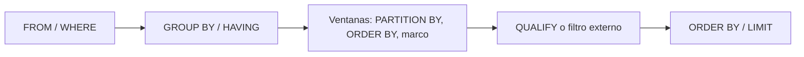

## 1. Resumen

Una función de ventana calcula un valor para cada fila a partir de un grupo de filas relacionadas, sin colapsarlas como hace `GROUP BY`. Con ella se escriben en una sola consulta los cálculos que más aparecen en datos: acumulados, medias móviles, variación contra el período anterior (`LAG`), rankings y "quedarse con la última versión" (`ROW_NUMBER`). Las tres decisiones son qué filas forman cada grupo (`PARTITION BY`), en qué orden (`ORDER BY`) y qué marco de filas mira cada cálculo (`ROWS` o `RANGE`).

## 2. Qué es

Es una capacidad estándar de SQL, disponible en BigQuery, Redshift, T-SQL (Synapse, Fabric Warehouse) y PostgreSQL. La documentación de BigQuery la llama también *función analítica*, y se trata del mismo mecanismo. Se reconoce por la cláusula `OVER (...)`:

```sql
función(argumentos) OVER (PARTITION BY ... ORDER BY ... ROWS|RANGE BETWEEN ... AND ...)
```

Hay tres familias: **agregaciones** en ventana (`SUM`, `AVG`, `COUNT`), **numeración** (`ROW_NUMBER`, `RANK`, `DENSE_RANK`) y **navegación** (`LAG`, `LEAD`, `FIRST_VALUE`, `LAST_VALUE`).

## 3. Problema que resuelve

Sin ventanas, un acumulado o la comparación con el día anterior exigen auto-joins o subconsultas correlacionadas: difíciles de leer, fáciles de equivocar y caras de ejecutar. Además, `GROUP BY` pierde el detalle de cada fila. Las ventanas conservan cada fila y le agregan el contexto de su grupo.

## 4. Cómo funciona

1. **Orden lógico:** primero `FROM`, `WHERE`, `GROUP BY` y `HAVING`, y después las ventanas. Por eso no se pueden usar en `WHERE`. Para filtrar por su resultado, se usa una subconsulta o CTE o, donde existe, `QUALIFY` (BigQuery, Redshift).
2. **`PARTITION BY`:** separa las filas en grupos independientes. Sin él, toda la entrada es una sola partición.
3. **`ORDER BY`:** ordena dentro de cada partición. Es obligatorio para la navegación y la numeración con sentido.
4. **Marco:** qué filas de la partición entran en el cálculo de cada fila.
   - `ROWS BETWEEN 6 PRECEDING AND CURRENT ROW`: las 7 filas físicas hasta la actual.
   - `RANGE BETWEEN 6 PRECEDING AND CURRENT ROW`: las filas cuyo valor de orden está a 6 unidades o menos. En BigQuery, `RANGE` exige una única expresión numérica en `ORDER BY`; para fechas se usa `UNIX_DATE(fecha)`.
   - **Marco por defecto:** con `ORDER BY` y sin marco, las agregaciones usan `RANGE BETWEEN UNBOUNDED PRECEDING AND CURRENT ROW` (un acumulado). Es así en BigQuery y en T-SQL.
5. **Determinismo:** si el `ORDER BY` tiene empates, `ROW_NUMBER` los numera en un orden no determinista. Hace falta una columna de desempate.

## 5. Cuándo utilizarlo

- Acumulados y medias móviles por entidad o período.
- Variación contra la fila anterior o siguiente (`LAG`, `LEAD`): crecimiento diario, tiempo entre eventos.
- Rankings y top-N por grupo.
- Deduplicación y "última versión por clave" (`ROW_NUMBER` + filtro).
- Cálculo de vigencias (`LEAD` de la fecha de inicio como fecha de fin) en SCD2.

## 6. Cuándo no utilizarlo

- Cuando solo se necesita el total por grupo: `GROUP BY` es más simple.
- Sobre particiones enormes sin filtrar (toda una tabla de eventos en una sola partición): cada partición se ordena completa; conviene filtrar antes y particionar por una clave razonable.
- Para filtrar en `WHERE`: no está permitido; usar `QUALIFY` o una CTE.

## 7. Ejemplo sencillo

| pais | dia | monto | acumulado | variación |
|---|---|---|---|---|
| CL | 2026-10-01 | 100 | 100 | null |
| CL | 2026-10-02 | 120 | 220 | 20 |
| CL | 2026-10-03 | 90 | 310 | −30 |

`acumulado = SUM(monto) OVER (PARTITION BY pais ORDER BY dia)` y `variación = monto − LAG(monto) OVER (PARTITION BY pais ORDER BY dia)`.

## 8. Ejemplo de producción

Una tabla de ventas diarias por tienda alimenta un tablero con la media móvil de 7 días y la variación contra el día anterior. La media se calcula con `RANGE` sobre `UNIX_DATE(dia)`, no con `ROWS`: si una tienda no vende un día y no tiene fila, `ROWS 6 PRECEDING` tomaría 7 filas que abarcan más de 7 días. La consulta filtra primero los últimos 37 días (30 visibles más 7 de contexto) para que el marco de los primeros días esté completo y no se ordene toda la historia.

## 9. Arquitectura



## 10. Código

```sql
-- BigQuery (ejecutable): acumulado, variación diaria, media móvil de 7 días de calendario y ranking.
WITH ventas AS (
  SELECT 'CL' AS pais, DATE '2026-10-01' AS dia, 100 AS monto UNION ALL
  SELECT 'CL', DATE '2026-10-02', 120 UNION ALL
  SELECT 'CL', DATE '2026-10-03', 90 UNION ALL
  SELECT 'PE', DATE '2026-10-01', 50 UNION ALL
  SELECT 'PE', DATE '2026-10-02', 70
)
SELECT
  pais, dia, monto,
  SUM(monto) OVER (PARTITION BY pais ORDER BY dia
                   ROWS BETWEEN UNBOUNDED PRECEDING AND CURRENT ROW) AS acumulado,
  monto - LAG(monto) OVER (PARTITION BY pais ORDER BY dia) AS variacion,
  -- RANGE sobre UNIX_DATE: 7 días de calendario aunque falten días; ROWS contaría 7 filas.
  AVG(monto) OVER (PARTITION BY pais ORDER BY UNIX_DATE(dia)
                   RANGE BETWEEN 6 PRECEDING AND CURRENT ROW) AS media_7d,
  RANK() OVER (PARTITION BY dia ORDER BY monto DESC) AS rank_del_dia
FROM ventas
ORDER BY pais, dia;
```

Resultado para CL: acumulado 100, 220 y 310; variación null, 20 y −30; media 100, 110 y 103,33. En el ranking del día, CL es 1 y PE es 2. La deduplicación con `ROW_NUMBER` y `QUALIFY` está en la ficha `deduplication` y en el snippet `bigquery-deduplicate-latest`.

## 11. GCP

**BigQuery** admite ventanas con nombre (cláusula `WINDOW`), marcos `ROWS` y `RANGE`, y `QUALIFY` para filtrar sin subconsulta. Diferencia a tener en cuenta: en `RANGE`, el `ORDER BY` debe ser una única expresión numérica, así que las fechas se convierten con `UNIX_DATE` y los timestamps con `UNIX_SECONDS` o similares. Las ventanas se evalúan después de `GROUP BY`, así que una agregación puede ser argumento de una ventana (por ejemplo, `SUM(SUM(monto)) OVER (...)`).

## 12. AWS

**Redshift** tiene las mismas familias de funciones, además de algunas propias (`RATIO_TO_REPORT`, `MEDIAN` como ventana). Las ventanas son las últimas operaciones antes del `ORDER BY` final. Admite `QUALIFY`, con un detalle propio: si va justo después del `FROM`, la tabla necesita alias.

## 13. Azure

En **T-SQL** (Synapse dedicated SQL pool, Fabric Warehouse) la cláusula es `OVER`, con el mismo marco por defecto que BigQuery (`RANGE UNBOUNDED PRECEDING AND CURRENT ROW` cuando hay `ORDER BY` sin marco). No hay `QUALIFY`: el filtro por el resultado de una ventana se escribe con una CTE o subconsulta. `ROW_NUMBER()` también es no determinista con empates.

## 14. Buenas prácticas

- Escribir el marco explícitamente cuando importa, sin depender del valor por defecto: `ROWS` y `RANGE` dan resultados distintos con empates o huecos.
- Usar `RANGE` sobre una fecha numérica para ventanas de calendario; `ROWS` para "las últimas N filas".
- Agregar siempre una columna de desempate al `ORDER BY` de `ROW_NUMBER`.
- Filtrar antes de la ventana (`WHERE`) para no ordenar más filas de las necesarias, dejando el contexto que el marco requiere.
- Reutilizar especificaciones con `WINDOW` cuando varias funciones comparten partición y orden.
- **Seguridad:** las ventanas no cambian el acceso a los datos, pero un ranking o un acumulado puede revelar información de otras filas (por ejemplo, la posición de un cliente); aplicar la seguridad a nivel de fila antes de calcular.
- **Observabilidad:** en consultas programadas, comparar el número de filas antes y después de un `QUALIFY` o filtro por ranking; un cambio brusco indica empates o duplicados nuevos.
- **Costo:** en BigQuery on-demand se paga por bytes leídos, no por la complejidad de la ventana; leer solo las columnas y particiones necesarias es lo que reduce el costo.

## 15. Errores frecuentes

- Confundir `ROWS` con `RANGE` y obtener "medias de 7 días" que abarcan más días.
- Olvidar que, con `ORDER BY` y sin marco, `SUM` se vuelve un acumulado.
- Usar `LAST_VALUE` con `ORDER BY` y el marco por defecto: el marco termina en la fila actual (incluidos sus empates), así que no devuelve la última de la partición. Hay que extender el marco hasta `UNBOUNDED FOLLOWING`.
- Intentar filtrar por una ventana en `WHERE`.
- `ROW_NUMBER` con empates en el orden: resultados que cambian entre ejecuciones.

## 16. Trade-offs

Las ventanas dan consultas más cortas y legibles que los auto-joins, y suelen ser más eficientes, pero cada partición se ordena: particiones muy grandes cuestan memoria y tiempo. `QUALIFY` simplifica, pero no existe en T-SQL, así que una consulta portable usa CTE.

## 17. Conceptos relacionados

- `deduplication`: `ROW_NUMBER` + filtro por clave.
- `scd-type-2`: vigencias con `LEAD`.
- `late-arriving-data`: ventanas de calendario y huecos.
- Del blueprint, pendiente de ficha: `sql-qualify`.

## 18. Preguntas técnicas abiertas

1. ¿Cómo calcularías el tiempo entre compras consecutivas de cada cliente?
2. Una media móvil "de 7 días" da valores raros en tiendas con días sin ventas. ¿Qué revisarías?
3. ¿Cómo obtendrías el top 3 de productos por categoría en un motor sin `QUALIFY`?

## 19. Laboratorio relacionado

Pendiente (F4).

## 20. Fuentes

- Google Cloud: *Window function calls*, *Navigation functions* y *Numbering functions* (BigQuery).
- PostgreSQL: *Window Functions* (tutorial).
- AWS: *Window functions* y *QUALIFY clause* (Amazon Redshift).
- Microsoft Learn: *OVER clause (Transact-SQL)* y *ROW_NUMBER (Transact-SQL)*.

El detalle de cada fuente está en `sources` del frontmatter.

## 21. Fecha de última verificación

2026-10-05. Pasa a `verified`: revisión B-F3.1 del lote 6 aplicada, sin VERIFY pendientes.

## 22. Historial de cambios importantes

- 2026-10-05: creación (lote 6 de F3).
- 2026-10-05: revisión B-F3.1 del lote 6 aplicada (docs/reviews/cards-lote6.md), sin cambios pedidos. `verification_status: verified` (sin VERIFY pendientes).
