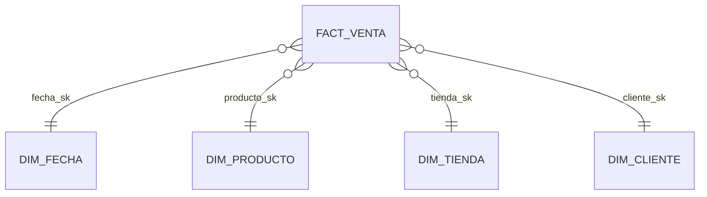
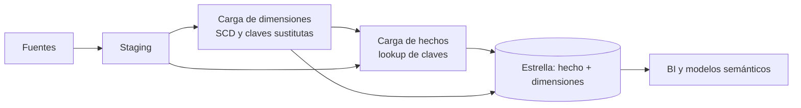

## 1. Resumen

El esquema estrella pone una **tabla de hechos** (medidas de un proceso) en el centro y la une, por claves foráneas, a **tablas de dimensión** desnormalizadas (fecha, cliente, producto). Toda consulta sigue la misma forma: filtrar y agrupar por atributos de dimensión y agregar medidas del hecho. Es el patrón de referencia para data warehouses y capas de consumo de BI.

## 2. Qué es

Es la implementación relacional del modelado dimensional de Kimball: un patrón consolidado de la literatura, no una característica de un producto. Kimball Group lo define así: un modelo dimensional instanciado en una base relacional, con hechos unidos a sus dimensiones mediante relaciones de clave primaria y foránea. Cada dimensión se une directamente al hecho; no hay cadenas de tablas normalizadas entre ellas, y por eso el diagrama tiene forma de estrella.

## 3. Problema que resuelve

Un modelo normalizado (3FN) evita redundancia y es ideal para escribir, pero una pregunta analítica simple ("ventas por categoría y región en septiembre") requiere unir muchas tablas por caminos que el analista debe conocer. La estrella fija un único camino de un salto entre medidas y contexto: consultas predecibles, fáciles de escribir para personas y herramientas de BI, y que los motores optimizan bien.

## 4. Cómo funciona

El diseño sigue los cuatro pasos de Kimball:

1. **Elegir el proceso de negocio** (ventas, envíos, pagos).
2. **Declarar el grano** del hecho: qué representa una fila.
3. **Identificar las dimensiones** coherentes con ese grano: el contexto de cada medición.
4. **Identificar las medidas** del hecho.

Reglas de forma:

- Las dimensiones son **anchas y desnormalizadas**: la categoría y el departamento del producto viven en `dim_producto`, no en tablas aparte. Si se normalizan, el resultado es un *snowflake schema*.
- El hecho guarda **una clave foránea por dimensión**, normalmente la clave sustituta.
- Varias estrellas que comparten **dimensiones conformadas** se pueden combinar en un mismo reporte (*drill-across*).

## 5. Cuándo utilizarlo

- Capa de consumo de un data warehouse o lakehouse para BI y análisis ad hoc.
- Modelos semánticos de herramientas de BI: Microsoft lo considera un prerrequisito para modelos semánticos empresariales de Power BI.
- Cuando muchos usuarios consultan las mismas medidas por distintas combinaciones de atributos.

## 6. Cuándo no utilizarlo

- Para sistemas transaccionales (OLTP): la redundancia de las dimensiones complica las escrituras.
- Para consultas de un solo uso sobre datos crudos o exploración temprana: modelar antes de entender el proceso fija un grano equivocado.
- Cuando el consumo es una tabla ancha única (una feature table para ML, un export): puede convenir una tabla plana derivada de la estrella.

## 7. Ejemplo sencillo



`fact_venta` (grano: línea de ticket) tiene `cantidad` y `monto`; cada dimensión aporta atributos para filtrar y agrupar.

## 8. Ejemplo de producción

Un retail publica tres estrellas: ventas (hecho transaccional), inventario (snapshot diario) y pedidos online (snapshot acumulativo). Las tres comparten `dim_fecha`, `dim_producto` y `dim_tienda` conformadas, de modo que un tablero compara ventas contra stock por producto y tienda. Las dimensiones se cargan primero (SCD2 para `dim_cliente`); los hechos después, resolviendo claves sustitutas y asignando un miembro "desconocido" a las claves que no encuentran dimensión. Controles diarios: huérfanos en cero y totales cuadrados contra el origen.

## 9. Arquitectura



## 10. Código

```sql
-- BigQuery (ejecutable adaptando nombres): consulta típica sobre la estrella.
-- Un salto por dimensión: filtrar y agrupar por atributos, agregar medidas del hecho.
SELECT
  p.categoria,
  t.region,
  SUM(f.monto) AS ventas,
  SUM(f.cantidad) AS unidades
FROM `proyecto.dwh.fact_venta_linea` AS f
JOIN `proyecto.dwh.dim_producto` AS p ON p.producto_sk = f.producto_sk
JOIN `proyecto.dwh.dim_tienda` AS t ON t.tienda_sk = f.tienda_sk
WHERE f.fecha BETWEEN '2026-09-01' AND '2026-09-30'   -- poda de particiones del hecho
GROUP BY p.categoria, t.region
ORDER BY ventas DESC;
```

## 11. GCP

En **BigQuery** la estrella funciona bien y no exige desnormalizar más: la guía de campos anidados y repetidos indica que los star schemas suelen estar ya optimizados para analítica y que aplanarlos más puede no mejorar el rendimiento de forma significativa. Las claves primarias y foráneas se declaran `NOT ENFORCED`: no se validan, pero BigQuery puede usarlas para optimizar (por ejemplo, eliminar joins innecesarios). El hecho se particiona por fecha y se clusteriza por las claves más filtradas.

## 12. AWS

En **Redshift** la estrella se completa con decisiones de distribución: AWS recomienda distribuir el hecho y su dimensión más unida por la columna común y, para dimensiones que no pueden colocarse junto al hecho, evaluar `ALL`, que copia la tabla en todos los nodos a costa de almacenamiento y tiempos de carga. Con `AUTO` (el valor por defecto), Redshift decide. Es la diferencia principal frente a BigQuery: la colocación física de los joins es parte del diseño.

## 13. Azure

La guía de **Fabric Warehouse** describe el modelo dimensional con estrella como base, optimizado para filtrar, agrupar, ordenar y resumir, y prerrequisito de los modelos semánticos empresariales de Power BI. El patrón lógico es el mismo; cambian el motor y las opciones físicas.

## 14. Buenas prácticas

- Un grano por hecho, escrito explícitamente.
- Dimensiones conformadas compartidas entre estrellas, definidas una vez.
- Miembros especiales ("desconocido", "no aplica") en lugar de claves foráneas nulas.
- Nombres de negocio en columnas de dimensión: son la interfaz para los usuarios.
- Cargar dimensiones antes que hechos y controlar huérfanos.
- **Seguridad:** aplicar seguridad a nivel de fila sobre el hecho filtrando por atributos de dimensión (región, unidad de negocio) en el motor.
- **Observabilidad:** controlar en cada carga las claves foráneas huérfanas (o asignadas al miembro desconocido), la frescura de cada hecho y que los totales cuadren con el origen.
- **Costo:** las consultas sobre la estrella deben filtrar por la fecha del hecho para podar particiones; las dimensiones pequeñas cuestan poco, el hecho es el que escala.

## 15. Errores frecuentes

- Normalizar dimensiones "por limpieza" y terminar en un snowflake que nadie pidió.
- Unir dos hechos de distinto grano directamente (multiplica filas) en lugar de agregarlos por separado y combinar por dimensiones conformadas.
- Dimensiones con nombres o códigos distintos para lo mismo entre estrellas: el drill-across deja de cuadrar.
- Unir por clave natural con una dimensión SCD2, lo que duplica hechos.

## 16. Trade-offs

Redundancia controlada en dimensiones a cambio de consultas simples y rápidas. Frente a una tabla plana: la estrella reutiliza dimensiones y mantiene la historia en un solo lugar, pero requiere joins. Frente a un snowflake: menos joins y modelo más legible, a cambio de repetir atributos jerárquicos.

## 17. Conceptos relacionados

- `fact-tables` y `dimension-tables`: las piezas de la estrella.
- `surrogate-keys`: la unión entre ambas.
- `slowly-changing-dimensions`: cómo cambian las dimensiones.
- Con ficha: `grain`.
- `snowflake-schema`: la alternativa con las jerarquías de las dimensiones normalizadas.

## 18. Preguntas técnicas abiertas

1. ¿Cómo combinarías en un reporte ventas (por día y producto) con metas (por mes y categoría) sin duplicar cifras?
2. ¿Cuándo aceptarías normalizar una dimensión muy grande en un snowflake?
3. ¿Qué controles automáticos pondrías para detectar que una estrella dejó de cuadrar con el origen?

## 19. Laboratorio relacionado

Pendiente (F4).

## 20. Fuentes

- Kimball Group: *Star Schemas and OLAP Cubes*, *Four-Step Dimensional Design Process*, *Dimension Table Structure*, *Conformed Dimensions* (referencia conceptual, Nivel 4).
- Microsoft Learn: *Dimensional modeling in Microsoft Fabric Warehouse*.
- Google Cloud: *Use nested and repeated fields* y *Use primary and foreign keys* (BigQuery).
- AWS: *Choose the best distribution style* y *Distribution styles* (Amazon Redshift).

El detalle de cada fuente está en `sources` del frontmatter.

## 21. Fecha de última verificación

2026-10-04. Pasa a `verified`: revisión B-F3.1 del lote 5 aplicada, sin VERIFY pendientes.

## 22. Historial de cambios importantes

- 2026-10-02: creación (lote 5 de F3).
- 2026-10-04: revisión B-F3.1 del lote 5 aplicada (docs/reviews/cards-lote5.md): viñeta de Observabilidad en §14.
- 2026-10-04: `verification_status: verified` (revisión B-F3.1 del lote 5 aplicada; sin VERIFY pendientes).
- 2026-10-06: la sección de conceptos relacionados ya no lista como pendiente de ficha a `grain`, que ya tiene ficha.
- 2026-10-11: §17 enlaza `snowflake-schema`, que ya tiene ficha (lote F3b-04a); antes figuraba como pendiente de ficha.
- 2026-10-13: `page_title` en cada cita, con el título de la página citada (ADR-012); sin cambios de contenido.
