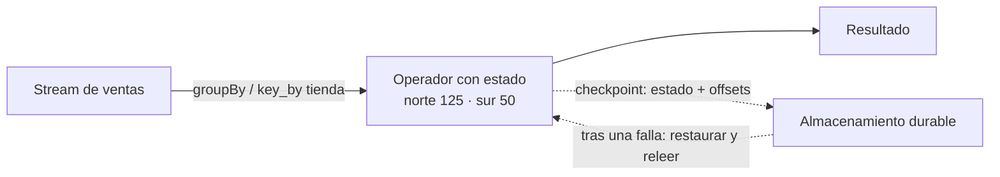

## 1. Resumen

Muchas operaciones de streaming miran un evento por vez, como parsear. Otras **recuerdan** algo entre eventos: un total, una ventana abierta, una sesión, el último estado de un pedido. Flink las llama *stateful*.

Tres ideas definen el estado en streaming:

- **por clave:** el estado de un total por tienda vive junto a la clave de cada tienda, después de un `keyBy`;
- **en el motor:** el motor lo guarda (en memoria o en un almacén como RocksDB), no la aplicación;
- **con checkpoints:** según Flink, «Flink implements fault tolerance using a combination of stream replay and checkpointing»; tras una falla se restaura el estado y se relee desde el punto del checkpoint.

## 2. Qué es

- **Operación con estado:** agregados, ventanas, joins entre streams, deduplicación, detección de patrones.
- **Keyed state:** estado separado por clave; cada evento ve solo el de su clave.
- **State store / backend:** dónde se guarda (memoria, RocksDB).
- **Checkpoint:** una copia consistente del estado y de la posición en cada fuente.
- **Sin estado:** filtrar, proyectar, parsear; solo se recuerda qué filas ya pasaron.

## 3. Problema que resuelve

Un tablero muestra el total vendido por tienda desde el inicio del día. Recalcularlo leyendo todo con cada venta no escala. Con estado, el motor guarda el total de cada tienda y le suma cada venta nueva. Si el proceso se reinicia, el checkpoint devuelve los totales tal como estaban, y la fuente se relee desde donde quedó.

## 4. Cómo funciona

1. El stream se agrupa por clave (`groupBy` en Spark, `key_by` en Flink).
2. Para cada evento, el motor lee el estado de su clave, lo actualiza y lo guarda.
3. Periódicamente, el motor escribe un checkpoint: el estado y la posición en la fuente.
4. Ante una falla, se restaura el último checkpoint y se relee la fuente desde esa posición.
5. La watermark o un TTL liberan el estado que ya no se necesita.

## 5. Cuándo utilizarlo

- Totales y conteos acumulados, ventanas, sesiones.
- Deduplicar por id dentro de un plazo.
- Joins entre dos streams.
- Máquinas de estado por entidad (pedidos, dispositivos).

## 6. Cuándo no utilizarlo

- Estado sin límite de tiempo y con claves que no paran de crecer: la memoria se agota.
- Guardar el estado en una base externa a mano cuando el motor ya lo hace con checkpoints.
- Cambiar el esquema del estado o el state store entre reinicios sin plan: en Databricks, cambiar la gestión del estado exige un checkpoint nuevo.

## 7. Ejemplo sencillo

Un total por tienda. Tras el primer archivo: norte 100, sur 40. La consulta se detiene y arranca de nuevo con el mismo checkpoint y un archivo nuevo: norte 125, sur 50. El total siguió desde donde quedó.

## 8. Ejemplo de producción

Sesiones de usuarios en un sitio:

- clave = id de usuario; estado = inicio, último evento y páginas vistas;
- la sesión se cierra tras 30 minutos sin actividad y su estado se borra;
- checkpoints frecuentes en almacenamiento durable;
- monitoreo del tamaño del estado y del tiempo de cada checkpoint.

## 9. Arquitectura



## 10. Código

```python
# Python 3.12 y PySpark 4.2.0 en modo local (ejecutado en la CI con Java 17): un total acumulado por tienda es estado
# que el motor guarda entre micro-batches. La consulta se detiene y vuelve a arrancar con el mismo checkpoint: el
# total sigue desde donde quedó, porque el estado se recupera del checkpoint.
import json
import sys
import tempfile
from pathlib import Path

from pyspark.sql import SparkSession
from pyspark.sql import functions as F

base = Path(sys.argv[1] if len(sys.argv) > 1 else tempfile.mkdtemp())
src = base / "ventas"
src.mkdir(parents=True, exist_ok=True)

spark = (SparkSession.builder.master("local[2]").config("spark.sql.shuffle.partitions", "2")
         .config("spark.ui.showConsoleProgress", "false").getOrCreate())
spark.sparkContext.setLogLevel("ERROR")


def run(file_name: str, sales: list[tuple[str, int]]) -> None:
    """Agrega un archivo de ventas y corre la consulta hasta procesar lo disponible."""
    rows = [json.dumps({"tienda": t, "monto": m}) for t, m in sales]
    (src / file_name).write_text("\n".join(rows), encoding="utf-8")
    totals = (spark.readStream.schema("tienda STRING, monto INT").json(str(src))
              .groupBy("tienda").agg(F.sum("monto").alias("total")))
    query = (totals.writeStream.outputMode("complete").format("memory").queryName("totales")
             .option("checkpointLocation", str(base / "checkpoint")).trigger(availableNow=True).start())
    query.awaitTermination()
    result = ", ".join(f"{r.tienda} {r.total}" for r in spark.sql("SELECT * FROM totales ORDER BY tienda").collect())
    print(f"tras {file_name}: {result}")


run("1.json", [("norte", 100), ("sur", 40)])
run("2.json", [("norte", 25), ("sur", 10)])   # nueva corrida, mismo checkpoint: retoma el estado
spark.stop()
```

```python
# PyFlink 2.3 (no ejecutado: la CI no corre Flink; la forma sigue el ejemplo de «Working with State» de Flink 2.3):
# el mismo total por tienda con estado keyed. El estado vive por clave, después de key_by, y Flink lo guarda en sus
# checkpoints.
from pyflink.common.typeinfo import Types
from pyflink.datastream import FlatMapFunction, RuntimeContext, StreamExecutionEnvironment
from pyflink.datastream.state import ValueStateDescriptor


class RunningTotal(FlatMapFunction):
    def __init__(self):
        self.total = None

    def open(self, runtime_context: RuntimeContext):
        descriptor = ValueStateDescriptor("total", Types.PICKLED_BYTE_ARRAY())   # nombre del estado y su tipo
        self.total = runtime_context.get_state(descriptor)

    def flat_map(self, value):
        current = (self.total.value() or 0) + value[1]   # el estado de la tienda de este evento
        self.total.update(current)
        yield value[0], current


env = StreamExecutionEnvironment.get_execution_environment()
env.from_collection([("norte", 100), ("sur", 40), ("norte", 25), ("sur", 10)]) \
    .key_by(lambda row: row[0]) \
    .flat_map(RunningTotal()) \
    .print()
env.execute()
```

El primer script se **ejecuta en la CI con PySpark 4.2.0 en modo local y Java 17**: imprime `tras 1.json: norte 100, sur 40` y `tras 2.json: norte 125, sur 50`, con el mismo checkpoint entre las dos corridas. El segundo es el mismo total con estado keyed en **PyFlink 2.3 y no se ejecutó**: la CI no corre Flink; su forma sigue el ejemplo de *Working with State*.

## 11. GCP

En GCP, **Dataflow** guarda el estado de los pipelines de Beam. Según *Exactly-once in Dataflow* (no ejecutado):

| | Spark Structured Streaming | Dataflow |
|---|---|---|
| Garantía sobre el estado | Checkpoints y write-ahead logs con los offsets de cada trigger | Exactly-once por defecto en streaming (at-least-once opcional): los registros se procesan al menos una vez y los resultados se confirman exactamente una vez; los efectos fuera del pipeline pueden repetirse |

## 12. AWS

En AWS, **Managed Service for Apache Flink** administra los checkpoints de Flink. Según *Implement fault tolerance in Managed Service for Apache Flink* (no ejecutado):

| | Flink propio | Managed Service for Apache Flink |
|---|---|---|
| Checkpoints | Se configuran y se guardan en un almacenamiento que el equipo elige | El servicio los usa como método de tolerancia a fallos: un respaldo actualizado de la aplicación para recuperarse de una interrupción o un failover |

## 13. Azure

En Azure, **Azure Databricks** corre Structured Streaming con estado. Según *What is stateful streaming?* y *Structured Streaming checkpoints* (no ejecutado):

| | Spark Structured Streaming | Azure Databricks |
|---|---|---|
| Dónde vive el estado | El state store del motor | Recomienda RocksDB con changelog checkpointing |
| Qué guarda el checkpoint | Offsets de cada trigger y estado | Offsets de cada micro-batch, los batches confirmados y el estado; un checkpoint nuevo empieza de cero |

## 14. Buenas prácticas

- Limitar el estado en el tiempo: watermark o TTL.
- Checkpoints en almacenamiento durable, uno por consulta, nunca compartidos.
- Planificar los cambios de lógica que tocan el estado.
- **Seguridad:** el estado y los checkpoints contienen datos; los mismos permisos y cifrado que el destino.
- **Observabilidad:** tamaño del estado por operador, duración de cada checkpoint y claves activas.
- **Costo:** más estado es más memoria o disco y checkpoints más pesados.

## 15. Errores frecuentes

- Borrar el checkpoint «para arreglar algo» y perder el estado: la consulta empieza de cero.
- Estado por clave sin límite de tiempo.
- Compartir un directorio de checkpoint entre dos consultas.
- Creer que el checkpoint del motor hace exactamente-una-vez el destino (ver `exactly-once-semantics`).

## 16. Trade-offs

El estado en el motor evita recalcular y da resultados en continuo, a cambio de memoria, checkpoints y reinicios más pesados. Checkpoints frecuentes reducen lo que se relee tras una falla y suman costo de escritura. Un TTL corto ahorra estado y olvida antes.

## 17. Conceptos relacionados

- `checkpoints`: cómo se guarda el estado.
- `windowing`: ventanas como estado.
- `watermarks`: la limpieza del estado.
- `exactly-once-semantics`: hasta dónde llega la consistencia.
- `offsets`: la posición que se guarda con el estado.

## 18. Preguntas técnicas abiertas

1. ¿Qué estado guarda hoy tu pipeline y cuánto crece por día?
2. ¿Qué pasa si se borra el checkpoint de tu consulta?
3. ¿Qué parte del estado podría tener un TTL?

## 19. Laboratorio relacionado

Pendiente (F4).

## 20. Fuentes

- Apache Flink 2.3: *Stateful Stream Processing*, *Working with State* y *Checkpoints*.
- Apache Spark 4.2.0: *Structured Streaming Programming Guide* (Getting Started).
- Google Cloud: *Exactly-once in Dataflow*.
- AWS: *Implement fault tolerance in Managed Service for Apache Flink*.
- Microsoft Learn: *What is stateful streaming?* y *Structured Streaming checkpoints*.

El detalle de cada fuente está en `sources` del frontmatter.

## 21. Fecha de última verificación

2026-10-20. Pasa a `verified`: revisión B-F3.1 del lote F3b-14b aplicada, sin VERIFY pendientes.

## 22. Historial de cambios importantes

- 2026-10-19: creación (lote F3b-14b).
- 2026-10-20: revisión B-F3.1 del lote F3b-14b aplicada (docs/reviews/cards-f3b-14b.md): sin hallazgos en esta ficha; sin cambios.
- 2026-10-20: `verification_status: verified` (sin VERIFY pendientes).
