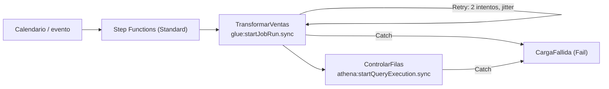

## 1. Resumen

**AWS Step Functions** orquesta pasos como una **máquina de estado** escrita en Amazon States Language (ASL). Cada estado hace algo (una tarea en otro servicio, una decisión, una espera) y pasa al siguiente. Según su documentación:

- hay dos tipos de workflow: **Standard** (hasta un año, exactamente una vez, salvo reintentos declarados) y **Express** (hasta cinco minutos, al menos una vez);
- con el patrón **`.sync`**, un estado lanza un job de Glue o una consulta de Athena y **espera a que termine**;
- **Retry** y **Catch** se declaran por estado, con backoff y jitter;
- **Map en modo distribuido** procesa en paralelo muchos objetos o un archivo grande de S3.

Para pipelines de datos por lotes, lo habitual es Standard con tareas `.sync`.

## 2. Qué es

- **Máquina de estado:** JSON con `StartAt` y `States`. Con `"QueryLanguage": "JSONata"`, los campos se calculan con expresiones `` y los parámetros de la tarea van en `Arguments`.
- **Estado Task:** trabajo que hace otro servicio. Patrones de integración:
  - Request a Response: llama y sigue;
  - Run a Job (`.sync`): espera el fin del job (por ejemplo `glue:startJobRun.sync`, `athena:startQueryExecution.sync`);
  - Wait for Callback (`.waitForTaskToken`): espera a que alguien devuelva un token.
- **Retry:** `ErrorEquals`, `IntervalSeconds` (1 por defecto), `MaxAttempts` (3), `BackoffRate` (2,0) y `JitterStrategy` (`FULL` o `NONE`).
- **Catch:** lleva a un estado de respaldo. Sin Retry ni Catch, un error hace fallar toda la ejecución.
- **Errores:** `States.ALL` coincide con cualquier error conocido; `States.TaskFailed` con cualquiera salvo `States.Timeout`.
- **Map distribuido:** ejecuciones hijas en paralelo (10.000 si no se indica otro valor), cada una con su historial.
- **Tipo de workflow:** no se puede cambiar después de crear la máquina de estado.

## 3. Problema que resuelve

Un pipeline tiene pasos que dependen unos de otros, con reintentos y caminos de error. Step Functions los declara como un grafo de estados, espera los jobs largos sin código de sondeo, guarda el historial de cada ejecución y no exige servidores ni un scheduler propio.

## 4. Cómo funciona

1. Algo inicia la ejecución (un evento de EventBridge, una llamada a la API) con una entrada, por ejemplo `{"fecha": "2026-10-01"}`.
2. El primer estado lanza el job de Glue con `.sync` y espera su fin.
3. Si el job falla, Retry lo reintenta con backoff y jitter; si se agotan los intentos, Catch lleva al estado de fallo.
4. El siguiente estado corre una consulta de control en Athena, también con `.sync`.
5. La ejecución termina con éxito o en un estado `Fail` explícito, con su historial.

## 5. Cuándo utilizarlo

- Pipelines serverless en AWS que encadenan Glue, Athena, EMR y Lambda.
- Procesos con esperas largas, ramas y manejo de errores declarado.
- Procesamiento paralelo de muchos objetos de S3: Map distribuido.
- Eventos de alto volumen y corta duración, con pasos idempotentes: Express.

## 6. Cuándo no utilizarlo

- Equipos con muchos DAGs de Airflow, operadores propios y backfills frecuentes: MWAA (ver `mwaa-managed-airflow`).
- Pasos que no son idempotentes en un workflow Express (al menos una vez).
- Pasar datos grandes entre estados: la entrada o el resultado de una tarea tiene un máximo de 256 KiB; los datos van en S3 y entre estados se pasan referencias.

## 7. Ejemplo sencillo

Una máquina de estado con dos estados: `TransformarVentas` lanza el job de Glue del día y espera; `ControlarFilas` cuenta las filas del día en Athena. Si cualquiera falla, la ejecución termina en `CargaFallida`.

## 8. Ejemplo de producción

Cada noche, un calendario inicia la máquina de estado con la fecha del día:

1. Glue transforma `raw/` a `curated/`, con dos reintentos con jitter;
2. Athena controla que haya filas;
3. un Map distribuido recorre los archivos de `curated/` y llama a una función de Lambda por archivo para validar el esquema.

Re-ejecutar un día inicia otra ejecución con la misma fecha; los pasos escriben por partición, así no duplican.

## 9. Arquitectura



## 10. Código

```json
{
  "Comment": "Amazon States Language (JSONata; validado en la CI como JSON y por estructura, no se ejecutó en Step Functions): job de Glue, consulta de control en Athena y fallo explícito si algo sale mal.",
  "QueryLanguage": "JSONata",
  "StartAt": "TransformarVentas",
  "States": {
    "TransformarVentas": {
      "Type": "Task",
      "Resource": "arn:aws:states:::glue:startJobRun.sync",
      "Arguments": {
        "JobName": "ventas_raw_a_curated",
        "Arguments": { "--fecha": "" }
      },
      "Retry": [
        {
          "ErrorEquals": ["States.TaskFailed"],
          "IntervalSeconds": 60,
          "MaxAttempts": 2,
          "BackoffRate": 2,
          "JitterStrategy": "FULL"
        }
      ],
      "Catch": [{ "ErrorEquals": ["States.ALL"], "Next": "CargaFallida" }],
      "Next": "ControlarFilas"
    },
    "ControlarFilas": {
      "Type": "Task",
      "Resource": "arn:aws:states:::athena:startQueryExecution.sync",
      "Arguments": {
        "QueryString": "",
        "WorkGroup": "etl"
      },
      "Catch": [{ "ErrorEquals": ["States.ALL"], "Next": "CargaFallida" }],
      "End": true
    },
    "CargaFallida": {
      "Type": "Fail",
      "Error": "CargaDiariaFallida",
      "Cause": "Falló el job de Glue o la consulta de control"
    }
  }
}
```

La definición se **valida en la CI** como JSON y por estructura: `StartAt` existe, cada `Next` y cada `Catch` apuntan a estados definidos, y hay un estado final. **No se ejecutó en Step Functions** ni en moto (ADR-011): los nombres del job, la base y el workgroup son ilustrativos. La sintaxis sigue los ejemplos de Glue y Athena con JSONata.

## 11. GCP

No aplica de forma específica: esta ficha describe Step Functions. Lo más cercano en GCP es Workflows; Composer, el Airflow administrado (ver `composer-environments`), se compara con MWAA. Las diferencias con Workflows, según sus páginas:

| | Step Functions | Workflows |
|---|---|---|
| Definición | Amazon States Language en JSON, con JSONata o JSONPath | Su propia sintaxis, en YAML o JSON |
| Esperar un job largo | Patrón Run a Job (`.sync`) en la integración | Conectores, con timeout y política de sondeo (`connector_params`) |
| Reintentos | `Retry` por estado: `IntervalSeconds`, `MaxAttempts`, `BackoffRate`, `JitterStrategy` | `try`/`retry`: `max_retries` y `backoff` (`initial_delay`, `max_delay`, `multiplier`) |
| Tipos y cobro | Standard (por transición de estado) y Express (por solicitud y duración) | Un tipo; se cobra por paso ejecutado, y cada reintento cuenta como un paso |

## 12. AWS

**AWS Step Functions.** Los tipos de workflow, ASL con JSONata, los patrones de integración, Retry y Catch, las integraciones con Glue y Athena y el Map distribuido son los de sus páginas. Los precios de Standard (por transición de estado) y Express (por solicitud y duración) se consultan en la página de precios.

## 13. Azure

No aplica de forma específica.

## 14. Buenas prácticas

- Standard para pipelines por lotes; Express solo con pasos idempotentes.
- `.sync` para esperar jobs en lugar de sondear con Lambda.
- Retry con jitter en errores transitorios y Catch hacia un estado de fallo explícito.
- Pasar referencias a S3 entre estados, no datos.
- **Seguridad:** la máquina de estado corre con un rol de IAM que solo puede iniciar sus jobs y consultas (ver `aws-iam-for-data`).
- **Observabilidad:** seguir ejecuciones fallidas, duración y reintentos; el historial de cada ejecución muestra el estado que falló.
- **Costo:** en Standard se cobra cada transición de estado, reintentos incluidos; en Express, solicitudes y duración. Los montos se consultan en la página de precios.

## 15. Errores frecuentes

- Elegir Express para un pipeline con pasos no idempotentes.
- Sondear un job con una función y un estado Wait en lugar de usar `.sync`.
- No declarar Retry ni Catch y que un error transitorio haga fallar toda la ejecución.
- Pasar el contenido de archivos entre estados y chocar con el límite de 256 KiB.

## 16. Trade-offs

Step Functions no tiene servidores y declara reintentos y errores en el workflow, a cambio de un lenguaje propio (ASL) y de menos herramientas para backfills y dependencias entre DAGs que Airflow. Standard da garantías de una sola ejecución y cobra por transición; Express es barato a gran volumen, con ejecución al menos una vez.

## 17. Conceptos relacionados

- `orchestration-landscape` y `data-orchestration`: dónde encaja.
- `retries` e `idempotency`: reintentos y tipos de workflow.
- `glue-catalog-and-etl` y `athena-serverless-queries`: los servicios que orquesta el ejemplo.
- `mwaa-managed-airflow` y `lambda-for-data`: las alternativas y los pasos cortos.
- `composer-environments`: orquestación administrada en GCP.
- `aws-iam-for-data`: el rol de la máquina de estado.

## 18. Preguntas técnicas abiertas

1. ¿Qué pasos de tu pipeline podrían ser tareas `.sync`?
2. ¿Qué errores reintentarías y cuáles llevarías directo al fallo?
3. ¿Cuándo preferirías Airflow sobre Step Functions?

## 19. Laboratorio relacionado

Pendiente (F4).

## 20. Fuentes

- AWS, AWS Step Functions Developer Guide: *What is Step Functions?*, *Choosing workflow type*, *Using Amazon States Language*, *Handling errors in Step Functions workflows*, *Integrating services with Step Functions*, *Start an AWS Glue job with Step Functions*, *Run Athena queries with Step Functions* y *Using Map state in Distributed mode*; *AWS Step Functions pricing*.

El detalle de cada fuente está en `sources` del frontmatter.

## 21. Fecha de última verificación

2026-10-13. Pasa a `verified`: revisión B-F3.1 del lote F3b-09b aplicada, sin VERIFY pendientes.

## 22. Historial de cambios importantes

- 2026-10-12: creación (lote F3b-09b).
- 2026-10-13: revisión B-F3.1 del lote F3b-09b aplicada (docs/reviews/cards-f3b-09b.md): el §11 compara con Workflows (definición, espera de jobs largos, reintentos, tipos y cobro), con fuente de cada lado.
- 2026-10-13: `verification_status: verified` (sin VERIFY pendientes).
