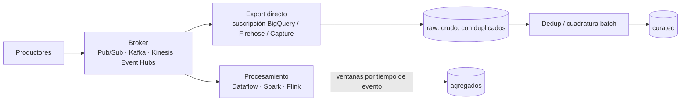

## 1. Resumen

La ingesta streaming trae los datos **mientras se producen**, evento a evento o en lotes muy pequeños, en vez de esperar a que cierre un período. Un productor publica en un broker (Pub/Sub, Kafka, Kinesis, Event Hubs). Un consumidor lee, opcionalmente transforma y agrega en ventanas, y escribe en el destino (BigQuery, el lake). Da frescura de segundos, a cambio de enfrentar tres realidades que el batch esconde:

- **duplicados**, porque la entrega es al menos una vez;
- **desorden**, porque los eventos no llegan en el orden en que ocurrieron;
- **datos tardíos**, que llegan después de cerrada su ventana.

## 2. Qué es

Es un modo consolidado de ingesta, opuesto a la ingesta batch. Sus piezas:

- **Broker:** guarda los eventos de forma durable durante un tiempo de retención y los entrega a uno o varios consumidores. Pub/Sub, Kafka, Kinesis Data Streams y Event Hubs cumplen ese papel con modelos distintos (suscripciones frente a log con offsets).
- **Procesamiento:** evento a evento (Dataflow/Beam, Flink) o en **micro-batch** (por defecto en Spark Structured Streaming: una serie de pequeños jobs batch, con latencias desde unos 100 ms).
- **Destino:** escritura continua en el warehouse (Storage Write API de BigQuery, suscripción de BigQuery de Pub/Sub) o archivos en el lake (Firehose, Capture de Event Hubs, suscripción de Cloud Storage).

## 3. Problema que resuelve

Algunas decisiones pierden valor con el tiempo: detectar fraude, reaccionar a una caída de ventas, mostrar inventario actualizado. Con batch, el dato llega horas después. El streaming reduce la latencia a segundos o minutos y reparte la carga en el tiempo, en lugar de concentrarla en una ventana nocturna.

## 4. Cómo funciona

1. **Publicar:** el productor envía cada evento al broker con su **tiempo de evento** (cuándo ocurrió), distinto del tiempo de llegada.
2. **Retener:** el broker guarda los eventos un tiempo (Kinesis, por ejemplo, 24 horas por defecto y hasta 365 días); permite que un consumidor caído se ponga al día y reprocesar.
3. **Consumir con entrega al menos una vez:** el mismo evento puede llegar dos veces, así que el consumidor debe ser idempotente o deduplicar por un identificador del evento.
4. **Agregar por tiempo de evento:** las agregaciones se hacen en **ventanas**. Un **watermark** estima cuándo llegaron todos los datos de una ventana; lo que llega después es **dato tardío**, y la política decide si se descarta, se reprocesa o actualiza el resultado.
5. **Escribir:** en BigQuery, el *default stream* de la Storage Write API es at-least-once y deja los datos consultables de inmediato; los streams creados por la aplicación dan exactly-once con offsets. Al lake, se escriben archivos por lotes de tiempo o de tamaño.

## 5. Cuándo utilizarlo

- Cuando la frescura necesaria es de segundos o minutos.
- Fuentes que ya emiten eventos: clics, IoT, logs, CDC.
- Cuando varios consumidores necesitan el mismo flujo (operación en tiempo real y aterrizaje para analítica).
- Para repartir una carga grande a lo largo del día.

## 6. Cuándo no utilizarlo

- Si una frescura de horas basta: el batch es más simple de operar y razonar.
- Si la fuente solo entrega exportaciones periódicas: convertirlas en "eventos" agrega piezas sin ganar frescura.
- Si el equipo no puede operar consumidores 24/7, con alertas de retraso y dead letter.

## 7. Ejemplo sencillo

Una app publica `{"event_id": "e-91", "user_id": 42, "evento": "compra", "ocurrio_en": "2026-10-05T10:00:03Z"}` en el topic `eventos`. Una suscripción de BigQuery escribe cada mensaje en `raw.eventos` en segundos. Una vista deduplica por `event_id` para el análisis.

## 8. Ejemplo de producción

Un retail publica en Pub/Sub cada venta de sus cajas. Hay dos suscripciones:

- **Export a BigQuery:** escribe el crudo en `raw.ventas_stream` en segundos, para un tablero de ventas del día.
- **Pull consumida por Dataflow:** agrega ventas por tienda en ventanas de 5 minutos por tiempo de evento, con un watermark que tolera hasta 10 minutos de atraso. Los eventos más tardíos se reprocesan en la carga batch nocturna.

Hay alertas por backlog y antigüedad del mensaje más viejo sin confirmar. Cada noche, un proceso batch deduplica por `event_id` y cuadra el día contra el cierre de cajas.

## 9. Arquitectura



## 10. Código

```bash
# Pub/Sub → BigQuery sin código intermedio: una suscripción de export escribe cada mensaje en la tabla.
# Requiere: gcloud autenticado con roles/pubsub.editor en el proyecto; el topic "eventos" y la tabla
# raw.eventos ya creados. Si el topic no tiene schema, la tabla necesita una columna "data".
# El agente de servicio de Pub/Sub (o la cuenta indicada) debe poder escribir en la tabla.
gcloud pubsub subscriptions create eventos-a-bigquery \
  --topic=eventos \
  --bigquery-table=mi-proyecto.raw.eventos
```

```sql
-- BigQuery: la entrega es al menos una vez, así que el consumo analítico deduplica por event_id.
-- Requiere que el payload tenga event_id y ocurrio_en (por ejemplo, en una tabla con esas columnas).
CREATE OR REPLACE VIEW `mi-proyecto.curated.eventos` AS
SELECT *
FROM `mi-proyecto.raw.eventos`
WHERE TRUE
QUALIFY ROW_NUMBER() OVER (PARTITION BY event_id ORDER BY ocurrio_en DESC) = 1;
```

Para transformar o agregar por ventanas antes de escribir, se usa Dataflow en lugar de la suscripción de export. Para escribir desde un servicio propio, la Storage Write API: su *default stream* es at-least-once y los streams con offsets dan exactly-once.

## 11. GCP

**Pub/Sub** es el broker administrado: entrega al menos una vez y sin orden por defecto, con suscripciones de export que escriben directo en BigQuery o Cloud Storage. **Dataflow** (Apache Beam) procesa en streaming con ventanas, watermarks y triggers, y trata explícitamente los datos tardíos. **BigQuery** recibe datos continuos con la Storage Write API: el *default stream* es at-least-once e inmediatamente consultable, y los streams de la aplicación dan exactly-once con offsets.

## 12. AWS

**Kinesis Data Streams** guarda los registros en shards, con retención de 24 horas por defecto y hasta 365 días (lo que pasa de 24 horas tiene costo adicional). **Amazon Data Firehose** acumula los datos hasta un tamaño o intervalo de buffer y los entrega a S3 o, vía S3 y `COPY`, a Redshift. Diferencia con Pub/Sub: Firehose es entrega por micro-lotes, así que la latencia hasta el destino depende del buffer configurado.

## 13. Azure

**Event Hubs** es un log particionado de solo agregado. Acepta clientes de Kafka y retiene los eventos de 1 a 90 días según el tier. **Capture** escribe los eventos a almacenamiento de largo plazo, y los consumidores leen por consumer group, con checkpointing de su offset. El modelo es el de Kafka, con particiones y offsets, no el de suscripciones con ack de Pub/Sub. Spark Structured Streaming, disponible en Fabric y Synapse, procesa por defecto en micro-batch.

## 14. Buenas prácticas

- Incluir en cada evento un identificador único y el tiempo de evento.
- Consumidores idempotentes o deduplicación aguas abajo por `event_id`.
- Agregar por tiempo de evento, con una política explícita para los tardíos.
- Aterrizar el crudo además de los agregados, para reprocesar.
- Cuadrar periódicamente el streaming contra una fuente batch de verdad.
- **Seguridad:** permisos de publicación y consumo por topic o suscripción, no por proyecto; los eventos suelen traer identificadores personales, que deben tratarse igual que en el destino.
- **Observabilidad:** vigilar backlog y antigüedad del evento más viejo sin procesar, tasa de dead letter, retraso del watermark y diferencia entre tiempo de evento y de llegada.
- **Costo:** el streaming paga cómputo continuo y, a veces, retención extendida; agrupar escrituras y aterrizar por lotes de tiempo reduce costo cuando la frescura lo permite.

## 15. Errores frecuentes

- Suponer que cada evento llega una sola vez.
- Agregar por tiempo de llegada y obtener ventanas que cambian al reprocesar.
- No guardar el crudo y no poder reconstruir tras un error.
- Elegir streaming para un tablero que se mira una vez al día.
- No alertar por el backlog: el consumidor se cae y nadie lo nota hasta que la retención borra los eventos.

## 16. Trade-offs

Frescura de segundos y carga repartida, a cambio de operar componentes siempre encendidos y de lidiar con duplicados, desorden y tardíos. El micro-batch simplifica el modelo y da exactly-once en Spark, con latencias algo mayores que el procesamiento evento a evento. Las suscripciones de export eliminan código, pero no transforman antes de escribir.

## 17. Conceptos relacionados

- `batch-vs-streaming` y `batch-ingestion`: la otra mitad de la decisión.
- `pubsub-topics-and-subscriptions` y `pubsub-delivery-semantics`: el broker de GCP y sus garantías.
- `late-arriving-data`: qué hacer con lo tardío.
- `deduplication`: cómo eliminar los duplicados de la entrega at-least-once.
- `delivery-semantics`: at-most-once y at-least-once en la ingesta.
- Del blueprint, pendiente de ficha: `event-time-vs-processing-time`.

## 18. Preguntas técnicas abiertas

1. ¿Qué latencia real necesita tu caso y qué parte del pipeline la determina (broker, procesamiento o escritura)?
2. ¿Cómo garantizarías que un reproceso de una hora de eventos no duplique filas en BigQuery?
3. ¿Qué harías con un evento que llega un día tarde a una agregación por ventanas de 5 minutos?

## 19. Laboratorio relacionado

Pendiente (F4).

## 20. Fuentes

- Apache: *Introduction* (Kafka) y *Structured Streaming Programming Guide* (Spark).
- Google Cloud: *Subscription overview* y *Create BigQuery subscriptions* (Pub/Sub), *Streaming pipelines* (Dataflow) e *Introduction to the Storage Write API (gRPC)* (BigQuery).
- AWS: *What is Amazon Kinesis Data Streams?*, *Change the data retention period* y *What is Amazon Data Firehose?*
- Microsoft Learn: *What is Azure Event Hubs*.

El detalle de cada fuente está en `sources` del frontmatter.

## 21. Fecha de última verificación

2026-10-05. Pasa a `verified`: revisión B-F3.1 del lote 6 aplicada, sin VERIFY pendientes.

## 22. Historial de cambios importantes

- 2026-10-05: creación (lote 6 de F3).
- 2026-10-05: revisión B-F3.1 del lote 6 aplicada (docs/reviews/cards-lote6.md), sin cambios pedidos. `verification_status: verified` (sin VERIFY pendientes).
- 2026-10-13: `page_title` en cada cita, con el título de la página citada (ADR-012); sin cambios de contenido.
- 2026-10-19: lote F3b-14a (regla del §17): relations y el §17 enlazan `delivery-semantics`, que ya tiene ficha; antes figuraba como pendiente de ficha.
