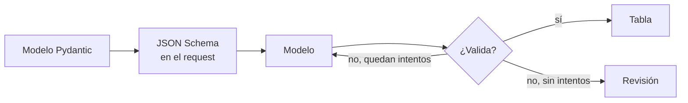

## 1. Resumen

Un pipeline no puede escribir en una tabla un párrafo libre. Con **salida estructurada**, el request lleva un **JSON Schema** y el proveedor hace que la respuesta lo cumpla. En Agent Platform es el response schema (*Structured output*); en la Converse API de Bedrock, `outputConfig.textFormat` (*Get validated JSON results from models*); en Azure OpenAI, `response_format` o `text.format` (*Structured outputs*).

Microsoft lo contrasta con el **modo JSON** anterior: ese garantizaba JSON válido, pero no que respetara el esquema. Del lado del pipeline, la respuesta **se valida igual** con el mismo modelo que generó el esquema: así un cambio de modelo, de versión o de configuración no llega silencioso a la tabla.

## 2. Qué es

- **Esquema:** el contrato de la respuesta (campos, tipos, enumeraciones, requeridos).
- **Modelo Pydantic:** define el esquema y valida; `model_json_schema()` lo exporta como JSON Schema (*JSON Schema*).
- **Salida estructurada del proveedor:** la respuesta se ajusta al esquema enviado.
- **Modo JSON:** solo JSON válido; no garantiza el esquema.
- **Validación en el pipeline:** el rechazo es un resultado esperado, con reintento o derivación a revisión.

## 3. Problema que resuelve

Un job extrae la tabla afectada y la severidad de cada incidente. Sin esquema, el modelo responde a veces «Alta», a veces «crítica», a veces una frase. Con esquema y validación, la columna `severidad` solo recibe `baja`, `media` o `alta`, y lo demás no entra.

## 4. Cómo funciona

1. Se define el modelo Pydantic con los campos y restricciones.
2. Se genera el JSON Schema con `model_json_schema()` y se envía en el request.
3. Se valida la respuesta con `model_validate_json`.
4. Si no valida, se reintenta un número fijo de veces.
5. Si se agotan los intentos, el registro va a revisión, no al warehouse.

## 5. Cuándo utilizarlo

- Extracción de campos de texto libre hacia una tabla.
- Clasificación con un conjunto cerrado de categorías.
- Cualquier salida de modelo que otro sistema lea.

## 6. Cuándo no utilizarlo

- Respuestas para una persona, como un resumen en un correo: el esquema agrega rigidez sin beneficio.
- Esquemas con palabras clave que el proveedor no soporta: Azure OpenAI soporta un subconjunto de JSON Schema y exige todos los campos como requeridos (*Structured outputs*).
- Como reemplazo de la validación propia.

## 7. Ejemplo sencillo

| Intento | Respuesta | Resultado |
|---|---|---|
| 1 | `severidad: "crítica"`, `filas_afectadas: -3` | Rechazada: dos campos inválidos |
| 2 | `severidad: "alta"`, `filas_afectadas: 1200` | Aceptada |

## 8. Ejemplo de producción

Clasificación diaria de incidentes de pipelines:

- el modelo Pydantic `Incidente` vive en el repositorio del pipeline y su esquema se envía en cada request;
- salida estructurada del proveedor activada (no ejecutado);
- validación con el mismo modelo; los rechazos se cuentan como métrica;
- tras dos intentos fallidos, el incidente va a una cola de revisión.

## 9. Arquitectura



## 10. Código

```python
# Python 3.12 y Pydantic 2 (ejecutado en la CI): el esquema que se envía al modelo sale del mismo modelo Pydantic que
# valida la respuesta. El "modelo" es una lista de respuestas fijas: la primera no cumple el esquema, la segunda sí.
# Con salida estructurada del proveedor (response schema, outputConfig.textFormat o response_format), la respuesta
# debería cumplir el esquema; la validación del lado del pipeline se mantiene igual.
import json
from collections.abc import Iterator
from typing import Literal

from pydantic import BaseModel, Field, ValidationError


class Incidente(BaseModel):
    tabla: str = Field(pattern=r"^[a-z_]+\.[a-z_]+$")
    severidad: Literal["baja", "media", "alta"]
    filas_afectadas: int = Field(ge=0)


esquema = Incidente.model_json_schema()
print("esquema enviado:", json.dumps({k: esquema[k] for k in ("required", "type")}, ensure_ascii=False))
print("  severidad:", esquema["properties"]["severidad"])

RESPUESTAS = iter([
    '{"tabla": "silver.pedidos", "severidad": "crítica", "filas_afectadas": -3}',
    '{"tabla": "silver.pedidos", "severidad": "alta", "filas_afectadas": 1200}',
])


def llamar_modelo(prompt: str, respuestas: Iterator[str] = RESPUESTAS) -> str:
    return next(respuestas)  # en producción: la llamada al proveedor, con el esquema en el request


def extraer(prompt: str, intentos: int = 2) -> Incidente:
    for intento in range(1, intentos + 1):
        try:
            return Incidente.model_validate_json(llamar_modelo(prompt))
        except ValidationError as error:
            campos = sorted(str(e["loc"][0]) for e in error.errors())
            print(f"intento {intento}: rechazado, campos inválidos {campos}")
    raise RuntimeError("sin respuesta válida: a revisión, no al warehouse")


incidente = extraer("Clasifica: el job de pedidos duplicó 1200 filas en silver.pedidos.")
print("intento aceptado:", incidente.model_dump())
```

El script se **ejecuta en la CI** con Pydantic y pasa `mypy --strict`. Imprime el esquema enviado (los tres campos requeridos y la enumeración de `severidad`), `intento 1: rechazado, campos inválidos ['filas_afectadas', 'severidad']` y `intento aceptado: {'tabla': 'silver.pedidos', 'severidad': 'alta', 'filas_afectadas': 1200}`. Las respuestas del modelo son fijas: el ejemplo muestra lo que se valida alrededor del modelo.

## 11. GCP

En GCP, **Gemini Enterprise Agent Platform**. Según *Structured output* (no ejecutado):

| | Este concepto | Agent Platform |
|---|---|---|
| Dónde va el esquema | En el request | Response schema |
| Garantía | Validar igual | La respuesta sigue siempre el esquema definido, según la página |
| Modelos | — | Lista de modelos soportados en la página |

## 12. AWS

En AWS, **Amazon Bedrock**. Según *Get validated JSON results from models* (no ejecutado):

| | Este concepto | Amazon Bedrock |
|---|---|---|
| Converse API | Esquema en el request | `outputConfig.textFormat` |
| InvokeModel | — | `output_config.format` con Claude (`output_format` está obsoleto); `response_format` con modelos de pesos abiertos |
| Herramientas | — | `strict: true` valida nombres y entradas de las llamadas |

## 13. Azure

En Azure, **Azure OpenAI en Microsoft Foundry**. Según *Structured outputs* (no ejecutado):

| | Este concepto | Azure OpenAI |
|---|---|---|
| Dónde va el esquema | En el request | `response_format` (Chat Completions) o `text.format` (Responses) |
| Frente al modo JSON | — | El modo JSON no garantizaba el esquema |
| Restricciones | — | Subconjunto de JSON Schema; todos los campos requeridos; sin llamadas en paralelo (`parallel_tool_calls: false`) |

## 14. Buenas prácticas

- Un solo modelo Pydantic como fuente del esquema y de la validación.
- Enumeraciones cerradas y restricciones de rango en el esquema.
- Reintentos acotados y una salida a revisión.
- Versionar el esquema con el pipeline: cambiarlo es un cambio de contrato.
- **Seguridad:** validar también que los campos no traigan instrucciones o código que otro sistema vaya a ejecutar.
- **Observabilidad:** tasa de rechazo por campo y por versión del modelo.
- **Costo:** cada reintento es otra llamada; una tasa de rechazo alta indica un esquema o un prompt a revisar.

## 15. Errores frecuentes

- Confiar en la garantía del proveedor y no validar.
- Usar el modo JSON creyendo que respeta el esquema.
- Reintentar sin límite.
- Esquemas con palabras clave que el proveedor no soporta.

## 16. Trade-offs

Un esquema estricto da datos limpios y rechaza más respuestas; uno laxo acepta más y mueve el problema a la tabla. La salida estructurada del proveedor reduce rechazos, y la validación propia sigue siendo la que protege la tabla.

## 17. Conceptos relacionados

- `data-validation-with-pydantic` y `schema-validation`: la validación del pipeline.
- `llm-fundamentals`: el modelo.
- `tool-calling`: argumentos de herramientas con esquema.

## 18. Preguntas técnicas abiertas

1. ¿Qué campo de tu pipeline sale hoy de texto libre y debería tener una enumeración?
2. ¿Qué haces con un registro que no valida después de dos intentos?
3. ¿Cómo detectarías que un cambio de modelo subió la tasa de rechazo?

## 19. Laboratorio relacionado

Pendiente (F4).

## 20. Fuentes

- Google Cloud: *Structured output*.
- AWS: *Get validated JSON results from models*.
- Microsoft Learn: *Structured outputs*.
- Pydantic: *JSON Schema*.

El detalle de cada fuente está en `sources` del frontmatter.

## 21. Fecha de última verificación

2026-10-25. `review_required`: pendiente de revisión B-F3.1 del lote F3b-21a.

## 22. Historial de cambios importantes

- 2026-10-25: creación (lote F3b-21a).
