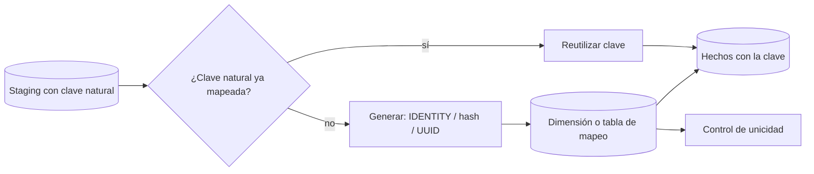

## 1. Resumen

Una clave sustituta (ver `surrogate-keys`) debe ser **única** y **estable**: el mismo cliente conserva su clave aunque la dimensión se recargue, para que los hechos ya cargados sigan apuntando bien. Hay tres formas de generarla en un pipeline:

- **IDENTITY o secuencia:** el motor asigna un entero nuevo al insertar. Es única, pero tiene huecos y no sigue el orden de los datos de origen. Para que sea estable hay que buscar primero la clave ya asignada.
- **Hash de la clave natural:** el mismo valor siempre da la misma clave, aunque se recargue todo. Puede colisionar, así que se verifica la unicidad.
- **UUID aleatorio:** único en la práctica, pero distinto en cada ejecución, así que se asigna una sola vez y se guarda.

`ROW_NUMBER()` sobre la carga **no** sirve como clave: al llegar un registro nuevo, los números de los demás cambian.

## 2. Qué es

«—»: no documentado en las fuentes de esta ficha.

| Método | BigQuery | Redshift | Fabric Warehouse | Synapse dedicado | PostgreSQL | Estable al recargar |
|---|---|---|---|---|---|---|
| IDENTITY / secuencia | — | `IDENTITY(seed, step)` | `IDENTITY` (solo `bigint`, sin semilla) | `IDENTITY` (no contiguo) | `GENERATED … AS IDENTITY` | Solo con tabla de mapeo |
| Hash de la clave natural | `FARM_FINGERPRINT` | Funciones hash (ver `change-detection`) | `HASHBYTES` (ver `change-detection`) | `HASHBYTES` | `md5` | Sí |
| UUID aleatorio | `GENERATE_UUID()` | — | — | — | `gen_random_uuid()` | Solo si se guarda |

## 3. Problema que resuelve

Las dimensiones se recargan, se reconstruyen y se versionan (SCD tipo 2). Si la clave cambia con cada recarga, los hechos quedan apuntando a otra fila. Si se repite, un hecho se une a dos dimensiones. Generar bien la clave evita ambos errores.

## 4. Cómo funciona

1. **IDENTITY o secuencia con tabla de mapeo:**
   - se busca la clave natural en la dimensión (o en una tabla de mapeo);
   - si existe, se reutiliza su clave;
   - si no, se inserta y el motor asigna una nueva.

   Los valores tienen huecos: PostgreSQL no revierte `nextval`, Fabric los admite explícitamente y Synapse no los asigna contiguos, por diseño.
2. **Unicidad no garantizada en todos los casos:**
   - Redshift no verifica la unicidad de valores insertados explícitamente en una identidad por defecto;
   - Synapse no la garantiza con `IDENTITY_INSERT`, cambios de semilla o un `UPDATE` de la columna de distribución;
   - Fabric sí la garantiza mientras exista la tabla.
3. **Hash determinista:** `FARM_FINGERPRINT('cliente|' || clave_natural)` en BigQuery da siempre el mismo `INT64`. Conviene incluir un prefijo de entidad y verificar la unicidad (ver `sql-quality-checks`), porque dos claves naturales distintas pueden colisionar.
4. **UUID aleatorio:** se genera una vez y se guarda. Volver a generarlo en una recarga cambia todas las claves.

## 5. Cuándo utilizarlo

- **IDENTITY:** dimensiones que se cargan de forma incremental y conservan sus filas, donde el motor ofrece identidad con unicidad garantizada.
- **Hash:** recargas completas o pipelines distribuidos que deben producir la misma clave en cualquier ejecución sin consultar el destino.
- **UUID:** cuando varias fuentes crean registros de forma independiente y la clave se guarda al crearla.

## 6. Cuándo no utilizarlo

- `ROW_NUMBER()` sobre la carga como clave permanente.
- IDENTITY con recargas completas sin tabla de mapeo: cada recarga asigna claves nuevas.
- Hash sin verificar la unicidad, o con una clave natural que cambia (por ejemplo, un email).
- `GENERATE_UUID()` dentro de un modelo que se reconstruye completo en cada ejecución.

## 7. Ejemplo sencillo

```sql
-- PostgreSQL (ejecutado): el ROLLBACK consume un valor y deja un hueco.
CREATE TABLE dim_producto (producto_sk bigint GENERATED ALWAYS AS IDENTITY, codigo text UNIQUE);
INSERT INTO dim_producto (codigo) VALUES ('P1');
BEGIN; INSERT INTO dim_producto (codigo) VALUES ('P2'); ROLLBACK;
INSERT INTO dim_producto (codigo) VALUES ('P3');
SELECT producto_sk, codigo FROM dim_producto;   -- 1 P1, 3 P3
```

## 8. Ejemplo de producción

Un modelo de dbt reconstruía `dim_cliente` completa cada noche y asignaba `cliente_sk` con `ROW_NUMBER() OVER (ORDER BY cliente_id)`. Un día se dio de alta un cliente con un `cliente_id` menor que los existentes, y todas las claves posteriores se corrieron en uno. Los hechos de los días anteriores quedaron apuntando a otros clientes.

El equipo cambió a `FARM_FINGERPRINT(CONCAT('cliente|', cliente_id))`, estable entre recargas, y agregó un control de unicidad sobre `cliente_sk`. Los hechos históricos se recargaron una vez con la clave nueva.

## 9. Arquitectura



## 10. Código

```sql
-- PostgreSQL (ejecutado). 1) Hash de la clave natural: misma clave en cualquier recarga.
--    Se toman 60 bits del MD5 para que entre en un bigint con signo.
SELECT codigo, ('x' || left(md5('producto|' || codigo), 15))::bit(60)::bigint AS producto_sk
FROM (VALUES ('P1'), ('P3')) AS v(codigo);

-- 2) ROW_NUMBER no es estable: si aparece P0, P1 pasa de 1 a 2.
SELECT codigo, row_number() OVER (ORDER BY codigo) AS sk FROM (VALUES ('P1'), ('P3')) AS v(codigo);
SELECT codigo, row_number() OVER (ORDER BY codigo) AS sk FROM (VALUES ('P0'), ('P1'), ('P3')) AS v(codigo);

-- BigQuery (sintaxis documentada; no ejecutado aquí): hash determinista y control de unicidad.
-- SELECT FARM_FINGERPRINT(CONCAT('cliente|', CAST(cliente_id AS STRING))) AS cliente_sk, * FROM stg_cliente;
-- ASSERT (SELECT COUNT(*) - COUNT(DISTINCT cliente_sk) FROM dim_cliente) = 0 AS 'cliente_sk repetida';
```

Resultados en PostgreSQL:

- la consulta 1 da a P1 y P3 claves de 18 dígitos que se repiten igual en cada ejecución;
- en la consulta 2, P1 recibe 1 en la primera carga y 2 en la segunda;
- `gen_random_uuid()` dio un valor distinto en cada llamada;
- el ejemplo de la sección 7 dejó el hueco del 2.

Las consultas de BigQuery siguen la sintaxis documentada de `FARM_FINGERPRINT` y `ASSERT` y no se ejecutaron.

## 11. GCP

En **BigQuery**, las opciones documentadas en esta ficha son:

- `FARM_FINGERPRINT`, un `INT64` que siempre da el mismo resultado para la misma entrada, para claves deterministas;
- `GENERATE_UUID()`, un UUID aleatorio que se guarda una vez.

La unicidad se verifica con un control (`ASSERT`, aserción de Dataform o test de dbt), porque BigQuery no aplica claves primarias (ver `sql-quality-checks`).

## 12. AWS

**Redshift** tiene `IDENTITY(seed, step)` y `GENERATED BY DEFAULT AS IDENTITY`, de tipo `INT` o `BIGINT`. Los valores generados son únicos, pero su orden puede no seguir el de los archivos de origen. En una identidad por defecto se pueden insertar valores explícitos, y Redshift no verifica su unicidad.

## 13. Azure

**Fabric Warehouse:**

- `IDENTITY` solo `bigint`, sin semilla ni incremento;
- valores únicos mientras exista la tabla, con huecos posibles;
- no se puede agregar a una tabla existente con `ALTER TABLE`.

**Synapse dedicado:**

- reparte los valores `IDENTITY` entre distribuciones, sin contigüidad;
- no garantiza la unicidad con `IDENTITY_INSERT`, cambios de semilla o un `UPDATE` de la columna de distribución.

El comportamiento es distinto aunque la sintaxis sea la misma.

## 14. Buenas prácticas

- Elegir la clave según cómo se carga la dimensión: incremental con identidad y mapeo, o recarga completa con hash.
- Verificar siempre la unicidad de la clave con un control.
- Con hash, incluir un prefijo de entidad y usar una clave natural estable.
- No asumir claves contiguas ni ordenadas en ningún motor.
- **Seguridad:** una clave derivada por hash de un identificador personal (RUT, email) puede revertirse por fuerza bruta si el espacio es pequeño; no exponerla como si fuera anónima.
- **Observabilidad:** registrar claves nuevas por carga y alertar si una recarga cambia claves existentes.
- **Costo:** el hash evita consultar la dimensión destino para asignar claves; la tabla de mapeo agrega un join por carga.

## 15. Errores frecuentes

- `ROW_NUMBER()` como clave permanente.
- Recarga completa con `IDENTITY` sin mapeo: todas las claves cambian.
- Suponer que IDENTITY no tiene huecos o sigue el orden de carga.
- Hash sin control de unicidad.
- `GENERATE_UUID()` en un modelo que se reconstruye en cada ejecución.

## 16. Trade-offs

IDENTITY da claves compactas y únicas, a cambio de necesitar el destino para reutilizarlas y de comportamientos distintos por motor. El hash es estable y no depende del destino, a cambio de colisiones posibles y claves más largas. El UUID es independiente entre fuentes, a cambio de tamaño y de tener que guardarlo.

## 17. Conceptos relacionados

- `surrogate-keys`: qué es y por qué.
- `scd-type-2`: una clave por versión.
- `dimension-tables`: dónde vive la clave.
- `sql-quality-checks`: control de unicidad.
- `change-detection`: funciones hash por motor.

## 18. Preguntas técnicas abiertas

1. ¿Tus dimensiones se cargan de forma incremental o se reconstruyen? ¿Qué método de clave corresponde?
2. ¿Cómo comprobarías que una recarga no cambió claves ya usadas por los hechos?
3. ¿Qué harías si un hash de clave natural colisiona?

## 19. Laboratorio relacionado

Pendiente (F4).

## 20. Fuentes

- AWS: *CREATE TABLE* (Amazon Redshift).
- Microsoft Learn: *IDENTITY columns in Fabric Data Warehouse* y *Using IDENTITY to create surrogate keys* (Synapse).
- Google Cloud: *Utility functions* y *Hash functions* (BigQuery).
- PostgreSQL: *Sequence Manipulation Functions* y *CREATE TABLE*.

El detalle de cada fuente está en `sources` del frontmatter.

## 21. Fecha de última verificación

2026-10-07. En `review_required` hasta la revisión B-F3.1 del lote F3b-02c.

## 22. Historial de cambios importantes

- 2026-10-05: esqueleto creado desde el blueprint (rama `f/sql`).
- 2026-10-07: ficha completa (lote F3b-02c, dominio 02-sql).
