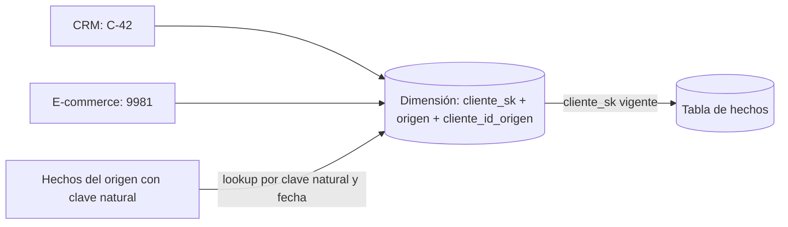

## 1. Resumen

Una clave sustituta es una clave primaria sin significado de negocio que el data warehouse genera y controla. Se usa en las dimensiones en lugar de la clave natural del sistema de origen porque, al guardar la historia, un mismo cliente puede tener varias filas, y porque las claves naturales de distintos orígenes pueden chocar o cambiar. Cómo se genera depende del motor, y en los motores distribuidos no hay que esperar valores consecutivos.

## 2. Qué es

Es la columna que identifica **cada fila** de una dimensión, distinta de la **clave natural** (o de negocio), que identifica al miembro en el sistema de origen:

- `cliente_id = "C-42"` es la clave natural;
- `cliente_sk = 1001` y `cliente_sk = 2310` son dos claves sustitutas, dos versiones del mismo cliente.

Las tablas de hechos guardan la clave sustituta, no la natural.

## 3. Problema que resuelve

- **Historia:** con SCD tipo 2 hay varias filas por clave natural; la clave natural deja de ser única.
- **Varios orígenes:** dos sistemas pueden usar el mismo id para clientes distintos, o formatos incompatibles.
- **Control:** si el origen recicla o cambia sus ids, el data warehouse no se rompe.
- **Tamaño:** una clave de una sola columna reemplaza claves naturales de varias columnas y hace más angosta la tabla de hechos.

## 4. Cómo funciona

1. Al insertar una fila nueva en la dimensión (miembro nuevo o nueva versión tipo 2), se genera una clave sustituta.
2. La dimensión guarda ambas: la sustituta (clave primaria) y la natural (para buscar el miembro).
3. Al cargar hechos, se busca la clave sustituta vigente para la clave natural del hecho, en el momento del hecho.
4. Los hechos guardan solo la sustituta.

Formas de generarla:

- **Secuencia o `IDENTITY`:** entero autogenerado por el motor. Kimball propone enteros asignados en secuencia.
- **UUID:** identificador aleatorio, sin coordinación entre procesos.
- **Hash de la clave natural y la versión:** determinista; la misma entrada da siempre la misma clave.

## 5. Cuándo utilizarlo

- En todas las dimensiones que siguen historia (SCD tipo 2).
- En dimensiones que integran miembros de varios sistemas de origen.
- Cuando la clave natural es compuesta, larga o poco confiable.

## 6. Cuándo no utilizarlo

- En la **dimensión fecha**, que Kimball exime de la regla: es estable y predecible, y puede usar una clave con significado (por ejemplo `20260930`).
- En tablas de staging o raw, donde se conserva la clave del origen tal cual.

## 7. Ejemplo sencillo

La venta del 2024 del cliente C-42 guarda `cliente_sk = 1001`. En 2026 el cliente cambia de segmento y se crea la versión `cliente_sk = 2310`. Las ventas nuevas guardan 2310 y las viejas siguen en 1001: cada venta queda asociada al segmento vigente cuando ocurrió.

## 8. Ejemplo de producción

Un data warehouse integra clientes de un CRM y de un e-commerce, que usan ids distintos. La dimensión guarda `origen` y `cliente_id_origen` como clave natural compuesta, y una clave sustituta generada por el warehouse. La carga de hechos resuelve la clave sustituta con un `JOIN` por clave natural y rango de validez. Los hechos que llegan antes que su cliente apuntan a un miembro provisional, cuya clave se reserva y luego se completa.

## 9. Arquitectura



## 10. Código

```sql
-- BigQuery (sintaxis documentada; no ejecutado aquí): dos formas de generar la clave sustituta al insertar miembros nuevos.
-- Requiere: dim_cliente(cliente_sk, cliente_hk, origen, cliente_id_origen, ...) y stg_cliente deduplicado.

-- a) UUID aleatorio: no requiere coordinación, pero es un STRING de 32 hexadecimales.
-- b) Hash determinista de clave natural + versión: repetir la carga produce la misma clave.
INSERT INTO `proyecto.dwh.dim_cliente` (cliente_sk, cliente_hk, origen, cliente_id_origen, valido_desde)
SELECT
  GENERATE_UUID() AS cliente_sk,
  FARM_FINGERPRINT(TO_JSON_STRING(STRUCT(s.origen, s.cliente_id_origen, s.valido_desde))) AS cliente_hk,  -- sin CONCAT: NULL → null
  s.origen, s.cliente_id_origen, s.valido_desde
FROM `proyecto.staging.stg_cliente` AS s
LEFT JOIN `proyecto.dwh.dim_cliente` AS d
  ON d.origen = s.origen AND d.cliente_id_origen = s.cliente_id_origen AND d.valido_desde = s.valido_desde
WHERE d.cliente_id_origen IS NULL;  -- solo miembros o versiones que no existen: reejecutar no duplica
```

El ejemplo muestra las dos opciones lado a lado; en un modelo real se elige una. El hash usa `TO_JSON_STRING(STRUCT(...))` y no `CONCAT`: según la documentación de BigQuery, `NULL` se codifica como `null` y el texto entre comillas con escape, así que un `NULL`, un texto que imite un marcador o un separador dentro de un valor no producen la misma entrada. Una clave natural nula igual debe rechazarse antes con un control de no nulos. El `LEFT JOIN ... IS NULL` hace que reejecutar la carga no inserte filas duplicadas.

## 11. GCP

En **BigQuery**, las claves sustitutas se generan habitualmente con funciones: `GENERATE_UUID()`, que devuelve un UUID aleatorio como `STRING`, o funciones de hash como `FARM_FINGERPRINT`, que devuelve un `INT64` y siempre da la misma salida para la misma entrada. El UUID no es reproducible entre ejecuciones; el hash sí, pero hay que incluir en la entrada todo lo que distingue una versión de otra. A diferencia de `IDENTITY` en Redshift o Synapse, la clave no la asigna una propiedad de la columna sino la sentencia de carga.

## 12. AWS

En **Redshift**, `IDENTITY(seed, step)` genera valores únicos en columnas `INT` o `BIGINT`. Con `INSERT ... SELECT` o `COPY` la carga es paralela y Redshift **salta valores** para garantizar unicidad: son únicos, pero no consecutivos ni en el orden de los archivos de origen. Con `GENERATED BY DEFAULT AS IDENTITY` se pueden insertar valores explícitos, que pueden duplicarse: la unicidad deja de estar garantizada.

## 13. Azure

En **Synapse** (dedicated SQL pool), la propiedad `IDENTITY` crea claves sustitutas escalando en todas las distribuciones, y por eso **no garantiza el orden** en que se asignan los valores. La documentación de **Fabric Warehouse** recomienda una clave sustituta de una sola columna aunque la clave natural parezca aceptable. Como en Redshift, la clave sirve para identificar, no para ordenar.

## 14. Buenas prácticas

- Tratar la clave sustituta como un identificador opaco: no ordenar ni inferir fechas a partir de ella.
- Guardar siempre también la clave natural, para poder buscar y reconciliar.
- Si la carga debe ser reproducible, preferir una clave determinista (hash de clave natural y versión).
- Resolver la clave sustituta de los hechos por clave natural y rango de validez, no solo por la fila vigente de hoy.
- **Seguridad:** una clave hash de un dato personal (email, documento) puede revertirse por fuerza bruta; no usar datos sensibles como única entrada del hash.
- **Observabilidad:** contar hechos que no encontraron clave sustituta (apuntan al miembro "desconocido") por carga.
- **Costo:** una clave entera o `INT64` ocupa menos que un UUID `STRING` en tablas de hechos de miles de millones de filas.

## 15. Errores frecuentes

- Usar la clave natural como clave primaria en una dimensión tipo 2.
- Esperar valores consecutivos u ordenados de `IDENTITY` en motores distribuidos.
- Insertar valores explícitos en una columna `GENERATED BY DEFAULT AS IDENTITY` y romper la unicidad.
- Generar UUID en una carga que se reejecuta y crear miembros duplicados.

## 16. Trade-offs

`IDENTITY` o secuencias dan claves compactas, pero dependen del motor y no son reproducibles entre entornos. Los UUID no requieren coordinación, pero ocupan más y no son reproducibles. Los hashes son reproducibles y no requieren coordinación, a cambio de un riesgo (bajo) de colisión y de exigir una entrada bien definida.

## 17. Conceptos relacionados

- `slowly-changing-dimensions`: el motivo principal de las claves sustitutas.
- `scd-type-2`: cada versión recibe una clave nueva.
- Con ficha: `dimension-tables`, `surrogate-key-generation`.
- Del blueprint, pendiente de ficha: `natural-keys`.

## 18. Preguntas técnicas abiertas

1. ¿Qué pasa con los hechos ya cargados si el sistema de origen recicla un id de cliente?
2. ¿Usarías UUID o hash si la dimensión se reconstruye desde cero cada cierto tiempo?
3. ¿Cómo resolverías la clave de un hecho que llega antes que su cliente?

## 19. Laboratorio relacionado

Pendiente (F4): modelo dimensional de ventas (lab de tipo A).

## 20. Fuentes

- Kimball Group: *Dimension Surrogate Keys*. Referencia conceptual canónica (Nivel 4).
- Microsoft Learn: *Modeling dimension tables in Warehouse* (Fabric) y *Use IDENTITY to create surrogate keys* (Synapse).
- Google Cloud: *Utility functions* y *Hash functions* (BigQuery).
- AWS: *CREATE TABLE* (Redshift).

El detalle de cada fuente está en `sources` del frontmatter.

## 21. Fecha de última verificación

2026-10-01. Pasa a `verified`: revisión B-F3.1 del lote 3 aplicada, sin VERIFY pendientes.

## 22. Historial de cambios importantes

- 2026-09-30: creación (lote 3 de F3).
- 2026-10-01: `verification_status: verified` (revisión B-F3.1 del lote 3 aplicada; sin VERIFY pendientes).
- 2026-10-06: la sección de conceptos relacionados ya no lista como pendiente de ficha a `dimension-tables`, que ya tiene ficha.
- 2026-10-07: la sección de conceptos relacionados ya no lista como pendiente de ficha a `surrogate-key-generation`, que ya tiene ficha.
- 2026-10-07: cambio mínimo (aprobado por Felipe): `cliente_hk` usa el marcador de NULL de `change-detection` (`IFNULL(…, '\\N')`), porque `CONCAT` de BigQuery devuelve NULL con un argumento NULL y la clave quedaba NULL. Una clave natural nula sigue debiendo rechazarse con un control de no nulos (ver `sql-quality-checks`). Sigue `verified`, pendiente de revisión de Cursor.
- 2026-10-07: revisión de los cambios mínimos de NULL aplicada (docs/reviews/fixes-null-concat.md, aprobada por Felipe): `cliente_hk` pasa de `CONCAT` con marcador a `FARM_FINGERPRINT(TO_JSON_STRING(STRUCT(...)))`, respaldado por las codificaciones JSON de BigQuery, que elimina las ambigüedades del marcador y del separador; el bloque queda marcado como sintaxis documentada, no ejecutado. Sigue `verified`.
