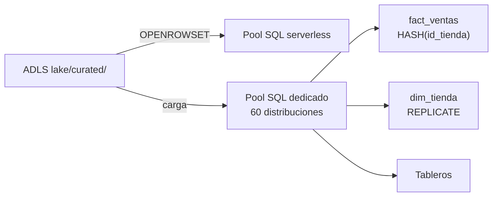

## 1. Resumen

**Azure Synapse Analytics** reúne en un workspace, según su documentación:

- **Synapse SQL**, con un **pool dedicado** (warehouse MPP con capacidad reservada) y un **pool serverless** (consultas sobre el lake, pago por uso);
- **Spark**, **Data Explorer** y **pipelines**.

En el pool dedicado, cada tabla se reparte en **60 distribuciones**: por **hash** de una columna (para hechos grandes), **round-robin** (carga rápida) o **replicada** (tablas chicas, una copia en cada nodo).

Sobre Synapse y Fabric, las páginas de Synapse traen un aviso: «If you're new to data warehousing, start with Fabric Data Warehouse. Existing dedicated SQL pool workloads can upgrade to Fabric». Microsoft publica además una guía de migración a Fabric Data Warehouse. Ninguna de las páginas citadas dice que Synapse esté deprecado.

## 2. Qué es

- **Workspace de Synapse:** agrupa SQL, Spark, Data Explorer y pipelines.
- **Pool SQL dedicado:**
  - 60 distribuciones por tabla;
  - **hash**: filas con el mismo valor en la misma distribución; mejora consultas sobre hechos grandes;
  - **round-robin**: reparto parejo; mejora la carga;
  - **replicada**: copia completa en cada nodo de cómputo; evita mover datos en los joins; mejor con menos de 2 GB comprimidos.
- **Pool SQL serverless:** un endpoint por workspace que consulta Parquet, Delta Lake y texto delimitado del lake con `OPENROWSET(BULK ...)`, con pago por uso.
- **Spark en Synapse:** Spark administrado dentro del workspace.

## 3. Problema que resuelve

Tener un warehouse MPP y consultas sobre el lake en un mismo lugar, con T-SQL, junto a Spark y pipelines. El pool serverless explora el lake sin cargar datos; el dedicado da rendimiento estable para tableros y modelos.

## 4. Cómo funciona

1. El lake vive en ADLS Gen2.
2. El pool serverless consulta los archivos con `OPENROWSET`; filtrar por carpeta (por ejemplo, el mes) limita lo que se lee.
3. Las tablas de hechos se cargan al pool dedicado con distribución por hash en la clave del join más frecuente.
4. Las dimensiones chicas se replican en cada nodo.
5. Un join entre el hecho y una dimensión replicada no mueve datos entre nodos.

## 5. Cuándo utilizarlo

- Cargas existentes en pools dedicados de Synapse.
- Consultas ad hoc con T-SQL sobre el lake (pool serverless).
- Equipos que necesitan SQL, Spark y pipelines en un mismo workspace.

## 6. Cuándo no utilizarlo

- Un warehouse nuevo: las páginas de Synapse recomiendan empezar con Fabric Data Warehouse.
- Tablas de cientos de GB replicadas: la guía sugiere replicar por debajo de 2 GB comprimidos.
- Distribuir por hash con una columna de pocos valores, que concentra filas en pocas distribuciones.

## 7. Ejemplo sencillo

`fact_ventas` se distribuye por hash en `id_tienda` y `dim_tienda` se replica. La suma de ventas por región hace el join en cada nodo sin mover filas, porque cada nodo tiene la dimensión completa.

## 8. Ejemplo de producción

Un warehouse en un pool dedicado:

- hechos de ventas por hash en `id_tienda`, con columnstore;
- dimensiones de menos de 2 GB replicadas;
- un pool serverless para que los analistas exploren `curated/` antes de pedir una tabla nueva.

El equipo evalúa la migración a Fabric Data Warehouse con la guía y el asistente de Microsoft.

## 9. Arquitectura



## 10. Código

```sql
-- T-SQL de Azure Synapse (no ejecutado: no hay Synapse en local ni en la CI).
-- Pool SQL dedicado: hecho distribuido por hash en la clave del join más frecuente, dimensión chica replicada.
CREATE TABLE dbo.fact_ventas
(
    id_venta   bigint        NOT NULL,
    id_tienda  int           NOT NULL,
    fecha      date          NOT NULL,
    monto      decimal(12,2) NOT NULL
)
WITH
(
    DISTRIBUTION = HASH(id_tienda),
    CLUSTERED COLUMNSTORE INDEX
);

CREATE TABLE dbo.dim_tienda
(
    id_tienda int         NOT NULL,
    region    varchar(32) NOT NULL
)
WITH
(
    DISTRIBUTION = REPLICATE,
    CLUSTERED INDEX (id_tienda)
);

-- Pool SQL serverless: leer Parquet del lake sin cargarlo; el filtro por carpeta limita lo que se lee.
SELECT id_tienda, SUM(monto) AS total
FROM OPENROWSET(
    BULK 'https://dekhlakeprod.dfs.core.windows.net/lake/curated/ventas/dt=2026-10-*/*.parquet',
    FORMAT = 'PARQUET'
) AS ventas
GROUP BY id_tienda;
```

**No ejecutado:** el T-SQL de Synapse no se corrió (no hay Synapse en local ni en la CI; ADR-013). La sintaxis de distribución sigue las guías de tablas distribuidas y replicadas, y la de `OPENROWSET`, la página del pool serverless. Los nombres y la ruta son ilustrativos.

## 11. GCP

No aplica de forma específica: esta ficha describe Synapse. El warehouse de GCP es BigQuery (ver `bigquery-architecture`). Las diferencias, según sus páginas:

| | Synapse | BigQuery |
|---|---|---|
| Distribución física | Se elige por tabla: hash, round-robin o replicada, sobre 60 distribuciones | No hay distribución que elegir: el motor reparte el trabajo entre workers |
| Consultar el lake sin cargar | Pool serverless con `OPENROWSET` | Tablas externas |
| Capacidad | Pool dedicado reservado o serverless por uso | Ver `bigquery-slots` |

## 12. AWS

No aplica de forma específica. Lo más cercano es Redshift para el warehouse (ver `redshift-architecture`) y Athena para el lake (ver `athena-serverless-queries`). Las diferencias, según sus páginas:

| | Synapse | Redshift / Athena |
|---|---|---|
| Distribución | Hash, round-robin o replicada sobre 60 distribuciones | Redshift: AUTO, EVEN, KEY o ALL |
| Tablas chicas copiadas a todos los nodos | `REPLICATE` | Redshift: `DISTSTYLE ALL` |
| Consultar el lake | Pool serverless con `OPENROWSET` | Athena, con SQL directamente sobre S3 |

## 13. Azure

**Azure Synapse Analytics.** Los pools dedicado y serverless, las distribuciones, las tablas replicadas, `OPENROWSET` y Spark son los de sus páginas. La relación con Fabric es la que dicen sus propias páginas (el aviso que recomienda Fabric Data Warehouse para empezar) y la guía de migración. Los precios se consultan en la página de precios.

## 14. Buenas prácticas

- Hash por la columna del join más frecuente, con muchos valores distintos.
- Replicar solo dimensiones chicas.
- Pool serverless para explorar; dedicado para cargas estables.
- Para proyectos nuevos, evaluar Fabric Data Warehouse, como recomiendan las páginas de Synapse.
- **Seguridad:** identidades administradas para leer el lake y permisos por esquema en el pool.
- **Observabilidad:** seguir el movimiento de datos en los planes y la distribución de filas por distribución (sesgo).
- **Costo:** el pool dedicado se paga por capacidad mientras está encendido; el serverless, por datos procesados. Los montos se consultan en la página de precios.

## 15. Errores frecuentes

- Distribuir un hecho por una columna con sesgo y concentrar filas.
- Replicar tablas grandes.
- Dejar el pool dedicado encendido sin uso.
- Afirmar que Synapse está deprecado sin que Microsoft lo diga.

## 16. Trade-offs

El pool dedicado da control sobre la distribución y rendimiento estable, a cambio de diseñar tablas y pagar capacidad reservada. El serverless no tiene nada que administrar y cobra por uso, con menos rendimiento para cargas repetidas. Fabric Data Warehouse es lo que Microsoft recomienda para empezar, con su propio modelo.

## 17. Conceptos relacionados

- `data-warehouse`: el tipo de sistema.
- `redshift-architecture` y `bigquery-architecture`: los warehouses de AWS y GCP.
- `athena-serverless-queries`: consultar el lake sin cargarlo, en AWS.
- `azure-analytics-landscape`: Synapse frente a Fabric, Data Factory y Databricks.
- `adls-gen2-storage`: el lake que lee el pool serverless.

## 18. Preguntas técnicas abiertas

1. ¿Por qué columna distribuirías tu hecho más grande?
2. ¿Qué tablas replicarías, y cuánto pesan comprimidas?
3. ¿Qué te haría migrar de un pool dedicado a Fabric Data Warehouse?

## 19. Laboratorio relacionado

Pendiente (F4).

## 20. Fuentes

- Microsoft Learn, Azure Synapse Analytics: *What is Azure Synapse Analytics?*, *Guidance for designing distributed tables using dedicated SQL pool in Azure Synapse Analytics*, *Design guidance for using replicated tables in Synapse SQL pool*, *Serverless SQL pool in Azure Synapse Analytics*, *How to use OPENROWSET using serverless SQL pool in Azure Synapse Analytics* y *What is Apache Spark in Azure Synapse Analytics?*; *Azure Synapse Analytics pricing*.
- Microsoft Learn, Microsoft Fabric: *Migration planning: Azure Synapse Analytics dedicated SQL pools to Fabric Data Warehouse*.
- AWS: *Distribution styles* (Redshift) y *What is Amazon Athena?*. Google Cloud, BigQuery: *Overview of BigQuery storage* e *Introduction to external tables*.

El detalle de cada fuente está en `sources` del frontmatter.

## 21. Fecha de última verificación

2026-10-13. `review_required`: pendiente de revisión B-F3.1 del lote F3b-10a.

## 22. Historial de cambios importantes

- 2026-10-13: creación (lote F3b-10a).
