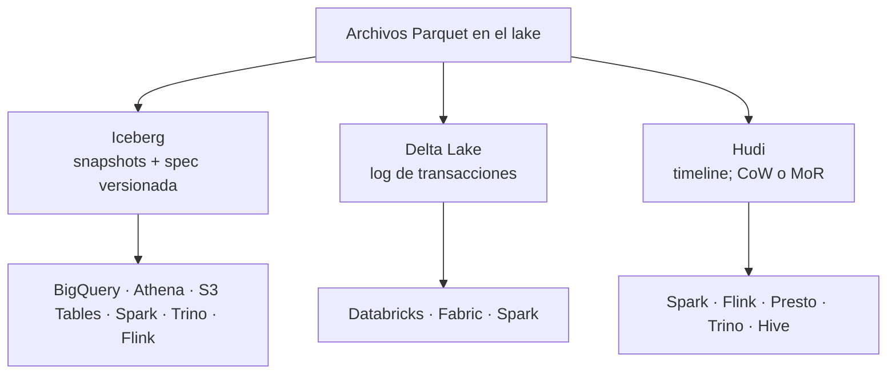

## 1. Resumen

Iceberg, Delta Lake y Hudi resuelven lo mismo a grandes rasgos (tablas con transacciones sobre archivos, ver `open-table-formats`), pero **no son equivalentes**. Difieren en cómo guardan los metadatos, cómo particionan, cómo actualizan filas y qué motores y servicios los soportan mejor:

- **Iceberg:** snapshots descritos por una especificación con versiones de formato; particionado oculto que puede evolucionar; borrados por fila con archivos de borrado (versión 2 del spec).
- **Delta Lake:** un log de transacciones junto a los archivos Parquet; concurrencia optimista; time travel por versión o por fecha; `vacuum` manual para borrar archivos viejos.
- **Hudi:** una timeline de acciones; dos tipos de tabla, copy-on-write (lecturas rápidas) y merge-on-read (escrituras rápidas con compactación).

Elegir uno es elegir también el ecosistema: BigQuery y Athena trabajan con Iceberg; Databricks y Fabric, con Delta.

## 2. Qué es

- **Snapshot y especificación (Iceberg):** cada commit deja un snapshot; el formato tiene versiones (1 a 4).
- **Log de transacciones (Delta):** el historial de operaciones de la tabla, con `DESCRIBE HISTORY`.
- **Timeline (Hudi):** el log de acciones sobre la tabla en instantes de tiempo.
- **Particionado oculto (Iceberg):** la partición es una transformación de una columna (`day(ts)`) y las consultas filtran por la columna, no por la partición.
- **Copy-on-write y merge-on-read (Hudi):** reescribir archivos base al actualizar, o escribir cambios en logs y combinar al leer.

## 3. Problema que resuelve

Un equipo elige un formato de tabla por popularidad y después descubre que su warehouse no lo lee, o que las actualizaciones de CDC reescriben archivos enormes. Comparar con las páginas de cada proyecto, diferencia por diferencia, evita elegir por costumbre.

## 4. Cómo funciona

| | Iceberg | Delta Lake | Hudi |
|---|---|---|---|
| Metadatos | Snapshots y metadatos según una especificación con versiones de formato (*Iceberg Table Spec*) | Log de transacciones junto a los archivos (*What is Delta Lake in Azure Databricks?*) | Timeline de acciones en instantes de tiempo (*Timeline*) |
| Particionado | Oculto: Iceberg calcula la partición y poda sin filtros extra (*Partitioning*) | Columnas de partición explícitas (`PARTITIONED BY`, `partitionBy`), que pueden ser columnas generadas, con poda por partición y estadísticas (*Table batch reads and writes*) | Una columna de partición (`partitionpath.field`) en la escritura (*Spark Quick Start*) |
| Cambiar la partición | En el lugar; los datos viejos conservan su especificación (*Evolution*) | Al sobrescribir la tabla con `overwriteSchema=true`, que reemplaza esquema y partición (*Table batch reads and writes*) | Las páginas citadas no lo describen |
| Actualizar o borrar filas | Archivos de borrado sin reescribir los datos (versión 2 del spec) | Reescribe los archivos afectados, con concurrencia optimista (*Concurrency control*) | Copy-on-write (archivos base nuevos) o merge-on-read (logs y compactación) (*Table & Query Types*) |
| Concurrencia | Optimista: intercambio atómico del metadato (*Reliability*) | Optimista: leer, escribir, validar y confirmar (*Concurrency control*) | Las páginas citadas mencionan un lock provider en el quick start, sin detallar el modelo |
| Time travel | Por snapshot; el spec define las lecturas en un punto del tiempo (*Iceberg Table Spec*) | `versionAsOf` o `timestampAsOf` (*Table batch reads and writes*) | `as.of.instant` (*Spark Quick Start*) |
| Archivos viejos | Se expiran snapshots y se borran los archivos que ya no usa ninguno (*Iceberg Table Spec*); en S3 Tables, automático | `vacuum`, no automático, retención de 7 días por defecto (*Table utility commands*) | Compactación periódica en merge-on-read (*Table & Query Types*) |

## 5. Cuándo utilizarlo

- **Iceberg:** cuando se necesita leer desde muchos motores y servicios (BigQuery, Athena, S3 Tables, Trino, Flink) y cambiar la partición con el tiempo.
- **Delta Lake:** plataformas en Databricks o Fabric, donde es el formato nativo.
- **Hudi:** ingesta incremental con muchas actualizaciones, donde merge-on-read baja la latencia de escritura.

## 6. Cuándo no utilizarlo

- Elegir un formato que el motor principal no soporta bien.
- Merge-on-read para tablas que se leen mucho más de lo que se escriben: Hudi lo describe como el tipo que equilibra, con lecturas que pueden variar.
- Delta sin programar `vacuum`: los archivos viejos se acumulan.
- Delta con una versión de Spark que su tabla de compatibilidad no lista (hoy, Spark 4.2).

## 7. Ejemplo sencillo

Una tabla Iceberg de logs particionada por `day(ts)`, sin columna de partición. Tres días de datos dejan tres archivos; un filtro por un día lee solo uno. Después la partición pasa a `month(ts)` sin reescribir los archivos: la tabla queda con dos especificaciones de partición y las mismas 6 filas.

## 8. Ejemplo de producción

Una empresa con dos plataformas:

- en GCP y AWS, tablas Iceberg leídas desde BigQuery y Athena, con la partición por día que pasa a mes cuando el volumen baja;
- en Azure, tablas Delta en Databricks, con `vacuum` semanal y retención acorde al time travel que se necesita;
- una tabla de CDC con mucho volumen de actualizaciones en Hudi merge-on-read, con compactación programada;
- la decisión de formato documentada por tabla, con la versión de Spark compatible.

## 9. Arquitectura



## 10. Código

```python
# Python 3.12, PyIceberg 0.12 y PyArrow (ejecutado en la CI; mypy --strict sin errores; ADR-018): particionado oculto de
# Iceberg. La tabla se particiona por day(ts) sin una columna de partición; la consulta filtra por ts y Iceberg descarta
# los archivos de otros días. Después, la partición evoluciona a month(ts) sin reescribir los archivos viejos.
from __future__ import annotations

import sys
import tempfile
from datetime import datetime
from pathlib import Path

import pyarrow as pa  # type: ignore[import-untyped]  # pyarrow no publica stubs de tipos
from pyiceberg.catalog.sql import SqlCatalog
from pyiceberg.partitioning import PartitionField, PartitionSpec
from pyiceberg.schema import Schema
from pyiceberg.transforms import DayTransform, MonthTransform
from pyiceberg.types import DoubleType, NestedField, TimestampType

base = Path(sys.argv[1] if len(sys.argv) > 1 else tempfile.mkdtemp())
(base / "warehouse").mkdir(parents=True, exist_ok=True)
catalog = SqlCatalog("local", uri=f"sqlite:///{(base / 'catalog.db').as_posix()}", warehouse=(base / "warehouse").as_uri())
catalog.create_namespace("logs")

schema = Schema(NestedField(1, "ts", TimestampType(), required=False), NestedField(2, "latencia", DoubleType(), required=False))
spec = PartitionSpec(PartitionField(source_id=1, field_id=1000, transform=DayTransform(), name="ts_day"))
table = catalog.create_table("logs.requests", schema=schema, partition_spec=spec)

arrow_schema = pa.schema([pa.field("ts", pa.timestamp("us")), pa.field("latencia", pa.float64())])
for day in (1, 2, 3):   # un append por día: un archivo por partición
    rows = {"ts": [datetime(2026, 10, day, 12), datetime(2026, 10, day, 18)], "latencia": [0.2, 0.4]}
    table.append(pa.Table.from_pydict(rows, schema=arrow_schema))

all_files = list(table.scan().plan_files())
one_day = list(table.scan(row_filter="ts >= '2026-10-02T00:00:00' and ts < '2026-10-03T00:00:00'").plan_files())
print(f"archivos de la tabla: {len(all_files)}; archivos que lee un filtro por un día: {len(one_day)}")

with table.update_spec() as update:   # evolución de la partición: de día a mes, solo para lo que se escriba
    update.remove_field("ts_day")
    update.add_field("ts", MonthTransform(), "ts_month")
table = catalog.load_table("logs.requests")
print(f"especificaciones de partición: {len(table.metadata.partition_specs)}; actual: {table.spec().fields[0].name}")
print(f"filas: {table.scan().to_arrow().num_rows}")
```

```python
# PySpark con Delta Lake y Apache Hudi (no ejecutado: la tabla de compatibilidad de Delta no lista Spark 4.2, que usa la
# CI, y Hudi queda fuera por decisión del plan; ADR-018). Las formas siguen «Quick Start» de Delta Lake y «Spark Quick
# Start» de Hudi 1.2.1. La sesión se arranca con los paquetes de cada formato, como indican esas páginas.
from pyspark.sql import SparkSession

spark = SparkSession.builder.getOrCreate()   # con --packages y --conf de Delta o de Hudi, según el formato
pedidos = spark.createDataFrame([(1, "norte", 10.0), (2, "sur", 25.0)], ["id", "tienda", "monto"])

# Delta Lake: cada escritura agrega una versión al log de transacciones; versionAsOf lee una versión anterior.
pedidos.write.format("delta").save("/tmp/delta/pedidos")
pedidos.limit(1).write.format("delta").mode("overwrite").save("/tmp/delta/pedidos")
version_0 = spark.read.format("delta").option("versionAsOf", 0).load("/tmp/delta/pedidos")   # time travel
spark.sql("DESCRIBE HISTORY delta.`/tmp/delta/pedidos`").show()

# Hudi: tabla merge-on-read con clave de registro; las actualizaciones van a archivos de log y se combinan al leer.
hudi_options = {
    "hoodie.table.name": "pedidos",
    "hoodie.datasource.write.recordkey.field": "id",
    "hoodie.datasource.write.partitionpath.field": "tienda",
    "hoodie.datasource.write.table.type": "MERGE_ON_READ",
}
pedidos.write.format("hudi").options(**hudi_options).mode("overwrite").save("/tmp/hudi/pedidos")
```

El primer script se **ejecuta en la CI con PyIceberg 0.12 y un catálogo SQLite** (ADR-018) y pasa `mypy --strict`: imprime `archivos de la tabla: 3; archivos que lee un filtro por un día: 1`, `especificaciones de partición: 2; actual: ts_month` y `filas: 6`. El segundo **no se ejecutó**: la tabla de compatibilidad de Delta Lake no lista Spark 4.2, que usa la CI, y Hudi queda fuera por decisión del plan (ADR-018). Sus formas siguen *Quick Start* de Delta Lake y *Spark Quick Start* de Hudi.

## 11. GCP

En GCP, **BigQuery** administra tablas **Iceberg**. Según *Apache Iceberg managed tables* (no ejecutado):

| | Iceberg | Delta Lake | Hudi |
|---|---|---|---|
| Tabla administrada en BigQuery | Sí: «Apache Iceberg managed tables», con los datos en buckets del cliente | La página citada no lo trata | La página citada no lo trata |

## 12. AWS

En AWS, **S3 Tables** y **Athena** trabajan con **Iceberg**. Según *Working with Amazon S3 Tables and table buckets* y *Query Apache Iceberg tables* (no ejecutado):

| | Iceberg | Delta Lake | Hudi |
|---|---|---|---|
| S3 Tables | Tablas Iceberg con mantenimiento automático | Las páginas citadas no lo tratan | Las páginas citadas no lo tratan |
| Athena | Lectura, escritura, time travel y DDL | Lake Formation administra permisos de lectura, no los de `VACUUM`, `MERGE`, `UPDATE` u `OPTIMIZE`; `read_restored_glacier_objects` da error | Igual con Lake Formation; `read_restored_glacier_objects` no da error, pero los objetos de Glacier no se saltan |

## 13. Azure

En Azure, **Databricks** y **Fabric** trabajan con **Delta Lake**. Según *What is Delta Lake in Azure Databricks?* y *Delta Lake table format interoperability* (no ejecutado):

| | Iceberg | Delta Lake | Hudi |
|---|---|---|---|
| Azure Databricks | Clonar en forma incremental o convertir tablas Iceberg a Delta, y seguir cambios por fila de tablas Iceberg v3 | La capa de almacenamiento de las tablas | Las páginas citadas no lo tratan |
| Microsoft Fabric | Las páginas citadas no lo tratan | El formato que generan y consumen todas las experiencias | Las páginas citadas no lo tratan |

## 14. Buenas prácticas

- Elegir el formato por los motores y servicios que lo van a leer y escribir.
- Comprobar la compatibilidad del formato con la versión del motor (Delta lo publica en su tabla de releases).
- Programar el mantenimiento propio de cada formato: `vacuum` en Delta, compactación en Hudi merge-on-read, y el que defina el catálogo o servicio de Iceberg.
- **Seguridad:** los permisos van en el catálogo y en el bucket, cualquiera sea el formato.
- **Observabilidad:** archivos chicos, snapshots o versiones retenidos y duración de la compactación.
- **Costo:** time travel y archivos viejos son almacenamiento; merge-on-read cambia costo de escritura por costo de lectura.

## 15. Errores frecuentes

- Presentar los tres formatos como intercambiables y descubrir tarde que el warehouse no lee uno de ellos.
- Usar Delta con una versión de Spark no listada en su tabla de compatibilidad.
- Merge-on-read sin compactación programada.
- Filtrar por una columna de partición explícita en Iceberg cuando la partición es oculta: se filtra por la columna original.

## 16. Trade-offs

Iceberg favorece la interoperabilidad entre motores y la evolución de la partición. Delta Lake favorece la integración con Databricks y Fabric, a cambio de depender de su ecosistema y de versiones de Spark compatibles. Hudi da opciones de escritura incremental (merge-on-read), a cambio de compactación y lecturas que pueden variar. Ninguno gana en todo.

## 17. Conceptos relacionados

- `open-table-formats`: lo que tienen en común.
- `partitioning`: particionado en general.
- `change-data-capture`: actualizaciones y borrados desde CDC.
- `lakehouse`: la arquitectura.
- `azure-databricks-lakehouse`: Delta en Azure Databricks.
- `bigquery-biglake-tables`: Iceberg en BigQuery.

## 18. Preguntas técnicas abiertas

1. ¿Qué motores leen tus tablas del lake y qué formatos soporta cada uno?
2. ¿Tus tablas reciben más escrituras o más lecturas?
3. ¿Qué versión de Spark corre tu plataforma y qué dice la tabla de compatibilidad de tu formato?

## 19. Laboratorio relacionado

Pendiente (F4).

## 20. Fuentes

- Apache Iceberg: *Documentation* (introducción), *Iceberg Table Spec*, *Partitioning*, *Evolution* y *Reliability*.
- Delta Lake: *Concurrency control*, *Table batch reads and writes*, *Table utility commands*, *Quick Start* y *Releases*.
- Apache Hudi: *Overview*, *Table & Query Types*, *Timeline* y *Spark Quick Start*.
- Google Cloud: *Apache Iceberg managed tables*.
- AWS: *Query Apache Iceberg tables* y *Working with Amazon S3 Tables and table buckets*.
- Microsoft Learn: *What is Delta Lake in Azure Databricks?* y *Delta Lake table format interoperability*.

El detalle de cada fuente está en `sources` del frontmatter.

## 21. Fecha de última verificación

2026-10-20. Pasa a `verified`: revisión B-F3.1 del lote F3b-20b aplicada, sin VERIFY pendientes.

## 22. Historial de cambios importantes

- 2026-10-20: creación (lote F3b-20b).
- 2026-10-20: revisión B-F3.1 del lote F3b-20b aplicada (docs/reviews/cards-f3b-20b.md): las celdas de Athena (Delta y Hudi), Azure Databricks (Iceberg), particionado y cambio de partición de Delta, y archivos viejos de Iceberg citan lo que dicen sus páginas; Trino, Flink, Presto y Hive con su fuente (*Documentation* de Iceberg y *Overview* de Hudi); las demás celdas «no lo tratan» se confirmaron en la página el 2026-10-20.
- 2026-10-20: `verification_status: verified` (sin VERIFY pendientes).
