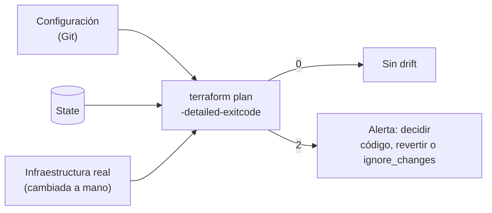

## 1. Resumen

Hay **drift** cuando la infraestructura real deja de coincidir con lo que Terraform cree que hay. El tutorial de HashiCorp lo explica: si alguien cambia a mano un recurso que administra Terraform, el state queda desincronizado («or "drift," from the real infrastructure»). Terraform intentará reconciliarlo en el próximo `apply`, lo que puede destruir o recrear recursos sin querer.

Según la documentación de `terraform plan`, hay dos formas de mirar el drift:

- **plan normal:** lee los objetos reales y propone cambios para volver a la configuración;
- **plan refresh-only:** solo actualiza el state para reflejar lo que cambió afuera, sin tocar los objetos.

Con `-detailed-exitcode`, `plan` sale con **2** si hay cambios. Así un job programado detecta el drift sin aplicar nada.

## 2. Qué es

- **Drift:** diferencia entre el state (y la configuración) y la infraestructura real.
- **Plan normal:** lee lo real, compara con la configuración y propone cambios.
- **Refresh-only (`-refresh-only`):** un plan que solo actualiza el state; reemplaza al comando deprecado `terraform refresh`.
- **`-detailed-exitcode`:** 0 sin cambios, 1 error, 2 con cambios.
- **`ignore_changes`:** atributos que Terraform no debe volver a su valor, porque cambian afuera a propósito.

## 3. Problema que resuelve

Durante un incidente, alguien sube a mano el tamaño de lote de un pipeline. Funciona, nadie lo anota, y el próximo `apply` de otro cambio lo vuelve al valor anterior: el incidente vuelve. Detectar el drift a tiempo permite decidir: o se lleva el cambio al código, o se revierte a propósito.

## 4. Cómo funciona

1. Terraform crea el archivo de configuración del pipeline.
2. Alguien lo cambia a mano (`batch_size` de 500 a 5000).
3. `terraform plan -detailed-exitcode` sale con 2: hay un cambio que proponer.
4. `terraform plan -refresh-only` muestra «Objects have changed outside of Terraform».
5. El equipo decide:
   - llevar el valor nuevo a la configuración y aplicar;
   - o aplicar la configuración actual para revertir el cambio a mano;
   - o, si el valor debe poder cambiar afuera, declararlo en `ignore_changes`.

## 5. Cuándo utilizarlo

- Un job programado con `plan -refresh-only -detailed-exitcode` por entorno, que avisa si hay drift.
- `-refresh-only` después de un cambio de emergencia hecho a mano, para que el state lo refleje.
- `ignore_changes` para atributos que otro sistema ajusta a propósito.

## 6. Cuándo no utilizarlo

- `apply` a ciegas cuando el plan muestra cambios que nadie hizo en el código: revertiría lo que cambió afuera, que puede ser una corrección necesaria.
- `ignore_changes` para esconder drift que debería corregirse.
- `terraform refresh`: está deprecado; se usa `-refresh-only`.

## 7. Ejemplo sencillo

Terraform crea `pipeline.json` con `batch_size = 500`. Alguien lo edita a 5000. El plan sale con código 2. Un `apply` vuelve a escribir el archivo con 500, y el siguiente plan sale con 0.

## 8. Ejemplo de producción

Una plataforma con:

- un workflow nocturno por entorno que corre `plan -refresh-only -detailed-exitcode` con credenciales de solo lectura;
- una alerta cuando sale con 2, con el plan adjunto;
- la regla de que todo cambio de emergencia hecho a mano se lleva al código en un pull request;
- `ignore_changes` solo en atributos documentados, como los que ajusta un autoscaler.

## 9. Arquitectura



## 10. Código

<!-- validate-terraform: excluido — se ejecuta con init, plan y apply en los tests, y se modifica fuera de Terraform (ADR-015) -->
```hcl
# Terraform 1.16 (ejecutado en la CI con init, plan y apply sobre hashicorp/local, sin nube; ADR-015): un archivo de
# configuración de un pipeline administrado por Terraform. El test lo cambia «a mano» y comprueba que plan lo detecta.
terraform {
  required_version = ">= 1.16"
  required_providers {
    local = {
      source  = "hashicorp/local"
      version = "~> 2.9"
    }
  }
}

resource "local_file" "pipeline_config" {
  filename = "${path.module}/out/pipeline.json"
  content  = jsonencode({ batch_size = 500, retries = 3 })
}
```

```bash
# Bash (no ejecutado; en la CI el test hace lo mismo desde pytest): detección de drift programada. Con
# -detailed-exitcode, plan sale con 0 si no hay cambios, 1 si hay un error y 2 si hay cambios.
set -uo pipefail
terraform plan -refresh-only -detailed-exitcode -input=false -no-color > drift.txt
case $? in
  0) echo "sin drift" ;;
  2) echo "drift detectado: revisar drift.txt antes de aplicar" >&2; exit 2 ;;
  *) echo "error al planificar" >&2; exit 1 ;;
esac
```

El bloque de Terraform se **ejecuta en la CI** con `init`, `plan` y `apply` sobre `hashicorp/local`, sin nube (ADR-015). El test:

- aplica la configuración;
- cambia el archivo fuera de Terraform;
- comprueba que `plan -detailed-exitcode` sale con 2 y que `plan -refresh-only` dice «Objects have changed outside of Terraform»;
- aplica de nuevo y comprueba que el plan siguiente sale con 0.

Con este provider, el archivo cambiado aparece como borrado y se vuelve a crear; en un provider de nube, el plan mostraría el atributo que cambió. El script de Bash **no se ejecutó**: es la forma del job programado, y el test hace lo mismo desde pytest.

## 11. GCP

En GCP, **Infrastructure Manager** ejecuta Terraform. Las diferencias, según sus páginas:

| | Terraform (CLI) | Infrastructure Manager |
|---|---|---|
| Ver cambios antes de aplicar | `terraform plan` | Una preview, que «executes the Terraform plan command» |
| Drift | `plan` y `plan -refresh-only`, con `-detailed-exitcode` | Permisos `config.resourcedrifts.get` y `list` en su IAM; las páginas citadas no describen la detección |

## 12. AWS

En AWS, la **drift detection** de CloudFormation. Las diferencias, según sus páginas:

| | Terraform | CloudFormation |
|---|---|---|
| Qué compara | Configuración y state contra los objetos reales | Plantilla y parámetros contra las propiedades reales de cada recurso |
| Cómo se corre | `terraform plan` (normal o refresh-only) | `detect-stack-drift`, y luego `describe-stack-resource-drifts` |
| Cobertura | Lo que el provider lee | Solo los recursos que soportan drift detection; los demás, `NOT_CHECKED` |

## 13. Azure

En **Bicep**, la operación **what-if** de Azure Resource Manager muestra, antes de desplegar, cómo cambiarían los recursos, sin cambiarlos. Hay variantes por alcance (`az deployment group what-if`, `sub`, `mg` y `tenant`). La página advierte del «noise»: propiedades que Azure pone por defecto y que no están en el archivo (*Bicep What-If*). No hay un state que comparar: what-if compara el archivo con lo que hay en Azure.

## 14. Buenas prácticas

- Detección de drift programada, con `-detailed-exitcode` y credenciales de solo lectura.
- Todo cambio a mano se lleva al código o se revierte; nunca se deja.
- `-refresh-only` después de un cambio de emergencia, antes del próximo `apply`.
- **Seguridad:** el job de detección no necesita permisos de escritura; que no los tenga.
- **Observabilidad:** guardar el plan del job de drift; muestra qué cambió y en qué recurso.
- **Costo:** el drift de tamaño (más nodos, más retención) también es drift de costo; detectarlo evita pagar por un cambio olvidado.

## 15. Errores frecuentes

- Aplicar un plan con cambios que nadie entiende.
- Usar `terraform refresh`, que está deprecado.
- `ignore_changes = all` para que el plan deje de mostrar diferencias.
- No mirar el drift hasta el próximo cambio, semanas después.

## 16. Trade-offs

Detectar drift seguido encuentra los cambios a mano cuando todavía se recuerda por qué se hicieron, a cambio de un job más y de alertas que alguien atiende. `ignore_changes` evita pelear con cambios legítimos externos, pero esconde lo que no se revisa. Revertir el drift con `apply` restablece el código como fuente de verdad, pero puede deshacer una corrección de emergencia.

## 17. Conceptos relacionados

- `terraform-plan-apply`: el plan que detecta el drift.
- `terraform-state`: contra qué se compara.
- `infrastructure-as-code`: el código como fuente de verdad.
- `terraform-environments`: drift por entorno.

## 18. Preguntas técnicas abiertas

1. ¿Cuándo corriste por última vez un plan sin cambios de código en producción?
2. ¿Qué atributos de tu infraestructura cambia otro sistema a propósito?
3. ¿Qué harías si el job de drift encuentra un cambio que nadie recuerda?

## 19. Laboratorio relacionado

Pendiente (F4).

## 20. Fuentes

- Terraform: *Manage resource drift* (tutorial), *terraform plan command*, *terraform refresh command* y *lifecycle reference* (1.16).
- Google Cloud: *Preview an update to a deployment* y *Access control with IAM*.
- AWS: *Detect unmanaged configuration changes to stacks and resources with drift detection* y *Detect drift on an entire CloudFormation stack*.
- Microsoft Learn: *Bicep What-If: Preview Changes Before Deployment*.

El detalle de cada fuente está en `sources` del frontmatter.

## 21. Fecha de última verificación

2026-10-19. Pasa a `verified`: revisión B-F3.1 del lote F3b-12b aplicada, sin VERIFY pendientes.

## 22. Historial de cambios importantes

- 2026-10-19: creación (lote F3b-12b).
- 2026-10-19: revisión B-F3.1 del lote F3b-12b aplicada (docs/reviews/cards-f3b-12b.md): sin hallazgos; sin cambios en esta ficha.
- 2026-10-19: `verification_status: verified` (sin VERIFY pendientes).
