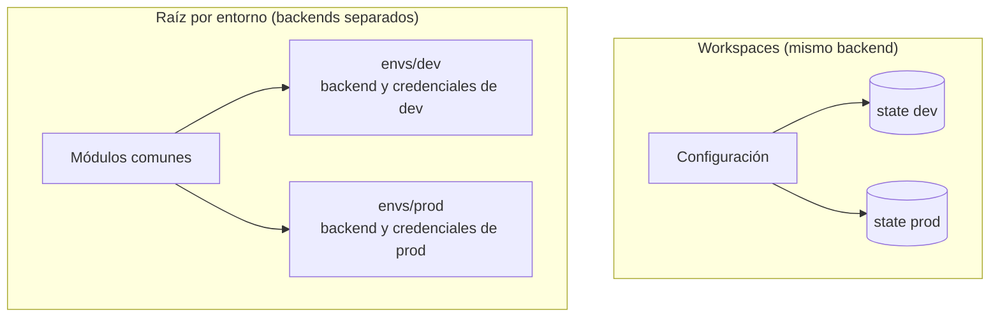

## 1. Resumen

Con Terraform hay dos formas de tener dev, staging y prod. Según su documentación:

- **workspaces:** una configuración, un backend y un state por workspace. `terraform.workspace` cambia nombres y tamaños. Sirven para una copia paralela de prueba, a menudo atada a una rama.
- **una configuración raíz por entorno:** cada una con su backend y sus credenciales, llamando a los mismos módulos.

La documentación es clara sobre el límite de la primera: «Workspaces are not appropriate for system decomposition or deployments requiring separate credentials and access controls». Si prod tiene que estar aislado de dev (otras credenciales, otros permisos), los workspaces del mismo directorio no alcanzan: comparten el backend.

## 2. Qué es

- **Workspace:** un state con nombre dentro del mismo backend; siempre existe `default`.
- **`terraform.workspace`:** el nombre del workspace actual, usable en la configuración.
- **`terraform.tfstate.d`:** donde quedan los states de cada workspace con el backend local.
- **Raíz por entorno:** un directorio por entorno (`envs/dev`, `envs/prod`) con su backend y sus valores, que llama a módulos comunes.

## 3. Problema que resuelve

Una sola configuración aplicada a mano en dev y en prod termina con prod pisado por un `apply` pensado para dev. Separar los states evita que un entorno toque los recursos de otro. Separar además credenciales y backend evita que un error en dev, o alguien con acceso a dev, llegue a producción.

## 4. Cómo funciona

Con workspaces, como en el ejemplo:

1. `terraform workspace new dev` y `apply`: el state queda en `terraform.tfstate.d/dev`.
2. `terraform workspace new prod` y `apply`: otro state, en `terraform.tfstate.d/prod`.
3. La configuración lee `terraform.workspace` para nombres (`spark-dev`, `spark-prod`) y tamaños (1 y 4 workers).

Con una raíz por entorno, cada directorio declara su backend (un bucket por entorno, con sus permisos) y llama a los mismos módulos con sus valores.

## 5. Cuándo utilizarlo

- **Workspaces:** copias temporales para probar un cambio antes de producción, como describe la documentación.
- **Raíz por entorno:** entornos permanentes que necesitan credenciales y permisos distintos, sobre todo producción.
- En los dos casos, módulos comunes para no duplicar la infraestructura.

## 6. Cuándo no utilizarlo

- Workspaces para separar producción de desarrollo con credenciales distintas: la documentación dice que no son adecuados.
- Workspaces para descomponer un sistema en partes: cada parte debería tener su propia configuración y su backend.
- Una raíz por entorno que copia recursos en lugar de llamar a módulos: los entornos divergen.

## 7. Ejemplo sencillo

La misma configuración se aplica en los workspaces `dev` y `prod`. Quedan dos states separados y dos archivos: `{"name": "spark-dev", "workers": 1}` y `{"name": "spark-prod", "workers": 4}`.

## 8. Ejemplo de producción

Una plataforma con:

- `envs/dev`, `envs/staging` y `envs/prod`, cada una con su backend (un bucket por entorno) y su cuenta de servicio;
- los mismos módulos con versión fija, y valores distintos por entorno;
- el pipeline aplicando cada entorno con sus propias credenciales y con aprobación antes de prod;
- workspaces solo para copias efímeras de una rama, que se destruyen al terminar.

## 9. Arquitectura



## 10. Código

<!-- validate-terraform: excluido — se ejecuta con init, workspaces y apply en los tests (ADR-015) -->
```hcl
# Terraform 1.16 (ejecutado en la CI con init, plan y apply sobre terraform_data y hashicorp/local, sin nube; ADR-015):
# una sola configuración y un workspace por entorno; terraform.workspace elige el tamaño y entra en los nombres.
terraform {
  required_version = ">= 1.16"
  required_providers {
    local = {
      source  = "hashicorp/local"
      version = "~> 2.9"
    }
  }
}

locals {
  sizes = {
    default = { workers = 1 }
    dev     = { workers = 1 }
    prod    = { workers = 4 }
  }
  env = local.sizes[terraform.workspace]
}

resource "terraform_data" "cluster" {
  input = {
    name    = "spark-${terraform.workspace}"
    workers = local.env.workers
  }
}

resource "local_file" "cluster_config" {
  filename = "${path.module}/out/${terraform.workspace}.json"
  content  = jsonencode(terraform_data.cluster.output)
}

output "cluster" {
  value = terraform_data.cluster.output
}
```

El bloque se **ejecuta en la CI** con `init`, `terraform workspace new` y `apply` sobre `terraform_data` y `hashicorp/local`, sin nube (ADR-015). El test aplica en `dev` y en `prod`. Comprueba que quedan dos states en `terraform.tfstate.d`, cada uno con su archivo y su tamaño, y que el workspace activo al final es `prod`. La alternativa de una raíz por entorno se arma con los módulos de `terraform-modules`.

## 11. GCP

En GCP, **Infrastructure Manager** despliega una configuración como deployment, que puede abarcar varios proyectos y ubicaciones. Las diferencias, según sus páginas:

| | Terraform (CLI) | Infrastructure Manager |
|---|---|---|
| Un entorno es | Un workspace o una configuración raíz con su backend | Un deployment, con sus revisions y su state |
| Permisos | Los del que corre Terraform | Los de la cuenta de servicio del deployment en cada proyecto |

## 12. AWS

En AWS, **StackSets** de CloudFormation. Las diferencias, según sus páginas:

| | Terraform | CloudFormation StackSets |
|---|---|---|
| Varios entornos o cuentas | Workspaces o una raíz por entorno | Una plantilla desde una cuenta administradora, desplegada como stacks en varias cuentas y regiones |
| Una operación | `apply` por workspace o por raíz | Crear, actualizar o borrar los stacks de todas las cuentas y regiones a la vez |

## 13. Azure

En **Bicep**, los valores de cada entorno van en archivos de parámetros: uno por entorno, en formato nativo `.bicepparam` (desde Bicep CLI 0.18.4) o JSON. Según *Create a parameters file for Bicep deployment*, permiten dimensionar los entornos no productivos sin cambiar la infraestructura central, y pasar a cada etapa del pipeline su archivo.

## 14. Buenas prácticas

- Producción en su propia configuración raíz, con su backend y sus credenciales.
- Módulos comunes, con versión fija, en todos los entornos.
- Workspaces solo para copias temporales, que se destruyen.
- **Seguridad:** credenciales distintas por entorno; un `apply` de dev nunca debería poder tocar prod.
- **Observabilidad:** el entorno en el nombre o las etiquetas de cada recurso (`terraform.workspace` o una variable).
- **Costo:** tamaños por entorno (1 worker en dev, 4 en prod), y destruir las copias temporales.

## 15. Errores frecuentes

- Separar producción con workspaces y las mismas credenciales.
- Olvidar en qué workspace se está y aplicar en el equivocado.
- Raíces por entorno que copian recursos en lugar de llamar módulos.
- Guardar `terraform.tfstate.d` en el repositorio en lugar de usar un backend remoto.

## 16. Trade-offs

Los workspaces son rápidos de crear y comparten la configuración y la caché de providers, pero no aíslan credenciales ni permisos. Una raíz por entorno aísla de verdad, a cambio de un directorio, un backend y un `init` por entorno. Más entornos permanentes dan más seguridad antes de producción, con más costo y más mantenimiento.

## 17. Conceptos relacionados

- `terraform-modules`: la base común de cada entorno.
- `terraform-remote-state`: un backend por entorno.
- `terraform-variables-and-outputs`: los valores de cada entorno.
- `environment-promotion`: promover entre entornos desde el pipeline.

## 18. Preguntas técnicas abiertas

1. ¿Tus entornos comparten credenciales o backend?
2. ¿Qué pasaría si alguien aplicara la configuración de dev en el workspace de prod?
3. ¿Qué entornos de tu plataforma son permanentes y cuáles podrían ser temporales?

## 19. Laboratorio relacionado

Pendiente (F4).

## 20. Fuentes

- Terraform 1.16: *Workspaces* y *Manage Workspaces Overview*.
- Google Cloud: *Deployments, revisions, and previews overview*. AWS: *Managing stacks across accounts and Regions with StackSets*. Microsoft Learn: *Create a parameters file for Bicep deployment*.

El detalle de cada fuente está en `sources` del frontmatter.

## 21. Fecha de última verificación

2026-10-14. `review_required`: pendiente de revisión B-F3.1 del lote F3b-12a.

## 22. Historial de cambios importantes

- 2026-10-14: creación (lote F3b-12a).
