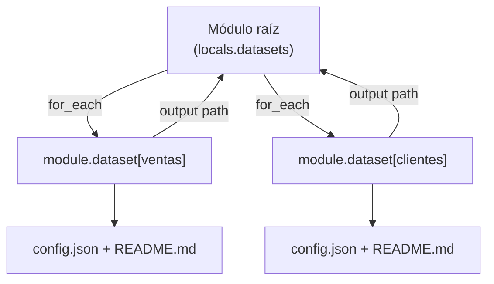

## 1. Resumen

Un **módulo** de Terraform es, según su documentación, «a collection of resources that Terraform manages together». Toda configuración es un módulo: la del directorio raíz es el **módulo raíz**, y los que llama con bloques `module` son **módulos hijos**.

Sirven para no repetir: la misma pieza (un dataset con su configuración y su documentación, una red, un bucket con su ciclo de vida) se llama varias veces con valores distintos. HashiCorp pide **moderación**: un buen módulo describe un concepto nuevo de la arquitectura. No recomienda «modules that are just thin wrappers around single other resource types».

## 2. Qué es

- **Módulo raíz:** la configuración del directorio donde se corre Terraform.
- **Módulo hijo:** el que llama un bloque `module`; sus variables son la entrada y sus outputs, la salida.
- **`source`:** de dónde viene: una ruta local (`./modules/dataset`), un registry o un repositorio.
- **`version`:** restricción de versión; solo para módulos de un registry.
- **`for_each` / `count`:** llaman al módulo varias veces; son excluyentes.

## 3. Problema que resuelve

Una plataforma con veinte datasets que copian los mismos tres recursos termina con veinte copias que divergen. Un módulo encapsula la pieza una vez. Cada dataset es una llamada con su nombre, su dueño y su retención; un cambio en el módulo llega a todos en el próximo `plan`.

## 4. Cómo funciona

1. `modules/dataset/main.tf` declara variables (`name`, `owner`, `retention_days`), dos recursos y un output (`path`).
2. El módulo raíz tiene un mapa `datasets` y llama a `module "dataset"` con `for_each`.
3. `terraform init` instala los providers que declaran los módulos.
4. `apply` crea una instancia del módulo por clave: `module.dataset["ventas"]` y `module.dataset["clientes"]`.
5. El output de la raíz junta el `path` de cada instancia.

## 5. Cuándo utilizarlo

- Una pieza con varios recursos que se repite: dataset con permisos, bucket con ciclo de vida y alertas.
- Componentes que comparten varios equipos, versionados en un registry.
- La misma infraestructura en varios entornos, con una raíz por entorno (ver `terraform-environments`).

## 6. Cuándo no utilizarlo

- Para envolver un solo recurso: HashiCorp no lo recomienda.
- Módulos con decenas de variables que exponen cada argumento: no abstraen nada.
- Anidar módulos en muchos niveles: la configuración se vuelve difícil de seguir.

## 7. Ejemplo sencillo

El módulo `dataset` crea `config.json` y `README.md` en una carpeta con el nombre del dataset. La raíz lo llama con `for_each` para `ventas` y `clientes`: `apply` crea cuatro archivos, y otro `plan` no muestra cambios.

## 8. Ejemplo de producción

Una plataforma con:

- un módulo `dataset` que crea el dataset, sus permisos y su documentación;
- un mapa de datasets en cada entorno;
- el módulo versionado en un registry privado, con `version` fijo en cada raíz;
- un cambio del módulo probado primero en dev, subiendo la versión.

## 9. Arquitectura



## 10. Código

```hcl
# modules/dataset/main.tf · Terraform 1.16 (ejecutado en la CI con init, plan y apply sobre hashicorp/local, sin nube;
# ADR-015): un módulo que representa «un dataset con su configuración y su README», no un solo recurso.
terraform {
  required_providers {
    local = {
      source  = "hashicorp/local"
      version = "~> 2.9"
    }
  }
}

variable "name" {
  type = string
}

variable "owner" {
  type = string
}

variable "retention_days" {
  type    = number
  default = 30
}

resource "local_file" "config" {
  filename = "${path.root}/out/${var.name}/config.json"
  content  = jsonencode({ dataset = var.name, owner = var.owner, retention_days = var.retention_days })
}

resource "local_file" "readme" {
  filename = "${path.root}/out/${var.name}/README.md"
  content  = "# ${var.name}\n\nDueño: ${var.owner}. Retención: ${var.retention_days} días.\n"
}

output "path" {
  value = dirname(local_file.config.filename)
}
```

<!-- validate-terraform: excluido — raíz que llama al módulo local; se ejecuta con el módulo en los tests (ADR-015) -->
```hcl
# main.tf (raíz) · Terraform 1.16 (ejecutado en la CI junto con el módulo): llama al módulo local una vez por dataset
# con for_each, y expone la ruta de cada uno.
terraform {
  required_version = ">= 1.16"
}

locals {
  datasets = {
    ventas   = { owner = "equipo-comercial", retention_days = 90 }
    clientes = { owner = "equipo-crm", retention_days = 365 }
  }
}

module "dataset" {
  source   = "./modules/dataset"
  for_each = local.datasets

  name           = each.key
  owner          = each.value.owner
  retention_days = each.value.retention_days
}

output "dataset_paths" {
  value = { for name, m in module.dataset : name => m.path }
}
```

Los dos bloques se **ejecutan en la CI** con `init`, `plan` y `apply` sobre `hashicorp/local`, sin nube (ADR-015). El test los escribe como `modules/dataset/main.tf` y `main.tf`. Comprueba una instancia por dataset (cuatro archivos) y que un segundo `plan -detailed-exitcode` sale con 0, es decir, sin cambios. El módulo hijo también pasa `terraform validate`.

## 11. GCP

En GCP, **Infrastructure Manager** despliega configuraciones de Terraform, módulos incluidos. Las diferencias, según sus páginas:

| | Terraform (CLI) | Infrastructure Manager |
|---|---|---|
| Dónde está la configuración | Directorio de trabajo; módulos locales, de un registry o de un repositorio | Bucket de Cloud Storage, repositorio Git o directorio local |
| Ejecución | `apply` donde corre la CLI | Deployments y revisions administrados |

## 12. AWS

En AWS, los **nested stacks** de CloudFormation. Las diferencias, según sus páginas:

| | Módulos de Terraform | Nested stacks |
|---|---|---|
| Unidad reutilizable | Directorio con variables, recursos y outputs | Plantilla propia referenciada con `AWS::CloudFormation::Stack` |
| Jerarquía | Raíz que llama a hijos, que pueden anidar | Root stack, parent stack y nested stacks |
| Varias instancias | `for_each` o `count` en el bloque `module` | Las páginas citadas no lo tratan |

## 13. Azure

En **Bicep**, un módulo es un archivo Bicep (o una plantilla ARM en JSON) que otro archivo despliega, con `module <nombre> '<ruta>' = { name: …, params: … }`. Su output se lee con `<módulo>.outputs.<propiedad>` (*Bicep modules*).

## 14. Buenas prácticas

- Un módulo por concepto de la arquitectura, no por recurso.
- Interfaz chica: pocas variables, con tipo y descripción, y los outputs que alguien usa.
- `version` fijo para módulos de un registry.
- `for_each` cuando cada instancia tiene valores propios; `count` para instancias casi idénticas (*count meta-argument reference*).
- **Seguridad:** módulos de terceros con versión fija y revisados, porque crean recursos con los permisos del que corre Terraform.
- **Observabilidad:** las direcciones `module.dataset["ventas"]…` en el plan dicen qué instancia cambia.
- **Costo:** un módulo con valores por defecto caros se copia en todas sus instancias; mejor defaults baratos.

## 15. Errores frecuentes

- Un módulo por cada recurso.
- `count` para instancias con valores distintos que no salen de un índice: la documentación indica `for_each` para ese caso.
- Módulos de un registry sin `version`.
- Cambiar un módulo compartido sin probarlo en un entorno primero.

## 16. Trade-offs

Los módulos evitan copias y dan consistencia, a cambio de una capa más que entender cuando algo falla. Un módulo genérico sirve para más casos, pero con más variables y más difícil de leer. Versionar en un registry da control sobre los cambios, a cambio de publicar y actualizar versiones.

## 17. Conceptos relacionados

- `terraform-variables-and-outputs`: la interfaz del módulo.
- `terraform-providers`: los providers que declara.
- `infrastructure-as-code`: el marco.
- `terraform-environments`: una raíz por entorno con los mismos módulos.

## 18. Preguntas técnicas abiertas

1. ¿Qué grupo de recursos copias hoy en varias configuraciones?
2. ¿Qué módulo tuyo es solo un envoltorio de un recurso?
3. ¿Cómo pruebas un cambio en un módulo que usan varios equipos?

## 19. Laboratorio relacionado

Pendiente (F4).

## 20. Fuentes

- Terraform 1.16: *Modules overview*, *module block reference*, *count meta-argument reference* y *Creating Modules*.
- Google Cloud: *Infrastructure Manager overview*. AWS: *Split a template into reusable pieces using nested stacks*. Microsoft Learn: *Bicep modules*.

El detalle de cada fuente está en `sources` del frontmatter.

## 21. Fecha de última verificación

2026-10-14. `review_required`: pendiente de revisión B-F3.1 del lote F3b-12a.

## 22. Historial de cambios importantes

- 2026-10-14: creación (lote F3b-12a).
