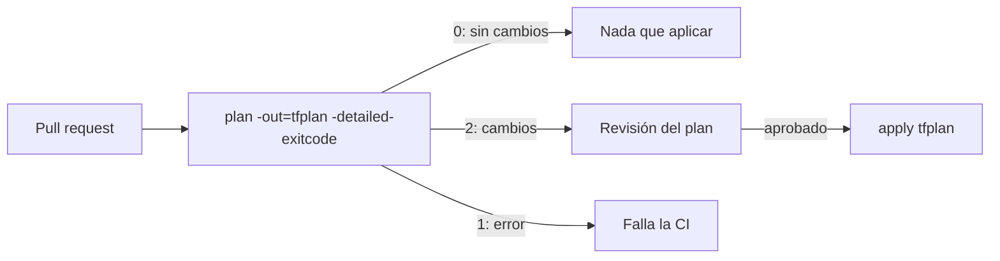

## 1. Resumen

`terraform plan` calcula qué cambios haría Terraform para que la infraestructura coincida con la configuración, sin ejecutarlos. Se revisa el plan, y `terraform apply` ejecuta esos cambios. En automatización, el plan se guarda con `-out` y se aplica ese archivo, así lo que se ejecuta es exactamente lo que se revisó. Aplicar a ciegas es la forma más común de borrar algo importante.

## 2. Qué es

Es el flujo de trabajo de Terraform en dos pasos:

- **plan:** lee el estado real de los objetos, compara la configuración con el state y propone acciones (crear, actualizar, reemplazar, destruir); no cambia nada;
- **apply:** ejecuta las acciones. Sin plan guardado, genera uno nuevo y pide aprobación; con plan guardado, ejecuta ese plan sin preguntar.

## 3. Problema que resuelve

Un cambio de configuración puede tener efectos no evidentes: un argumento que obliga a reemplazar una tabla, un recurso que alguien cambió en la consola, un provider nuevo con otro valor por defecto. El plan muestra esos efectos antes de que ocurran, y el plan guardado evita que entre la revisión y la aplicación cambie lo que se ejecuta.

## 4. Cómo funciona

1. `terraform plan -out=tfplan` lee el estado real, compara y guarda la propuesta en `tfplan`.
2. Se revisa el plan (salida del comando o `terraform show tfplan`): qué se crea, cambia, reemplaza o destruye.
3. `terraform apply tfplan` ejecuta exactamente esas operaciones, sin volver a pedir confirmación.
4. Si el plan quedó desactualizado (alguien aplicó otro cambio entre medio), se vuelve a planificar.

Opciones útiles:

- `-detailed-exitcode` devuelve 0 si no hay cambios, 1 si hubo error y 2 si hay cambios: sirve para que la CI detecte cambios.
- `-refresh-only` actualiza el state a cambios hechos fuera de Terraform sin tocar la infraestructura.

## 5. Cuándo utilizarlo

En todo cambio de infraestructura con Terraform. En pipelines de CI/CD, siempre el flujo de dos pasos: plan guardado, revisión y apply del archivo.

## 6. Cuándo no utilizarlo

- `apply -auto-approve` sin plan revisado en entornos productivos: la documentación recomienda usarlo solo si nadie cambia la infraestructura por fuera de Terraform.
- Planes guardados viejos: si la infraestructura cambió desde el plan, hay que planificar de nuevo.

## 7. Ejemplo sencillo

Se agrega una etiqueta a un dataset. El plan muestra "1 to change, 0 to destroy". Se aplica. Si el plan hubiera mostrado "1 to destroy", la revisión lo habría detenido.

## 8. Ejemplo de producción

En cada pull request, la CI ejecuta `terraform plan -out=tfplan -detailed-exitcode` y publica la salida como comentario. Si el código de salida es 2 (hay cambios), el revisor debe aprobar explícitamente. Al mergear, el pipeline de despliegue aplica el mismo archivo `tfplan` generado para ese commit. Un plan que contenga destrucciones de datasets o buckets bloquea el merge hasta una aprobación adicional.

## 9. Arquitectura



## 10. Código

```bash
# Flujo de dos pasos en un pipeline (Terraform 1.x, credenciales del entorno de despliegue).
# El plan guardado contiene atributos de los recursos y puede tener valores sensibles: no publicarlo como artefacto público.
set -euo pipefail

terraform init -input=false
set +e
terraform plan -input=false -out=tfplan -detailed-exitcode
code=$?
set -e

case "$code" in
  0) echo "Sin cambios: nada que aplicar." ;;
  2) terraform show -no-color tfplan > plan.txt   # para revisión
     # ... aprobación humana en el sistema de CI ...
     terraform apply -input=false tfplan ;;       # aplica exactamente lo revisado
  *) echo "Error en el plan"; exit 1 ;;
esac
```

Repetir el pipeline sin cambios en la configuración termina en "Sin cambios": el flujo es idempotente.

## 11. GCP

En Google Cloud se usa el mismo flujo de Terraform. **Infrastructure Manager** ofrece el equivalente administrado: **previews** de despliegue para ver cómo los cambios afectan la infraestructura antes de aplicarlos, sobre las mismas configuraciones de Terraform.

## 12. AWS

En **CloudFormation**, el equivalente del plan es el **change set**: muestra qué recursos se agregarán, modificarán o borrarán, con una comparación antes y después de sus propiedades; se pueden crear varios y ejecutar el elegido. La diferencia es que lo calcula el servicio sobre el stack, no la herramienta local sobre un state.

## 13. Azure

En **Bicep**, el equivalente es **what-if** (`az deployment group what-if` y sus variantes por suscripción, grupo de administración y tenant). Requiere los mismos permisos que el despliegue. Como el change set de CloudFormation, lo calcula Azure sobre los recursos existentes; Terraform, en cambio, lo calcula localmente comparando con su state.

## 14. Buenas prácticas

- Plan guardado con `-out` y apply de ese archivo en automatización.
- Leer especialmente los reemplazos y destrucciones.
- Usar `-detailed-exitcode` para que la CI distinga "sin cambios" de "con cambios".
- Planificar de nuevo si pasó tiempo o hubo otros cambios.
- **Seguridad:** el archivo de plan puede contener valores sensibles: tratarlo como el state, sin publicarlo; aplicar con una cuenta de servicio de despliegue, no con credenciales personales.
- **Observabilidad:** guardar la salida de cada plan y apply con el commit asociado.
- **Costo:** detectar en el plan recursos nuevos o reemplazos costosos antes de aplicar.

## 15. Errores frecuentes

- `apply -auto-approve` en producción sin revisión.
- Revisar un plan y aplicar otro (sin `-out`).
- Ignorar un reemplazo en el plan y perder los datos de una tabla.
- Publicar el archivo de plan como artefacto accesible.

## 16. Trade-offs

El flujo de dos pasos con aprobación agrega fricción y tiempo a cada cambio, a cambio de saber exactamente qué se ejecuta. Aplicar directamente es más rápido y aceptable en entornos efímeros, pero en producción traslada el riesgo a la suerte.

## 17. Conceptos relacionados

- `terraform-state`: lo que el plan compara.
- `infrastructure-as-code`: el marco.
- Del blueprint, pendientes de ficha: `ci-cd-pipelines`, `terraform-drift`.

## 18. Preguntas técnicas abiertas

1. ¿Qué regla pondrías en la CI para los planes que destruyen recursos?
2. ¿Qué harías si el plan muestra cambios que nadie hizo en el código?
3. ¿Dónde guardarías el archivo de plan entre la revisión y el apply?

## 19. Laboratorio relacionado

Pendiente (F4): pipeline de Terraform con plan guardado (lab de tipo A).

## 20. Fuentes

- HashiCorp: *terraform plan*, *terraform apply* y *Manage sensitive data*.
- AWS: *Update CloudFormation stacks using change sets*.
- Microsoft Learn: *Bicep What-If* y *What is Bicep?*.
- Google Cloud: *Infrastructure Manager overview*.

El detalle de cada fuente está en `sources` del frontmatter.

## 21. Fecha de última verificación

2026-10-01. Pasa a `verified`: revisión B-F3.1 del lote 4 aplicada, sin VERIFY pendientes.

## 22. Historial de cambios importantes

- 2026-10-01: creación (lote 4 de F3).
- 2026-10-01: `verification_status: verified` (revisión B-F3.1 del lote 4 aplicada; sin VERIFY pendientes).
- 2026-10-13: `page_title` en cada cita, con el título de la página citada (ADR-012); sin cambios de contenido.
