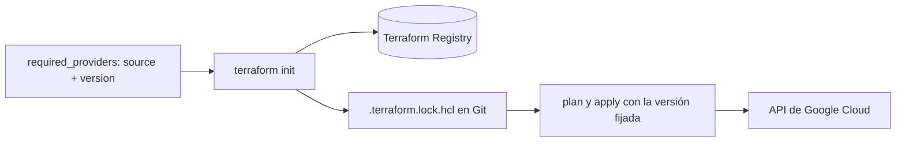

## 1. Resumen

Un provider es el plugin que conecta Terraform con una plataforma: el de Google Cloud sabe crear datasets y buckets; el de AWS, tablas de Redshift y buckets de S3. Terraform por sí solo no gestiona nada. Cada provider se declara con su origen y una restricción de versión, y el archivo `.terraform.lock.hcl` fija la versión exacta para que todos usen la misma.

## 2. Qué es

Es un plugin distribuido aparte de Terraform, con su propio ritmo de versiones, que aporta **tipos de recurso** (por ejemplo, `google_bigquery_table`) y **data sources**. Se publica en el Terraform Registry y se instala con `terraform init`.

Hay tres piezas:

- `required_providers`: qué provider se usa (`source`) y qué versiones se aceptan (`version`);
- el bloque `provider`: su configuración (proyecto, región);
- `.terraform.lock.hcl`: la versión exacta seleccionada.

## 3. Problema que resuelve

Sin fijar la versión, dos personas (o la CI y un desarrollador) pueden instalar versiones distintas del provider y obtener planes distintos para el mismo código. Un provider nuevo puede cambiar valores por defecto o deprecar argumentos; sin control, eso aparece como un cambio inesperado en producción.

## 4. Cómo funciona

1. La configuración declara el provider en `required_providers`, con `source = "hashicorp/google"` y una restricción como `"~> 8.0"`.
2. `terraform init` elige la versión más nueva que cumple la restricción, la descarga y la registra en `.terraform.lock.hcl`.
3. Las ejecuciones siguientes reutilizan la versión del lock, aunque haya una más nueva.
4. Para actualizar, se ejecuta `terraform init -upgrade`, que vuelve a elegir la más nueva compatible y actualiza el lock; el cambio del lock se revisa en un pull request.

## 5. Cuándo utilizarlo

Siempre que se use Terraform: toda configuración necesita al menos un provider. Fijar la versión y versionar el lock es la práctica por defecto, no una opción.

## 6. Cuándo no utilizarlo

- No conviene dejar la versión sin restricción "para tener siempre la última": un cambio mayor del provider puede romper la configuración.
- No conviene usar varios providers de la misma nube sin necesidad (por ejemplo, el estable y el beta) solo por comodidad: duplica superficies de cambio.

## 7. Ejemplo sencillo

`version = "~> 8.0"` acepta cualquier 8.x. El lock fija 8.5.0. Cuando sale 8.6.0, nada cambia hasta que alguien ejecuta `terraform init -upgrade` y sube el lock en un pull request.

## 8. Ejemplo de producción

El repositorio de infraestructura de datos fija `hashicorp/google` en `~> 8.0` y versiona `.terraform.lock.hcl`. Una tarea mensual abre un pull request con `terraform init -upgrade`; la CI ejecuta `terraform plan` en todos los entornos con la versión nueva y el equipo revisa si el plan muestra cambios no buscados antes de mergear.

## 9. Arquitectura



## 10. Código

```hcl
# Declaración y configuración del provider de Google Cloud.
# Requiere: Terraform 1.x. terraform init descarga el provider y crea .terraform.lock.hcl (versionarlo).
terraform {
  required_providers {
    google = {
      source  = "hashicorp/google"
      version = "~> 8.0" # cualquier 8.x; el lock fija la exacta
    }
  }
}

variable "project_id" {
  type = string
}

provider "google" {
  project = var.project_id
  region  = "us-central1"
}
```

`terraform init -backend=false` y `terraform validate` comprueban esta configuración sin credenciales. Repetir `terraform init` con el lock presente instala siempre la misma versión.

## 11. GCP

El provider `hashicorp/google` aprovisiona y gestiona recursos de Google Cloud (BigQuery, Cloud Storage, IAM y el resto). Al 2026-10-01 su última versión es la 8.5.0. Los snippets de este proyecto lo fijan con `~> 8.0`.

## 12. AWS

En AWS, Terraform usa su propio provider (`hashicorp/aws`), con los mismos mecanismos de `required_providers` y lock. No es intercambiable con el de Google: los tipos de recurso, los argumentos y la autenticación son otros. La alternativa nativa, CloudFormation, no usa providers: sus tipos de recurso son de AWS.

## 13. Azure

En Azure, el provider de Terraform es otro (`hashicorp/azurerm`), con sus propios recursos y autenticación. Bicep, la alternativa nativa, no usa providers ni archivo de lock: despliega directamente recursos de Azure y soporta sus tipos y versiones de API en cuanto se publican.

## 14. Buenas prácticas

- Declarar siempre `source` y una restricción de versión en `required_providers`.
- Versionar `.terraform.lock.hcl` y revisar sus cambios como código.
- Actualizar providers de forma deliberada (`terraform init -upgrade`), con plan en todos los entornos.
- Leer las notas de versión antes de subir de versión mayor.
- **Seguridad:** el lock guarda checksums de cada provider y la instalación falla si el paquete no coincide; revisar sus cambios evita introducir sin querer una versión no evaluada del plugin.
- **Observabilidad:** registrar en la CI la versión de provider usada por cada plan y apply.
- **Costo:** un cambio de versión puede proponer reemplazar recursos; detectarlo en el plan evita recreaciones costosas.

## 15. Errores frecuentes

- No versionar el lock y obtener planes distintos en cada máquina.
- Restricciones demasiado amplias (`>= 4.0`) que aceptan versiones mayores incompatibles.
- Actualizar el provider y aplicar en producción en el mismo paso.

## 16. Trade-offs

Restricciones estrictas y lock versionado dan reproducibilidad, a cambio de actualizar a mano. Restricciones amplias reciben correcciones antes, a cambio de cambios sorpresa en el plan.

## 17. Conceptos relacionados

- `infrastructure-as-code`: el marco.
- `terraform-plan-apply`: donde se ve el efecto de un cambio de versión.
- Del blueprint, pendientes de ficha: `terraform-modules`, `terraform-security`.

## 18. Preguntas técnicas abiertas

1. ¿Qué harías si `terraform init -upgrade` produce un plan que reemplaza una tabla de producción?
2. ¿Qué restricción de versión pondrías al provider y por qué?
3. ¿Cómo detectarías que alguien aplicó con una versión de provider distinta a la del lock?

## 19. Laboratorio relacionado

Pendiente (F4): snippets de Terraform para Cloud Storage e IAM (lote 4).

## 20. Fuentes

- HashiCorp: *Providers*, *Provider requirements* y *Dependency lock file*; releases del provider de Google.
- Google Cloud: *Overview of Terraform on Google Cloud*.
- AWS: *What is CloudFormation?*.
- Microsoft Learn: *What is Bicep?*.

El detalle de cada fuente está en `sources` del frontmatter.

## 21. Fecha de última verificación

2026-10-01. Pasa a `verified`: revisión B-F3.1 del lote 4 aplicada, sin VERIFY pendientes.

## 22. Historial de cambios importantes

- 2026-10-01: creación (lote 4 de F3).
- 2026-10-01: `verification_status: verified` (revisión B-F3.1 del lote 4 aplicada; sin VERIFY pendientes).
