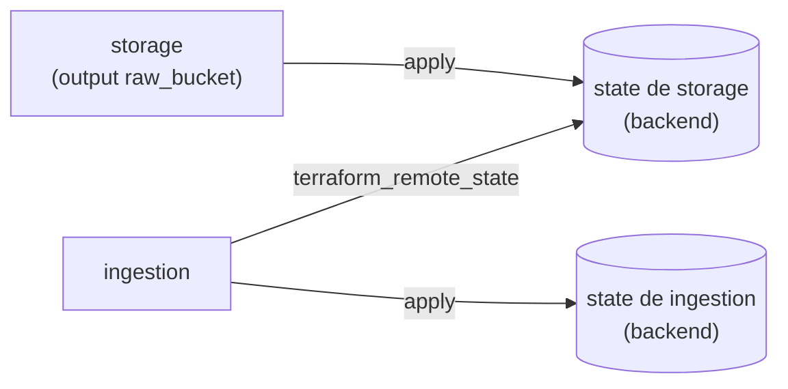

## 1. Resumen

Terraform guarda en el **state** lo que creó. Por defecto es un archivo local, `terraform.tfstate`, y la documentación explica por qué no sirve en equipo: cada persona tiene que tener siempre el state más reciente, y nadie puede correr Terraform al mismo tiempo. Con **remote state**, un backend (Cloud Storage, S3, Azure Blob Storage, HCP Terraform) guarda el state en un lugar compartido y lo **bloquea** durante las operaciones que lo escriben.

El remote state también sirve para **compartir datos** entre configuraciones: `terraform_remote_state` lee los outputs de otra. HashiCorp advierte el costo: quien lo usa necesita acceso al **state completo**, que suele tener información sensible.

## 2. Qué es

- **Backend:** dónde guarda Terraform el state (`local`, `gcs`, `s3`, `azurerm`, HCP Terraform).
- **Locking:** si el backend lo soporta, Terraform bloquea el state al escribirlo; si no consigue el lock, no sigue.
- **`terraform_remote_state`:** data source integrado que lee los outputs del módulo raíz de otra configuración desde su backend.
- **Backend `local` con `path`:** el state en una ruta fija; en los tests de esta ficha reemplaza a un bucket.

## 3. Problema que resuelve

Dos personas aplican la misma configuración con states locales distintos y una crea recursos que la otra no conoce. O una configuración de ingesta necesita el nombre del bucket que creó la de almacenamiento, y alguien lo copia a mano. El remote state resuelve lo primero con un state compartido y bloqueado. `terraform_remote_state` resuelve lo segundo, con un costo de permisos.

## 4. Cómo funciona

1. La configuración `storage` declara un backend (aquí `local`, con `path = "../state/storage.tfstate"`; en producción, un bucket) y un output `raw_bucket`.
2. `apply` escribe el state en esa ruta.
3. La configuración `ingestion` declara `data "terraform_remote_state" "storage"` con el mismo backend y la misma ruta.
4. Lee `data.terraform_remote_state.storage.outputs.raw_bucket` y lo usa en su configuración.
5. Cada configuración tiene su propio state; solo comparten el output.

## 5. Cuándo utilizarlo

- Siempre que más de una persona o un pipeline aplique la misma configuración: backend remoto con locking.
- `terraform_remote_state` entre configuraciones del mismo equipo, que ya tiene acceso a los dos states.
- Para descomponer una plataforma grande en configuraciones más chicas (almacenamiento, ingesta, permisos).

## 6. Cuándo no utilizarlo

- `terraform_remote_state` para compartir datos con otro equipo: necesita leer todo el state. HashiCorp recomienda publicar el dato en un lugar aparte con sus propios permisos.
- State local en un pipeline compartido.
- Un backend sin locking cuando puede haber dos `apply` a la vez.

## 7. Ejemplo sencillo

`storage` crea un sufijo aleatorio y publica `raw_bucket = "dekh-raw-<hex>"`. `ingestion` lo lee con `terraform_remote_state` y escribe `{"landing_bucket": "dekh-raw-<hex>"}` en su configuración. Nadie copió el nombre.

## 8. Ejemplo de producción

Una plataforma con:

- un bucket de state por entorno, con versionado y acceso solo para el pipeline de Terraform;
- una configuración por componente (red, almacenamiento, ingesta, permisos), cada una con su prefijo de state;
- `terraform_remote_state` solo entre componentes del mismo equipo;
- los datos que consumen otros equipos publicados aparte, con sus propios permisos.

## 9. Arquitectura



## 10. Código

<!-- validate-terraform: excluido — se ejecuta con init, plan y apply en los tests (ADR-015) -->
```hcl
# storage/main.tf · Terraform 1.16 (ejecutado en la CI con init, plan y apply sobre hashicorp/random, sin nube;
# ADR-015): la configuración del almacenamiento guarda su state con el backend local en una ruta fija, como lo haría
# en un bucket, y publica el nombre del bucket como output.
terraform {
  required_version = ">= 1.16"
  backend "local" {
    path = "../state/storage.tfstate"
  }
  required_providers {
    random = {
      source  = "hashicorp/random"
      version = "~> 3.9"
    }
  }
}

resource "random_id" "suffix" {
  byte_length = 4
}

output "raw_bucket" {
  value = "dekh-raw-${random_id.suffix.hex}"
}
```

<!-- validate-terraform: excluido — lee el state del bloque anterior; se ejecuta en los tests (ADR-015) -->
```hcl
# ingestion/main.tf · Terraform 1.16 (ejecutado en la CI después del bloque anterior): la configuración de la ingesta
# lee el output del almacenamiento con terraform_remote_state (backend local) y lo usa en su propia configuración.
terraform {
  required_version = ">= 1.16"
  backend "local" {
    path = "../state/ingestion.tfstate"
  }
  required_providers {
    local = {
      source  = "hashicorp/local"
      version = "~> 2.9"
    }
  }
}

data "terraform_remote_state" "storage" {
  backend = "local"
  config = {
    path = "${path.module}/../state/storage.tfstate"
  }
}

resource "local_file" "ingestion_config" {
  filename = "${path.module}/out/ingestion.json"
  content  = jsonencode({ landing_bucket = data.terraform_remote_state.storage.outputs.raw_bucket })
}
```

Los dos bloques se **ejecutan en la CI** con `init`, `plan` y `apply` sobre `hashicorp/random` y `hashicorp/local`, sin nube (ADR-015). El backend es `local` con una ruta fija, en lugar de un bucket. El test comprueba que quedan dos states separados y que la ingesta escribió exactamente el nombre que publicó el almacenamiento. Con un backend `gcs`, `s3` o `azurerm`, solo cambian el bloque `backend` y el `config` del data source.

## 11. GCP

En GCP, el state de Terraform va al **backend `gcs`**, o lo administra **Infrastructure Manager**. Las diferencias, según sus páginas:

| | Backend `gcs` (Terraform) | Infrastructure Manager |
|---|---|---|
| Dónde queda el state | Bucket de Cloud Storage que elige el equipo | Un state por deployment y revision, administrado por el servicio; sus artifacts, en un bucket que crea en el proyecto |
| Acceso al state | Permisos sobre el bucket | Permisos propios (`config.deployments.getState`, `updateState`, `lock`, `unlock`) |

## 12. AWS

En AWS, el state de Terraform va al **backend `s3`**. CloudFormation no expone un state propio, y comparte datos entre stacks con **exports**. Las diferencias, según sus páginas:

| | Terraform (`terraform_remote_state`) | CloudFormation |
|---|---|---|
| Compartir un valor | Leer los outputs de otra configuración desde su state | Marcar un output para export e importarlo con `Fn::ImportValue` |
| Qué hay que poder leer | El snapshot completo del state | El valor exportado |

## 13. Azure

En Azure, el state de Terraform va al **backend `azurerm`** (Blob Storage). **Bicep** no tiene state: «No state or state files to manage: Azure stores all states» (*What is Bicep?*). Lo que en Terraform es leer el state de otra configuración, en Bicep es leer el output de un módulo o del recurso desplegado.

## 14. Buenas prácticas

- Backend remoto con locking desde el primer día de trabajo en equipo.
- Un state por componente y por entorno.
- `terraform_remote_state` solo donde ya hay acceso al otro state.
- **Seguridad:** el state tiene información sensible; quien lee un state remoto lo lee completo. Acceso al bucket solo para el pipeline y para quien lo administra (ver `terraform-state`).
- **Observabilidad:** versionado en el bucket del state para ver y recuperar versiones anteriores.
- **Costo:** CloudFormation es gratuito según su página, y se pagan los recursos; un bucket de state cuesta poco, y perder el state cuesta mucho.

## 15. Errores frecuentes

- State local en un repositorio compartido.
- Dar acceso al state a otro equipo solo para que lea un output.
- Desactivar el locking para destrabar un `apply` sin saber quién tiene el lock.
- Un único state para toda la plataforma.

## 16. Trade-offs

El remote state da trabajo en equipo seguro, a cambio de administrar un backend y sus permisos. Varias configuraciones chicas reducen el radio de un error, pero obligan a compartir datos entre ellas. `terraform_remote_state` es simple, pero acopla configuraciones y exige leer el state completo. Publicar los datos aparte da permisos finos, con un recurso más que mantener.

## 17. Conceptos relacionados

- `terraform-state`: qué guarda el state y por qué protegerlo.
- `terraform-variables-and-outputs`: los outputs que se comparten.
- `infrastructure-as-code`: descomponer la infraestructura.
- `terraform-environments`: un backend por entorno.

## 18. Preguntas técnicas abiertas

1. ¿Dónde está hoy el state de tu infraestructura y quién puede leerlo?
2. ¿Qué configuraciones leen el state de otras?
3. ¿Qué pasaría si dos pipelines aplicaran la misma configuración a la vez?

## 19. Laboratorio relacionado

Pendiente (F4).

## 20. Fuentes

- Terraform 1.16: *Remote State*, *The terraform_remote_state Data Source*, *local* (backend) y *State Locking*; backends *gcs*, *s3* y *azurerm*.
- Google Cloud: *Manage the Terraform state file* y *Deployments, revisions, and previews overview*.
- AWS: *Refer to resource outputs in another CloudFormation stack*. Microsoft Learn: *What is Bicep?*.

El detalle de cada fuente está en `sources` del frontmatter.

## 21. Fecha de última verificación

2026-10-14. `review_required`: pendiente de revisión B-F3.1 del lote F3b-12a.

## 22. Historial de cambios importantes

- 2026-10-14: creación (lote F3b-12a).
