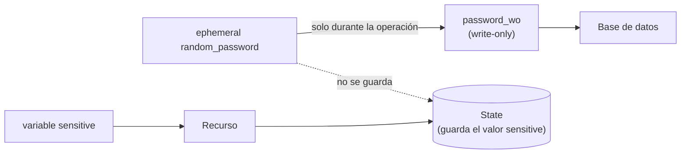

## 1. Resumen

La documentación de Terraform lo dice sin rodeos: si se ponen secretos en la configuración, «Terraform stores those secrets in its state and plan files». En local, el state es un archivo de texto plano. De ahí salen tres reglas:

- **`sensitive` no protege el secreto:** solo lo oculta en la CLI; el valor queda en el state.
- **`ephemeral` (desde 1.10) y los argumentos write-only (desde 1.11)** dejan el valor fuera del state y del plan.
- **El state se trata como dato sensible:** fuera de Git, en un backend con cifrado y acceso restringido.

La otra mitad son los **permisos**: Terraform crea y borra con la identidad de quien lo corre. Esa identidad debería tener solo lo que la configuración necesita.

## 2. Qué es

- **`sensitive`:** oculta el valor en la salida de la CLI; no lo saca del state.
- **`ephemeral` (variable, output de módulo hijo o bloque):** el valor existe solo durante la operación; Terraform no lo guarda en el state ni en el plan.
- **Argumento write-only (`*_wo`):** recibe un valor, ephemeral o no, que el provider usa y Terraform descarta; un argumento de versión (`*_wo_version`) indica cuándo volver a enviarlo.
- **Lock file:** registra los checksums de cada provider; si un paquete no coincide, Terraform falla.
- **`prevent_destroy`:** hace fallar el plan que destruiría el recurso, pero no lo protege si se borra su configuración.

## 3. Problema que resuelve

Una configuración que crea la base del warehouse con `password = var.db_password` deja la contraseña en el state. Cualquiera con acceso al bucket del state la tiene. Y un pipeline que aplica Terraform con permisos de administrador puede, por un error en un `for_each`, borrar datasets de producción. La seguridad en Terraform es decidir qué valores no deben quedar en el state y qué puede hacer la identidad que aplica.

## 4. Cómo funciona

1. Los valores que no deben guardarse se declaran `ephemeral`, o se generan con un recurso `ephemeral` (como `random_password`).
2. Llegan al recurso por un argumento write-only (`password_wo`), con su `password_wo_version`.
3. Terraform rechaza guardar un valor ephemeral donde quedaría persistido: el plan falla con «Invalid use of ephemeral value».
4. Lo que igual queda en el state (atributos de recursos, valores `sensitive`) se protege con el backend: cifrado, versionado y acceso solo para el pipeline.
5. El pipeline aplica con una identidad dedicada y con permisos acotados.

## 5. Cuándo utilizarlo

- `ephemeral` y write-only para contraseñas, tokens y claves que solo necesita el recurso al crearse o rotarse.
- `sensitive` para todo valor que no deba aparecer en logs, sabiendo que igual queda en el state.
- Una identidad por pipeline y entorno, con los permisos de esa configuración.

## 6. Cuándo no utilizarlo

- `ephemeral` y write-only en Infrastructure Manager: soporta Terraform hasta 1.5.7, y estas funciones necesitan 1.10 y 1.11.
- `sensitive` como única protección de un secreto.
- `prevent_destroy` como protección contra borrar la configuración del recurso: no lo protege en ese caso.

## 7. Ejemplo sencillo

Un `api_token` marcado `sensitive` aparece dos veces en `terraform.tfstate`. Un `bootstrap_password` marcado `ephemeral` no aparece ninguna. Si alguien lo pone en un recurso que se guarda, el plan falla.

## 8. Ejemplo de producción

Una plataforma con:

- contraseñas de bases generadas con `ephemeral "random_password"` y pasadas por `password_wo`, con `password_wo_version` para rotarlas;
- el state en un bucket cifrado, con versionado, que solo leen el pipeline y quien administra la plataforma;
- el pipeline con una cuenta de servicio por entorno, sin permisos de administrador del proyecto;
- `.terraform.lock.hcl` en el repositorio, revisado en cada cambio de provider.

## 9. Arquitectura



## 10. Código

<!-- validate-terraform: excluido — se ejecuta con init, plan y apply en los tests (ADR-015) -->
```hcl
# Terraform 1.16 (ejecutado en la CI con init, plan y apply sobre hashicorp/random y terraform_data, sin nube;
# ADR-015): un valor sensitive y uno ephemeral. El test comprueba que el primero queda en el state y el segundo no, y
# que Terraform rechaza guardar un valor ephemeral en un recurso.
terraform {
  required_version = ">= 1.11"
  required_providers {
    random = {
      source  = "hashicorp/random"
      version = "~> 3.9"
    }
  }
}

variable "api_token" {
  type      = string
  sensitive = true # se oculta en la CLI, pero se guarda en el state
}

variable "bootstrap_password" {
  type      = string
  ephemeral = true # no se guarda ni en el plan ni en el state
}

ephemeral "random_password" "temporary" {
  length = 24
}

resource "terraform_data" "connector" {
  input = { token = var.api_token }
}

locals {
  # Un valor ephemeral solo puede ir a contextos ephemeral, como este local o un argumento write-only.
  password_length = length(var.bootstrap_password) + length(ephemeral.random_password.temporary.result)
}
```

```hcl
# Terraform 1.16 (validado en la CI con terraform validate, sin credenciales; no se aplicó): la contraseña de la base del
# warehouse se genera como ephemeral y llega a la base por un argumento write-only (password_wo), sin quedar en el plan
# ni en el state. password_wo_version se sube cuando hay que rotarla. Requiere hashicorp/aws ~> 6.0 y random ~> 3.9.
terraform {
  required_version = ">= 1.11"
  required_providers {
    aws = {
      source  = "hashicorp/aws"
      version = "~> 6.0"
    }
    random = {
      source  = "hashicorp/random"
      version = "~> 3.9"
    }
  }
}

variable "db_password_version" {
  type    = number
  default = 1
}

ephemeral "random_password" "db" {
  length = 24
}

resource "aws_db_instance" "warehouse_staging" {
  identifier          = "dekh-staging"
  instance_class      = "db.t3.micro"
  allocated_storage   = 20
  engine              = "postgres"
  username            = "loader"
  password_wo         = ephemeral.random_password.db.result
  password_wo_version = var.db_password_version
  storage_encrypted   = true
  skip_final_snapshot = true
}
```

El primer bloque se **ejecuta en la CI** con `init`, `plan` y `apply` sobre `hashicorp/random` y `terraform_data`, sin nube (ADR-015). El test comprueba que el token `sensitive` está en `terraform.tfstate` y que la contraseña `ephemeral` no. También agrega un recurso que guarda el valor ephemeral y comprueba que el plan falla con «Invalid use of ephemeral value». El segundo bloque se **valida con `terraform validate` en la CI y no se aplicó**. Sigue el ejemplo de `aws_db_instance` con `password_wo` y `password_wo_version` de *Use temporary write-only arguments*.

## 11. GCP

En GCP, **Infrastructure Manager** ejecuta Terraform con una cuenta de servicio. Las diferencias, según sus páginas:

| | Terraform (CLI) | Infrastructure Manager |
|---|---|---|
| Identidad que aplica | La de quien corre Terraform | Una cuenta de servicio, obligatoria para crear, actualizar o borrar |
| `ephemeral` y write-only | Desde 1.10 y 1.11 | No disponibles: soporta Terraform 1.3.10, 1.4.7 y 1.5.7 |

## 12. AWS

En AWS, **CloudFormation**. Las diferencias, según sus páginas:

| | Terraform | CloudFormation |
|---|---|---|
| Secretos | `ephemeral` y write-only; si no, quedan en el state | Referencias dinámicas a Secrets Manager (`{{resolve:secretsmanager:…}}`), sin versión para que funcione la rotación |
| Identidad que aplica | La de quien corre Terraform | Por defecto, una sesión con las credenciales del usuario; con un service role, solo los permisos del rol |

## 13. Azure

En **Bicep**, `@secure()` hace que Azure Resource Manager no registre ni muestre el valor (*Parameters in Bicep*). La función `getSecret` pasa un secreto de Key Vault a un parámetro seguro de un módulo sin exponer el valor, porque solo se referencia su ID (*Use Azure Key Vault to pass a secret as a parameter during Bicep deployment*).

## 14. Buenas prácticas

- Ningún secreto literal en la configuración ni en los `.tfvars`.
- `ephemeral` y write-only donde el provider los soporte.
- El state como secreto: backend cifrado, versionado y con acceso mínimo.
- El lock file en el repositorio.
- **Seguridad:** una identidad por pipeline y entorno, con los permisos de su configuración; revisar el plan antes de aplicar.
- **Observabilidad:** los logs del pipeline no deberían tener valores sensibles; `terraform output -json` los muestra en texto plano.
- **Costo:** el costo de un secreto filtrado o de un borrado en producción es mucho mayor que el de una identidad por entorno.

## 15. Errores frecuentes

- Creer que `sensitive` saca el valor del state.
- Commitear `terraform.tfstate` o los `.tfvars` con secretos.
- Aplicar con credenciales de administrador desde el pipeline.
- Confiar en `prevent_destroy` y borrar la configuración del recurso.

## 16. Trade-offs

`ephemeral` y write-only sacan el secreto del state, a cambio de que Terraform no pueda ver si cambió: hay que subir la versión a mano. Permisos acotados reducen el daño de un error, pero un permiso faltante hace fallar el `apply` y obliga a ajustarlo. Un backend muy restringido protege el state, a cambio de que menos personas puedan diagnosticar problemas.

## 17. Conceptos relacionados

- `terraform-state` y `terraform-remote-state`: qué guarda el state y quién lo lee.
- `terraform-variables-and-outputs`: `sensitive` en variables y outputs.
- `terraform-providers`: el lock file y los checksums.
- `infrastructure-as-code`: los permisos de quien aplica.
- `ci-cd-secrets`: las credenciales del pipeline.

## 18. Preguntas técnicas abiertas

1. ¿Qué secretos hay hoy en el state de tu infraestructura?
2. ¿Con qué permisos aplica Terraform tu pipeline?
3. ¿Quién puede leer el bucket donde está el state?

## 19. Laboratorio relacionado

Pendiente (F4).

## 20. Fuentes

- Terraform 1.16: *Manage sensitive data in your configuration*, *Ephemeral values in resources*, *Use temporary write-only arguments*, *Dependency Lock File* y *lifecycle reference*.
- Google Cloud: *Configure the service account* y *Terraform and Infrastructure Manager*.
- AWS: *Get a secret or secret value from Secrets Manager* y *CloudFormation service role*.
- Microsoft Learn: *Use Azure Key Vault to pass a secret as a parameter during Bicep deployment* y *Parameters in Bicep*.

El detalle de cada fuente está en `sources` del frontmatter.

## 21. Fecha de última verificación

2026-10-19. `review_required`: pendiente de revisión B-F3.1 del lote F3b-12b.

## 22. Historial de cambios importantes

- 2026-10-19: creación (lote F3b-12b).
