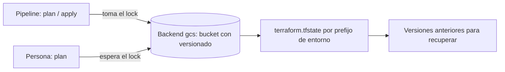

## 1. Resumen

El state es el registro en el que Terraform anota qué objeto real (un dataset, un bucket) corresponde a cada recurso de la configuración. Sin él, Terraform no sabe qué gestiona. Por eso se guarda en un backend remoto con bloqueo, para que dos personas no lo escriban a la vez, y con versionado, para recuperarlo. Y se protege como un secreto: puede contener contraseñas y tokens.

## 2. Qué es

Es un archivo (por defecto `terraform.tfstate`, local) con el vínculo entre cada recurso de la configuración y el objeto remoto que creó, más metadatos. Terraform lo usa para:

- saber qué existe y qué gestiona;
- calcular qué cambiar en el siguiente plan;
- mejorar el rendimiento en infraestructuras grandes.

El **backend** es dónde se guarda: local o remoto (Cloud Storage, S3, Azure Blob Storage, HCP Terraform).

## 3. Problema que resuelve

Terraform necesita recordar qué creó para poder actualizarlo o borrarlo. El problema operativo es otro: un state local en el portátil de una persona impide colaborar y se pierde con el equipo; dos `apply` simultáneos sobre el mismo state pueden corromperlo; y un state en Git expone secretos y no tiene bloqueo.

## 4. Cómo funciona

1. Al aplicar, Terraform registra en el state la identidad de cada objeto remoto creado.
2. En el siguiente plan, lee el state, consulta el estado real de los objetos y compara con la configuración.
3. Con un **backend remoto con bloqueo**, toda operación que puede escribir el state toma el lock; si no lo consigue, no continúa.
4. Con **versionado** en el bucket, cada escritura del state deja una versión anterior recuperable.

## 5. Cuándo utilizarlo

Siempre que se use Terraform. Un backend remoto con bloqueo es necesario en cuanto más de una persona o un pipeline aplican sobre la misma infraestructura.

## 6. Cuándo no utilizarlo

- No guardar el state en Git ni en almacenamientos sin bloqueo ni control de acceso: la documentación de Terraform lo desaconseja.
- No desactivar el bloqueo (`-lock=false`) salvo en una recuperación consciente.
- No editar el state a mano para "arreglar" diferencias: se usan los comandos de Terraform y se revisa el plan.

## 7. Ejemplo sencillo

Un `apply` crea el dataset `dwh`. El state registra que el recurso `google_bigquery_dataset.dwh` es el dataset `proyecto:dwh`. En el siguiente plan, Terraform sabe que ya existe y solo propone cambios si la configuración difiere.

## 8. Ejemplo de producción

El state de cada entorno vive en un bucket de Cloud Storage dedicado (`empresa-tfstate-prod`), con Object Versioning y permisos solo para la cuenta de servicio del pipeline de despliegue y para un grupo de administradores. Un prefijo por entorno separa los states. Cuando un `apply` falla a mitad, el lock impide que otro pipeline escriba el state hasta revisar; si el state se daña, se recupera la versión anterior del objeto.

## 9. Arquitectura



## 10. Código

```hcl
# Backend remoto en Cloud Storage: state compartido, con bloqueo, por prefijo de entorno.
# Requiere: el bucket debe existir antes y conviene que tenga Object Versioning activado.
# Validar sin acceder al bucket: terraform init -backend=false && terraform validate
terraform {
  backend "gcs" {
    bucket = "empresa-tfstate-prod"
    prefix = "datos/prod"
  }

  required_providers {
    google = {
      source  = "hashicorp/google"
      version = "~> 8.0"
    }
  }
}
```

El bucket del state se crea aparte (por ejemplo, con el snippet de Cloud Storage del lote 4), porque el backend debe existir antes de usarlo.

## 11. GCP

El backend **gcs** guarda el state en un bucket de Cloud Storage que debe existir de antemano, soporta bloqueo de state, y la documentación recomienda activar **Object Versioning** para recuperar el state ante borrados accidentales o errores humanos. El `prefix` separa states de distintos entornos en el mismo bucket.

## 12. AWS

El backend **s3** guarda el state en un bucket de S3. A diferencia de gcs, el bloqueo es **opcional**: se activa con `use_lockfile = true` (por defecto `false`), y el bloqueo con DynamoDB está deprecado. También recomienda activar Bucket Versioning. Quien migra desde gcs debe recordar activar el bloqueo explícitamente.

## 13. Azure

El backend **azurerm** guarda el state como un blob en un contenedor de una cuenta de Azure Storage, con bloqueo y comprobación de consistencia mediante capacidades nativas de Blob Storage. Recomienda pasar las credenciales por variables de entorno y no en la configuración. Con Bicep, en cambio, no hay state que gestionar: Azure lo mantiene.

## 14. Buenas prácticas

- Backend remoto con bloqueo y versionado desde el primer día.
- Un state por entorno (prefijo o bucket distinto), para limitar el alcance de un error.
- No desactivar el bloqueo y no editar el state a mano.
- **Seguridad:** tratar el state como un secreto: puede contener contraseñas y tokens. Acceso mínimo al bucket, sin acceso público, y preferir mecanismos que eviten que los secretos lleguen al state.
- **Observabilidad:** registrar quién aplica y cuándo; vigilar locks que quedan tomados tras un fallo.
- **Costo:** el almacenamiento del state es mínimo; el costo real de perderlo es reconstruir el vínculo con la infraestructura existente.

## 15. Errores frecuentes

- State local en el equipo de una persona.
- State en Git, con secretos expuestos y sin bloqueo.
- Backend s3 sin `use_lockfile` y dos `apply` simultáneos.
- Un único state para todos los entornos.

## 16. Trade-offs

Un state por entorno o por componente limita el impacto de un error y acelera los planes, a cambio de más configuración y de coordinar dependencias entre states. Un único state es más simple, pero cualquier `apply` toca todo y el lock bloquea a todos.

## 17. Conceptos relacionados

- `infrastructure-as-code`: el marco.
- `terraform-plan-apply`: el plan lee el state.
- `gcs-buckets-and-objects`: el bucket que guarda el state en Google Cloud.
- `terraform-remote-state`: el state en un backend compartido y los datos entre configuraciones.
- `terraform-drift`: la diferencia entre el state y lo real.
- `terraform-security`: los secretos que quedan en el state y cómo evitarlo.

## 18. Preguntas técnicas abiertas

1. ¿Qué harías si un `apply` falló a mitad y el lock quedó tomado?
2. ¿Cómo dividirías el state de una plataforma de datos con varios equipos?
3. ¿Qué secretos podrían terminar en tu state y cómo lo evitarías?

## 19. Laboratorio relacionado

Pendiente (F4): snippet de bucket de Cloud Storage para el state (lote 4).

## 20. Fuentes

- HashiCorp: *State*, *State: Locking*, *Manage sensitive data* y los backends *gcs*, *s3* y *azurerm*.
- Google Cloud: *Overview of Terraform on Google Cloud*.

El detalle de cada fuente está en `sources` del frontmatter.

## 21. Fecha de última verificación

2026-10-01. Pasa a `verified`: revisión B-F3.1 del lote 4 aplicada, sin VERIFY pendientes.

## 22. Historial de cambios importantes

- 2026-10-01: creación (lote 4 de F3).
- 2026-10-01: `verification_status: verified` (revisión B-F3.1 del lote 4 aplicada; sin VERIFY pendientes).
- 2026-10-13: `page_title` en cada cita, con el título de la página citada (ADR-012); sin cambios de contenido.
- 2026-10-14: regla del §17 (lote F3b-12a): el §17 enlaza `terraform-remote-state`, que ya tiene ficha, y relations la incluye; antes figuraba como pendiente de ficha.
- 2026-10-19: regla del §17 (lote F3b-12b): el §17 enlaza `terraform-drift` y `terraform-security`, que ya tienen ficha, y relations las incluye; antes figuraban como pendiente de ficha.
