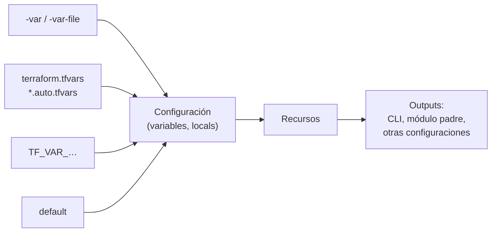

## 1. Resumen

Las **variables** son la entrada de una configuración de Terraform y los **outputs**, su salida. Según la documentación de Terraform 1.16:

- una variable tiene tipo, valor por defecto, descripción y **validación**;
- su valor puede llegar por `-var` o `-var-file`, archivos `*.auto.tfvars`, `terraform.tfvars`, variables de entorno `TF_VAR_` o el `default`, en ese orden de precedencia;
- un output expone un valor a la CLI, al módulo padre o a otras configuraciones.

Hay una trampa que la documentación dice directo: `sensitive` oculta el valor en la CLI, pero «Terraform still stores the values of sensitive variables in your state». Y `terraform output -json` muestra los outputs sensibles en texto plano.

## 2. Qué es

- **`variable`:** declara una entrada. Argumentos: `type`, `default`, `description`, `validation`, `sensitive`, `nullable`, `ephemeral`, `const` y `deprecated`.
- **`validation`:** una `condition` y un `error_message`; el plan falla si no se cumple.
- **`locals`:** valores calculados dentro de la configuración, como un prefijo de nombres.
- **`output`:** declara una salida; `sensitive = true` la muestra como `<sensitive>`.
- **`terraform.tfvars`:** archivo de valores que Terraform carga solo.

## 3. Problema que resuelve

Una configuración con nombres, regiones y tamaños escritos a mano solo sirve para un entorno. Con variables, la misma configuración crea dev y prod con valores distintos. Con validación, un valor equivocado (`environment = "qa"`) falla en el plan en lugar de crear recursos mal nombrados. Con outputs, otra configuración o el pipeline reciben el nombre real del bucket sin copiarlo a mano.

## 4. Cómo funciona

1. La configuración declara `environment` (con validación), `tables` (un mapa de objetos con atributos opcionales) y `api_token` (sensible).
2. `terraform.tfvars` da los valores de dev. El token llega por `TF_VAR_api_token`, desde el pipeline.
3. `locals` arma el prefijo `dekh-dev`.
4. `for_each` sobre `tables` crea un archivo por tabla.
5. Los outputs devuelven la ruta de cada archivo y el token, marcado `sensitive`.

## 5. Cuándo utilizarlo

- Variables para todo lo que cambia entre entornos o usos: nombres, regiones, tamaños, retenciones.
- Validación en las variables que, mal puestas, crean recursos difíciles de corregir.
- Outputs para lo que necesita otra configuración, el módulo padre o el pipeline.

## 6. Cuándo no utilizarlo

- Una variable por cada argumento de cada recurso: la configuración se vuelve difícil de leer.
- `sensitive` como protección del secreto: sigue en el state.
- Secretos en `terraform.tfvars` dentro del repositorio.

## 7. Ejemplo sencillo

Con `environment = "dev"` y dos tablas, `apply` crea `dekh-dev-ventas.json` (retención por defecto, 30 días) y `dekh-dev-clientes.json` (365 días). Con `-var environment=qa`, el plan falla con «environment debe ser dev, staging o prod.».

## 8. Ejemplo de producción

Una plataforma con:

- un archivo `.tfvars` por entorno, revisado en el repositorio, sin secretos;
- secretos que llegan del pipeline como `TF_VAR_…` o, mejor, desde un gestor de secretos;
- validación en entorno, región y retenciones;
- outputs con lo que consumen otras configuraciones (nombres de buckets, datasets, cuentas de servicio).

## 9. Arquitectura



## 10. Código

<!-- validate-terraform: excluido — se ejecuta con init, plan y apply en los tests (ADR-015) -->
```hcl
# Terraform 1.16 (ejecutado en la CI con init, plan y apply sobre hashicorp/local, sin nube; ADR-015): variables con
# tipo, validación y valor sensible, un local y outputs. Escribe un archivo de configuración por tabla.
terraform {
  required_version = ">= 1.16"
  required_providers {
    local = {
      source  = "hashicorp/local"
      version = "~> 2.9"
    }
  }
}

variable "environment" {
  type        = string
  description = "Entorno: dev, staging o prod."
  validation {
    condition     = contains(["dev", "staging", "prod"], var.environment)
    error_message = "environment debe ser dev, staging o prod."
  }
}

variable "tables" {
  type = map(object({
    partition_field = string
    retention_days  = optional(number, 30)
  }))
  description = "Tablas a configurar, por nombre."
}

variable "api_token" {
  type        = string
  description = "Token del proveedor de datos."
  sensitive   = true
}

locals {
  prefix = "dekh-${var.environment}"
}

resource "local_file" "table_config" {
  for_each = var.tables
  filename = "${path.module}/out/${local.prefix}-${each.key}.json"
  content = jsonencode({
    table           = each.key
    partition_field = each.value.partition_field
    retention_days  = each.value.retention_days
  })
}

output "config_files" {
  description = "Archivo de configuración de cada tabla."
  value       = { for name, f in local_file.table_config : name => f.filename }
}

output "api_token_used" {
  description = "El token, marcado como sensible: la CLI lo muestra como <sensitive>."
  value       = var.api_token
  sensitive   = true
}
```

<!-- validate-terraform: excluido — archivo terraform.tfvars, no una configuración (ADR-015) -->
```hcl
# terraform.tfvars (ejecutado en la CI junto con el bloque anterior): valores del entorno dev. El token no va aquí:
# llega por la variable de entorno TF_VAR_api_token.
environment = "dev"
tables = {
  ventas   = { partition_field = "fecha_venta" }
  clientes = { partition_field = "fecha_alta", retention_days = 365 }
}
```

```yaml
# CloudFormation (template.yaml; revisado con cfn-lint en la CI, no desplegado): el mismo patrón con Parameters
# (AllowedValues y NoEcho) y Outputs con Export para referencias entre stacks.
AWSTemplateFormatVersion: "2010-09-09"
Description: Bucket de la zona cruda por entorno.
Parameters:
  Environment:
    Type: String
    AllowedValues: [dev, staging, prod]
    Description: Entorno de despliegue.
  RetentionDays:
    Type: Number
    Default: 30
    MinValue: 1
Resources:
  RawBucket:
    Type: AWS::S3::Bucket
    Properties:
      LifecycleConfiguration:
        Rules:
          - Id: expirar-crudo
            Status: Enabled
            ExpirationInDays: !Ref RetentionDays
      Tags:
        - Key: environment
          Value: !Ref Environment
Outputs:
  RawBucketName:
    Description: Nombre del bucket de la zona cruda.
    Value: !Ref RawBucket
    Export:
      Name: !Sub "${AWS::StackName}-raw-bucket"
```

```bicep
// Bicep (main.bicep; compilado con bicep build en la CI, no desplegado): parámetros con @allowed y @secure, y outputs.
@allowed([
  'dev'
  'staging'
  'prod'
])
param environment string

param location string = resourceGroup().location

@secure()
param apiToken string

resource raw 'Microsoft.Storage/storageAccounts@2023-05-01' = {
  name: 'dekh${uniqueString(resourceGroup().id, environment)}'
  location: location
  sku: {
    name: 'Standard_LRS'
  }
  kind: 'StorageV2'
  properties: {
    isHnsEnabled: true
    minimumTlsVersion: 'TLS1_2'
  }
  tags: {
    environment: environment
    tokenConfigured: string(!empty(apiToken))
  }
}

output storageAccountName string = raw.name
```

Los dos bloques de Terraform se **ejecutan en la CI** con `init`, `plan` y `apply` sobre `hashicorp/local`, sin nube (ADR-015). El test comprueba:

- los dos archivos y sus retenciones (la de `ventas`, por el valor opcional por defecto);
- que la salida del `apply` muestra `<sensitive>` y no el token;
- que el token sí está en `terraform.tfstate`, como dice la documentación;
- que `environment = "qa"` falla en el plan con el mensaje de la validación.

La plantilla de CloudFormation se **revisa con cfn-lint** y el archivo Bicep se **compila con `bicep build`** en la CI. Ninguno de los dos se desplegó.

## 11. GCP

En GCP, **Infrastructure Manager** ejecuta configuraciones de Terraform. Las diferencias con Terraform en la CLI, según sus páginas:

| | Terraform (CLI) | Infrastructure Manager |
|---|---|---|
| Valores de las variables | `-var`, `-var-file`, `*.tfvars`, `TF_VAR_`, `default` | `--input-values=NOMBRE=VALOR` en el comando de despliegue |
| Versión de Terraform | La que se instale (aquí, 1.16.6) | `--tf-version-constraint`, entre las soportadas: 1.3.10, 1.4.7 y 1.5.7 (*Terraform and Infrastructure Manager*) |

## 12. AWS

En AWS, **CloudFormation**. Las diferencias, según sus páginas:

| | Terraform | CloudFormation |
|---|---|---|
| Entrada | `variable`, con `validation` | `Parameters`: solo `Type` es obligatorio; `AllowedValues`, `Default`, `MinValue` |
| Salida | `output`; otras configuraciones lo leen del state | `Outputs`, con `Export` para otros stacks y `Fn::GetStackOutput` entre cuentas o regiones |
| Secretos | `sensitive` oculta en la CLI, pero queda en el state | CloudFormation no oculta lo que va en `Outputs`; no poner secretos ahí |

## 13. Azure

En **Bicep**, `param` y `output` cumplen el mismo papel. `@allowed` limita los valores, y el despliegue falla en la validación si llega otro. `@secure()` hace que Azure Resource Manager no registre ni muestre el valor en el historial, el portal ni la CLI (*Parameters in Bicep*). Desde Bicep 0.35.1, un output también puede ser `@secure()` (*Outputs in Bicep*). A diferencia de Terraform, Bicep no tiene un state propio: «No state or state files to manage: Azure stores all states» (*What is Bicep?*).

## 14. Buenas prácticas

- Tipos estrictos (`object`, `map`) con atributos `optional` y su valor por defecto.
- Validación en las variables críticas.
- Descripción en cada variable y output: es la documentación del módulo.
- **Seguridad:** secretos fuera de los `.tfvars` del repositorio; `sensitive` no los saca del state, así que el state se protege como un secreto (ver `terraform-state`).
- **Observabilidad:** outputs con lo que el pipeline necesita registrar, como nombres y URLs creados.
- **Costo:** variables para tamaños y retenciones, para que dev no copie los de prod.

## 15. Errores frecuentes

- Creer que `sensitive` evita que el secreto quede en el state.
- Correr `terraform output -json` en un log de la CI con outputs sensibles: los muestra en texto plano.
- Un `terraform.tfvars` con secretos en el repositorio.
- Olvidar el orden de precedencia y no entender de dónde salió un valor.

## 16. Trade-offs

Más variables dan una configuración más reutilizable, a cambio de más superficie que entender y documentar. La validación detecta errores temprano, pero hay que mantenerla junto con la variable. Los outputs facilitan compartir datos entre configuraciones, a cambio de acoplarlas al nombre del output.

## 17. Conceptos relacionados

- `terraform-modules`: variables y outputs como interfaz de un módulo.
- `terraform-state`: dónde quedan también los valores sensibles.
- `infrastructure-as-code`: la misma configuración para varios entornos.
- `ci-cd-secrets`: cómo llega el secreto desde el pipeline.

## 18. Preguntas técnicas abiertas

1. ¿Qué valores de tu configuración deberían tener validación?
2. ¿Dónde guardas hoy los valores de cada entorno?
3. ¿Quién puede leer el state donde quedan tus valores sensibles?

## 19. Laboratorio relacionado

Pendiente (F4).

## 20. Fuentes

- Terraform 1.16: *Use input variables to add module arguments*, *variable block reference* y *Use outputs to expose module data*.
- Google Cloud: *Deploy infrastructure using Infrastructure Manager* y *Terraform and Infrastructure Manager*.
- AWS: *CloudFormation template Parameters syntax* y *CloudFormation template Outputs syntax*.
- Microsoft Learn: *What is Bicep?*, *Parameters in Bicep* y *Outputs in Bicep*.

El detalle de cada fuente está en `sources` del frontmatter.

## 21. Fecha de última verificación

2026-10-19. Pasa a `verified`: revisión B-F3.1 del lote F3b-12a aplicada, sin VERIFY pendientes.

## 22. Historial de cambios importantes

- 2026-10-14: creación (lote F3b-12a).
- 2026-10-19: revisión B-F3.1 del lote F3b-12a aplicada (docs/reviews/cards-f3b-12a.md): sin hallazgos; sin cambios en esta ficha.
- 2026-10-19: `verification_status: verified` (sin VERIFY pendientes).
