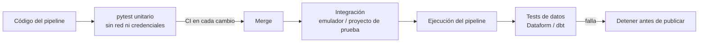

## 1. Resumen

En un pipeline, los tests de pytest protegen lo que más se rompe al cambiar el código: transformaciones, reglas de validación, manejo de errores e idempotencia de las cargas. Se escriben con `assert` simple; los datos de prueba se preparan con *fixtures* (un archivo en `tmp_path`, por ejemplo) y los casos se multiplican con `parametrize`. La regla para que corran en segundos y en la CI es separar la lógica de los clientes de la nube y probarla sin red ni credenciales. Esta ficha no es un curso de pytest: cubre lo necesario para probar código de datos.

## 2. Qué es

pytest es el framework de tests más usado en Python. Busca archivos `test_*.py` y ejecuta las funciones que empiezan con `test`. Sus piezas útiles para datos:

- **`assert` simple:** al fallar, muestra los valores de la expresión.
- **Fixtures:** funciones que preparan lo que un test necesita (un archivo, un cliente falso) y que el test pide por nombre; con `yield`, limpian al terminar.
- **`tmp_path`:** un directorio temporal único por test.
- **`@pytest.mark.parametrize`:** el mismo test con varios juegos de datos.
- **`pytest.raises`:** comprueba que se lanza una excepción.
- **`monkeypatch`:** reemplaza una función o atributo durante el test.

## 3. Problema que resuelve

Un cambio "pequeño" en una función de limpieza o en la configuración de una carga puede pasar inadvertido hasta que corrompe una tabla en producción, por ejemplo un `WRITE_TRUNCATE` que se convierte en `WRITE_APPEND`. Probar a mano contra la nube es lento y caro, y depende de credenciales. Los tests unitarios dan una respuesta en segundos en cada cambio y en la CI.

## 4. Cómo funciona

1. **Separar lógica de entrada y salida:** las funciones puras (normalizar, validar, calcular) se prueban directamente. Las que hablan con la nube reciben el cliente como parámetro, para pasarles un doble en el test.
2. **Datos de prueba mínimos:** cada caso, en un fixture o en `parametrize`; un caso por regla, más los bordes (vacío, negativo, formato inválido).
3. **Errores:** `pytest.raises` fija que un dato inválido falla, y con qué mensaje.
4. **Propiedades del pipeline:** ejecutar dos veces la misma carga y comprobar que se emite lo mismo (idempotencia); comprobar destino, partición y modo de escritura.
5. **Capas superiores:** tests de integración contra emuladores o un proyecto de prueba, y tests de datos (aserciones de Dataform, data tests de dbt) sobre las tablas resultantes. pytest no reemplaza esos controles: los complementa.

## 5. Cuándo utilizarlo

- Todo código Python de un pipeline: transformaciones, validación, parseo de archivos y APIs, construcción de consultas y configuración de cargas.
- En la CI, en cada cambio.
- Antes de refactorizar: los tests fijan el comportamiento actual.

## 6. Cuándo no utilizarlo

- Para validar la calidad de los datos ya cargados (unicidad, nulos, integridad referencial): eso se hace con aserciones SQL en el motor (Dataform, dbt) sobre los datos reales.
- Para "probar" la nube con un cliente falso que acepta todo: los permisos, el schema y las cuotas solo se comprueban contra el servicio real o un emulador.
- Para SQL largo dentro de strings de Python: mejor llevar el SQL a Dataform o dbt y probarlo allí.

## 7. Ejemplo sencillo

```python
def test_normalize_amount() -> None:
    assert normalize_amount("1.250") == 1250
```

Si falla, pytest muestra el valor obtenido y el esperado sin mensajes adicionales.

## 8. Ejemplo de producción

Un repositorio de ingesta tiene tres niveles de tests:

- **Unitarios con pytest**, en cada push: validación de payloads con Pydantic, normalización y la configuración de los load jobs con un cliente falso. Tardan segundos.
- **Integración**, cada noche: un consumidor contra el emulador de Pub/Sub y una carga real a un dataset de prueba con expiración de tablas.
- **Datos**, en cada ejecución del pipeline: aserciones de Dataform de unicidad y no nulos sobre las tablas resultantes.

Un fallo en el primer nivel bloquea el merge; uno en el tercero detiene el pipeline antes de publicar.

## 9. Arquitectura



## 10. Código

```python
# tests/test_transform.py · Python 3.12 y pytest: prueba una transformación de un pipeline, sin red.
import csv
import re
from pathlib import Path

import pytest


AMOUNT = re.compile(r"^(\d{1,3}(\.\d{3})+|\d+)$")  # miles con punto o sin separador; sin decimales


def normalize_amount(raw: str) -> int:
    """Monto en pesos chilenos desde texto con separador de miles: '1.250' -> 1250."""
    text = raw.strip()
    if not AMOUNT.match(text):  # valida antes de quitar los puntos: '10.50' no pasa a 1050
        raise ValueError(f"formato de monto inválido: {raw!r}")
    return int(text.replace(".", ""))


def load_rows(path: Path) -> list[dict[str, int | str]]:
    with path.open(encoding="utf-8", newline="") as f:
        return [{"id": r["id"], "amount": normalize_amount(r["amount"])} for r in csv.DictReader(f)]


@pytest.fixture
def sample_csv(tmp_path: Path) -> Path:
    """Archivo de entrada mínimo; tmp_path es un directorio temporal único por test."""
    path = tmp_path / "pedidos.csv"
    path.write_text("id,amount\nA1,1.250\nA2,90\n", encoding="utf-8")
    return path


@pytest.mark.parametrize(("raw", "expected"), [("1.250", 1250), ("90", 90), (" 3.000 ", 3000)])
def test_normalize_amount(raw: str, expected: int) -> None:
    assert normalize_amount(raw) == expected


@pytest.mark.parametrize("raw", ["10.50", "1.2.3", "12.34", "-5", "N/D", ""])
def test_invalid_amount_is_rejected(raw: str) -> None:
    with pytest.raises(ValueError, match="formato"):
        normalize_amount(raw)


def test_load_rows_reads_the_whole_file(sample_csv: Path) -> None:
    assert load_rows(sample_csv) == [{"id": "A1", "amount": 1250}, {"id": "A2", "amount": 90}]
```

`python -m pytest -q` ejecuta 10 tests (los parametrizados cuentan 3 y 6). Sin la expresión regular, `'10.50'` se convertiría sin error en 1050, `'1.2.3'` en 123 y `'12.34'` en 1234: el test de formatos inválidos lo impide. En un repositorio real, `normalize_amount` y `load_rows` viven en el paquete del pipeline y el test los importa. El snippet `pytest-ingestion-test` aplica lo mismo a la validación con Pydantic y a una carga de BigQuery con un cliente falso.

## 11. GCP

Para lo que pytest no cubre, Google Cloud ofrece dos piezas. El **emulador de Pub/Sub** permite probar publicadores y consumidores en local: la aplicación se conecta con `PUBSUB_EMULATOR_HOST`, usando las bibliotecas cliente; no admite la consola ni `gcloud pubsub`. **Dataform** prueba los datos con aserciones (`nonNull`, `rowConditions`, `uniqueKey`) y con tests unitarios de SQL (`type: "test"`) que reemplazan las dependencias por datos de entrada propios. pytest queda para el código Python; Dataform, para el SQL y los datos.

## 12. AWS

Para jobs de **Glue** (Spark), AWS publica una imagen Docker y la biblioteca ETL de Glue, que permiten desarrollar y probar los scripts en local sin costos de Glue. A diferencia del código Python puro, probar un job de Glue requiere el runtime de Spark de esa imagen. Las funciones puras que el job usa conviene probarlas aparte con pytest, sin Spark.

## 13. Azure

En **Azure Functions** con Python, la documentación indica escribir los tests unitarios con pytest, construyendo las entradas de los bindings con las clases del paquete `azure.functions`. El patrón es el mismo de esta ficha: la función recibe sus dependencias y el test le pasa objetos simulados. Para SQL en Fabric o Synapse, los tests de datos se hacen con dbt (*data tests*) u otra herramienta del motor.

## 14. Buenas prácticas

- Un caso por regla y por borde; nombres de test que digan qué protegen.
- Fixtures pequeños y explícitos; `tmp_path` para archivos, nunca rutas compartidas.
- Inyectar los clientes de la nube y tiparlos con un `Protocol`, para pasar dobles sin `monkeypatch` cuando se pueda.
- Un test de idempotencia por carga: ejecutarla dos veces y comparar.
- Ejecutar los tests en la CI en cada cambio y bloquear el merge si fallan.
- **Seguridad:** los tests unitarios no usan credenciales reales; los datos de prueba no contienen datos personales reales, aunque sean "de ejemplo".
- **Observabilidad:** registrar en la CI el tiempo y los tests saltados (*skipped*); un test que se salta siempre no protege nada.
- **Costo:** los unitarios no tocan la nube; los de integración usan un proyecto o dataset de prueba con expiración, para no acumular almacenamiento.

## 15. Errores frecuentes

- Tests que llaman a la API real "porque es más fácil": lentos, frágiles y con credenciales en la CI.
- Probar solo el caso feliz, sin los inválidos.
- Dobles que aceptan cualquier llamada: el test pasa aunque el código use mal el cliente. Comprobar los argumentos.
- Un fixture compartido que un test modifica y otro asume intacto.
- Usar pytest para lo que debería ser una aserción sobre los datos cargados.

## 16. Trade-offs

Los tests unitarios son rápidos y baratos, pero no comprueban la integración real (permisos, schema, cuotas). Los de integración sí, a cambio de lentitud, costo y credenciales. Inyectar dependencias y usar `Protocol` agrega algo de diseño, y ahorra `monkeypatch`, que es más frágil porque depende de dónde se importa cada nombre.

## 17. Conceptos relacionados

- `python-api-consumption` y `python-error-handling-and-retries`: el código que más conviene probar.
- `data-validation-with-pydantic`: reglas de validación con un test por regla.
- `batch-ingestion`: la carga con cliente inyectado.
- `idempotency`: la propiedad que fija el test de repetición.

## 18. Preguntas técnicas abiertas

1. ¿Qué probarías con pytest y qué con aserciones en el motor en un pipeline de ingesta a BigQuery?
2. Una función crea su cliente de BigQuery adentro. ¿La refactorizarías o usarías `monkeypatch`? ¿Por qué?
3. ¿Qué test escribirías para detectar que una carga dejó de ser idempotente?

## 19. Laboratorio relacionado

Pendiente (F4).

## 20. Fuentes

- pytest: *How to write and report assertions in tests*, *How to use fixtures*, *How to use temporary directories and files in tests*, *How to parametrize fixtures and test functions*, *How to monkeypatch/mock modules and environments* y *Good Integration Practices*.
- Google Cloud: *Testing apps locally with the emulator* (Pub/Sub) y *Test data quality* (Dataform).
- dbt: *Add data tests to your DAG*.
- AWS: *Developing and testing AWS Glue job scripts locally*.
- Microsoft Learn: *Python developer reference for Azure Functions*.

El detalle de cada fuente está en `sources` del frontmatter.

## 21. Fecha de última verificación

2026-10-05. Pasa a `verified`: revisión B-F3.1 del lote 6 aplicada, sin VERIFY pendientes.

## 22. Historial de cambios importantes

- 2026-10-05: creación (lote 6 de F3).
- 2026-10-05: revisión B-F3.1 del lote 6 aplicada (docs/reviews/cards-lote6.md), sin cambios pedidos. `verification_status: verified` (sin VERIFY pendientes).
- 2026-10-06: §10, `normalize_amount` valida el formato con una expresión regular antes de quitar los puntos (aprobado por Felipe): `'10.50'`, `'1.2.3'` y `'12.34'` ya no se convierten en 1050, 123 y 1234. Es la expresión de `data-transformation` sin el grupo decimal, porque la función devuelve pesos enteros. El test de negativos pasa a un test parametrizado de formatos inválidos con esos tres casos más `-5`, `N/D` y vacío. Pendiente de revisión de Cursor.
