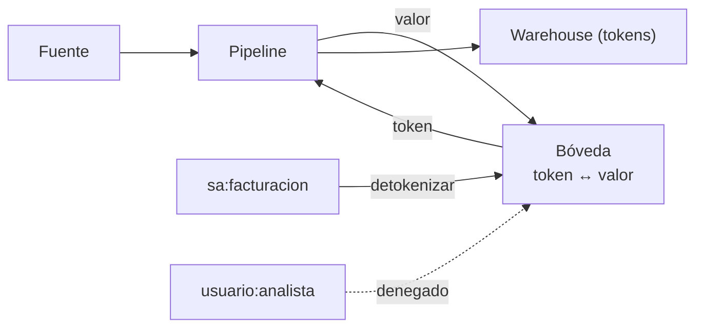

## 1. Resumen

**Tokenizar** es reemplazar un valor sensible (un correo, un número de tarjeta) por un **token** que no se deriva de él, y guardar la correspondencia en una **bóveda** aparte. Los sistemas de análisis y de prueba trabajan con tokens; solo un servicio autorizado **detokeniza**.

Dos variantes:

- **con bóveda:** el token es aleatorio; sin la bóveda no hay forma de volver al valor;
- **sin bóveda (cifrado determinista):** el token es el valor cifrado con una clave; con la clave se vuelve. Sensitive Data Protection llama a esto seudonimización reversible (AES-SIV o FPE) (*Pseudonymization*).

En las dos, el mismo valor da el mismo token, y eso permite unir tablas.

## 2. Qué es

- **Token:** el reemplazo; aleatorio con bóveda, cifrado sin ella.
- **Bóveda:** la tabla token → valor, en un servicio separado.
- **Detokenizar:** recuperar el valor; es un permiso aparte.
- **Integridad referencial:** el mismo valor da el mismo token en todas las tablas.

## 3. Problema que resuelve

El equipo de análisis necesita contar pedidos y reclamos por cliente, y el de facturación necesita el correo real. Con el correo en todas las tablas, todos lo ven. Con tokens, análisis une por token sin ver correos, y facturación detokeniza solo lo que necesita.

## 4. Cómo funciona

1. El pipeline manda el valor sensible a la bóveda.
2. Si el valor ya tiene token, la bóveda lo devuelve; si no, genera uno aleatorio y guarda el par.
3. El pipeline guarda el token en lugar del valor.
4. Las uniones y los conteos se hacen por token.
5. Un servicio autorizado pide a la bóveda el valor de un token; el resto recibe un error.

## 5. Cuándo utilizarlo

- Cuando algunos procesos necesitan el valor original y la mayoría no.
- Para copiar datos de producción a entornos de prueba con tokens en lugar de valores.

## 6. Cuándo no utilizarlo

- Si nadie necesita volver al valor: un HMAC es más simple y no requiere bóveda (`keyed-hashing`).
- Como anonimización: el resto de las columnas puede reidentificar igual (`pseudonymization-vs-anonymization`).

## 7. Ejemplo sencillo

| Prueba | Resultado |
|---|---|
| El mismo correo en dos pedidos | mismo token |
| ¿El token contiene el correo? | no |
| Unir pedidos y reclamos por token | pedidos 1 y 3 |
| Detokenizar como `sa:facturacion` | el correo |
| Detokenizar como `usuario:analista` | `PermissionError` |

## 8. Ejemplo de producción

- Bóveda como servicio aparte, con su propia base, cifrada en reposo y respaldada.
- Tokenizar en la ingesta: el valor original no llega al lago ni al warehouse.
- Permiso de detokenizar solo para las cuentas de servicio que lo necesitan, con auditoría de cada llamada.
- Entornos de prueba con tokens.

## 9. Arquitectura



## 10. Código

```python
"""Tokenización con bóveda: el token es aleatorio y solo la bóveda sabe a qué valor corresponde."""

import secrets


class Boveda:
    """En producción, un servicio aparte con su propia base, acceso restringido y auditoría."""

    def __init__(self, autorizados: set[str]) -> None:
        self._por_valor: dict[str, str] = {}
        self._por_token: dict[str, str] = {}
        self._autorizados = autorizados

    def tokenizar(self, valor: str) -> str:
        if valor not in self._por_valor:               # mismo valor, mismo token: permite unir tablas
            token = "tok_" + secrets.token_urlsafe(12)  # aleatorio: no se deriva del valor
            self._por_valor[valor] = token
            self._por_token[token] = valor
        return self._por_valor[valor]

    def detokenizar(self, token: str, quien: str) -> str:
        if quien not in self._autorizados:
            raise PermissionError(f"{quien} no puede detokenizar")
        return self._por_token[token]


boveda = Boveda(autorizados={"sa:facturacion"})
pedidos = [(1, boveda.tokenizar("ana.perez@example.com")), (2, boveda.tokenizar("luis@example.org")),
           (3, boveda.tokenizar("ana.perez@example.com"))]
reclamos = [(10, boveda.tokenizar("ana.perez@example.com"))]

t = pedidos[0][1]
print(f"mismo valor, mismo token: {t == pedidos[2][1]}")
print(f"el token contiene el valor: {'ana' in t or 'example' in t}")
union = [(p, r) for p, tp in pedidos for r, tr in reclamos if tp == tr]
print(f"pedidos unidos a reclamos por token: {[p for p, _ in union]}")
print(f"detokenizar como sa:facturacion: {boveda.detokenizar(t, 'sa:facturacion')}")
try:
    boveda.detokenizar(t, "usuario:analista")
except PermissionError as exc:
    print(f"detokenizar como usuario:analista: PermissionError ({exc})")
```

El script se **ejecuta en la CI** con la biblioteca estándar y pasa `mypy --strict`. Los tokens se generan con `secrets.token_urlsafe` (*secrets*), así que no se derivan del valor. Imprime el mismo token para el mismo correo, que el token no contiene el correo, la unión por token y el `PermissionError` al detokenizar sin permiso.

## 11. GCP

En GCP, **Sensitive Data Protection**. Según *secrets* y *Pseudonymization* (no ejecutado):

| | Bóveda (este ejemplo) | Sensitive Data Protection |
|---|---|---|
| Token | Aleatorio, con bóveda | Cifrado con clave: AES-SIV (no conserva formato) o FPE-FFX (conserva caracteres y largo); también HMAC, no reversible |
| Volver al valor | La bóveda, con permiso | La clave, la anotación sustituta y el context tweak |
| Mismo valor, mismo token | Sí | Sí, con la misma clave y el mismo context tweak |

## 12. AWS

En AWS, **AWS Glue DataBrew**. Según *secrets* y *DETERMINISTIC_ENCRYPT* (no ejecutado):

| | Bóveda (este ejemplo) | `DETERMINISTIC_ENCRYPT` |
|---|---|---|
| Token | Aleatorio | AES-GCM-SIV con clave de 256 bits, de Secrets Manager |
| Volver al valor | La bóveda | Solo dentro de DataBrew, con `DETERMINISTIC_DECRYPT` |
| Clave | — | No usa AWS KMS; la página desaconseja usar un secreto más de un año |

## 13. Azure

En Azure, **Always Encrypted** en Azure SQL. Según *secrets* y *Always Encrypted* (no ejecutado):

| | Bóveda (este ejemplo) | Cifrado determinista de Always Encrypted |
|---|---|---|
| Dónde vive el valor | En la bóveda; el warehouse solo tiene tokens | Cifrado en la propia columna |
| Operaciones | Unir por token | Búsqueda puntual, joins por igualdad, agrupar e indexar |
| Riesgo | Acceso a la bóveda | Adivinar valores por patrones, sobre todo con pocos valores posibles |

## 14. Buenas prácticas

- Tokens aleatorios con `secrets`, nunca derivados del valor sin clave.
- La bóveda separada de los datos tokenizados, con acceso mínimo.
- Tokenizar lo antes posible en el pipeline.
- **Seguridad:** detokenizar es un permiso aparte, auditado, para pocas cuentas.
- **Observabilidad:** registrar y alertar por volúmenes inusuales de detokenización.
- **Costo:** la bóveda es un servicio más que operar, respaldar y escalar; en cada escritura se le hace una llamada.

## 15. Errores frecuentes

- Tokens con parte del valor (los últimos dígitos, el dominio del correo) sin haberlo decidido.
- La bóveda en la misma base que los datos tokenizados.
- Todos con permiso de detokenizar «por si acaso».

## 16. Trade-offs

Con bóveda, el token no revela nada y la bóveda es un punto único de falla y de ataque. Sin bóveda (cifrado determinista), no hay servicio que operar y todo depende de la clave; además, el mismo valor da el mismo resultado y eso deja ver patrones.

## 17. Conceptos relacionados

- `pseudonymization-vs-anonymization`: tokenizar seudonimiza.
- `keyed-hashing`: seudónimos sin vuelta atrás.
- `data-masking`: ocultar al mostrar.
- `least-privilege`: el permiso de detokenizar.

## 18. Preguntas técnicas abiertas

1. ¿Qué procesos necesitan de verdad el valor original?
2. ¿Dónde estaría tu bóveda y quién la opera?
3. ¿Tus entornos de prueba tienen datos reales?

## 19. Laboratorio relacionado

Pendiente (F4).

## 20. Fuentes

- Python 3.12: *secrets*.
- Google Cloud: *Pseudonymization* (Sensitive Data Protection).
- AWS: *DETERMINISTIC_ENCRYPT* (Glue DataBrew).
- Microsoft Learn: *Always Encrypted*.

El detalle de cada fuente está en `sources` del frontmatter.

## 21. Fecha de última verificación

2026-10-21. `review_required`: pendiente de revisión B-F3.1 del lote F3b-18c.

## 22. Historial de cambios importantes

- 2026-10-21: creación (lote F3b-18c).
