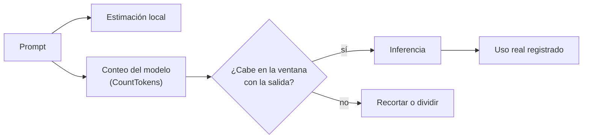

## 1. Resumen

Un modelo no lee caracteres ni palabras: lee **tokens**. El tokenizador de cada modelo divide el texto en unidades que pueden ser caracteres, palabras o frases (*List and count tokens*). Los tokens determinan dos cosas que un data engineer tiene que controlar: **cuánto entra en una llamada** (`context-windows`) y **cuánto se paga**, porque la entrada cuenta para el costo y para la cuota por minuto y por día (*Monitor your token usage…*).

La cuenta exacta depende del modelo. Una estimación por caracteres sirve para presupuestar; antes de procesar un lote grande, se cuenta con el tokenizador o la API del modelo elegido.

## 2. Qué es

- **Token:** la unidad del modelo; un mismo texto da distinta cantidad de tokens en modelos distintos.
- **Tokenizador:** el que convierte texto en tokens y cada token en un ID.
- **Tokens de entrada y de salida:** se cuentan y se cobran por separado.
- **Conteo previo:** CountTokens en Bedrock, `countTokens` o el tokenizador del SDK en Agent Platform.
- **Uso real:** el que devuelve la respuesta; para entradas multimodales el conteo previo es una estimación (*Use the Count Tokens API*).

## 3. Problema que resuelve

Un job que resume 2 millones de tickets se lanza sin medir y a mitad de camino falla por cuota, o termina con una factura que nadie estimó. Contar tokens antes permite decidir el tamaño del lote, la cuota necesaria y si conviene recortar el texto.

## 4. Cómo funciona

1. Se arma el prompt (sistema más mensaje).
2. Se estima por caracteres para un primer presupuesto. La regla depende del idioma: para inglés, la página de Titan da 4.7 caracteres por token en promedio.
3. Se cuenta con la API o el tokenizador del modelo elegido. En Bedrock, CountTokens no tiene costo y coincide con lo que se cobraría (*Monitor your token usage…*).
4. Se compara con la ventana del modelo, reservando la salida (`context-windows`).
5. En la respuesta se registra el uso real de tokens.

## 5. Cuándo utilizarlo

- Antes de lanzar un lote: tokens por fila por cantidad de filas.
- Al definir el tamaño de los fragmentos que se van a enviar a un modelo de embeddings (`embeddings`).
- En cada corrida, como métrica de costo y de uso de cuota.

## 6. Cuándo no utilizarlo

- Como cifra exacta a partir de la estimación por caracteres: es un presupuesto, no la cuenta del modelo.
- Para comparar costos entre modelos sin contar con el tokenizador de cada uno.

## 7. Ejemplo sencillo

El prompt de sistema (62 caracteres) y el mensaje (100) del §10 suman 162 caracteres. La estimación a 4 caracteres por token da 41 tokens; la cuenta del modelo (aquí, una respuesta fija) da 47. Con una ventana de 300 000 y 10 000 reservados para la salida, cabe; con una ventana de 60 y 30 reservados, no.

## 8. Ejemplo de producción

Antes de resumir los tickets del mes:

- muestra de 1 000 tickets, contada con la API del modelo elegido;
- tokens medios por ticket por la cantidad de tickets da el total del lote;
- el total contra la cuota por minuto define cuántos workers usar;
- en cada respuesta se guardan los tokens de entrada y salida para comparar con la estimación (no ejecutado: requiere el modelo).

## 9. Arquitectura



## 10. Código

```python
# Python 3.12 y boto3 (ejecutado en la CI, sin red; ADR-025): estimar tokens antes de llamar al modelo.
# 1) Estimación local por caracteres, que sirve para presupuestar pero no es el conteo del modelo.
# 2) CountTokens de Bedrock con un Stubber: botocore valida el request contra el modelo del servicio y devuelve
#    una respuesta fija (inputTokens inventado para el ejemplo). En producción, la cuenta sale del modelo elegido.
from typing import TYPE_CHECKING

import boto3
from botocore import UNSIGNED
from botocore.config import Config
from botocore.stub import Stubber

if TYPE_CHECKING:
    from mypy_boto3_bedrock_runtime import BedrockRuntimeClient

MODELO = "amazon.nova-pro-v1:0"
SISTEMA = "Eres un asistente que resume incidentes de pipelines de datos."
PROMPT = "Resume en 3 líneas: el job ventas_diarias falló a las 03:10 por timeout al escribir en el warehouse."


def estimar_tokens(texto: str, caracteres_por_token: float = 4.0) -> int:
    """Regla de pulgar para presupuestar; cada modelo tokeniza distinto."""
    return max(1, round(len(texto) / caracteres_por_token))


def contar_con_bedrock(cliente: "BedrockRuntimeClient", sistema: str, prompt: str) -> int:
    respuesta = cliente.count_tokens(
        modelId=MODELO,
        input={"converse": {"system": [{"text": sistema}], "messages": [{"role": "user", "content": [{"text": prompt}]}]}},
    )
    return int(respuesta["inputTokens"])


cliente = boto3.client("bedrock-runtime", region_name="us-east-1", config=Config(signature_version=UNSIGNED))
with Stubber(cliente) as stub:
    stub.add_response("count_tokens", {"inputTokens": 47})
    real = contar_con_bedrock(cliente, SISTEMA, PROMPT)

estimado = estimar_tokens(SISTEMA) + estimar_tokens(PROMPT)
print(f"estimado local: {estimado} tokens; CountTokens (respuesta fija): {real} tokens")
for ventana, salida in ((300_000, 10_000), (60, 30)):
    cabe = real + salida <= ventana
    print(f"ventana {ventana} con {salida} de salida reservados: {'cabe' if cabe else 'NO cabe'}")

try:
    cliente.count_tokens(modelId=MODELO, input={"converse": {"messages": "texto suelto"}})  # type: ignore[typeddict-item]
except Exception as error:  # botocore rechaza el request antes de enviarlo
    print("request mal formado:", type(error).__name__)
```

El script se **ejecuta en la CI** con boto3, sin red ni credenciales, y pasa `mypy --strict`. Imprime `estimado local: 41 tokens; CountTokens (respuesta fija): 47 tokens`, que cabe en la ventana de 300 000 y no en la de 60, y `request mal formado: ParamValidationError`: botocore rechaza `messages` como texto suelto antes de enviar nada. El 47 es una respuesta fija del Stubber (*Stubber Reference*), no la cuenta de un modelo.

## 11. GCP

En GCP, **Gemini Enterprise Agent Platform**. Según *List and count tokens* y *Use the Count Tokens API* (no ejecutado):

| | Este concepto | Agent Platform |
|---|---|---|
| Conteo previo | Estimación o API del modelo | `countTokens`; la página recomienda el tokenizador integrado del SDK |
| Listado | — | Lista cada token con su ID |
| Multimodal | — | El conteo previo es una estimación; el uso exacto llega en `usage_metadata` |

## 12. AWS

En AWS, **Amazon Bedrock**. Según *Monitor your token usage by counting tokens before running inference* (no ejecutado, salvo el request validado con el Stubber):

| | Este concepto | Amazon Bedrock |
|---|---|---|
| Conteo previo | Estimación o API del modelo | CountTokens, con cuerpo de InvokeModel o Converse |
| Costo del conteo | — | Sin costo |
| Exactitud | Depende del tokenizador | Coincide con lo que se cobraría en la inferencia |
| Excepciones | — | Algunos modelos Claude se cuentan en el endpoint `bedrock-mantle` |

## 13. Azure

En Azure, **Microsoft Foundry** (Azure OpenAI). Según *Work with chat completion models* (no ejecutado):

| | Este concepto | Microsoft Foundry |
|---|---|---|
| Límite | Ventana del modelo | Mensajes más salida pedida dentro del límite, o la solicitud falla |
| Salida cortada | — | `finish_reason: length` |
| Quién controla | Quien llama | La página lo deja como responsabilidad de quien llama |

## 14. Buenas prácticas

- Contar con el tokenizador del modelo que se va a usar, no con el de otro.
- Guardar los tokens de entrada y salida de cada respuesta junto con la corrida.
- Presupuestar por lote antes de lanzarlo y comparar con lo real después.
- Revisar `finish_reason` o equivalente: una salida cortada por límite no es una salida válida.
- **Seguridad:** el conteo envía el texto al proveedor igual que la inferencia; mismas reglas para datos personales.
- **Observabilidad:** tokens por corrida y por fila como métricas, con alerta ante saltos.
- **Costo:** se paga por token de entrada y de salida; recortar el contexto innecesario reduce ambos.

## 15. Errores frecuentes

- Calcular el costo en filas o en caracteres y no en tokens.
- Asumir que dos modelos cuentan igual el mismo texto.
- Ignorar que la salida también consume tokens.
- No mirar si la respuesta terminó por límite de tokens.

## 16. Trade-offs

Estimar por caracteres es instantáneo y aproximado; contar con el modelo es exacto y requiere una llamada (sin costo en Bedrock) o el tokenizador del SDK. Recortar texto baja el costo y puede quitar información que la tarea necesita.

## 17. Conceptos relacionados

- `llm-fundamentals`: el modelo que consume los tokens.
- `context-windows`: el límite por llamada.
- `embeddings`: límites de tokens por entrada.

## 18. Preguntas técnicas abiertas

1. ¿Cuántos tokens por fila tendría tu proceso más grande?
2. ¿Dónde guardarías el uso real de tokens de cada corrida?
3. ¿Qué harías con una respuesta cortada por límite?

## 19. Laboratorio relacionado

Pendiente (F4).

## 20. Fuentes

- Google Cloud: *List and count tokens* y *Use the Count Tokens API*.
- AWS: *Monitor your token usage by counting tokens before running inference* y *Amazon Titan Text Embeddings models*; botocore: *Stubber Reference*.
- Microsoft Learn: *Work with chat completion models*.

El detalle de cada fuente está en `sources` del frontmatter.

## 21. Fecha de última verificación

2026-10-25. `review_required`: pendiente de revisión B-F3.1 del lote F3b-21a.

## 22. Historial de cambios importantes

- 2026-10-25: creación (lote F3b-21a).
