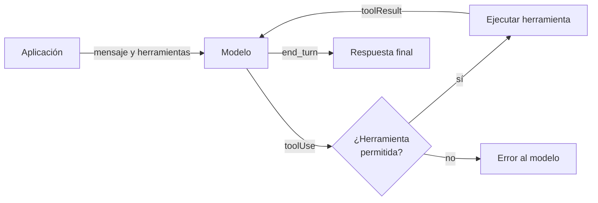

## 1. Resumen

Con **function calling** o **tool use**, la aplicación le describe al modelo unas herramientas (nombre, descripción y esquema de entrada). El modelo, al procesar el prompt, decide si necesita una y **devuelve el nombre y los argumentos**; **la aplicación** la ejecuta y le devuelve el resultado (*Introduction to function calling*). Bedrock lo dice sin rodeos: el modelo no llama directamente a la herramienta (*Use a tool…*). Microsoft agrega la consecuencia: la aplicación mantiene el control de las acciones (*How to use function calling…*).

Para un data engineer, eso ubica la seguridad en el código propio: qué herramientas existen, cuáles son de solo lectura y cómo se validan los argumentos antes de ejecutar nada.

## 2. Qué es

- **Definición de herramienta:** nombre, descripción y esquema de entrada (JSON Schema).
- **Pedido de herramienta:** la respuesta del modelo con el nombre y los argumentos; en Converse, un bloque `toolUse` con `stopReason: tool_use`.
- **Resultado:** lo que la aplicación devuelve al modelo; en Converse, un bloque `toolResult`.
- **Lista de permitidas:** el despachador ejecuta solo lo declarado; cualquier otro nombre es un error.
- **Herramientas de alto nivel:** Google recomienda herramientas específicas sobre genéricas como `bash`, y un máximo de 10 a 20 activas (*Introduction to function calling*).

## 3. Problema que resuelve

Un asistente de operaciones tiene que responder «¿se cargó `silver.pedidos` hoy?». El modelo no tiene ese dato; con una herramienta `filas_por_dia` lo pide, la aplicación consulta el catálogo de cargas y el modelo responde con el número real.

## 4. Cómo funciona

1. La aplicación envía el mensaje y las definiciones de herramientas.
2. El modelo responde con un pedido de herramienta (nombre y argumentos).
3. La aplicación verifica que la herramienta esté permitida y valida los argumentos.
4. Ejecuta la herramienta y agrega el resultado a la conversación.
5. Vuelve a llamar al modelo, que responde con el texto final (`stopReason: end_turn` en Converse).

## 5. Cuándo utilizarlo

- Consultas de solo lectura a datos operativos: estado de cargas, conteos, metadata del catálogo.
- Cuando la respuesta necesita un dato actual que el modelo no tiene.
- Como base de un agente (`llm-agents`).

## 6. Cuándo no utilizarlo

- Para acciones destructivas sin aprobación humana: borrar, sobrescribir, desplegar.
- Con herramientas genéricas que reciben SQL o comandos arbitrarios.
- Cuando un pipeline determinista ya resuelve la tarea: la herramienta agrega llamadas y no agrega certeza.

## 7. Ejemplo sencillo

| Paso | Quién | Qué |
|---|---|---|
| 1 | Aplicación | Pregunta y definición de `filas_por_dia` |
| 2 | Modelo | `toolUse`: `filas_por_dia(tabla="silver.pedidos", dia="2026-10-25")` |
| 3 | Aplicación | Ejecuta: 0 filas |
| 4 | Modelo | «No: silver.pedidos tiene 0 filas el 2026-10-25.» |
| — | Aplicación | Un pedido de `borrar_tabla` se responde con `status: error`, sin ejecutar nada |

## 8. Ejemplo de producción

Un asistente de guardia con tres herramientas de solo lectura (estado de cargas, conteos por día y último error de un job):

- cada herramienta corre con una cuenta de solo lectura;
- argumentos validados contra el esquema y contra una lista de tablas permitidas;
- cada llamada se registra con el pedido, el resultado y el usuario;
- la llamada al modelo no se ejecuta aquí; el §10 valida los requests contra el modelo del servicio con un Stubber.

## 9. Arquitectura



## 10. Código

```python
# Python 3.12 y boto3 (ejecutado en la CI, sin red; ADR-025): tool use con la Converse API de Bedrock.
# El modelo no ejecuta la herramienta: pide usarla (stopReason "tool_use"); la aplicación valida el pedido contra su
# lista de herramientas permitidas, la ejecuta y devuelve un toolResult. Las respuestas del modelo son fijas
# (Stubber); botocore valida cada request contra el modelo del servicio antes de "enviarlo".
from typing import TYPE_CHECKING, Any, cast

import boto3
from botocore import UNSIGNED
from botocore.config import Config
from botocore.stub import ANY, Stubber

if TYPE_CHECKING:
    from mypy_boto3_bedrock_runtime.type_defs import MessageUnionTypeDef, ToolConfigurationTypeDef

MODELO = "amazon.nova-pro-v1:0"
FILAS = {("silver.pedidos", "2026-10-24"): 1180, ("silver.pedidos", "2026-10-25"): 0}


def filas_por_dia(tabla: str, dia: str) -> int:
    """La herramienta: una consulta de solo lectura al catálogo de cargas."""
    return FILAS.get((tabla, dia), 0)


PERMITIDAS = {"filas_por_dia": filas_por_dia}
HERRAMIENTAS: "ToolConfigurationTypeDef" = {"tools": [{"toolSpec": {
    "name": "filas_por_dia",
    "description": "Filas cargadas en una tabla un día dado.",
    "inputSchema": {"json": {"type": "object", "required": ["tabla", "dia"],
                             "properties": {"tabla": {"type": "string"}, "dia": {"type": "string"}}}},
}}]}


def respuesta(contenido: list[dict[str, Any]], motivo: str) -> dict[str, Any]:
    return {"output": {"message": {"role": "assistant", "content": contenido}}, "stopReason": motivo,
            "usage": {"inputTokens": 120, "outputTokens": 30, "totalTokens": 150}, "metrics": {"latencyMs": 10}}


def ejecutar(pedido: dict[str, Any]) -> dict[str, Any]:
    nombre, entrada = pedido["name"], pedido["input"]
    if nombre not in PERMITIDAS:
        return {"toolUseId": pedido["toolUseId"], "content": [{"text": f"herramienta {nombre} no permitida"}], "status": "error"}
    filas = PERMITIDAS[nombre](str(entrada["tabla"]), str(entrada["dia"]))
    return {"toolUseId": pedido["toolUseId"], "content": [{"json": {"filas": filas}}]}


cliente = boto3.client("bedrock-runtime", region_name="us-east-1", config=Config(signature_version=UNSIGNED))
mensajes: "list[MessageUnionTypeDef]" = [{"role": "user", "content": [{"text": "¿Se cargó silver.pedidos el 2026-10-25?"}]}]
with Stubber(cliente) as stub:
    stub.add_response("converse", respuesta([{"toolUse": {"toolUseId": "t1", "name": "filas_por_dia",
                                                          "input": {"tabla": "silver.pedidos", "dia": "2026-10-25"}}}],
                                            "tool_use"), {"modelId": MODELO, "messages": ANY, "toolConfig": HERRAMIENTAS})
    stub.add_response("converse", respuesta([{"text": "No: silver.pedidos tiene 0 filas el 2026-10-25."}], "end_turn"),
                      {"modelId": MODELO, "messages": ANY, "toolConfig": HERRAMIENTAS})

    primera = cliente.converse(modelId=MODELO, messages=mensajes, toolConfig=HERRAMIENTAS)
    print("stopReason:", primera["stopReason"])
    pedido = primera["output"]["message"]["content"][0]["toolUse"]
    resultado = ejecutar(dict(pedido))
    print("la aplicación ejecuta", pedido["name"], dict(pedido["input"]), "->", resultado["content"][0])
    mensajes.append(primera["output"]["message"])
    mensajes.append(cast("MessageUnionTypeDef", {"role": "user", "content": [{"toolResult": resultado}]}))
    final = cliente.converse(modelId=MODELO, messages=mensajes, toolConfig=HERRAMIENTAS)
    print("stopReason:", final["stopReason"], "->", final["output"]["message"]["content"][0]["text"])

print("pedido de una herramienta no declarada:",
      ejecutar({"toolUseId": "t2", "name": "borrar_tabla", "input": {"tabla": "silver.pedidos"}})["status"])
```

El script se **ejecuta en la CI** con boto3, sin red ni credenciales, y pasa `mypy --strict`. Imprime `stopReason: tool_use`, la ejecución de `filas_por_dia` con resultado `{'json': {'filas': 0}}`, `stopReason: end_turn` con la respuesta final y `error` para la herramienta no declarada. Botocore valida cada request contra el modelo de la Converse API antes de entregarlo al Stubber, que además verifica `modelId` y `toolConfig` (*Stubber Reference*). Las respuestas del modelo son fijas.

## 11. GCP

En GCP, **Gemini Enterprise Agent Platform**. Según *Introduction to function calling* (no ejecutado):

| | Este concepto | Agent Platform |
|---|---|---|
| Quién ejecuta | La aplicación | La aplicación; el modelo devuelve herramienta y parámetros |
| Usos | Leer datos | Obtener datos y ejecutar acciones |
| Cuántas herramientas | Las necesarias | Idealmente 10 a 20 activas como máximo |

## 12. AWS

En AWS, **Amazon Bedrock** con la Converse API. Según *Use a tool to complete an Amazon Bedrock model response* e *Inference using Converse API* (no ejecutado, salvo los requests validados con el Stubber):

| | Este concepto | Amazon Bedrock |
|---|---|---|
| Quién ejecuta | La aplicación | La aplicación; el modelo no llama a la herramienta |
| API | — | Converse: la misma para todos los modelos que soportan mensajes |
| Con esquema | — | Tool use con salida estructurada |

## 13. Azure

En Azure, **Microsoft Foundry**. Según *How to use function calling with Microsoft Foundry Models* (no ejecutado):

| | Este concepto | Microsoft Foundry |
|---|---|---|
| Quién ejecuta | La aplicación | La aplicación, que mantiene el control de las acciones |
| Respuesta | Nombre y argumentos | JSON con los argumentos |
| Paralelo | Una llamada por vez | Admite llamadas en paralelo; con salida estructurada no (ver `structured-outputs`) |

## 14. Buenas prácticas

- Lista cerrada de herramientas, con nombres y descripciones claras.
- Herramientas de solo lectura por defecto; las que escriben, con aprobación humana.
- Validar los argumentos contra el esquema y contra listas de valores permitidos.
- Límite de llamadas por conversación.
- **Seguridad:** la herramienta corre con permisos mínimos; el modelo puede pedir cualquier cosa que el prompt le sugiera.
- **Observabilidad:** registrar cada pedido, si se ejecutó y su resultado.
- **Costo:** cada vuelta herramienta-modelo es otra llamada con todo el contexto.

## 15. Errores frecuentes

- Ejecutar el pedido del modelo sin verificar que la herramienta esté permitida.
- Una herramienta genérica que recibe SQL libre.
- Credenciales de escritura en una herramienta de consulta.
- No limitar las vueltas y entrar en un ciclo de llamadas.

## 16. Trade-offs

Más herramientas dan más capacidades y más formas de usarlas mal; Google recomienda pocas y específicas. Una herramienta de alto nivel es más segura y menos flexible que una genérica. Cada herramienta agrega latencia y costo por vuelta.

## 17. Conceptos relacionados

- `structured-outputs`: el esquema de los argumentos.
- `llm-fundamentals`: el modelo.
- `llm-agents`: el bucle que usa estas herramientas.

## 18. Preguntas técnicas abiertas

1. ¿Qué consulta de solo lectura le darías primero a un asistente de guardia?
2. ¿Cómo validarías que la tabla que pide el modelo está permitida?
3. ¿Qué acción nunca dejarías que una herramienta ejecute sin aprobación?

## 19. Laboratorio relacionado

Pendiente (F4).

## 20. Fuentes

- Google Cloud: *Introduction to function calling*.
- AWS: *Use a tool to complete an Amazon Bedrock model response* e *Inference using Converse API*; botocore: *Stubber Reference*.
- Microsoft Learn: *How to use function calling with Microsoft Foundry Models*.

El detalle de cada fuente está en `sources` del frontmatter.

## 21. Fecha de última verificación

2026-10-25. `review_required`: pendiente de revisión B-F3.1 del lote F3b-21a.

## 22. Historial de cambios importantes

- 2026-10-25: creación (lote F3b-21a).
- 2026-10-26: §17 y `relations` enlazan `llm-agents`, creada en el lote F3b-21c (regla del §17); sin otros cambios.
