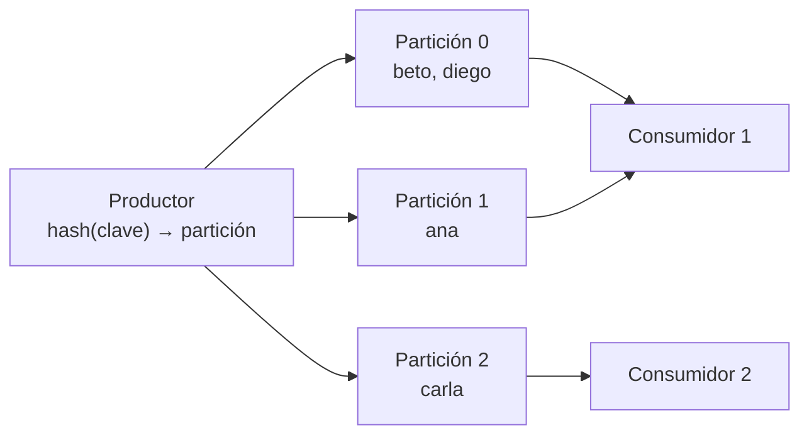

## 1. Resumen

En Kafka, un **topic** es el lugar donde se guardan los eventos de un tipo, por ejemplo `pagos`. Según la documentación, «Topics are partitioned, meaning a topic is spread over a number of “buckets” located on different Kafka brokers».

Las particiones dan tres cosas:

- **escala:** se escribe y se lee en varios brokers a la vez;
- **ubicación por clave:** los eventos con la misma clave van siempre a la misma partición;
- **orden por partición:** cada partición se lee en el orden en que se escribió; entre particiones no hay orden.

## 2. Qué es

- **Topic:** una categoría de eventos, con muchos productores y muchos consumidores.
- **Partición:** un log ordenado y de solo agregar, en un broker; un topic tiene una o más.
- **Clave de partición:** la clave del evento, que se hashea para elegir la partición.
- **Sin clave:** el cliente reparte los eventos entre particiones.
- **Paralelismo:** en un grupo, cada partición la lee un solo consumidor; el número de particiones es el máximo de consumidores útiles.

## 3. Problema que resuelve

Un topic de clicks recibe más eventos de los que un solo servidor o un solo consumidor pueden manejar. Partirlo deja repartir la carga entre brokers y consumidores. Usar el id del usuario como clave mantiene juntos los clicks de cada usuario, para que quien calcule sesiones los reciba todos y en orden.

## 4. Cómo funciona

1. El topic se crea con un número de particiones.
2. El productor hashea la clave y elige la partición; sin clave, reparte.
3. El evento se agrega al final de esa partición con el siguiente offset.
4. Los consumidores de un grupo se reparten las particiones.
5. Cada consumidor lee sus particiones en orden.

## 5. Cuándo utilizarlo

- Topics con volumen que necesita más de un consumidor.
- Cuando los eventos de una misma entidad deben procesarse juntos y en orden: se usa la entidad como clave.
- Para fijar de antemano el paralelismo máximo de los consumidores.

## 6. Cuándo no utilizarlo

- Una clave con muy pocos valores o con uno muy frecuente: concentra la carga en una partición.
- Muchas más particiones de las necesarias: cada una cuesta recursos en el broker.
- Cambiar el número de particiones de un topic con claves esperando que cada clave siga en su partición: el hash reparte distinto (Event Hubs advierte lo mismo para su mapeo de claves).

## 7. Ejemplo sencillo

Un topic `clicks` con 3 particiones recibe dos clicks de cada uno de cuatro usuarios. Al leer cada partición por separado, los dos clicks de cada usuario aparecen juntos en una sola partición. Una partición puede tener más de un usuario.

## 8. Ejemplo de producción

Un topic `clicks` de un sitio:

- 24 particiones, para que hasta 24 consumidores lean en paralelo;
- clave = id de usuario, para calcular sesiones por usuario;
- un monitoreo del volumen por partición para detectar claves calientes;
- un topic nuevo con más particiones, y no un cambio en caliente, si hace falta crecer y el orden por clave importa.

## 9. Arquitectura



## 10. Código

```bash
# Bash y Kafka (ejecutado en la CI con un broker Kafka 4.3.1 en KRaft, en Docker; ADR-017): un topic de 3 particiones;
# los eventos con la misma clave caen siempre en la misma partición.
set -euo pipefail
K="${KAFKA_CONTAINER:-dekh-kafka}"
kafka() { docker exec -i "$K" /opt/kafka/bin/"$1" --bootstrap-server localhost:9092 "${@:2}"; }
trap 'kafka kafka-topics.sh --delete --topic clicks > /dev/null 2>&1 || true' EXIT

kafka kafka-topics.sh --create --topic clicks --partitions 3 > /dev/null
for round in 1 2; do
  for user in ana beto carla diego; do echo "$user|click $round"; done
done | kafka kafka-console-producer.sh --topic clicks --reader-property parse.key=true --reader-property key.separator='|'

for p in 0 1 2; do   # cada partición por separado, desde su primer offset
  keys=$(kafka kafka-console-consumer.sh --topic clicks --partition "$p" --offset earliest --timeout-ms 8000 \
           --formatter-property print.key=true 2> /dev/null | cut -f1 | sort | tr '\n' ' ')
  echo "partición $p: $keys"
done
```

El script se **ejecuta en la CI contra un broker Kafka 4.3.1 en KRaft, en Docker** (ADR-017). Imprime las claves de cada partición; el test comprueba que cada usuario aparece en una sola partición, con sus dos clicks. Qué partición le toca a cada clave depende del hash, así que la ficha no la fija.

## 11. GCP

En GCP, **Pub/Sub** no pide elegir particiones; el orden se pide con una ordering key. Según *Order messages* (no ejecutado):

| | Kafka | Pub/Sub |
|---|---|---|
| Unidad de orden | La partición, elegida por la clave | La ordering key (hasta 1 KB), con el orden habilitado en la suscripción |
| Sin clave | Se reparte entre particiones | Los mensajes no se ordenan |

## 12. AWS

En AWS, **Kinesis Data Streams** usa shards. Según *Amazon Kinesis Data Streams Terminology and concepts* (no ejecutado):

| | Kafka | Kinesis Data Streams |
|---|---|---|
| Unidad | Partición | Shard, con límites de lectura y escritura por shard |
| Cómo se elige | Hash de la clave | La partition key (hasta 256 caracteres) pasa por MD5 a un entero de 128 bits que elige el shard |

## 13. Azure

En Azure, **Event Hubs** usa particiones. Según *Event Hubs features and terminology* (no ejecutado):

| | Kafka | Event Hubs |
|---|---|---|
| Cómo se elige | Hash de la clave | Partition key del emisor con una función de hash estática; sin clave, round-robin |
| Cambiar el mapeo | Agregar particiones puede mandar una clave a otra partición; Kafka no mueve los datos existentes | La documentación advierte que cambiar el mapeo de claves a particiones cambia la distribución |

## 14. Buenas prácticas

- Elegir la clave por la entidad cuyo orden importa (cliente, pedido, dispositivo).
- Particiones según el paralelismo máximo esperado, con margen.
- Vigilar claves calientes.
- **Seguridad:** permisos por topic, no por partición.
- **Observabilidad:** volumen y lag por partición, no solo por topic.
- **Costo:** en Kinesis cada shard tiene capacidad fija y se cobra según el modo (ver `message-brokers`); en Kafka, cada partición ocupa recursos del broker.

## 15. Errores frecuentes

- Una clave con un valor muy frecuente que satura una partición.
- Esperar orden global en un topic de varias particiones.
- Agregar particiones a un topic con claves y romper el orden por clave.
- Sin clave cuando el procesamiento depende del orden.

## 16. Trade-offs

Más particiones dan más paralelismo y reparten la carga, a cambio de recursos y de perder el orden global. Una clave fina reparte bien y deja sin orden a lo que no comparte clave; una clave gruesa mantiene más eventos juntos y concentra carga.

## 17. Conceptos relacionados

- `message-brokers`: dónde viven las particiones.
- `event-ordering`: el orden dentro de una partición.
- `offsets`: la posición en cada partición.
- `producers-and-consumers`: quién elige y quién lee las particiones.
- `partitioning`: repartir por clave en el almacenamiento.

## 18. Preguntas técnicas abiertas

1. ¿Qué clave usan tus topics y qué orden protege?
2. ¿Tienes una clave que concentra la mayor parte del volumen?
3. ¿Cuántos consumidores necesitarías en el pico y cuántas particiones tienes?

## 19. Laboratorio relacionado

Pendiente (F4).

## 20. Fuentes

- Apache Kafka 4.3: *Introduction*, *Design* y *Basic Kafka Operations*.
- Google Cloud: *Order messages*.
- AWS: *Amazon Kinesis Data Streams Terminology and concepts*.
- Microsoft Learn: *Event Hubs features and terminology*.

El detalle de cada fuente está en `sources` del frontmatter.

## 21. Fecha de última verificación

2026-10-19. `review_required`: pendiente de revisión B-F3.1 del lote F3b-14a.

## 22. Historial de cambios importantes

- 2026-10-19: creación (lote F3b-14a).
