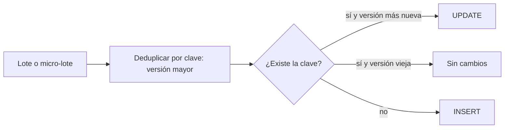

## 1. Resumen

Un upsert inserta una fila si su clave no existe y la actualiza si ya existe, como una sola operación. Es la forma más común de hacer idempotente una carga por clave: aplicar dos veces el mismo lote deja la tabla igual. Cada motor lo expresa distinto (`INSERT ... ON CONFLICT` en PostgreSQL, `MERGE` en los data warehouses), y cada uno trata de forma distinta las claves duplicadas en el origen.

## 2. Qué es

Es un patrón con tres piezas:

- una **clave** que identifica la entidad (clave primaria o de negocio), respaldada por una restricción única cuando el motor lo exige;
- una **regla de actualización**: qué columnas se sobrescriben y bajo qué condición (por ejemplo, solo si la versión que llega es más nueva);
- una **operación atómica**, para que dos procesos concurrentes no inserten la misma clave dos veces.

## 3. Problema que resuelve

Hacerlo "a mano" (consultar si existe, luego insertar o actualizar) tiene una carrera: entre la consulta y la escritura otro proceso puede insertar la misma clave. Además, cada reintento de un lote con `INSERT` simple duplica filas. El upsert resuelve ambos problemas en una sentencia.

## 4. Cómo funciona

- **PostgreSQL:** `INSERT ... ON CONFLICT (clave) DO UPDATE SET ...`. Garantiza un resultado atómico, INSERT o UPDATE, incluso con alta concurrencia. Se apoya en un índice o una restricción única, y la fila que llega se lee con la tabla especial `excluded`.
- **Data warehouses (BigQuery, Redshift, Synapse):** `MERGE` con `WHEN MATCHED THEN UPDATE` y `WHEN NOT MATCHED THEN INSERT`.
- **Duplicados en el origen:** si el lote trae dos filas con la misma clave, PostgreSQL, BigQuery, Redshift y T-SQL fallan. Por eso hay que deduplicar el lote antes, con una regla explícita.

## 5. Cuándo utilizarlo

- Cargar entidades con estado actual (clientes, productos, pedidos) desde un delta.
- Consumir eventos o mensajes con posibles repeticiones, cuando la clave identifica el efecto.
- Sincronizar una réplica o un caché con su origen.

## 6. Cuándo no utilizarlo

- Cuando hay que conservar la historia de cambios: corresponde SCD2 o una tabla de eventos, no sobrescribir.
- Hechos sin clave natural (por ejemplo, logs): se deduplican por id de evento o se reemplaza la partición.
- Lotes enormes que reemplazan períodos completos: reemplazar la partición suele ser más simple y barato que fusionar fila a fila.

## 7. Ejemplo sencillo

Llega el cliente 42 con email nuevo. Si existe, se actualiza su email. Si no existe, se inserta. Si el mismo lote se aplica dos veces, el resultado es el mismo.

## 8. Ejemplo de producción

Un consumidor de CDC aplica cambios de `clientes` a PostgreSQL cada minuto. Deduplica el micro-lote por `cliente_id` quedándose con la versión mayor y aplica `INSERT ... ON CONFLICT DO UPDATE ... WHERE` con condición de versión. Así, un cambio viejo que llega tarde no pisa uno nuevo, y reprocesar el micro-lote no cambia nada. En el data warehouse, la misma lógica se escribe con `MERGE` y la misma condición.

## 9. Arquitectura



## 10. Código

```sql
-- PostgreSQL: upsert atómico e idempotente con condición de versión.
-- Requiere: clientes(cliente_id PRIMARY KEY, email, version, ...) y privilegios INSERT y UPDATE.
INSERT INTO clientes AS c (cliente_id, email, version)
VALUES (42, 'nuevo@ejemplo.com', 7)
ON CONFLICT (cliente_id) DO UPDATE
SET email = excluded.email,
    version = excluded.version
WHERE c.version < excluded.version;   -- una versión vieja o repetida no sobrescribe
```

```sql
-- BigQuery: el mismo patrón con MERGE; el lote se deduplica antes para no fallar
-- con "UPDATE/MERGE must match at most one source row for each target row".
MERGE `proyecto.dwh.clientes` AS t
USING (
  SELECT * FROM `proyecto.staging.clientes`
  WHERE TRUE
  QUALIFY ROW_NUMBER() OVER (PARTITION BY cliente_id ORDER BY version DESC) = 1
) AS s
ON t.cliente_id = s.cliente_id
WHEN MATCHED AND s.version > t.version THEN
  UPDATE SET email = s.email, version = s.version
WHEN NOT MATCHED THEN
  INSERT (cliente_id, email, version) VALUES (s.cliente_id, s.email, s.version);
```

## 11. GCP

En **BigQuery**, el upsert se escribe con `MERGE`. Si una fila del destino coincide con más de una fila de origen, la sentencia falla con *"UPDATE/MERGE must match at most one source row for each target row"*. La condición de versión va en `WHEN MATCHED AND ...`.

## 12. AWS

En **Redshift**, el upsert se escribe con `MERGE` y, como en BigQuery, falla si varias filas de origen coinciden con una fila del destino. Redshift ofrece además un modo simplificado, `REMOVE DUPLICATES`, que actualiza lo que coincide e inserta lo que falta sin cláusulas `WHEN`. Es más rápido, pero no admite condición de versión y elimina en silencio los duplicados del destino que coinciden con una fila de origen (los que no coinciden quedan).

## 13. Azure

En **Synapse** (solo dedicated SQL pool), **Azure SQL** y **Fabric Warehouse**, el upsert se escribe con `MERGE` de T-SQL. Como en BigQuery, falla si varias filas de origen coinciden con la misma fila del destino.

## 14. Buenas prácticas

- Deduplicar el lote por clave antes del upsert, con una regla explícita (versión o timestamp mayor).
- Usar una condición de versión para que un dato viejo no sobrescriba uno nuevo.
- Respaldar la clave con una restricción única donde el motor la exige (PostgreSQL).
- Actualizar solo las columnas que cambian de verdad, para no generar escrituras innecesarias.
- **Seguridad:** el upsert requiere privilegios de inserción y de actualización (en PostgreSQL, INSERT y UPDATE); darlos solo a la cuenta del proceso de carga.
- **Observabilidad:** registrar por lote las filas insertadas, actualizadas y omitidas; una tasa de omitidas que crece revela reenvíos o datos tardíos.
- **Costo:** en los data warehouses, `MERGE` lee el destino para comparar; filtrar el destino por partición en la condición reduce los bytes procesados.

## 15. Errores frecuentes

- No deduplicar el origen y que la sentencia falle a mitad del pipeline.
- Upsert sin condición de versión: un reenvío viejo pisa el dato actual.
- Consultar y luego insertar en dos pasos, con carrera entre procesos.
- Usar upsert donde se necesitaba historia (SCD2).

## 16. Trade-offs

El upsert por clave mantiene una tabla de estado actual compacta y es idempotente, pero pierde la historia y cuesta más que un `INSERT` simple, porque compara con el destino. Reemplazar particiones es más barato para lotes por período, pero no sirve cuando los cambios afectan a claves de muchos períodos.

## 17. Conceptos relacionados

- `sql-merge`: la sentencia que implementa el upsert en los data warehouses.
- `idempotency`: el upsert con versión es una técnica de idempotencia.
- `incremental-load`: el modo upsert de la carga incremental.
- `scd-type-2`: la alternativa cuando hay que conservar la historia.
- Del blueprint, pendientes de ficha: `deduplication`, `primary-keys`, `optimistic-concurrency`.

## 18. Preguntas técnicas abiertas

1. ¿Qué columna usarías como versión si el origen no tiene una?
2. ¿Cómo tratarías un borrado en el origen dentro de un flujo de upserts?
3. ¿Cuándo preferirías reemplazar la partición en lugar de hacer upsert fila a fila?

## 19. Laboratorio relacionado

Pendiente (F4): lab de tipo B sobre duplicados tras un reproceso (§25).

## 20. Fuentes

- PostgreSQL: *INSERT* (cláusula ON CONFLICT).
- Google Cloud: *DML syntax* (BigQuery).
- AWS: *MERGE* (Redshift).
- Microsoft Learn: *MERGE (Transact-SQL)*.

El detalle de cada fuente está en `sources` del frontmatter.

## 21. Fecha de última verificación

2026-09-30. Pasa a `verified`: revisión B-F3.1 del lote 2 aplicada, sin VERIFY pendientes.

## 22. Historial de cambios importantes

- 2026-09-30: creación (lote 2 de F3).
- 2026-09-30: revisión B-F3.1 aplicada: en `REMOVE DUPLICATES`, los duplicados del destino sin coincidencia con el origen no se tocan.
- 2026-09-30: `verification_status: verified` (revisión B-F3.1 del lote 2 aplicada; sin VERIFY pendientes).
