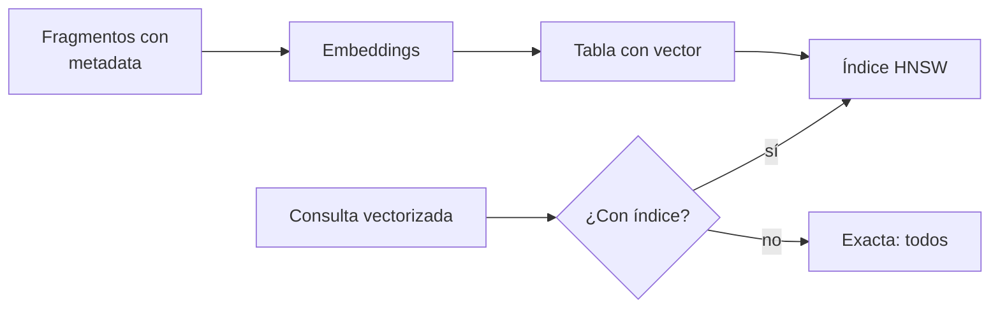

## 1. Resumen

Una **base de datos vectorial** guarda vectores (`embeddings`) junto con el texto y la metadata que representan, y responde una pregunta: **¿cuáles son los k vectores más cercanos a este?** Puede ser un servicio dedicado o una extensión de una base que ya existe, como pgvector en PostgreSQL.

La decisión técnica central es **exacta o aproximada**. pgvector, por defecto, hace búsqueda exacta con recall perfecto; un índice (HNSW o IVFFlat) la vuelve aproximada: más rápida, pero puede no devolver exactamente los mismos resultados (*pgvector*, README v0.8.7). BigQuery funciona igual: con índice vectorial, búsqueda aproximada; sin índice o forzándolo, fuerza bruta (*Introduction to embeddings and vector search*).

## 2. Qué es

- **Vector con metadata:** la fila guarda el vector, el texto o un puntero a él, y atributos para filtrar (`metadata-filtering`).
- **Distancia:** coseno (`<=>` en pgvector), L2 (`<->`), producto interno (`<#>`), L1 (`<+>`).
- **Búsqueda exacta:** compara con todos los vectores; recall perfecto, costo lineal.
- **Índice aproximado (ANN):** HNSW (grafo multicapa), IVFFlat (listas), ScaNN en Vector Search de Google (*Vector Search*); cambia recall por velocidad.
- **Un índice por distancia:** en pgvector, el índice se crea para una función de distancia y solo acelera esa.

## 3. Problema que resuelve

Con 50 millones de fragmentos, comparar la consulta con cada vector en cada búsqueda no escala. Un índice aproximado responde en milisegundos a cambio de perder, a veces, alguno de los k más cercanos.

## 4. Cómo funciona

1. Se crea la columna o el índice con la dimensión del modelo de embeddings.
2. Se cargan los vectores con su texto y metadata.
3. La consulta se vectoriza con el mismo modelo y se ordena por distancia (`ORDER BY embedding <=> q LIMIT k`).
4. Sin índice, el motor compara con todos; con índice, recorre la estructura aproximada.
5. Al cambiar de modelo, se recalculan todos los vectores y se reconstruye el índice.

## 5. Cuándo utilizarlo

- Búsqueda por significado sobre muchos fragmentos, como paso de `rag`.
- Recomendaciones y deduplicación aproximada.
- Cuando ya se usa PostgreSQL y el volumen cabe: pgvector evita otra pieza de infraestructura.

## 6. Cuándo no utilizarlo

- Pocos miles de vectores: la búsqueda exacta ya es rápida y no pierde resultados.
- Búsquedas exactas por clave o por rango: un índice normal es mejor.
- Como única búsqueda cuando importan códigos o nombres exactos: ahí suma la búsqueda léxica (`hybrid-rag`).

## 7. Ejemplo sencillo

Ocho descripciones de tablas y la consulta «ventas por región». La búsqueda exacta por coseno devuelve primero «ventas mensuales por región» (distancia 0.141). Con un índice HNSW, el plan usa el índice y el top 3 es el mismo: con 8 filas el índice no pierde nada; con millones, puede.

## 8. Ejemplo de producción

Un índice de fragmentos de documentación interna en PostgreSQL con pgvector:

- una tabla por modelo de embeddings, con `modelo`, `version` y `actualizado`;
- índice HNSW con `vector_cosine_ops`, creado después de la carga inicial;
- un conjunto de preguntas de control para medir el recall del índice contra la búsqueda exacta;
- en la nube, la alternativa administrada (no ejecutado): Vector Search, VECTOR_SEARCH, Knowledge Bases o Azure AI Search.

## 9. Arquitectura



## 10. Código

```python
# Python 3.12, psycopg 3 y numpy contra pgvector 0.8.7 (ejecutado en la CI con pgvector/pgvector:0.8.7-pg17 en
# Docker; ADR-025): una tabla con una columna vector, búsqueda exacta por distancia coseno (<=>) y la misma búsqueda
# con un índice HNSW. Los vectores son de la opción A (léxicos, por hashing); el mecanismo es el mismo con un modelo.
import os
import zlib

import numpy as np
import psycopg

DIM = 64
DESCRIPCIONES = [
    "ventas diarias por tienda y canal",
    "ventas mensuales por región",
    "ingresos por zona geográfica",
    "pedidos cancelados por cliente",
    "inventario de bodegas por producto",
    "clientes activos por segmento",
    "devoluciones de productos por tienda",
    "errores de carga del job de ventas",
]


def vector(texto: str) -> str:
    limpio = f" {texto.lower()} "
    v = np.zeros(DIM)
    for i in range(len(limpio) - 2):
        v[zlib.crc32(limpio[i:i + 3].encode()) % DIM] += 1.0
    v = v / np.linalg.norm(v)
    return "[" + ",".join(f"{x:.6f}" for x in v) + "]"  # literal de pgvector


CONSULTA = """SELECT descripcion, round((embedding <=> %s::vector)::numeric, 3)::float8
              FROM tablas ORDER BY embedding <=> %s::vector LIMIT 3"""

with psycopg.connect(os.environ["PGVECTOR_DSN"], autocommit=True) as conn:
    conn.execute("CREATE EXTENSION IF NOT EXISTS vector")
    conn.execute("DROP TABLE IF EXISTS tablas")
    conn.execute(f"CREATE TABLE tablas (id serial PRIMARY KEY, descripcion text, embedding vector({DIM}))")
    with conn.cursor() as cur:
        cur.executemany("INSERT INTO tablas (descripcion, embedding) VALUES (%s, %s::vector)",
                        [(d, vector(d)) for d in DESCRIPCIONES])
    q = vector("ventas por región")
    exacta = conn.execute(CONSULTA, (q, q)).fetchall()
    print("exacta (sin índice):", exacta)

    conn.execute("CREATE INDEX ON tablas USING hnsw (embedding vector_cosine_ops)")
    conn.execute("SET enable_seqscan = off")  # con 8 filas el planificador preferiría recorrer la tabla
    plan = " ".join(r[0] for r in conn.execute("EXPLAIN " + CONSULTA, (q, q)).fetchall())
    hnsw = conn.execute(CONSULTA, (q, q)).fetchall()
    print("usa el índice HNSW:", "tablas_embedding_idx" in plan)
    print("mismo top 3 con HNSW:", [r[0] for r in hnsw] == [r[0] for r in exacta])
```

El script se **ejecuta en la CI** contra `pgvector/pgvector:0.8.7-pg17` en Docker (ADR-025) y pasa `mypy --strict`. Imprime el top 3 exacto con sus distancias, `usa el índice HNSW: True` y `mismo top 3 con HNSW: True`. `enable_seqscan = off` fuerza el índice: con 8 filas el planificador recorrería la tabla.

## 11. GCP

En GCP, **Vector Search** de Gemini Enterprise Agent Platform y **VECTOR_SEARCH** de BigQuery. Según *Vector Search* e *Introduction to embeddings and vector search* (no ejecutado):

| | pgvector (este concepto) | Google Cloud |
|---|---|---|
| Servicio | Extensión de PostgreSQL | Vector Search, servicio dedicado basado en ScaNN; en BigQuery, funciones SQL |
| Exacta o aproximada | Exacta por defecto; aproximada con índice | En BigQuery, aproximada con índice vectorial; fuerza bruta sin índice o si se pide |

## 12. AWS

En AWS, **Amazon Bedrock Knowledge Bases**. Según *How content chunking works for knowledge bases* (no ejecutado):

| | pgvector (este concepto) | Bedrock Knowledge Bases |
|---|---|---|
| Quién carga | El pipeline propio | Bedrock divide, vectoriza y escribe en un índice vectorial |
| Vínculo al origen | Columna propia | Mantiene el vínculo con el documento original |

## 13. Azure

En Azure, **Azure AI Search**. Según *Vector indexes in Azure AI Search* (no ejecutado):

| | pgvector (este concepto) | Azure AI Search |
|---|---|---|
| Algoritmo | HNSW o IVFFlat | HNSW o KNN exhaustivo |
| Límites | Los de la base | Límites de almacenamiento vectorial informados aparte |

## 14. Buenas prácticas

- Medir el recall del índice contra la búsqueda exacta con preguntas de control.
- Crear el índice con la misma distancia que usa la consulta.
- Guardar modelo y versión con cada vector, y reindexar al cambiar.
- Empezar exacto y agregar el índice cuando el volumen lo pida.
- **Seguridad:** el índice guarda texto; aplicar los mismos permisos que a la tabla de origen.
- **Observabilidad:** latencia de consulta, recall de control y tamaño del índice.
- **Costo:** HNSW usa más memoria y se construye más lento que IVFFlat, según el README.

## 15. Errores frecuentes

- Indexar con una distancia y consultar con otra.
- Asumir que el índice devuelve lo mismo que la búsqueda exacta.
- Mezclar vectores de modelos distintos.
- Montar una base vectorial dedicada para pocos miles de filas.

## 16. Trade-offs

La búsqueda exacta no pierde resultados y escala lineal; la aproximada escala y puede perder vecinos. pgvector usa la base que ya se opera; un servicio dedicado suma escala y otra pieza. HNSW consulta mejor que IVFFlat y construye más lento.

## 17. Conceptos relacionados

- `embeddings`: los vectores.
- `metadata-filtering`: filtros con el índice.
- `hybrid-rag`: vectores y texto juntos.
- `rag`: el uso principal.

## 18. Preguntas técnicas abiertas

1. ¿Cuántos vectores tendría tu índice y cuál sería el recall aceptable?
2. ¿Usarías la base que ya operas o un servicio dedicado?
3. ¿Cómo detectarías que el índice empezó a perder resultados?

## 19. Laboratorio relacionado

Pendiente (F4).

## 20. Fuentes

- pgvector: *pgvector* (README, v0.8.7).
- Google Cloud: *Vector Search* e *Introduction to embeddings and vector search*.
- AWS: *How content chunking works for knowledge bases*.
- Microsoft Learn: *Vector indexes in Azure AI Search*.

El detalle de cada fuente está en `sources` del frontmatter.

## 21. Fecha de última verificación

2026-10-25. `review_required`: pendiente de revisión B-F3.1 del lote F3b-21b.

## 22. Historial de cambios importantes

- 2026-10-25: creación (lote F3b-21b).
