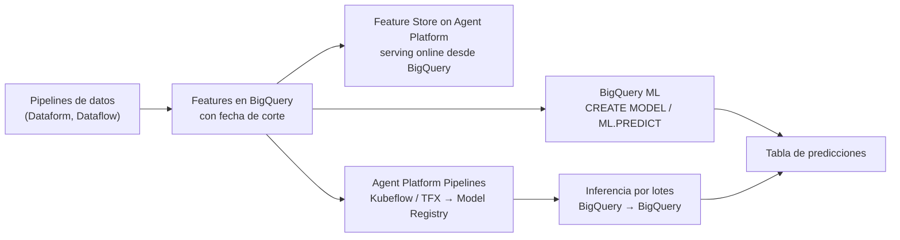

## 1. Resumen

La plataforma de ML de Google Cloud se llama **Gemini Enterprise Agent Platform**. La página de cambios de nombre (*Last updated* 2026-10-09 UTC) tiene dos filas para la plataforma: **Vertex AI Platform → Gemini Enterprise Agent Platform** y **Vertex AI → Agent Platform**. También renombra sus productos: Vertex AI Pipelines, Feature Store, Batch Inference, Model Registry y otros. Esta ficha usa los nombres nuevos; «Vertex AI» queda solo como alias de búsqueda.

Para un data engineer, la plataforma toca cuatro piezas:

- **Features en BigQuery:** Feature Store on Gemini Enterprise Agent Platform sirve online los últimos valores **directamente desde una tabla o vista de BigQuery**.
- **Pipelines de ML:** Agent Platform Pipelines ejecuta pipelines definidos con **Kubeflow Pipelines** o **TFX**, de forma serverless.
- **Inferencia por lotes:** entrada y salida en **BigQuery** o Cloud Storage, en la misma región.
- **BigQuery ML:** entrenar y predecir con SQL. También puede llamar modelos de Agent Platform como modelos remotos.

RAG y agentes están en el dominio 21; aquí, solo el servicio de ML.

## 2. Qué es

- **Gemini Enterprise Agent Platform:** la plataforma para construir, entrenar y administrar modelos de ML, con AutoML o modelos propios (TensorFlow, PyTorch, scikit-learn, XGBoost), datasets administrados, entrenamiento administrado y Model Registry.
- **Feature Store on Gemini Enterprise Agent Platform:**
  - las features viven en BigQuery; el servicio es una capa de metadatos y serving online;
  - las *feature views* conectan las tablas con el serving;
  - admite embeddings con búsqueda por similitud.
- **Agent Platform Pipelines:** pipelines de ML con Kubeflow Pipelines o TFX, con el linaje de los artefactos en ML Metadata.
- **Inferencia por lotes:** una solicitud con fuente y destino, en BigQuery o Cloud Storage.
- **BigQuery ML:**
  - `CREATE MODEL` y funciones como `ML.PREDICT` en SQL; los modelos se guardan en datasets;
  - modelos remotos que apuntan a modelos desplegados en Agent Platform; su `CREATE MODEL` no procesa bytes.

## 3. Problema que resuelve

Los modelos de ML dependen de datos que prepara el data engineer: features consistentes entre entrenamiento y servicio, y predicciones que vuelven al warehouse. Sin una plataforma, cada equipo copia features a otro sistema para servirlas online y arma su propia orquestación. Con estas piezas:

- las features se mantienen en BigQuery y se sirven desde ahí, sin copiarlas a otro almacén;
- los pipelines de ML se ejecutan y registran en un mismo lugar;
- las predicciones por lotes leen y escriben en BigQuery.

## 4. Cómo funciona

1. El data engineer construye las tablas de features en BigQuery, con fechas de corte claras para evitar fugas de información.
2. **Si el modelo cabe en SQL,** BigQuery ML lo entrena con `CREATE MODEL` y predice con `ML.PREDICT`, escribiendo el resultado en una tabla.
3. **Si el modelo es propio,** un pipeline (Kubeflow Pipelines o TFX) en Agent Platform Pipelines entrena, evalúa y registra en Model Registry.
4. Para inferencia por lotes, se indica la tabla o archivos de entrada y el destino, en la misma región.
5. Para servir online, Feature Store se configura sobre las tablas de BigQuery y sirve los últimos valores.

## 5. Cuándo utilizarlo

- **BigQuery ML:** modelos estándar (regresión, clasificación, pronóstico) sobre datos que ya están en BigQuery.
- **Feature Store:** servir features online a una aplicación sin copiarlas fuera de BigQuery.
- **Agent Platform Pipelines:** entrenamiento con modelos propios que hay que orquestar y registrar.
- **Inferencia por lotes:** puntajes periódicos sobre tablas grandes.

## 6. Cuándo no utilizarlo

- Para orquestar pipelines de datos generales: para eso, Airflow o Dataform (ver `orchestration-landscape`).
- RAG y agentes, que se tratan en el dominio 21.
- Un modelo propio complejo forzado a BigQuery ML, o un modelo simple llevado a un pipeline de ML completo sin necesidad.

## 7. Ejemplo sencillo

Una tabla de features de clientes calculada en BigQuery y un modelo de regresión logística con BigQuery ML predicen quién volverá a comprar. Las predicciones se escriben en una tabla que lee el equipo de marketing.

## 8. Ejemplo de producción

El equipo de datos mantiene en BigQuery las features de clientes con una fecha de corte, recalculadas cada día por un workflow de Dataform:

- el modelo de recompra se entrena con BigQuery ML, y la etiqueta sale de los 30 días posteriores al corte, sin fuga de información;
- cada mañana, `ML.PREDICT` escribe las predicciones en una tabla;
- la aplicación de recomendaciones lee en línea las mismas features a través de Feature Store, sin copiarlas.

Un modelo propio de detección de fraude se entrena en un pipeline de Kubeflow en Agent Platform Pipelines, con sus versiones en Model Registry.

## 9. Arquitectura



## 10. Código

```sql
-- BigQuery ML, GoogleSQL (no ejecutado: requiere un proyecto de GCP). La parte del data engineer: features calculadas
-- solo con datos anteriores a una fecha de corte, la etiqueta con los 30 días siguientes (sin fuga de información),
-- un modelo entrenado con SQL y la inferencia por lotes escrita en una tabla.
DECLARE corte DATE DEFAULT DATE '2026-09-10';

CREATE OR REPLACE TABLE `mi-proyecto.ml.entrenamiento_recompra` AS
WITH features AS (
  SELECT cliente_id, COUNT(*) AS pedidos_90d, SUM(monto) AS monto_90d,
         DATE_DIFF(corte, MAX(DATE(creado_en)), DAY) AS dias_desde_ultimo
  FROM `mi-proyecto.validado.pedidos`
  WHERE DATE(creado_en) >= DATE_SUB(corte, INTERVAL 90 DAY) AND DATE(creado_en) < corte   -- solo el pasado
  GROUP BY cliente_id
),
etiqueta AS (
  SELECT DISTINCT cliente_id, TRUE AS recompro
  FROM `mi-proyecto.validado.pedidos`
  WHERE DATE(creado_en) >= corte AND DATE(creado_en) < DATE_ADD(corte, INTERVAL 30 DAY)   -- el futuro, solo para la etiqueta
)
SELECT f.*, IFNULL(e.recompro, FALSE) AS recompro
FROM features AS f LEFT JOIN etiqueta AS e USING (cliente_id);

CREATE OR REPLACE MODEL `mi-proyecto.ml.recompra`
OPTIONS (model_type = 'logistic_reg', input_label_cols = ['recompro']) AS
SELECT pedidos_90d, monto_90d, dias_desde_ultimo, recompro
FROM `mi-proyecto.ml.entrenamiento_recompra`;

-- Inferencia por lotes con las features calculadas al corte de hoy (misma lógica, otra fecha).
CREATE OR REPLACE TABLE `mi-proyecto.ml.prediccion_recompra` AS
SELECT cliente_id, predicted_recompro
FROM ML.PREDICT(MODEL `mi-proyecto.ml.recompra`, TABLE `mi-proyecto.ml.features_hoy`);
```

Este bloque es BigQuery ML en GoogleSQL y **no se ejecutó**: requiere un proyecto de GCP con la tabla de pedidos. Las features se calculan solo con datos anteriores a la fecha de corte, y la etiqueta con los 30 días siguientes, para que el modelo no vea el futuro. La tabla `features_hoy` se construye con la misma consulta de features y la fecha de corte de hoy.

## 11. GCP

**Gemini Enterprise Agent Platform**, con **BigQuery ML**. La página de cambios de nombre (*Last updated* 2026-10-09 UTC) tiene dos filas para la plataforma: **Vertex AI Platform → Gemini Enterprise Agent Platform** y **Vertex AI → Agent Platform**. La tecnología conserva el slug `gcp-vertex-ai`; «Vertex AI Platform», «Vertex AI» y «Agent Platform» son alias de búsqueda (ADR-010). En las URLs, la documentación de `vertex-ai/docs` redirige a `gemini-enterprise-agent-platform`.

## 12. AWS

No aplica de forma específica: esta ficha describe la plataforma de ML de Google Cloud.

## 13. Azure

No aplica de forma específica (ver §12).

## 14. Buenas prácticas

- Features en BigQuery, con fecha de corte y sin datos del futuro para entrenar.
- BigQuery ML para lo que cabe en SQL; pipelines de ML para modelos propios.
- Entrada y salida de la inferencia por lotes en la misma región.
- Feature Store sobre las tablas de BigQuery, sin copias.
- **Seguridad:** las tablas de features suelen tener datos personales; aplicar los mismos controles que en el resto de BigQuery (ver `bigquery-security`) y dar a los pipelines de ML solo lectura.
- **Observabilidad:** frescura de las tablas de features y de las predicciones; un modelo que predice sobre features viejas falla en silencio.
- **Costo:** entrenar y predecir con BigQuery ML consume cómputo de BigQuery; los modelos remotos no procesan bytes en su `CREATE MODEL`, pero la inferencia en Agent Platform tiene su propio costo.

## 15. Errores frecuentes

- Calcular la etiqueta con datos del mismo período que las features, una fuga de información.
- Copiar las features a otro almacén para servirlas online cuando Feature Store las sirve desde BigQuery.
- Buscar la documentación por «Vertex AI» y no encontrar los nombres nuevos.
- Inferencia por lotes con entrada y salida en regiones distintas.

## 16. Trade-offs

BigQuery ML deja entrenar y predecir sin salir del warehouse, con menos control sobre el modelo que un entrenamiento propio. Agent Platform Pipelines da control total y registro de versiones, a cambio de construir y operar pipelines de ML. Feature Store sobre BigQuery evita copias y sirve online, con la latencia y el costo de su capa de serving.

## 17. Conceptos relacionados

- `bigquery-sql-dialect`: el SQL de BigQuery ML.
- `batch-ingestion`: las cargas batch de features y predicciones.
- `orchestration-landscape`: los orquestadores de datos frente a los de ML.
- `bigquery-security`: los controles sobre las tablas de features.
- Del blueprint, pendientes de ficha: `ml-feature-pipeline-architecture` (arquitectura, Backlog) y `rag` (dominio 21).

## 18. Preguntas técnicas abiertas

1. ¿Qué modelo de tu organización cabría en BigQuery ML?
2. ¿Cómo garantizarías que las features de entrenamiento no usan datos del futuro?
3. ¿Qué features necesitaría servir online una aplicación tuya?

## 19. Laboratorio relacionado

Pendiente (F4).

## 20. Fuentes

- Google Cloud, Gemini Enterprise Agent Platform: *name changes*, *Introduction to machine learning*, *About Feature Store*, *Introduction to Pipelines* y *Get batch inferences from a custom trained model*.
- Google Cloud, BigQuery: *Introduction to ML in BigQuery*.

El detalle de cada fuente está en `sources` del frontmatter.

## 21. Fecha de última verificación

2026-10-12. Pasa a `verified`: revisión B-F3.1 del lote F3b-08c aplicada, sin VERIFY pendientes.

## 22. Historial de cambios importantes

- 2026-10-11: creación (lote F3b-08c), con el nombre actual de la plataforma según su página de cambios de nombre y los anteriores como alias (ADR-010).
- 2026-10-12: revisión B-F3.1 del lote F3b-08c aplicada (docs/reviews/cards-f3b-08c.md): el §1 y el §11 dicen las dos filas de la página de cambios de nombre (Vertex AI Platform → Gemini Enterprise Agent Platform; Vertex AI → Agent Platform); «Vertex AI» queda solo como alias de búsqueda; aliases con Vertex AI Platform y Agent Platform.
- 2026-10-12: `verification_status: verified` (sin VERIFY pendientes).
- 2026-10-13: `page_title` en cada cita, con el título de la página citada (ADR-012); sin cambios de contenido.
