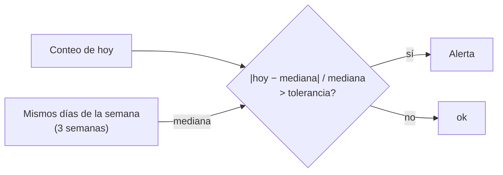

## 1. Resumen

Una **anomalía de volumen** es una carga con muchas más o muchas menos filas de lo normal: la mitad de los pedidos, el doble de eventos, cero filas. Esta ficha la detecta con un **umbral simple**:

- el conteo de hoy contra la **mediana del mismo día de la semana** en las tres semanas anteriores;
- con una **tolerancia fija** (±25 %).

**No es machine learning** ni un modelo estadístico: es una regla que cualquiera puede leer y explicar. Los servicios de nube ofrecen además detección con machine learning (CloudWatch, Glue Data Quality, Azure Monitor); son otra cosa, con otras ventajas y otros costos de entender.

## 2. Qué es

- **Conteo:** filas cargadas en un período (día, partición).
- **Referencia:** la mediana de los mismos días de la semana en semanas anteriores; la mediana no se mueve por un solo día raro, y comparar el mismo día de la semana respeta los ciclos semanales.
- **Tolerancia:** cuánto se acepta alrededor de la referencia.
- **Anomalía:** un conteo fuera de la tolerancia.

## 3. Problema que resuelve

Un miércoles, la carga de pedidos trae 640 filas en lugar de ~1000, porque una región dejó de enviar. Todas las filas son válidas y ningún test falla. El umbral de volumen marca el día como anomalía (−37 %) y alguien revisa el origen antes de que finanzas cierre el mes con datos incompletos.

## 4. Cómo funciona

1. Se guarda el conteo de cada carga (una métrica, o una tabla de metadatos).
2. Para el día evaluado se toman los conteos del mismo día de la semana en las semanas anteriores.
3. Referencia = mediana de esos conteos.
4. Desvío = (hoy − referencia) / referencia.
5. Si `|desvío|` supera la tolerancia, se alerta.

## 5. Cuándo utilizarlo

- En tablas con volumen regular o con ciclos semanales.
- Cuando hace falta una regla que el equipo pueda explicar a quien recibe la alerta.
- Como primera señal, antes de evaluar herramientas con modelos.

## 6. Cuándo no utilizarlo

- Con pocas semanas de historia.
- En días festivos o campañas, que el umbral marcará como anomalía (conviene un calendario de excepciones).
- Con tendencias fuertes (un negocio que crece rápido): la mediana de semanas pasadas queda baja.

## 7. Ejemplo sencillo

Cuatro semanas de conteos; los lunes el negocio vende menos. La última semana:

| Día | Filas | Mediana de los 3 mismos días anteriores | Desvío | Estado |
|---|---|---|---|---|
| mar | 1000 | 1005 | +0 % | ok |
| mié | 640 | 1015 | −37 % | anomalía |
| jue a dom | ~1000 a ~1300 | parecidas | ±2 % | ok |
| lun | 405 | 400 | +1 % | ok |

El lunes con 405 filas no es anomalía: se compara con otros lunes.

## 8. Ejemplo de producción

- El conteo por tabla y día se publica como métrica después de cada carga.
- Un job diario aplica el umbral a las 50 tablas principales, con tolerancia por tabla.
- Un calendario de excepciones (feriados, campañas) evita alertas conocidas.
- Si una tabla cambia de patrón, se ajusta la tolerancia o la ventana, con historial del cambio.

## 9. Arquitectura



## 10. Código

```python
"""Anomalías de volumen con un umbral simple: el conteo de hoy contra la mediana de los mismos días de la semana."""
from datetime import date, timedelta
from statistics import median

CONTEOS = {  # filas cargadas por día; los lunes el negocio vende menos
    date(2026, 9, 22) + timedelta(days=i): n
    for i, n in enumerate([1000, 1020, 990, 1010, 1100, 1300, 400,
                           1005, 1015, 995, 1000, 1120, 1280, 410,
                           1010, 1000, 985, 1020, 1090, 1310, 395,
                           1000, 640, 1005, 1012, 1110, 1295, 405])
}
TOLERANCIA = 0.25   # ±25 % alrededor de la mediana
DIAS = ["lun", "mar", "mié", "jue", "vie", "sáb", "dom"]


def evaluar(dia: date, semanas: int = 3) -> str:
    referencia = [CONTEOS[dia - timedelta(weeks=k)] for k in range(1, semanas + 1)]
    base, hoy = median(referencia), CONTEOS[dia]
    desvio = round((hoy - base) / base * 100)
    estado = "ok" if abs(desvio) <= TOLERANCIA * 100 else "ANOMALÍA"
    return f"{dia} ({DIAS[dia.weekday()]}): {hoy} filas, mediana {base:.0f}, {desvio:+d} % -> {estado}"


for dia in sorted(CONTEOS)[-7:]:
    print(evaluar(dia))
```

El script se **ejecuta en la CI** y pasa `mypy --strict`. Imprime los siete días de la última semana; solo el miércoles sale como anomalía: `2026-10-14 (mié): 640 filas, mediana 1015, -37 % -> ANOMALÍA`. El lunes, con 405 filas, sale `ok`.

## 11. GCP

En GCP, **Cloud Monitoring** alerta con umbrales y **Knowledge Catalog** tiene una dimensión Volume. Según *Behavior of metric-based alerting policies* y *Auto data quality overview* (no ejecutado):

| | Umbral simple (esta ficha) | Cloud Monitoring | Knowledge Catalog |
|---|---|---|---|
| Regla | Desvío contra la mediana del mismo día | metric-threshold: el valor supera un umbral fijo durante la retest window; metric-absence: no hay datos | Reglas de calidad asociadas a la dimensión Volume |
| Referencia | Calculada de la historia | Un valor configurado | La que define la regla |
| Machine learning | No | No: el umbral es un valor fijo | La página citada no lo trata para Volume |

## 12. AWS

En AWS, **CloudWatch** y **AWS Glue Data Quality** ofrecen detección con machine learning. Según *Using CloudWatch anomaly detection* y *Anomaly detection in AWS Glue Data Quality* (no ejecutado):

| | Umbral simple (esta ficha) | CloudWatch anomaly detection | Glue Data Quality anomaly detection |
|---|---|---|---|
| Método | Mediana y tolerancia fija | Algoritmos estadísticos y de machine learning que generan un modelo con un rango esperado | Un algoritmo de machine learning que aprende tendencias y predice valores |
| Historia | 3 semanas en el ejemplo | Entrena con hasta dos semanas de datos; se puede activar con menos | Al menos tres puntos de datos |
| Explicar una alerta | La regla se lee entera | Fuera del rango del modelo | Fuera del rango predicho (Anomaly Observation) |

## 13. Azure

En Azure, **Azure Monitor** con umbrales dinámicos. Según *Alert rules with dynamic thresholds overview* (no ejecutado):

| | Umbral simple (esta ficha) | Umbrales dinámicos de Azure Monitor |
|---|---|---|
| Método | Mediana y tolerancia fija | Machine learning y algoritmos que aprenden el comportamiento histórico |
| Ciclos | Mismo día de la semana | Patrones horarios, diarios o semanales |
| Umbral | Lo fija el equipo | Lo calcula el servicio |

## 14. Buenas prácticas

- Mediana del mismo día de la semana antes que promedio de todos los días.
- Tolerancia por tabla, revisada con quien recibe la alerta.
- Un calendario de excepciones.
- Alertar por caídas y por subidas (duplicados).
- **Seguridad:** el conteo no expone datos; la consulta solo necesita leer metadatos o contar.
- **Observabilidad:** guardar conteo, referencia y desvío de cada día.
- **Costo:** contar filas por partición o desde metadatos es barato; recontar tablas enteras no.

## 15. Errores frecuentes

- Comparar un lunes con el promedio de la semana.
- Una tolerancia tan amplia que nunca alerta, o tan estrecha que siempre alerta.
- Presentar un umbral como «detección con IA».
- Alertar solo por caídas.

## 16. Trade-offs

Un umbral simple se explica y se ajusta a mano, y no aprende tendencias ni estacionalidades complejas. La detección con machine learning de los servicios aprende patrones sola, a cambio de ser más difícil de explicar y de depender de la historia que el servicio necesita.

## 17. Conceptos relacionados

- `data-observability`: el panorama.
- `observability-metrics`: el conteo como métrica.
- `data-freshness`: otra señal.
- `data-reconciliation`: confirmar con el origen.

## 18. Preguntas técnicas abiertas

1. ¿Tus tablas tienen ciclos semanales?
2. ¿Qué tolerancia aceptaría el consumidor principal?
3. ¿Qué días del año marcaría como excepción?

## 19. Laboratorio relacionado

Pendiente (F4).

## 20. Fuentes

- Google Cloud: *Behavior of metric-based alerting policies* y *Auto data quality overview*.
- AWS: *Using CloudWatch anomaly detection* y *Anomaly detection in AWS Glue Data Quality*.
- Microsoft Learn: *Alert rules with dynamic thresholds overview*.

El detalle de cada fuente está en `sources` del frontmatter.

## 21. Fecha de última verificación

2026-10-20. `review_required`: pendiente de revisión B-F3.1 del lote F3b-16a.

## 22. Historial de cambios importantes

- 2026-10-20: creación (lote F3b-16a).
