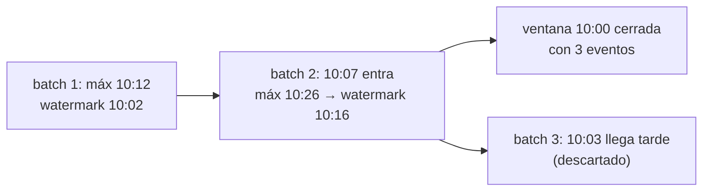

## 1. Resumen

En streaming los eventos llegan tarde y desordenados, así que el motor necesita decidir cuándo una ventana está completa. La **watermark** es esa marca: según Flink, «the mechanism that signals progress in event time». En Spark se define con un umbral: la watermark es el máximo tiempo de evento visto menos ese umbral.

Con la watermark:

- **se aceptan los tardíos** que quedan dentro del umbral;
- **se cierran las ventanas** que la watermark ya pasó, y se emite su resultado final;
- **se libera el estado** de esas ventanas.

La garantía de Spark es de un solo lado: un umbral de 2 horas «guarantees that the engine will never drop any data that is less than 2 hours delayed»; lo que llega con más atraso puede descartarse o no.

En una carga incremental se llama «watermark» a otra cosa: la marca de hasta dónde se cargó (ver `incremental-pipelines`).

## 2. Qué es

- **Umbral (delay):** cuánto atraso se tolera, por ejemplo `withWatermark("event_time", "10 minutes")`.
- **Watermark:** máximo tiempo de evento visto menos el umbral.
- **Ventana cerrada:** una cuyo fin quedó detrás de la watermark.
- **Dato tardío descartable:** uno cuyo tiempo de evento cae en una ventana ya cerrada.
- **Modo de salida:** en `append`, una ventana se emite una vez, al cerrarse; en `update`, se emite cada vez que cambia.

## 3. Problema que resuelve

Un conteo por ventanas de 10 minutos sin watermark tiene que guardar todas las ventanas para siempre, porque podría llegar un evento viejo. El estado crece sin límite y nunca hay un resultado final. Con una watermark de 10 minutos, el motor sabe cuándo dar una ventana por terminada, emite su resultado y borra su estado.

## 4. Cómo funciona

1. En cada micro-batch, el motor mira el máximo tiempo de evento.
2. Calcula la watermark: ese máximo menos el umbral.
3. Los eventos de ventanas que siguen abiertas se agregan, aunque lleguen tarde.
4. Las ventanas cuyo fin quedó detrás de la watermark se cierran: en `append` se emiten y su estado se borra.
5. Un evento que llega para una ventana ya cerrada puede descartarse.

## 5. Cuándo utilizarlo

- Toda agregación por tiempo de evento en streaming.
- Joins entre streams y deduplicación, para limitar el estado.
- Con un umbral que cubra el desfase que se mide en los orígenes.

## 6. Cuándo no utilizarlo

- Un umbral de cero con datos que llegan desordenados: se pierden eventos.
- Un umbral enorme «por las dudas»: el estado y la latencia crecen.
- Contar con que todo lo que llega tarde se descarta: Spark no lo garantiza.

## 7. Ejemplo sencillo

Ventanas de 10 minutos y watermark de 10 minutos, en tres micro-batches. El primero trae eventos de 10:01, 10:04 y 10:12: la watermark queda en 10:02. El segundo trae uno de 10:07, que entra en la ventana de las 10:00 porque esa ventana sigue abierta, y uno de 10:26. El tercero trae uno de 10:03 cuando la watermark ya está en 10:16, y se descarta. La ventana de las 10:00 se cierra con 3 eventos.

## 8. Ejemplo de producción

Ventas por hora con datos de tiendas:

- el desfase medido de las tiendas llega a 40 minutos; la watermark es de 1 hora;
- modo `append` hacia la tabla de agregados, que recibe cada hora una sola vez;
- los eventos más tardíos se guardan aparte con su tiempo de ingesta, para corregir en batch;
- una métrica de eventos descartados por tienda.

## 9. Arquitectura



## 10. Código

```python
# Python 3.12 y PySpark 4.2.0 en modo local (ejecutado en la CI con Java 17): conteo por ventanas de 10 minutos por
# tiempo de evento, con watermark de 10 minutos. Cada archivo es un micro-batch (maxFilesPerTrigger=1). Un evento que
# llega con más atraso que la watermark se descarta; en modo append, una ventana se emite cuando la watermark la pasa.
import json
import sys
import tempfile
from pathlib import Path

from pyspark.sql import SparkSession
from pyspark.sql import functions as F

BATCHES = [   # (archivo, eventos con su tiempo de evento)
    ("1.json", ["10:01", "10:04", "10:12"]),
    ("2.json", ["10:07", "10:26"]),            # 10:07 llega tarde, pero dentro de la watermark (10:02)
    ("3.json", ["10:03", "10:31"]),            # 10:03 llega con la watermark en 10:16: se descarta
]

base = Path(sys.argv[1] if len(sys.argv) > 1 else tempfile.mkdtemp())
src = base / "eventos"
src.mkdir(parents=True, exist_ok=True)
for name, times in BATCHES:
    rows = [json.dumps({"id": f"{name}-{t}", "event_time": f"2026-10-19 {t}:00"}) for t in times]
    (src / name).write_text("\n".join(rows), encoding="utf-8")

spark = (SparkSession.builder.master("local[2]").config("spark.sql.shuffle.partitions", "2")
         .config("spark.ui.showConsoleProgress", "false").getOrCreate())
spark.sparkContext.setLogLevel("ERROR")
events = (spark.readStream.schema("id STRING, event_time TIMESTAMP").option("maxFilesPerTrigger", 1).json(str(src))
          .withWatermark("event_time", "10 minutes"))
counts = events.groupBy(F.window("event_time", "10 minutes")).count()

emitted: list[tuple[int, str, int]] = []

def collect(batch, batch_id: int) -> None:   # noqa: ANN001 - DataFrame de PySpark
    for row in batch.orderBy("window").collect():
        emitted.append((batch_id, row["window"]["start"].strftime("%H:%M"), row["count"]))

query = (counts.writeStream.outputMode("append").foreachBatch(collect)
         .option("checkpointLocation", str(base / "checkpoint")).trigger(availableNow=True).start())
query.awaitTermination()
for batch_id, start, n in emitted:
    print(f"batch {batch_id}: ventana {start} cerrada con {n} eventos")
spark.stop()
```

El script se **ejecuta en la CI con PySpark 4.2.0 en modo local y Java 17**; cada archivo es un micro-batch (`maxFilesPerTrigger=1`). Imprime que la ventana de las 10:00 se cierra con 3 eventos (entra el de 10:07, no el de 10:03) y que la de las 10:10 se cierra con 1. La del 10:20 no se emite porque la watermark (10:21) no llegó a su fin. Que el evento de 10:03 se descarte es lo que pasa en esta corrida: Spark solo garantiza no descartar lo que está dentro del umbral. El número de cada batch depende del motor y el test no lo fija.

## 11. GCP

En GCP, **Dataflow** usa watermarks del modelo de Beam. Según *Streaming pipelines* (no ejecutado):

| | Spark Structured Streaming | Dataflow |
|---|---|---|
| Quién define la watermark | El umbral de `withWatermark` sobre el máximo tiempo visto | La fuente determina la watermark |
| Datos tardíos | Se aceptan dentro del umbral; después pueden descartarse | Beam permite aceptar datos tardíos |
| Cuándo se emite | En `append`, cuando la watermark pasa la ventana | Por defecto, cuando la watermark pasa el final de la ventana; los triggers lo cambian |

## 12. AWS

En AWS, **Managed Service for Apache Flink** corre Flink. Según *Track events in Managed Service for Apache Flink using the DataStream API* y *Timely Stream Processing* (no ejecutado):

| | Spark Structured Streaming | Managed Service for Apache Flink |
|---|---|---|
| Watermarks | Umbral sobre el máximo tiempo visto | Las genera el programa; el servicio remite a la documentación de Flink |

## 13. Azure

En Azure, **Azure Databricks** corre Structured Streaming. Según *Apply watermarks to control data processing thresholds* (no ejecutado):

| | Spark Structured Streaming | Azure Databricks |
|---|---|---|
| Qué guarda | Estado de las ventanas abiertas | El estado de cada ventana, hasta que su fin queda más viejo que el último `event_time` menos el umbral |

## 14. Buenas prácticas

- Umbral a partir del desfase medido, con margen.
- `append` cuando el destino debe recibir cada ventana una sola vez.
- Guardar aparte lo que llega después de la watermark si importa.
- **Seguridad:** un origen con el reloj adelantado mueve la watermark para todos; validar timestamps futuros.
- **Observabilidad:** watermark actual, filas descartadas por tardías y tamaño del estado.
- **Costo:** un umbral más largo es más estado guardado y más memoria o disco del motor.

## 15. Errores frecuentes

- Un timestamp futuro que adelanta la watermark y hace descartar datos buenos.
- `withWatermark` sobre una columna distinta de la de la agregación: no limpia estado.
- Modo `complete` con watermark esperando que libere estado: no lo hace.
- Confundir la watermark de streaming con la marca de una carga incremental.

## 16. Trade-offs

Un umbral corto da resultados antes y menos estado, y pierde más tardíos. Uno largo es más completo y más lento. La watermark convierte un stream sin fin en resultados finales, a costa de decidir qué es «demasiado tarde».

## 17. Conceptos relacionados

- `event-time-vs-processing-time`: el tiempo que mide la watermark.
- `windowing`: lo que la watermark cierra.
- `late-arriving-data`: lo que llega tarde.
- `stateful-stream-processing`: el estado que la watermark libera.
- `dataflow-streaming-pipelines`: watermarks en Dataflow.
- `incremental-pipelines`: la otra «watermark», la marca de progreso de una carga.
- `batch-vs-streaming`: cuándo cerrar un período.

## 18. Preguntas técnicas abiertas

1. ¿Qué desfase máximo tienen tus orígenes y qué umbral usarías?
2. ¿Qué haces hoy con los eventos que llegan después de cerrar un período?
3. ¿Puede un origen con el reloj mal mover tu watermark?

## 19. Laboratorio relacionado

Pendiente (F4).

## 20. Fuentes

- Apache Spark 4.2.0: *Structured Streaming Programming Guide* (APIs on DataFrames and Datasets).
- Apache Flink 2.3: *Timely Stream Processing*.
- Google Cloud: *Streaming pipelines*.
- AWS: *Track events in Managed Service for Apache Flink using the DataStream API*.
- Microsoft Learn: *Apply watermarks to control data processing thresholds*.

El detalle de cada fuente está en `sources` del frontmatter.

## 21. Fecha de última verificación

2026-10-19. `review_required`: pendiente de revisión B-F3.1 del lote F3b-14b.

## 22. Historial de cambios importantes

- 2026-10-19: creación (lote F3b-14b).
