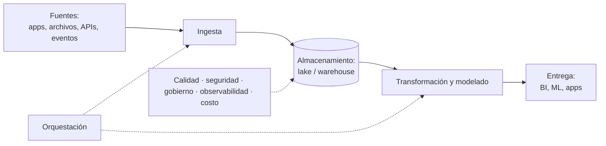

## 1. Resumen

La ingeniería de datos diseña, construye y opera los sistemas que llevan los datos desde donde se producen hasta donde se usan, en forma **confiable**: recolectar, almacenar, transformar y entregar. Su producto no es un reporte ni un modelo, sino los pipelines, tablas y plataformas de los que dependen los reportes, los modelos y los productos. Google Cloud, AWS y Microsoft describen el rol con las mismas piezas: ingesta, transformación, orquestación, modelado, ciclo de vida, calidad y seguridad.

## 2. Qué es

Es una disciplina consolidada de la ingeniería de software aplicada a datos. Las descripciones oficiales coinciden:

- **Google Cloud:** el data engineer recolecta, transforma, almacena y entrega datos; diseña infraestructura robusta, optimizando rendimiento y seguridad, y elige soluciones según necesidades de negocio y regulatorias.
- **AWS:** ingerir y transformar datos, orquestar pipelines, diseñar modelos de datos, gestionar ciclos de vida y asegurar calidad.
- **Microsoft:** diseñar, construir y mantener sistemas para recolectar, almacenar, procesar y analizar grandes volúmenes, con datos accesibles, organizados y de calidad.

Se diferencia de otros roles cercanos:

| Rol | Pregunta principal |
|---|---|
| Ingeniería de datos | ¿Llegan los datos correctos, a tiempo, de forma segura y repetible? |
| Análisis de datos | ¿Qué dicen los datos sobre el negocio? |
| Ciencia de datos / ML | ¿Qué modelo predice o explica mejor? |
| Ingeniería de plataformas / DevOps | ¿Está disponible y automatizada la infraestructura? |

## 3. Problema que resuelve

Los datos nacen dispersos en aplicaciones, archivos, APIs y eventos, en formatos distintos, con errores y sin historia. Sin ingeniería de datos, cada analista extrae y limpia por su cuenta, las cifras no cuadran entre áreas, los procesos se rompen en silencio y nadie sabe de dónde salió un número. La disciplina convierte ese trabajo manual en sistemas repetibles, observables y gobernados.

## 4. Cómo funciona

El trabajo se organiza alrededor del ciclo de vida del dato:

1. **Ingesta:** traer datos de las fuentes, en batch o streaming.
2. **Almacenamiento:** elegir dónde y cómo guardarlos (lake, warehouse, lakehouse), con formato, particionado y retención.
3. **Transformación:** limpiar, integrar y modelar (por ejemplo, en estrella).
4. **Entrega:** exponer los datos a BI, ML, aplicaciones o socios.
5. **Orquestación:** ejecutar todo en orden, con reintentos, backfills y alertas.
6. **Transversales:** calidad, seguridad, gobierno, observabilidad y costo, en cada paso.

Las prácticas de ingeniería de software aplican igual: control de versiones, tests, CI/CD, infraestructura como código e idempotencia.

## 5. Cuándo utilizarlo

Hace falta ingeniería de datos cuando:

- hay varias fuentes que integrar o volúmenes que no caben en una planilla;
- las cifras deben ser reproducibles y auditables;
- los datos alimentan decisiones o productos en forma recurrente;
- hay requisitos de seguridad, privacidad o regulación sobre los datos.

## 6. Cuándo no utilizarlo

- Para un análisis único sobre un archivo pequeño: construir un pipeline es sobreingeniería.
- Como sinónimo de "elegir herramientas": la disciplina es diseñar sistemas confiables; las herramientas cambian.
- Como reemplazo de quien entiende el negocio: el data engineer construye la plataforma, pero las definiciones (qué es una venta neta) las acuerda el negocio.

## 7. Ejemplo sencillo

Un equipo comercial pide ventas diarias por región. Hoy alguien descarga un CSV del ERP cada mañana y lo pega en una planilla. Ingeniería de datos lo reemplaza por una carga diaria a BigQuery, una transformación que limpia y agrega, un control de que el total cuadra con el ERP y un tablero que se actualiza solo.

## 8. Ejemplo de producción

Un e-commerce tiene:

- ingesta por CDC de la base de pedidos y por API del sistema de pagos;
- eventos web en Pub/Sub;
- un lake en Cloud Storage y un warehouse en BigQuery con modelos en Dataform;
- orquestación con Airflow, con alertas por frescura y cuadratura;
- permisos por capa y Terraform para toda la infraestructura.

El equipo de datos mide su trabajo por SLAs de frescura y por incidentes de calidad, no por número de tablas.

## 9. Arquitectura



## 10. Código

```bash
# El ciclo mínimo de ingeniería de datos con la CLI de BigQuery: ingerir, transformar y entregar.
# Requiere: bq autenticado, los datasets raw y mart creados y el archivo en Cloud Storage.

# 1. Ingesta idempotente: --replace=true reemplaza la tabla (WRITE_TRUNCATE), repetir no duplica.
bq load --source_format=PARQUET --replace=true \
  raw.ventas gs://empresa-lake/ventas/dt=2026-10-04/*.parquet

# 2. Transformación y entrega: tabla agregada para el tablero.
bq query --use_legacy_sql=false --replace=true --destination_table=mart.ventas_region_dia \
  'SELECT fecha, region, SUM(monto) AS ventas FROM raw.ventas GROUP BY fecha, region'
```

En producción, estos pasos los ejecuta un orquestador, con reintentos, controles de calidad y alertas.

## 11. GCP

Google Cloud describe el rol a través de su certificación Professional Data Engineer: recolectar, transformar, almacenar y entregar datos, y diseñar infraestructura robusta con foco en rendimiento, seguridad y requisitos regulatorios. Las piezas típicas son Cloud Storage, BigQuery, Pub/Sub, Dataflow, Dataform y Managed Airflow (Cloud Composer).

## 12. AWS

AWS enumera las competencias en su certificación Data Engineer - Associate: ingerir y transformar datos, orquestar pipelines con conceptos de programación, diseñar modelos de datos, gestionar ciclos de vida y asegurar la calidad. Hace explícito el ciclo de vida del dato y la calidad como parte del rol, no como tareas de otro equipo.

## 13. Azure

Microsoft define **Fabric Data Engineering** como diseñar, construir y mantener sistemas para recolectar, almacenar, procesar y analizar grandes volúmenes de datos, con foco en datos accesibles, organizados y de calidad. Para la certificación de Fabric pide dominar patrones de carga, arquitecturas de datos y orquestación. En Fabric, ese trabajo se hace sobre lakehouse, pipelines, notebooks y Spark.

## 14. Buenas prácticas

- Tratar los pipelines como software: versionado, tests, revisión y despliegue automatizado.
- Diseñar para la repetición: ingestas y cargas idempotentes, backfills por parámetro.
- Acordar definiciones de negocio y documentarlas junto a los datos.
- Medir lo que importa al usuario: frescura, completitud y exactitud.
- **Seguridad:** mínimo privilegio, cifrado y tratamiento explícito de datos personales desde la ingesta.
- **Observabilidad:** logs estructurados, métricas de frescura y volumen, alertas con responsable.
- **Costo:** medir el costo por pipeline y por consulta, y diseñar el almacenamiento (formatos, particiones, retención) para controlarlo.

## 15. Errores frecuentes

- Construir pipelines sin un consumidor ni una pregunta de negocio clara.
- Medir el trabajo por cantidad de tablas en vez de por confiabilidad.
- Dejar la calidad y la seguridad "para después".
- Procesos manuales "temporales" que se vuelven permanentes.
- Elegir herramientas antes de entender el problema.

## 16. Trade-offs

Más ingeniería significa más confiabilidad, repetibilidad y escala, a cambio de tiempo de construcción y de mantenimiento. La disciplina está en dimensionarla: una planilla puede bastar para una pregunta única; un producto de datos recurrente necesita pipelines, tests y monitoreo.

## 17. Conceptos relacionados

- `data-lifecycle`: el marco del trabajo.
- `data-pipeline`: el producto central.
- `data-ingestion`, `data-transformation` y `data-orchestration`: las responsabilidades principales.

## 18. Preguntas técnicas abiertas

1. ¿Qué diferencia hay entre "tener datos" y "tener datos confiables" en tu organización?
2. ¿Qué responsabilidades del ciclo de vida del dato no tienen hoy un dueño claro?
3. ¿Cómo medirías si un equipo de datos está haciendo bien su trabajo?

## 19. Laboratorio relacionado

Pendiente (F4).

## 20. Fuentes

- Google Cloud: *Professional Data Engineer Certification*; *bq command-line tool reference* (BigQuery).
- AWS: *AWS Certified Data Engineer - Associate*.
- Microsoft Learn: *What is Fabric Data Engineering?* y *Microsoft Certified: Fabric Data Engineer Associate*.

El detalle de cada fuente está en `sources` del frontmatter.

## 21. Fecha de última verificación

2026-10-05. En `review_required` hasta la revisión B-F3.1 del lote F3b-01a.

## 22. Historial de cambios importantes

- 2026-10-05: creación (lote F3b-01a, dominio 01-fundamentals).
