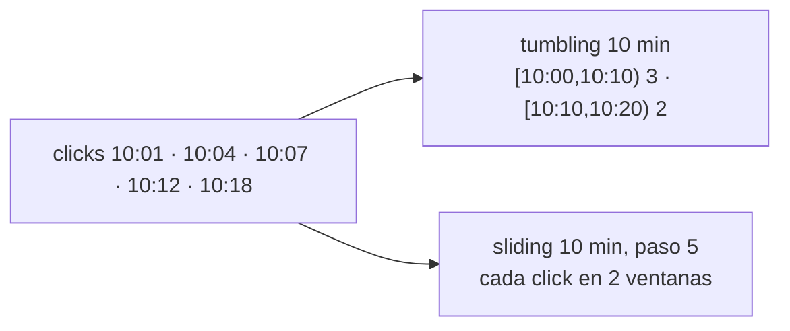

## 1. Resumen

Un stream no termina, así que «el total» no existe: se agrega por **ventanas** de tiempo. Spark y Flink ofrecen tres tipos:

- **tumbling:** tamaño fijo, sin solaparse; cada evento cae en una sola;
- **sliding:** tamaño fijo y un paso menor que el tamaño; las ventanas se solapan y un evento cae en varias;
- **de sesión:** sin tamaño fijo; una ventana se cierra tras un tiempo sin actividad.

Las ventanas se definen sobre un tiempo, normalmente el tiempo de evento (ver `event-time-vs-processing-time`), y la watermark decide cuándo se cierran (ver `watermarks`).

## 2. Qué es

- **Ventana tumbling:** `[10:00, 10:10)`, `[10:10, 10:20)`, …
- **Ventana sliding:** de 10 minutos que empiezan cada 5: `[10:00, 10:10)`, `[10:05, 10:15)`, …
- **Ventana de sesión:** empieza con un evento y se cierra cuando pasa un intervalo sin eventos de esa clave.
- **Tamaño y paso:** cuánto dura cada ventana y cada cuánto empieza una nueva.
- **Ventana de SQL:** `OVER (…)` es otra cosa: calcula sobre filas vecinas, no agrupa por tiempo (ver `sql-window-functions`).

## 3. Problema que resuelve

Un tablero muestra clicks por cada 10 minutos. Con un stream sin fin, sin ventanas no hay dónde cortar. Con ventanas tumbling, cada click cuenta en un tramo. Si además se quiere una curva suave actualizada cada 5 minutos, ventanas sliding de 10 minutos con paso de 5.

## 4. Cómo funciona

1. Cada evento trae su tiempo.
2. El asignador calcula en qué ventana (o ventanas) cae.
3. El motor mantiene un agregado por ventana (y por clave, si la hay).
4. Cuando la ventana se da por cerrada, se emite su resultado.
5. Con ventanas sliding, cada evento suma en tantas ventanas como pasos entren en el tamaño.

## 5. Cuándo utilizarlo

- **Tumbling:** totales por período (ventas por hora, clicks cada 10 minutos).
- **Sliding:** promedios móviles, alertas sobre los últimos N minutos actualizadas con frecuencia.
- **De sesión:** actividad de usuarios con pausas, como sesiones de navegación.

## 6. Cuándo no utilizarlo

- Sliding con un paso muy chico frente al tamaño: cada evento entra en muchas ventanas y el estado crece.
- Ventanas por tiempo de procesamiento para reportes de negocio.
- Confundir una ventana de streaming con una función de ventana de SQL.

## 7. Ejemplo sencillo

Cinco clicks a las 10:01, 10:04, 10:07, 10:12 y 10:18. En ventanas tumbling de 10 minutos: 3 en `[10:00, 10:10)` y 2 en `[10:10, 10:20)`. En ventanas sliding de 10 minutos con paso de 5 aparecen cinco ventanas, y cada click cuenta en dos.

## 8. Ejemplo de producción

Un tablero de ventas en vivo:

- ventas por hora en ventanas tumbling de 1 hora, por tiempo de evento;
- una alerta con ventanas sliding de 15 minutos y paso de 1 minuto sobre devoluciones;
- sesiones de compra con ventanas de sesión de 30 minutos sin actividad;
- watermark acorde al desfase medido de las tiendas.

## 9. Arquitectura



## 10. Código

```python
# Python 3.12 y PySpark 4.2.0 en modo local (ejecutado en la CI con Java 17): los mismos eventos en ventanas tumbling
# de 10 minutos (cada evento cae en una) y sliding de 10 minutos que avanzan cada 5 (cada evento cae en dos), por
# tiempo de evento, sobre un stream de archivos.
import json
import sys
import tempfile
from pathlib import Path

from pyspark.sql import SparkSession
from pyspark.sql import functions as F

base = Path(sys.argv[1] if len(sys.argv) > 1 else tempfile.mkdtemp())
src = base / "clicks"
src.mkdir(parents=True, exist_ok=True)
times = ["10:01", "10:04", "10:07", "10:12", "10:18"]
(src / "clicks.json").write_text("\n".join(json.dumps({"event_time": f"2026-10-19 {t}:00"}) for t in times),
                                 encoding="utf-8")

spark = (SparkSession.builder.master("local[2]").config("spark.sql.shuffle.partitions", "2")
         .config("spark.ui.showConsoleProgress", "false").getOrCreate())
spark.sparkContext.setLogLevel("ERROR")
clicks = spark.readStream.schema("event_time TIMESTAMP").json(str(src))
windows = {
    "tumbling": clicks.groupBy(F.window("event_time", "10 minutes")).count(),
    "sliding": clicks.groupBy(F.window("event_time", "10 minutes", "5 minutes")).count(),
}
for name, counts in windows.items():
    query = (counts.writeStream.outputMode("complete").format("memory").queryName(name)
             .option("checkpointLocation", str(base / f"checkpoint-{name}")).trigger(availableNow=True).start())
    query.awaitTermination()
    rows = spark.sql(f"SELECT window.start AS start, window.end AS end, count FROM {name} ORDER BY start").collect()
    print(f"{name}: " + ", ".join(f"[{r.start:%H:%M}, {r.end:%H:%M}) {r['count']}" for r in rows))
spark.stop()
```

El script se **ejecuta en la CI con PySpark 4.2.0 en modo local y Java 17**. Imprime `tumbling: [10:00, 10:10) 3, [10:10, 10:20) 2` y `sliding: [09:55, 10:05) 2, [10:00, 10:10) 3, [10:05, 10:15) 2, [10:10, 10:20) 2, [10:15, 10:25) 1`. Usa el modo de salida `complete` para ver todas las ventanas de una vez; en producción, con watermark, se usa `append` o `update` (ver `watermarks`).

## 11. GCP

En GCP, **Dataflow** ejecuta pipelines de Apache Beam. Según *Streaming pipelines* (no ejecutado):

| | Spark Structured Streaming | Dataflow |
|---|---|---|
| Tipos | Tumbling, sliding y de sesión | Tumbling (fixed en Beam), hopping (sliding en Beam) y de sesión |
| Cuándo se emite | Según el modo de salida y la watermark | Por defecto, cuando la watermark pasa el final de la ventana; los triggers lo cambian |

## 12. AWS

En AWS, **Managed Service for Apache Flink** corre aplicaciones de Flink. Según *What is Amazon Managed Service for Apache Flink?* y *Windows* de Flink 2.3 (no ejecutado):

| | Spark Structured Streaming | Managed Service for Apache Flink |
|---|---|---|
| Tipos | Tumbling, sliding y de sesión | Los asignadores de Flink: tumbling, sliding y de sesión |

## 13. Azure

En Azure, **Azure Databricks** corre Structured Streaming. Según *Apply watermarks to control data processing thresholds* (no ejecutado):

| | Spark Structured Streaming | Azure Databricks |
|---|---|---|
| Ventanas | `window()` tumbling y sliding; sesiones | Las mismas de Spark; la documentación las muestra con watermark, por ejemplo ventas por hora en tumbling |

## 14. Buenas prácticas

- Ventanas por tiempo de evento, con watermark.
- Tumbling para totales; sliding solo si hace falta la ventana móvil.
- Paso de sliding no mucho menor que el tamaño.
- **Seguridad:** sin aspectos propios; los permisos son los del destino.
- **Observabilidad:** eventos descartados por llegar tarde, por ventana.
- **Costo:** cada ventana abierta es estado; sliding con paso chico y sesiones largas lo multiplican.

## 15. Errores frecuentes

- Sumar los resultados de ventanas sliding como si fueran tumbling y contar dos veces.
- Ventanas sin watermark que nunca liberan estado.
- Zona horaria implícita en los límites de las ventanas.
- Llamar «ventana» a una función de ventana de SQL en una conversación de streaming.

## 16. Trade-offs

Ventanas más chicas dan resultados más frecuentes y más ruidosos; más grandes, más estables y más tarde. Sliding da una vista móvil a cambio de más estado. Las sesiones siguen la actividad real, a cambio de ventanas de largo impredecible.

## 17. Conceptos relacionados

- `event-time-vs-processing-time`: el tiempo de las ventanas.
- `watermarks`: cuándo cerrar una ventana.
- `late-arriving-data`: lo que llega a una ventana cerrada.
- `sql-window-functions`: otra idea con el mismo nombre.
- `batch-vs-streaming`: agregar un stream sin fin.

## 18. Preguntas técnicas abiertas

1. ¿Qué tamaño de ventana usan tus tableros y por qué?
2. ¿Tienes métricas con ventanas sliding que alguien suma como si fueran tumbling?
3. ¿Dónde te serviría una ventana de sesión?

## 19. Laboratorio relacionado

Pendiente (F4).

## 20. Fuentes

- Apache Spark 4.2.0: *Structured Streaming Programming Guide* (APIs on DataFrames and Datasets).
- Apache Flink 2.3: *Windows*.
- Google Cloud: *Streaming pipelines*.
- AWS: *What is Amazon Managed Service for Apache Flink?*.
- Microsoft Learn: *Apply watermarks to control data processing thresholds*.

El detalle de cada fuente está en `sources` del frontmatter.

## 21. Fecha de última verificación

2026-10-19. `review_required`: pendiente de revisión B-F3.1 del lote F3b-14b.

## 22. Historial de cambios importantes

- 2026-10-19: creación (lote F3b-14b).
