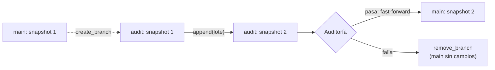

## 1. Resumen

**Write-Audit-Publish (WAP)** separa escribir de publicar:

1. **Write:** el lote se escribe en un lugar aparte de lo que leen los consumidores.
2. **Audit:** se valida ahí.
3. **Publish:** si pasa, se publica de una vez; si no, se descarta y los consumidores nunca lo vieron.

Con **Iceberg**, ese lugar aparte es una **rama**: el lote se escribe en una rama `audit`, se audita el snapshot de la rama y, si pasa, `main` se adelanta (fast-forward) a ese snapshot (*Branching and Tagging*, *Python API*). Es un `quality-gate` donde publicar es mover una referencia, sin copiar datos.

En esta ficha, **Write y Audit se ejecutan** con PyIceberg 0.12.0. El **Publish no**: la guía de PyIceberg lo hace con `fast_forward_branch`, que no existe en PyIceberg 0.12.0, la última versión publicada (comprobado el 2026-10-20 contra el paquete instalado y PyPI).

## 2. Qué es

- **Rama (branch):** una referencia mutable con nombre a un snapshot de la tabla.
- **main:** la rama que leen los consumidores.
- **Rama de auditoría:** se crea desde el snapshot actual de `main` y recibe el lote.
- **Fast-forward:** mover `main` al snapshot de la rama; exige que el snapshot de `main` sea ancestro del de la rama (*Python API*).
- **Descartar:** quitar la rama; `main` no cambió.

## 3. Problema que resuelve

Un lote de pedidos trae montos negativos. Con un pipeline que escribe directo en la tabla, los tableros ven el lote malo hasta que alguien lo borra, y borrar en una tabla compartida es otra escritura riesgosa. Con WAP, el lote queda en la rama `audit`, la auditoría falla, la rama se quita y `main` nunca lo tuvo.

## 4. Cómo funciona

1. `create_branch(snapshot_id=<snapshot de main>, branch_name="audit")`.
2. `append(lote, branch="audit")`: el snapshot nuevo queda en la rama; `main` no cambia.
3. Auditoría: leer `scan(snapshot_id=refs()["audit"].snapshot_id)` y validar.
4. Si pasa: publicar con fast-forward de `main` a `audit` (`fast_forward_branch` en la guía de PyIceberg; `CALL … system.fast_forward(…)` en Spark).
5. Si falla: no se publica; la rama se inspecciona o se quita con `remove_branch`, y la expiración de snapshots limpia sus archivos (*Python API*).

## 5. Cuándo utilizarlo

- Tablas de Iceberg leídas por muchos consumidores, donde un lote malo publicado cuesta caro.
- Cuando la auditoría necesita la tabla completa con el lote nuevo (por ejemplo, unicidad contra todo lo anterior).
- Cuando descartar debe ser instantáneo y sin borrar datos de la tabla principal.

## 6. Cuándo no utilizarlo

- Si el motor que escribe no soporta ramas o WAP: Amazon Redshift, por ejemplo, no escribe en tablas Iceberg con WAP habilitado (*SQL commands*).
- Para validar registro por registro: eso va antes, en la ingesta.
- Con lotes que llegan de varios procesos a la vez sobre la misma rama: el fast-forward exige una historia lineal.

## 7. Ejemplo sencillo

`main` tiene dos pedidos (10 y 25). Dos lotes, cada uno en su rama:

| Rama | Lote | Auditoría (`monto > 0`, no vacío) | Filas en la rama | Filas en main | Qué sigue |
|---|---|---|---|---|---|
| `audit-1` | pedido 3, monto 40 | pasa | 3 | 2 | Publish (fast-forward), no ejecutado |
| `audit-2` | pedido 4, monto −5 | falla | 3 | 2 | La rama se quita |

Al final: ramas `audit-1` y `main`; montos en `main`: 10 y 25.

## 8. Ejemplo de producción

Un pipeline diario en Spark sobre una tabla Iceberg:

- la tabla con `write.wap.enabled=true`;
- cada corrida crea `audit-<fecha>` desde `main` y escribe con `spark.wap.branch`;
- la auditoría corre las reglas de calidad sobre la rama (dbt, GX o SQL);
- si pasa, `CALL system.fast_forward('db.pedidos', 'main', 'audit-<fecha>')`; si no, alerta y la rama queda para diagnóstico hasta que la retención la expire.

## 9. Arquitectura



## 10. Código

```python
# Python 3.12, PyIceberg 0.12 y PyArrow (ejecutado en la CI; mypy --strict sin errores; ADR-018): Write y Audit sobre
# una rama de Iceberg con un catálogo SQL en SQLite. El Publish (fast_forward_branch de la guía de PyIceberg) no está
# en PyIceberg 0.12.0, la última versión publicada: no se ejecuta.
from __future__ import annotations

import sys
import tempfile
from pathlib import Path

import pyarrow as pa  # type: ignore[import-untyped]  # pyarrow no publica stubs de tipos
import pyarrow.compute as pc  # type: ignore[import-untyped]
from pyiceberg.catalog.sql import SqlCatalog
from pyiceberg.table import Table

base = Path(sys.argv[1] if len(sys.argv) > 1 else tempfile.mkdtemp())
warehouse = base / "warehouse"
warehouse.mkdir(parents=True, exist_ok=True)
catalog = SqlCatalog("local", uri=f"sqlite:///{(base / 'catalog.db').as_posix()}", warehouse=warehouse.as_uri())
catalog.create_namespace("ventas")


def pedidos(ids: list[int], montos: list[float]) -> pa.Table:
    return pa.table({"id": pa.array(ids, pa.int64()), "monto": pa.array(montos, pa.float64())})


table = catalog.create_table("ventas.pedidos", schema=pedidos([], []).schema)
table.append(pedidos([1, 2], [10.0, 25.0]))                       # lo publicado hasta hoy, en main


def write_audit(table: Table, lote: pa.Table, rama: str) -> bool:
    main_id = table.refs()["main"].snapshot_id
    table.manage_snapshots().create_branch(snapshot_id=main_id, branch_name=rama).commit()   # 1. Write: rama
    table.append(lote, branch=rama)                                                          #    desde main
    auditado = table.scan(snapshot_id=table.refs()[rama].snapshot_id).to_arrow()            # 2. Audit: solo la rama
    return bool(auditado.num_rows > 0 and pc.all(pc.greater(auditado["monto"], 0)).as_py())


for rama, lote in (("audit-1", pedidos([3], [40.0])), ("audit-2", pedidos([4], [-5.0]))):
    ok = write_audit(table, lote, rama)
    filas_rama = table.scan(snapshot_id=table.refs()[rama].snapshot_id).to_arrow().num_rows
    print(f"{rama}: auditoría {'pasa' if ok else 'falla'}; filas en la rama: {filas_rama}; "
          f"filas en main: {table.scan().to_arrow().num_rows}")
    if not ok:
        table.manage_snapshots().remove_branch(rama).commit()   # se descarta; main nunca vio el lote
print(f"ramas: {sorted(table.refs())}")
print(f"montos en main: {sorted(table.scan().to_arrow().column('monto').to_pylist())}")
```

El script se **ejecuta en la CI con PyIceberg 0.12.0** y un catálogo SQL en SQLite (ADR-018), y pasa `mypy --strict`; en Windows el test se salta, como los otros ejemplos de PyIceberg. Imprime `audit-1: auditoría pasa; filas en la rama: 3; filas en main: 2`, `audit-2: auditoría falla; filas en la rama: 3; filas en main: 2`, `ramas: ['audit-1', 'main']` y `montos en main: [10.0, 25.0]`.

El **Publish no se ejecutó**. Así lo muestra la guía de PyIceberg (no ejecutado):

```python
# Publish según la guía de PyIceberg (Python API); no está en PyIceberg 0.12.0: no ejecutado
with table.manage_snapshots() as ms:
    ms.fast_forward_branch("main", "audit-1")
    ms.remove_branch("audit-1")
```

Y en Spark, según *Branching and Tagging* (no ejecutado):

```sql
-- Spark con Iceberg (no ejecutado)
ALTER TABLE db.pedidos SET TBLPROPERTIES ('write.wap.enabled' = 'true');
ALTER TABLE db.pedidos CREATE BRANCH `audit-1` AS OF VERSION 3 RETAIN 7 DAYS;   -- 3: el snapshot actual de main
SET spark.wap.branch = audit-1;
INSERT INTO db.pedidos VALUES (3, 40.0);
-- auditoría sobre la rama; si pasa:
CALL catalog.system.fast_forward('db.pedidos', 'main', 'audit-1');
```

## 11. GCP

En GCP, las **tablas Iceberg administradas de BigQuery**. Según *Python API* y *Apache Iceberg managed tables* (no ejecutado):

| | WAP con ramas de Iceberg | Tablas Iceberg administradas de BigQuery |
|---|---|---|
| Lugar aparte para escribir | Una rama de la misma tabla | La página no trata ramas; no admiten clones, copias ni snapshots de tabla de BigQuery |
| Consecuencia | Publicar es mover `main` | La página no describe un mecanismo de WAP; habría que resolverlo de otra forma (por ejemplo, una tabla de staging) |

## 12. AWS

En AWS, **Amazon Redshift** escribiendo en tablas Iceberg. Según *Branching and Tagging* y *SQL commands* (no ejecutado):

| | WAP con ramas de Iceberg | Amazon Redshift |
|---|---|---|
| WAP | `write.wap.enabled=true` y escritura en una rama (Spark) | Para escribir en una tabla Iceberg existente, la tabla no debe tener WAP habilitado |
| Consecuencia | — | Una tabla con WAP no la puede escribir Redshift; el WAP lo hace otro motor (por ejemplo, Spark) |

## 13. Azure

En Azure, **Azure Databricks** con tablas Delta, que no tienen ramas. Según *Python API* y *Clone a table on Azure Databricks* (no ejecutado):

| | WAP con ramas de Iceberg | Shallow clone en Azure Databricks |
|---|---|---|
| Lugar aparte | Una rama de la misma tabla | Un shallow clone que referencia los datos de producción |
| Publicar | Fast-forward de `main` | `MERGE INTO` desde el clon a la tabla de producción |
| Riesgo propio | El fast-forward exige historia lineal | Un `VACUUM` en el origen deja al shallow clone sin poder leer archivos |

No son lo mismo: el clon es otra tabla y publicar es una escritura (`MERGE`), no mover una referencia.

## 14. Buenas prácticas

- Una rama por lote, con nombre que identifique la corrida.
- La auditoría lee solo el snapshot de la rama.
- Retención corta en las ramas de auditoría, para que la expiración limpie lo descartado.
- Probar el método de publicación en la versión instalada del cliente.
- **Seguridad:** quien escribe en la rama no necesita poder mover `main`; separar esos permisos donde el catálogo lo permita.
- **Observabilidad:** registrar por lote la rama, el resultado de la auditoría y si se publicó.
- **Costo:** las ramas descartadas retienen archivos hasta que expiran sus snapshots.

## 15. Errores frecuentes

- Auditar leyendo `main` en lugar del snapshot de la rama.
- Dos procesos escribiendo en `main` mientras otro audita: el fast-forward falla porque `main` ya no es ancestro.
- Ramas descartadas sin retención, que acumulan archivos.
- Copiar el ejemplo de la guía sin comprobar que la versión instalada tiene el método.

## 16. Trade-offs

WAP con ramas publica de forma atómica y sin copiar datos, a cambio de exigir un formato y un motor que soporten ramas. Un staging aparte funciona en cualquier motor y obliga a copiar o mover datos al publicar. Auditar sobre la tabla completa detecta más que auditar solo el lote, y cuesta más lectura.

## 17. Conceptos relacionados

- `quality-gate`: el patrón general.
- `open-table-formats`: snapshots y ramas.
- `table-format-comparison`: diferencias entre formatos.
- `great-expectations-validation`: una forma de auditar.
- `dbt-tests`: otra forma de auditar.
- `idempotency`: repetir sin duplicar.

## 18. Preguntas técnicas abiertas

1. ¿Qué tabla tuya se beneficiaría de publicar solo lo auditado?
2. ¿Los motores que escriben tus tablas Iceberg soportan ramas?
3. ¿Cuánto tiempo deberían vivir las ramas descartadas?

## 19. Laboratorio relacionado

Pendiente (F4).

## 20. Fuentes

- PyIceberg: *Python API*. Apache Iceberg: *Branching and Tagging*.
- AWS: *SQL commands* (Amazon Redshift, escritura en Iceberg).
- Google Cloud: *Apache Iceberg managed tables*.
- Microsoft Learn: *Clone a table on Azure Databricks*.

El detalle de cada fuente está en `sources` del frontmatter.

## 21. Fecha de última verificación

2026-10-20. Pasa a `verified`: revisión B-F3.1 del lote F3b-15b sin hallazgos, sin VERIFY pendientes.

## 22. Historial de cambios importantes

- 2026-10-20: creación (lote F3b-15b).
- 2026-10-20: revisión B-F3.1 del lote F3b-15b (docs/reviews/cards-f3b-15b.md), sin hallazgos que corregir.
- 2026-10-20: `verification_status: verified` (sin VERIFY pendientes).
