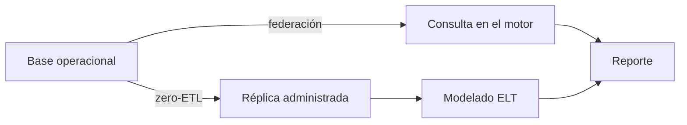

## 1. Resumen

Para analizar datos de una base operacional, lo clásico es un pipeline: extraer, cargar, transformar (`etl-vs-elt`). Hay dos formas de saltarse la primera parte. La **federación** consulta la base de origen en el momento, sin copiar: BigQuery lo hace con consultas federadas de solo lectura que delegan filtros a la fuente (*Introduction to federated queries*). **Zero-ETL** replica en forma administrada al motor analítico, casi en tiempo real: Aurora hacia Redshift (*Aurora zero-ETL integrations*) o Mirroring hacia OneLake en Fabric (*What is Mirroring in Fabric?*).

La terminología es de proveedores y está en evolución: cada afirmación se verifica con su página. Ninguna de las dos **transforma**: los datos llegan con la forma de la base de origen, y el modelado sigue siendo trabajo de ELT. Por eso **no lo reemplazan**.

## 2. Qué es

- **Federación:** una consulta en el motor analítico que lee la base de origen en ese momento (en PostgreSQL, `postgres_fdw`).
- **Pushdown:** el filtro se ejecuta en el origen para traer menos datos.
- **Zero-ETL:** replicación administrada y continua al destino analítico; por detrás hay captura de cambios (`change-data-capture`).
- **Mirroring:** el nombre de Fabric para una réplica sincronizada en OneLake.
- **Lo que no hace ninguna:** limpiar, modelar ni versionar.

## 3. Problema que resuelve

Un reporte de pagos necesita los pedidos de la base operacional y el segmento de clientes del warehouse. Construir y operar un pipeline para una sola tabla toma semanas. Con federación, el reporte cruza ambas en una consulta y ve el pedido de hace un minuto. Si el volumen crece o la base operacional sufre, la réplica administrada lleva los datos al motor analítico sin cargar el origen en cada consulta.

## 4. Cómo funciona

1. **Federación:** se declara el servidor remoto y sus tablas en el motor analítico.
2. La consulta se ejecuta, empuja los filtros al origen y cruza con tablas locales.
3. **Zero-ETL:** se configura la integración entre origen y destino.
4. La plataforma replica los cambios en forma continua.
5. En ambos casos, el modelado posterior sigue siendo ELT.

## 5. Cuándo utilizarlo

- **Federación:** consultas poco frecuentes, volúmenes chicos o datos que tienen que estar al minuto.
- **Zero-ETL:** tablas operacionales que se analizan seguido y cuyo pipeline sería solo copia.
- Prototipos antes de decidir si hace falta un pipeline.

## 6. Cuándo no utilizarlo

- Federación para reportes pesados y frecuentes: cada consulta carga la base operacional.
- Como reemplazo del modelado: los datos llegan sin limpiar ni modelar.
- Cuando el origen o el destino no está soportado por la integración.

## 7. Ejemplo sencillo

| Paso | Resultado |
|---|---|
| Reporte federado (pagados por segmento) | `[('empresa', 100), ('persona', 50)]` |
| Pedido nuevo en la base operacional | `[('empresa', 100), ('persona', 80)]`, sin copiar nada |
| `EXPLAIN VERBOSE` | El filtro `estado = 'pagado'` va en el *Remote SQL* |

## 8. Ejemplo de producción

Datos operacionales en el warehouse:

- federación para el reporte de pagos del día, con filtros que se empujan al origen;
- réplica administrada para las tablas de pedidos que se analizan a diario;
- modelos de staging y marts sobre la réplica, como en cualquier ELT (`analytics-engineering`);
- monitoreo del retraso de la réplica;
- en la nube (no ejecutado): federated queries de BigQuery, zero-ETL de Aurora a Redshift o Mirroring de Fabric.

## 9. Arquitectura



## 10. Código

```python
# Python 3.12 y psycopg contra PostgreSQL 17 (ejecutado en la CI con el servicio postgres:17): consulta federada con
# postgres_fdw. La base operacional tiene los pedidos; la analítica los consulta sin copiarlos, los cruza con una
# tabla local, ve un pedido nuevo al instante y EXPLAIN VERBOSE muestra el filtro enviado al servidor remoto.
# CREATE EXTENSION requiere un superusuario: si el usuario no lo es, el ejemplo dice «no ejecutado» y termina.
# PG_DSN apunta a una base vacía; la base operacional se crea con sufijo y se borra al terminar.
import os

import psycopg

DB = os.environ["PG_DB"]
OPS = f"{DB}_ops"
BASE = " ".join(f"{k}={os.environ[v]}" for k, v in (("host", "PG_HOST"), ("port", "PG_PORT"),
                                                     ("user", "PG_USER"), ("password", "PG_PASSWORD")))

with psycopg.connect(os.environ["PG_DSN"], autocommit=True) as conn:
    if not conn.execute("SELECT rolsuper FROM pg_roles WHERE rolname = current_user").fetchone() == (True,):
        print("no ejecutado: CREATE EXTENSION postgres_fdw requiere un superusuario")
        raise SystemExit(0)
    conn.execute(f"CREATE DATABASE {OPS}")
    try:
        with psycopg.connect(f"{BASE} dbname={OPS}", autocommit=True) as ops:
            ops.execute("CREATE TABLE pedidos (id int PRIMARY KEY, cliente_id int, monto int, estado text)")
            ops.execute("INSERT INTO pedidos VALUES (1, 10, 100, 'pagado'), (2, 20, 50, 'pagado'), (3, 10, 70, 'anulado')")
            conn.execute("CREATE EXTENSION postgres_fdw")
            # el servidor remoto se ve desde el propio PostgreSQL: sin host, usa su conexión local
            conn.execute(f"CREATE SERVER ops FOREIGN DATA WRAPPER postgres_fdw OPTIONS (dbname '{OPS}')")
            conn.execute(f"CREATE USER MAPPING FOR CURRENT_USER SERVER ops OPTIONS (user '{os.environ['PG_USER']}')")
            conn.execute("CREATE SCHEMA ops_remote")
            conn.execute("IMPORT FOREIGN SCHEMA public LIMIT TO (pedidos) FROM SERVER ops INTO ops_remote")
            conn.execute("CREATE TABLE clientes (cliente_id int, segmento text)")
            conn.execute("INSERT INTO clientes VALUES (10, 'empresa'), (20, 'persona')")

            report = ("SELECT c.segmento, sum(p.monto) FROM ops_remote.pedidos p JOIN clientes c USING (cliente_id) "
                      "WHERE p.estado = 'pagado' GROUP BY c.segmento ORDER BY c.segmento")
            print("reporte federado:", conn.execute(report).fetchall())
            ops.execute("INSERT INTO pedidos VALUES (4, 20, 30, 'pagado')")
            print("tras un pedido nuevo en la base operacional:", conn.execute(report).fetchall())
            plan = [str(r[0]) for r in conn.execute("EXPLAIN VERBOSE SELECT id FROM ops_remote.pedidos "
                                                    "WHERE estado = 'pagado'").fetchall()]
            print("filtro enviado al remoto:", any("Remote SQL" in line and "WHERE" in line for line in plan))
            conn.execute("DROP SCHEMA ops_remote CASCADE")
            conn.execute("DROP SERVER ops CASCADE")
    finally:
        conn.execute(f"DROP DATABASE IF EXISTS {OPS} WITH (FORCE)")
```

El script se **ejecuta en la CI** contra el PostgreSQL de la CI (una base temporal y una operacional que crea y borra) y pasa `mypy --strict`. `CREATE EXTENSION postgres_fdw` requiere un superusuario: el usuario de la CI lo es; si no lo fuera, el script imprime «no ejecutado» y termina. Imprime las tres líneas del §7. Zero-ETL y Mirroring son servicios administrados: no se ejecutan.

## 11. GCP

En GCP, las **federated queries** de BigQuery. Según *Introduction to federated queries* (no ejecutado):

| | Este concepto | BigQuery |
|---|---|---|
| Escritura | No aplica | Solo lectura: la consulta externa no admite DML ni DDL |
| Pushdown | Filtros al origen | SQL pushdowns, como el filtrado, delegados a la fuente |

## 12. AWS

En AWS, **zero-ETL de Aurora** hacia Amazon Redshift. Según *Aurora zero-ETL integrations* (no ejecutado):

| | Este concepto | Aurora zero-ETL |
|---|---|---|
| Tipo | Réplica administrada | Integración administrada de Aurora a Redshift o SageMaker AI |
| Latencia | Casi en tiempo real | Casi en tiempo real tras escribirse en Aurora |

## 13. Azure

En Azure, **Mirroring** de Microsoft Fabric. Según *What is Mirroring in Fabric?* (no ejecutado):

| | Este concepto | Mirroring |
|---|---|---|
| Destino | Motor analítico | Réplica en tablas Delta en OneLake |
| Frecuencia | Continua | Cambios publicados hasta cada 15 segundos |
| Variante sin copia | Federación | Metadata mirroring con shortcuts de OneLake |

## 14. Buenas prácticas

- Federar con filtros que el origen pueda ejecutar.
- Medir la carga que la federación pone sobre la base operacional.
- Modelar sobre la réplica como sobre cualquier fuente.
- **Seguridad:** el usuario de la federación lee solo lo necesario en el origen.
- **Observabilidad:** retraso de la réplica y duración de las consultas federadas.
- **Costo:** cada consulta federada usa el origen; una réplica cuesta almacenamiento y la integración tiene su propio modelo de cobro según cada nube.

## 15. Errores frecuentes

- Federar reportes pesados que se ejecutan cada minuto.
- Creer que zero-ETL elimina el modelado.
- No vigilar el retraso de la réplica.
- Asumir que toda versión de la base de origen está soportada.

## 16. Trade-offs

La federación da datos al instante sin copiar y carga el origen en cada consulta. Zero-ETL saca la carga del origen y agrega una réplica y un servicio que dependen del proveedor. Un pipeline propio da control y transformación a cambio de construirlo y operarlo. Es terminología emergente: los nombres y alcances cambian.

## 17. Conceptos relacionados

- `etl-vs-elt`: lo que esto no reemplaza.
- `change-data-capture`: el mecanismo detrás de zero-ETL.
- `bigquery-external-tables`: consultar fuera del warehouse.
- `database-ingestion`: el pipeline que se evita.
- `analytics-engineering`: el modelado sobre la réplica.

## 18. Preguntas técnicas abiertas

1. ¿Qué tabla operacional copias hoy sin transformarla?
2. ¿Cuánta carga aguanta tu base operacional para consultas analíticas?
3. ¿Qué retraso aceptarías en una réplica?

## 19. Laboratorio relacionado

Pendiente (F4).

## 20. Fuentes

- PostgreSQL 17: *F.36. postgres_fdw — access data stored in external PostgreSQL servers*.
- Google Cloud: *Introduction to federated queries*.
- AWS: *Aurora zero-ETL integrations*.
- Microsoft Learn: *What is Mirroring in Fabric?*.

El detalle de cada fuente está en `sources` del frontmatter.

## 21. Fecha de última verificación

2026-10-26. `review_required`: pendiente de revisión B-F3.1 del lote F3b-22b.

## 22. Historial de cambios importantes

- 2026-10-26: creación (lote F3b-22b).
